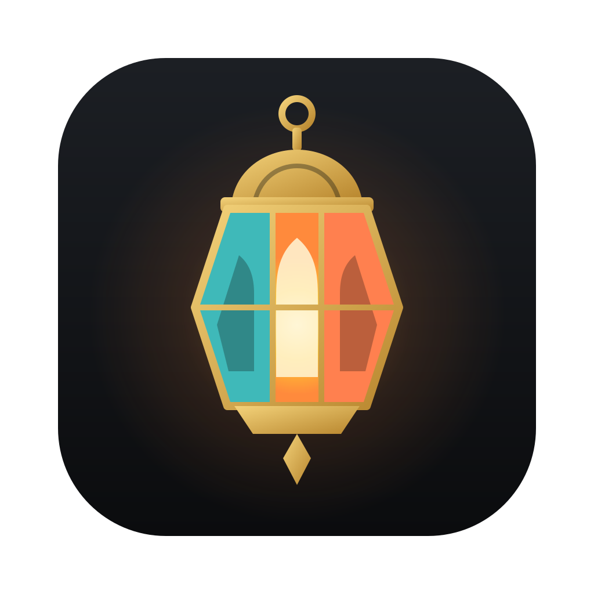
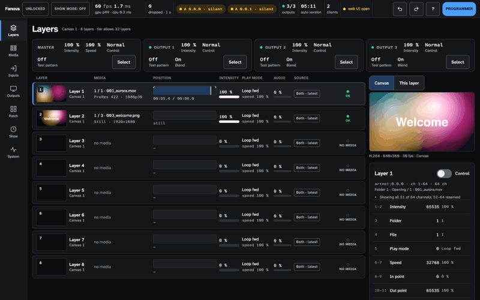
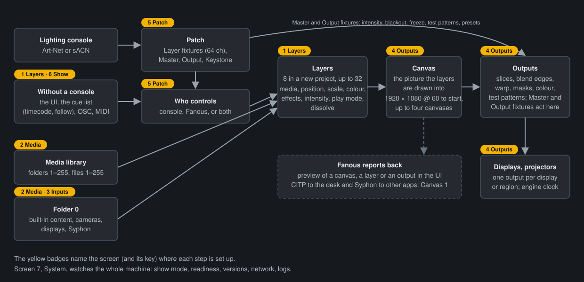
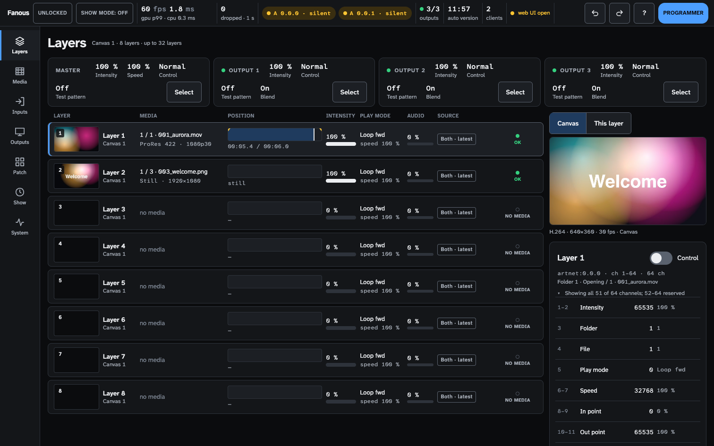
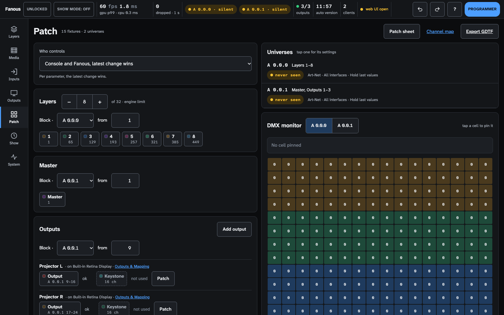
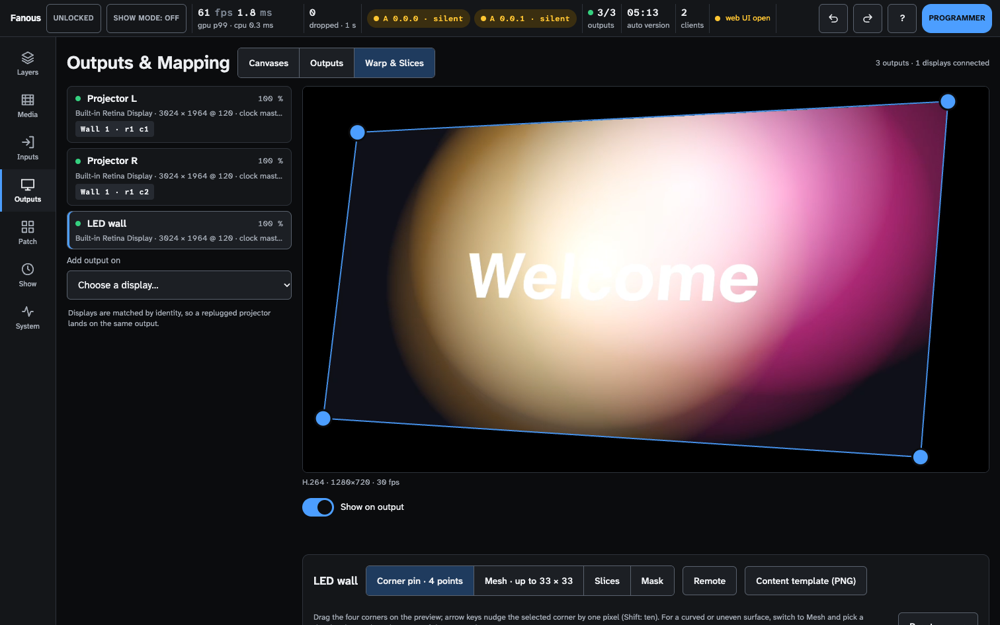
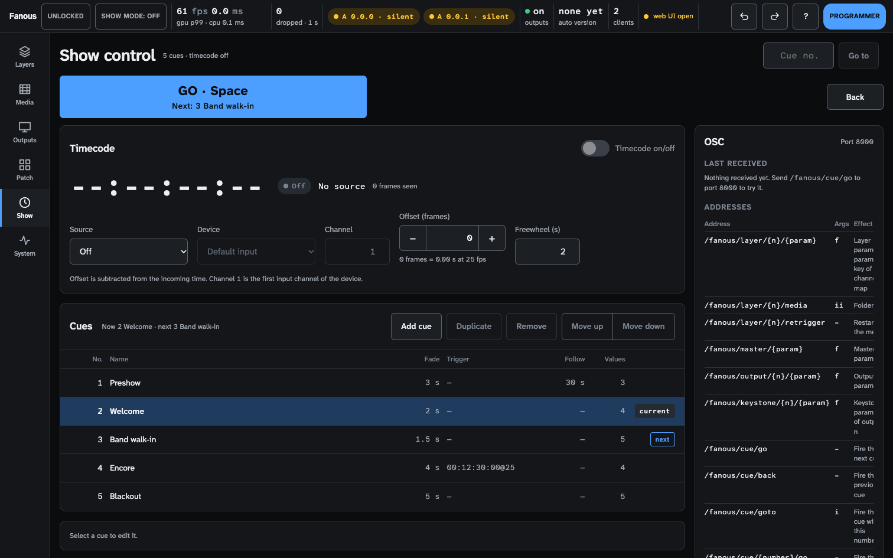

<p align="center"></p>

<h1 align="center">Fanous</h1>

<p align="center"><b>Video layers are fixtures. Patch them, program them, cue them with the rest of the show.</b><br>
A free, open-source media server for Apple Silicon Macs, driven by your lighting console over Art-Net or sACN.<br>
No dongle, no licence server, no account.</p>

<p align="center">
  <a href="LICENSE"></a>
  
  
  <a href="https://github.com/Timdebruijn/fanous/actions/workflows/ci.yml"></a>
</p>

<p align="center"></p>

<p align="center">
  <a href="#download-or-build"><b>Download or build</b></a> ·
  <a href="docs/user/getting-started.md">Getting started</a> ·
  <a href="docs/user/README.md">User guide</a> ·
  <a href="docs/user/show-day-checklist.md">Show-day checklist</a> ·
  <a href="#help-test-it-on-a-real-desk">Test it on your desk</a>
</p>

You know the drill. The media server is a separate rig with its own UI, its own
licence, its own dongle, and the thumbnails never show up on the desk.
Fanous goes the other way: every video layer is a **64-channel DMX fixture**,
eight layers to a universe, up to 32 layers. Patch the generated GDTF, pull a
layer up, record it in a cue next to your moving lights. Media, play mode,
speed, position, scale, rotation, colour, blend mode, effects and dissolve are
all on the encoders you already know.

You need an Apple Silicon Mac (any M-series chip except the base M1, macOS 15
or newer), a console that sends Art-Net or sACN on the same network as the
Mac, and a projector or display on the Mac. Every video term on this page is
in the guide's [glossary](docs/user/reference/glossary.md).

<p align="center"></p>

> [!IMPORTANT]
> **1.0.0 release candidate.** A signed, notarized disk image is on
> [Releases](https://github.com/Timdebruijn/fanous/releases). It is measured on one Mac
> but **not yet tested with a real console** (GDTF import, CITP thumbnails). Rehearse
> with your own desk before you commit a show to it.

## What you get

| On the desk | What it does |
|---|---|
| **Layer fixture, 64 ch** | Intensity, folder and file, play mode, speed, in and out points, dissolve, position, scale, rotation, colour, 8 blend modes, 11 effects, crop, audio level, sync; 16-bit where it matters ([channel map](docs/channel-map.md)) |
| **Master, Output and Keystone fixtures** | Master intensity and speed; per-output intensity, test patterns and mapping presets; the four corners of an output from the desk |
| **GDTF export** | Generated from the same parameter spec as the DMX map, so the two cannot drift apart. GDTF only: no grandMA2 XML, Avolites personality or MagicQ head file; the import is not yet verified on a real desk |
| **Art-Net and sACN** | Merge and Who controls: console only, Fanous only, or console and Fanous together (latest change or highest value wins) |
| **CITP/MSEX** | Layer status, media libraries, thumbnails and a preview stream for a desk that speaks it (grandMA2, MagicQ, Hog 4, Onyx, Titan); grandMA3 and Eos have no CITP and see no thumbnails. Tested against captured packets, not a desk yet |
| **OSC, MIDI and timecode** | The full OSC address map with feedback and timetags; MIDI Learn and MIDI Show Control; LTC and MTC chase per layer |
| **Live inputs** | Cameras, capture cards, this Mac's displays and Syphon servers as media, next to the built-in test card, test patterns, clock and motion test |
| **Several Macs, one picture** | A Sync channel on every layer: one Mac is the Sync master, the others follow its clock |

| | |
|---|---|
|  |  |
| **Layers:** live canvas preview, per-layer channel list | **Patch:** fixtures, collisions, live DMX, GDTF export |
|  |  |
| **Outputs:** blending, corner pin, mesh warp, slices, masks | **Show:** Fanous cue list, timecode, OSC, MIDI |

## Built for show day

| | |
|---|---|
| **The engine outlives the UI** | It runs as a background service in your login. Quit or crash the app and the output keeps going; a crashed engine is back at once (0.26 s measured; 10 s after a crash in its first 10 s) and resumes show mode if it was on; browsers log in again and no cue is current ([what comes back](docs/user/show-day-checklist.md#what-comes-back-after-the-engine-stops)) |
| **Readiness list before doors** | 24 items: power, thermal, disk, memory, universes, outputs and display modes, permissions, sync, Spotlight, automatic updates, Time Machine, display sleep ([every item](docs/user/reference/readiness.md)) |
| **Show mode** | The Mac stays awake, ingest pauses, every output with a Mode set goes to it, a canvas or library change is refused; it refuses to start while a readiness item fails and is not acknowledged |
| **Show lock** | One key (L): accidental edits are refused while GO, Back and the timecode keep running |
| **Every screen in a browser** | The whole UI on an iPad or any computer on the network, with monitor, operator and programmer roles and passwords ([the user interface](docs/user/ui.md#roles-and-logging-in)). Keep the Mac on the show network: OSC, a few read-only endpoints (live DMX values, patch) and the library rescan take no password ([known limitations](docs/user/reference/known-limitations.md#the-web-ui-and-security)) |
| **Nothing to license on show day** | No dongle, no licence check, no cloud. Your spare Mac runs the same free software; Fanous has no failover feature, so a spare is a second install you switch to yourself |
| **Made for a dark room in a hurry** | Atkinson Hyperlegible, 44 px touch targets, undo after a delete, plain wording |

## What you stop paying for

| Usually | Here |
|---|---|
| A licence or dongle per machine, spares included | None. The backup Mac is free too |
| A paid tier for console control, mapping, blending or timecode | All in the free build |
| A licence server or account that has to be reachable | Nothing to reach; works without internet |
| A dongle that shows "unlicensed" the afternoon of the show | There is no dongle |

This compares licence models, not features: Fanous is not a touring-scale
server. See [what it does not do yet](#what-it-does-not-do-yet).

## Measured on one machine

A **MacBook Pro M1 Pro** (32 GB), release build. Pass criterion is zero: no
missed frame, no late frame, no layer without a picture, over the whole window.

| Test | Result |
|---|---|
| 16 layers, 1080p60, ProRes 422 HQ or HAP Q, on the 120 Hz built-in display, 2 min | 0 missed, 0 late; GPU p99 10 ms (2026-10-26) |
| 4K60 ProRes 422 HQ, on a 4K display | 4 layers pass; 7 showed late GPU frames (2026-11-03, other work running) |
| 8-hour soak, 8 layers 1080p60, headless, `kill -9` every 2 h | 0 missed frames in about 1.7 million, 5 presented one refresh late; engine back in 0.26 s; memory 218 to 230 MB (2026-10-24) |
| Art-Net in to pixel out, 2 layers, 60 fps canvas | p99 32 ms: two frames; the display's own scan-out not included (2026-10-23) |

ProRes goes from the Apple hardware decoder straight into Metal; HAP, HAP Q and
HAP Alpha play too; anything else (an iPhone's H.264, for one) is transcoded on
import. Effect costs, dissolves, the method and every run:
[`docs/benchmarks/`](docs/benchmarks/README.md); what to expect per codec and
size: [media library](docs/user/media-library.md#what-a-mac-can-play).

## Mapping

Soft-edge blending with black lift, corner pin and mesh warp up to 33 × 33,
slices for several surfaces from one projector, and masks you draw by tapping
on the picture. Test patterns follow the warp, so you align on the real surface.
Export a content template for your designer so windows and edges land where the
mapping expects them. Syphon in, and Canvas 1 out. The blend curve is checked
in the engine's own test against ideal gamma-2.2 projectors (summed light
within 3.5 % of flat); real projectors are tuned by eye on the test pattern.
Guide: [Outputs and mapping](docs/user/outputs-and-mapping.md) and
[Warp, slices and masks](docs/user/warp-and-masks.md).

## Download or build

Needs an Apple Silicon Mac with a ProRes engine (every M-series chip except
the base M1) and macOS 15 or newer; displays extended, not mirrored.

**Download** the signed, notarized disk image from
[Releases](https://github.com/Timdebruijn/fanous/releases), drag Fanous to
Applications and open it. macOS asks once to let the engine run in the
background (Login Items), and once for Local Network access: allow both.
Camera, microphone and screen-recording prompts come the first time a layer
needs them; grant them before the show, never during it.

**Build** with Swift 6.2+ and Node 26:

```bash
git clone https://github.com/Timdebruijn/fanous && cd fanous
(cd web && npm install)
scripts/bundle.sh && open dist/Fanous.app
```

A build without a Developer ID is signed ad hoc; allow it under System
Settings › Privacy & Security the first time it is refused.

The UI opens in the app and on `https://<mac-name>.local:8443` for any browser on
the network (self-signed certificate; System › Network shows its fingerprint).
Put media in `~/Movies/Fanous Library` as `001_Opening/001_intro_loop.mov`
(the numbers are what the console dials), export the GDTF from the Patch
screen, and send Art-Net. Step by step, with pictures:
[Getting started](docs/user/getting-started.md), then
[Console setup](docs/user/console-setup.md).
Building for development, protocols and endpoints: [`docs/DEVELOPMENT.md`](docs/DEVELOPMENT.md).

## The user guide

Written for lighting operators and programmers who have never run video from
a console. A first show, in reading order:
[How Fanous works](docs/user/how-it-works.md) →
[Getting started](docs/user/getting-started.md) →
[Console setup](docs/user/console-setup.md) →
[Media library](docs/user/media-library.md) →
[Outputs and mapping](docs/user/outputs-and-mapping.md) →
[Show control](docs/user/show-control.md) →
[Show-day checklist](docs/user/show-day-checklist.md).
To look things up: [one page per screen](docs/user/README.md#the-seven-screens)
with every control, the [channel map](docs/channel-map.md),
[OSC](docs/user/reference/osc.md), the [API](docs/user/reference/api.md),
[readiness items](docs/user/reference/readiness.md) and
[known limitations](docs/user/reference/known-limitations.md). Every
procedure that branches is a flowchart; every screen has a picture. The index,
with a "where to start" chart: [docs/user/README.md](docs/user/README.md).

## What it does not do yet

- **A release candidate.** A first install on a clean Mac account is not tested yet.
- **Not tested with real consoles or LTC/MTC hardware.** Built and tested against loopback,
  generated signals and captured packets; timecode not at 29.97 drop frame or over long runs.
  Display hot-plug is checked with one external display; with two or more it rests on unit tests.
- **One machine measured** (M1 Pro). Other Apple Silicon chips are expectations.
- **No genlock or frame lock.** Outputs run on the engine's clock at the canvas rate: match the
  canvas rate to the display's refresh, and expect two projectors up to one refresh apart.
- **Audio is one stereo mix** on the Mac's default output, at 100 % forward speed only.
- **Apple Silicon only:** no Intel, Windows or Linux.
- **4K60 is about 4 ProRes layers;** Blur and Edge on every layer fit 3 ProRes layers at 1080p60 (headless, measured before the Blur speed-up).
- **No NDI, DeckLink or AJA in the open build.** No text layer, no MIDI output; 3D mapping comes
  later. In plain words: [known limitations](docs/user/reference/known-limitations.md);
  everything open: [`docs/BACKLOG.md`](docs/BACKLOG.md).

### Help test it on a real desk

If you have a grandMA, Eos, ChamSys or Avolites desk and a spare Apple Silicon
Mac, a test report is the most useful contribution right now: does the GDTF
import, do thumbnails show up (CITP should reach grandMA2, ChamSys MagicQ,
Hog 4, Onyx and Titan; grandMA3 and Eos have none), does a layer follow your
faders? [Open an issue](https://github.com/Timdebruijn/fanous/issues/new/choose).

## Free, and how the project is paid for

- **Free:** everything above, under GPL-3.0.
- **Fanous Pro:** the same engine as signed, auto-updating binaries with plugins
  that need closed vendor SDKs (NDI, DeckLink, AJA). Planned; no date or price yet.
- **Support and training:** show commissioning (patch, mapping, timecode) and
  operator training.
- **Sponsored features:** pay for a feature you need; it lands in the open build
  unless it needs a closed SDK.

Commercial licences and the plugin boundary: [`docs/licensing/`](docs/licensing/).

## Contributing

Issues, bug reports, feature proposals and test reports are welcome now.
Pull requests wait until the [Contributor License Agreement](docs/licensing/CLA.md)
is final. See [`CONTRIBUTING.md`](CONTRIBUTING.md).

## Licence

GPL-3.0-only with additional terms ([`LICENSE-ADDITIONAL-TERMS.md`](LICENSE-ADDITIONAL-TERMS.md)),
including an attribution notice in modified versions. Name and logo:
[`TRADEMARKS.md`](TRADEMARKS.md). Copyright (c) 2026 Tim de Bruijn.

<sub>A fanous is the Egyptian lantern: coloured light for a celebration. The project was called Lanthorn until 2026-10-25.</sub>
