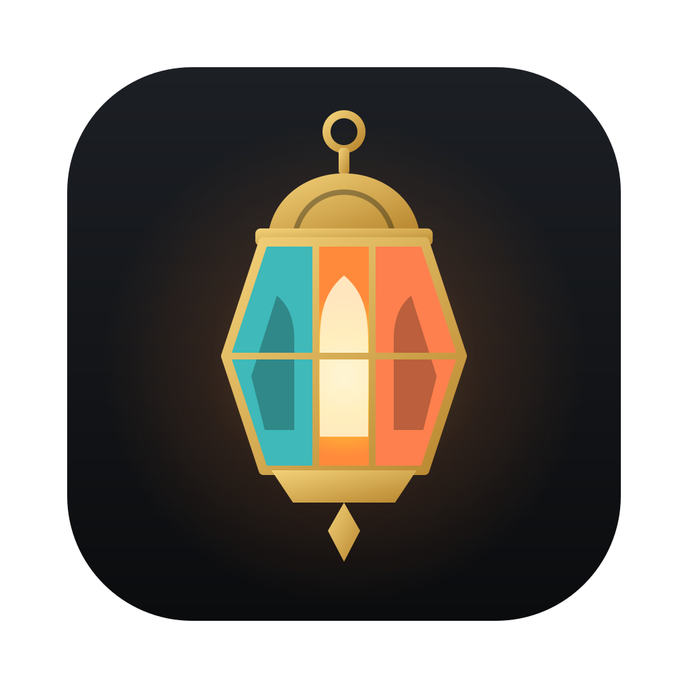
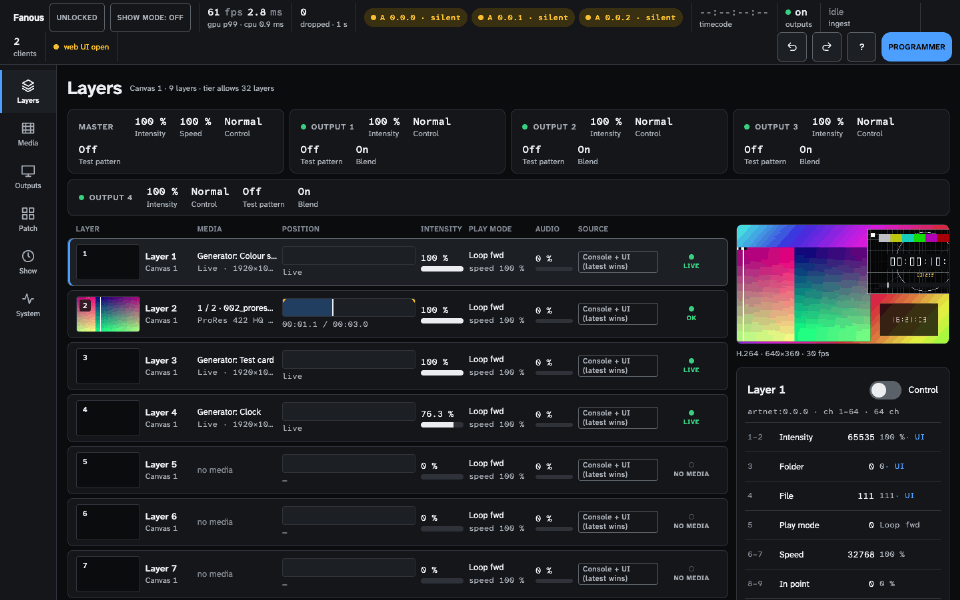
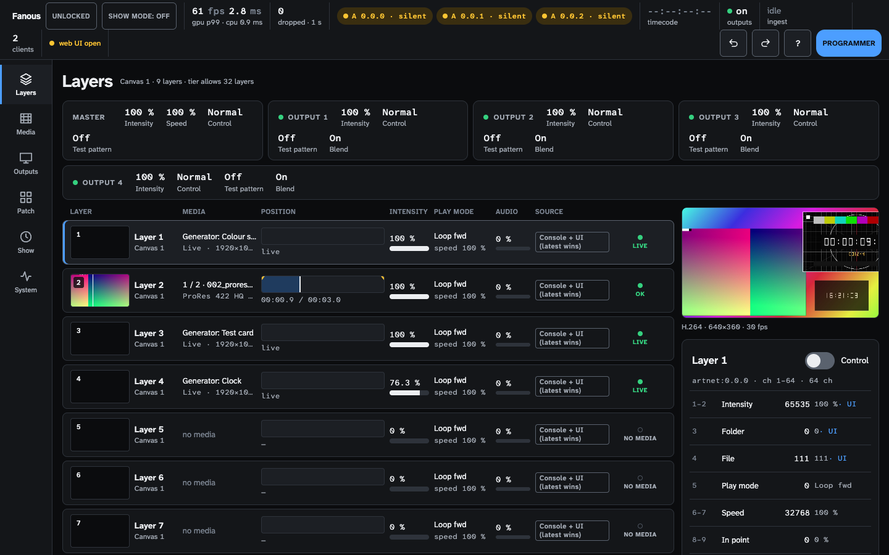
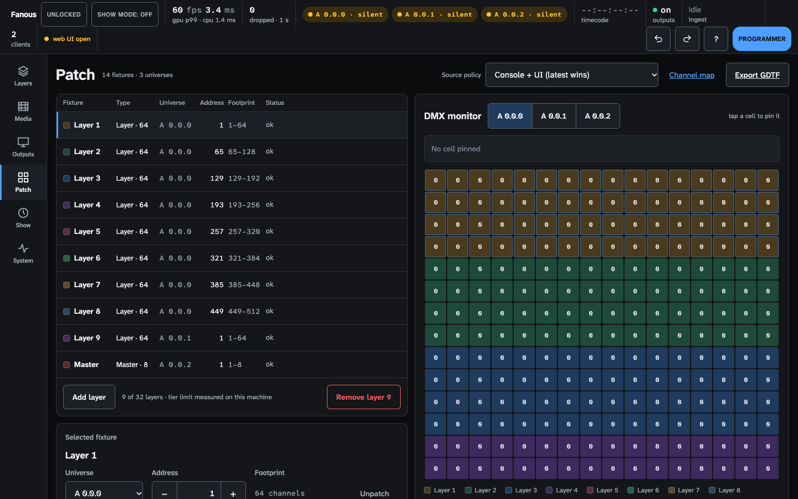
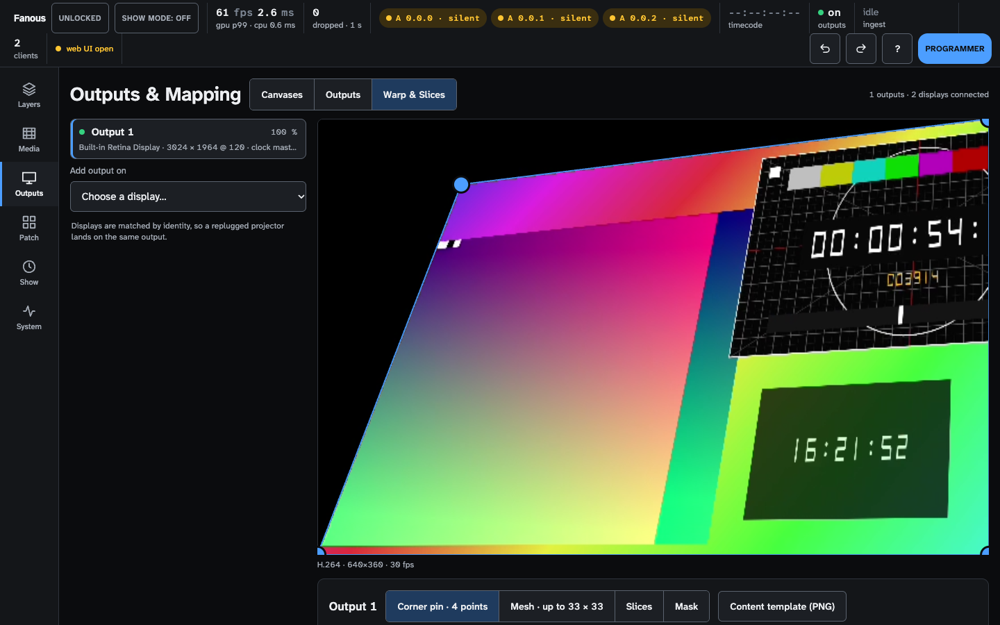
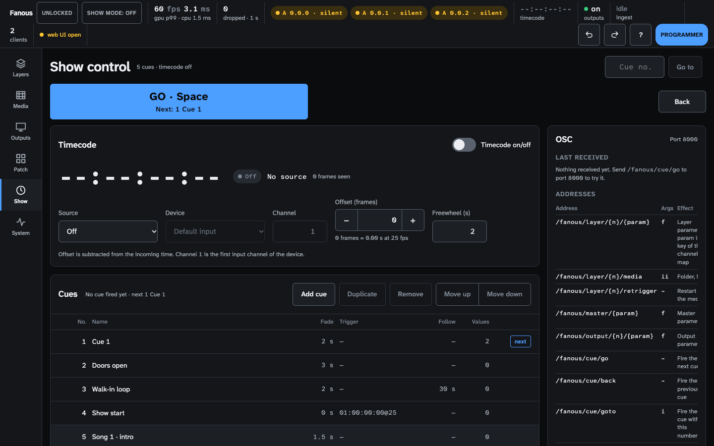

<p align="center"></p>

<h1 align="center">Fanous</h1>

<p align="center"><b>Video layers are fixtures. Patch them, program them, cue them with the rest of the show.</b><br>
A free, open-source media server for Apple Silicon Macs, driven by your lighting console over Art-Net or sACN.<br>
No dongle, no licence server, no account.</p>

<p align="center">
  <a href="LICENSE"></a>
  
  
  <a href="https://github.com/Timdebruijn/fanous/actions/workflows/ci.yml"></a>
</p>

<p align="center"></p>

<p align="center">
  <a href="#build-and-run"><b>Build it</b></a> ·
  <a href="docs/user/README.md">User guide</a> ·
  <a href="docs/user/show-day-checklist.md">Show-day checklist</a> ·
  <a href="#help-test-it-on-a-real-desk">Test it on your desk</a>
</p>

You know the drill. The media server is a separate rig with its own UI, its own
licence, its own dongle, and the thumbnails never show up on the desk.
Fanous goes the other way: every video layer is a **64-channel DMX fixture**,
eight layers to a universe. Patch the generated GDTF, pull a layer up, record it
in a cue next to your moving lights. Media, play mode, speed, position, scale,
rotation, colour, blend mode, effects and dissolve are all on the encoders you
already know.

> [!IMPORTANT]
> **1.0.0 release candidate, source only.** There is no download yet: you build it.
> It is measured on one Mac but **not yet tested with a real console** (GDTF import,
> CITP thumbnails). Rehearse with your own desk before you commit a show to it.

## What you get

| On the desk | What it does |
|---|---|
| **Layer fixture, 64 ch** | Intensity, folder/file, play mode, speed, in/out, dissolve, position, scale, rotation, colour, 8 blend modes, 11 effects; 16-bit where it matters ([channel map](docs/channel-map.md)) |
| **Master and Output fixtures** | Master intensity and speed, per-output intensity, test patterns per projector |
| **GDTF export** | Generated from the same parameter spec as the DMX map, so the two cannot drift apart |
| **Art-Net and sACN** | Merge and Who controls: console only, Fanous only, or console and Fanous together (latest change or highest value wins) |
| **CITP/MSEX** | Layer status, media libraries, thumbnails and a preview stream for the desk |
| **OSC and timecode** | The full OSC address map with timetags; LTC and MTC chase per layer |
| **Built-in content** | Test card, motion test, clock and test patterns, selectable from the desk |

| | |
|---|---|
|  |  |
| **Layers:** live canvas preview, per-layer DMX inspector | **Patch:** fixtures, collisions, live DMX, GDTF export |
|  |  |
| **Outputs:** blending, corner pin, mesh warp, slices, masks | **Show:** Fanous cue list, timecode, OSC |

## Built for show day

| | |
|---|---|
| **The engine outlives the UI** | It runs as a background service. Quit or crash the app and the output keeps going; a killed engine is back in 0.26 s |
| **Readiness check before doors** | Power, thermal, disk, universes, outputs, Spotlight, automatic updates, Time Machine |
| **Show mode and show lock** | Power assertions on, ingest paused, accidental edits blocked while cues keep running |
| **Every screen in a browser** | Any number of operators, with monitor, operator and programmer roles and passwords |
| **Nothing to license on show day** | No dongle, no licence check, no cloud. Your spare Mac runs the same free software |
| **Made for a dark room in a hurry** | Atkinson Hyperlegible, 44 px targets, undo after a delete, plain wording |

## What you stop paying for

| Usually | Here |
|---|---|
| A licence or dongle per machine, spares included | None. The backup Mac is free too |
| A paid tier for console control, mapping, blending or timecode | All in the free build |
| A licence server or account that has to be reachable | Nothing to reach; works without internet |
| A dongle that shows "unlicensed" the afternoon of the show | There is no dongle |

This compares licence models, not features: Fanous is not a touring-scale
server. See [what it does not do yet](#what-it-does-not-do-yet).

## Measured, not promised

One machine, a **MacBook Pro M1 Pro**, release build. Pass criterion is zero:
no missed display ticks, no late GPU frames, no layer without a decoded frame.

| Test | Result |
|---|---|
| 16 layers, 1080p60, ProRes 422 HQ or HAP Q, 120 Hz built-in panel | 0 missed, 0 late, GPU p99 about 10 ms |
| 8-hour soak | 0 dropped frames in about 1.7 million; three `kill -9` restarts, engine back in 0.26 s; memory flat |
| DMX in to pixel out | p99 about 30–32 ms (two frames at 60 fps, display scan-out excluded) |
| Soft-edge blend over 2 and 4 projectors | flat in linear light, error under 2–3.5 % |

ProRes goes from the Apple hardware decoder straight into Metal; HAP, HAP Q and
HAP Alpha play too. 4K, effect costs and the method: [`docs/benchmarks/`](docs/benchmarks/README.md).

## Mapping without the paid tier

Soft-edge blending with black lift, corner pin and mesh warp up to 33 × 33,
slices for several surfaces from one projector, and masks you draw by tapping
on the picture. Test patterns follow the warp, so you align on the real surface.
Export a content template for your designer so windows and edges land where the
mapping expects them. Syphon in and out.
Guide: [Outputs and mapping](docs/user/outputs-and-mapping.md).

## Build and run

Needs an Apple Silicon Mac with a ProRes engine (not the base M1), macOS 15+,
Swift 6.2+ and Node 26.

```bash
git clone https://github.com/Timdebruijn/fanous && cd fanous
(cd web && npm install && npm run build)
scripts/bundle.sh && open dist/Fanous.app
```

The UI opens in the app and on `https://<mac-name>.local:8443` for any browser on the
network (self-signed certificate; the fingerprint is in the log). Put media in
`~/Movies/Fanous Library` as `001_folder/001_clip.mov`, export the GDTF from the
Patch screen, and send Art-Net. Step by step:
[getting started](docs/user/getting-started.md) and
[console setup](docs/user/console-setup.md).
Building for development, protocols and endpoints: [`docs/DEVELOPMENT.md`](docs/DEVELOPMENT.md).

## What it does not do yet

- **No download.** Source only; a signed, notarized app comes later.
- **Not tested with real consoles, LTC/MTC hardware or display hot-plug.** Built and tested against loopback, generated signals and captured packets.
- **One machine measured** (M1 Pro). Other Apple Silicon chips are expectations.
- **Apple Silicon only:** no Intel, Windows or Linux.
- **4K60 is about 6 ProRes layers;** heavy blur and edge effects fit on 2–3 layers.
- **No NDI, DeckLink or AJA in the open build.** OSC feedback, MIDI notes, project
  versions and 3D mapping come later. Everything open: [`docs/BACKLOG.md`](docs/BACKLOG.md).

### Help test it on a real desk

If you have a grandMA, Eos, ChamSys or Avolites desk and a spare Apple Silicon
Mac, a test report is the most useful contribution right now: does the GDTF
import, do thumbnails show up, does a layer follow your faders?
[Open an issue](https://github.com/Timdebruijn/fanous/issues/new/choose).

## Free, and how the project is paid for

- **Free:** everything above, under GPL-3.0.
- **Fanous Pro:** the same engine as signed, auto-updating binaries with plugins
  that need closed vendor SDKs (NDI, DeckLink, AJA). Planned.
- **Support and training:** show commissioning (patch, mapping, timecode) and
  operator training.
- **Sponsored features:** pay for a feature you need; it lands in the open build
  unless it needs a closed SDK.

Commercial licences and the plugin boundary: [`docs/licensing/`](docs/licensing/).

## Contributing

Issues, bug reports, feature proposals and test reports are welcome now.
Pull requests wait until the [Contributor License Agreement](docs/licensing/CLA.md)
is final. See [`CONTRIBUTING.md`](CONTRIBUTING.md).

## License

GPL-3.0-only with additional terms ([`LICENSE-ADDITIONAL-TERMS.md`](LICENSE-ADDITIONAL-TERMS.md)),
including an attribution notice in modified versions. Name and logo:
[`TRADEMARKS.md`](TRADEMARKS.md). Copyright (c) 2026 Tim de Bruijn.

<sub>A fanous is the Egyptian lantern: coloured light for a celebration. The project was called Lanthorn until 2026-10-25.</sub>
