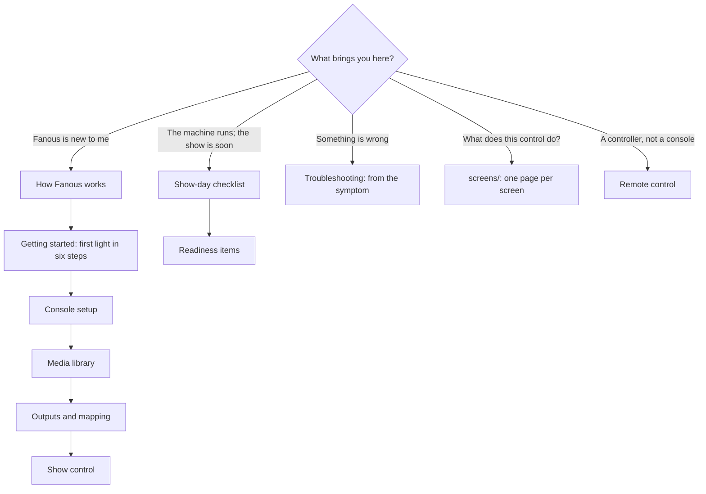

<!-- SPDX-License-Identifier: GPL-3.0-only -->
<!-- Copyright (c) 2026 Tim de Bruijn -->
<!-- Additional terms under GPLv3 §7 apply: see LICENSE-ADDITIONAL-TERMS.md -->

# Fanous user guide

Fanous is a media server for live events. Your lighting console patches it as
a fixture and drives video layers over Art-Net or sACN; Fanous plays the
media, blends, warps and maps it onto projectors and displays, and reports
back what it is doing. This guide describes version 1.0.0-rc.5.

## Who this is for

Operators and programmers of lighting consoles who have to get a show running
on a Mac: patch the fixture, put media in the library, set up the outputs,
program cues, and run the machine reliably on show day. It does not teach
Art-Net, sACN or console programming. It does explain the video side: every
term a lighting technician may not have met is in the
[glossary](reference/glossary.md), and the pages on projectors, blending and
warping ([Outputs and mapping](outputs-and-mapping.md),
[Warp, slices and masks](warp-and-masks.md)) start from zero.

## Requirements

- An Apple Silicon Mac with a hardware ProRes engine: every M-series chip
  except the base M1. Intel Macs do not run Fanous. The M1 Pro is the
  reference machine; every number in this guide that comes from a measurement
  was measured on it. Which chips have what: [hardware.md](../hardware.md).
- macOS 15 or newer.
- A lighting console (or software) that sends Art-Net or sACN to the Mac.
- For the UI on another device: a browser on the same network. An iPad is the
  intended second screen.

## Where to start

## Pages

Three kinds of pages: read the first kind once, work from the second, look
things up in the third.

| Kind | Page | What is in it |
|---|---|---|
| Understand | [how-it-works.md](how-it-works.md) | The whole picture on one page: engine and UI, from console to projector, who controls a value, the project and its versions, what keeps a show safe |
| | [reference/glossary.md](reference/glossary.md) | Every term in one or two lines |
| Do | [getting-started.md](getting-started.md) | Install, the first launch, the firewall, and first light in six steps: a clip on a layer on a display, driven by the console |
| | [ui.md](ui.md) | The window and its menus, the status bar item by item, messages and banners, the UI on an iPad, roles and passwords, why a control is greyed out |
| | [console-setup.md](console-setup.md) | Fixture types, the standard patch, the Patch screen, universe settings, GDTF export, sACN, Who controls and merging |
| | [media-library.md](media-library.md) | The library and its numbers, what plays as it is, import and transcode and what they change, image sequences, the library root, what a Mac can play |
| | [live-inputs.md](live-inputs.md) | Cameras, capture cards, this Mac's displays and Syphon servers on a layer: numbers, permissions, what arrives, the LTC audio input, show-day advice |
| | [outputs-and-mapping.md](outputs-and-mapping.md) | Canvases, displays and display modes, outputs, blending two projectors, test patterns, colour, projector walls and the seam check |
| | [warp-and-masks.md](warp-and-masks.md) | Corner pin, mesh, slices, masks, the content template, Show on output, Remote from an iPad, mapping presets, the Keystone fixture |
| | [show-control.md](show-control.md) | Running the show, building cues, triggers and follows, timecode (LTC, MTC) with its states |
| | [remote-control.md](remote-control.md) | Without a console: Who controls, the UI, OSC and reading state back (Companion, TouchOSC), MIDI Learn, MIDI Show Control, CITP/MSEX |
| | [multi-server.md](multi-server.md) | Several Macs, one picture: the Sync channel, a left/right setup, badges, sync settings, the camera check |
| | [show-day-checklist.md](show-day-checklist.md) | A printable checklist for the day of the show: Mac settings, the readiness list, show mode and what comes back after a crash |
| | [troubleshooting.md](troubleshooting.md) | From the symptom to the cause, with flowcharts: unreachable engine, silent universe, black layer or output, timecode, CITP, logs, versions, reset, a forgotten password |
| Look up | [screens/](#the-seven-screens) | One page per screen with every control, status word and message: see The seven screens below |
| | [channel-map.md](../channel-map.md) | Every DMX channel of the four fixtures with its default, bands and OSC key |
| | [reference/files-and-ports.md](reference/files-and-ports.md) | Every file the engine writes, every port, the command line, service names |
| | [reference/osc.md](reference/osc.md) | Every OSC address in and out, argument types, the subscribe handshake, limits |
| | [reference/api.md](reference/api.md) | REST routes with their roles, the WebSocket protocol, every command, error codes, limits |
| | [reference/built-in-content.md](reference/built-in-content.md) | Folder 0 by file number: solid colour, the test patterns as a layer, test card, colour sweep, clock, motion test, with pictures |
| | [reference/shortcuts.md](reference/shortcuts.md) | Keys and their touch equivalents |
| | [reference/readiness.md](reference/readiness.md) | Every readiness item: threshold, what the row reads, the fix, whether it blocks |
| | [reference/known-limitations.md](reference/known-limitations.md) | What this version does not do or has not been tested on, with its backlog entry |

Outside this guide: [DESIGN.md](../DESIGN.md) is the technical design,
[BACKLOG.md](../BACKLOG.md) everything known to be missing, and
[DEVELOPMENT.md](../DEVELOPMENT.md) how to build and the protocol details.

## The seven screens

Switch screens with the rail on the left or the keys 1 to 7. Each screen has
a reference page with every control; the task pages say when to use them.

| Key | Screen | Purpose | Every control | Tasks |
|---|---|---|---|---|
| 1 | Layers | One row per layer: media, position, intensity, play mode, source; preview of the canvas or the selected layer; the layer panel | [screens/layers.md](screens/layers.md) | [remote-control.md](remote-control.md#from-the-ui) |
| 2 | Media | The library: folders, files, built-in content and live inputs, import, transcode, the ingest queue | [screens/media.md](screens/media.md) | [media-library.md](media-library.md), [reference/built-in-content.md](reference/built-in-content.md) |
| 3 | Inputs | Cameras, capture cards, displays and Syphon servers with their signal, numbers and Forget; audio inputs and the LTC channel; the permissions they need | [screens/inputs.md](screens/inputs.md) | [live-inputs.md](live-inputs.md) |
| 4 | Outputs | Canvases, outputs, projector walls, blend, warp, slices, masks, presets | [screens/outputs.md](screens/outputs.md) | [outputs-and-mapping.md](outputs-and-mapping.md), [warp-and-masks.md](warp-and-masks.md) |
| 5 | Patch | Who controls, fixture groups and blocks, universes, DMX monitor, patch sheet, GDTF export | [screens/patch.md](screens/patch.md) | [console-setup.md](console-setup.md) |
| 6 | Show | GO, timecode, cues, OSC, MIDI | [screens/show.md](screens/show.md) | [show-control.md](show-control.md), [remote-control.md](remote-control.md) |
| 7 | System | Show mode and readiness, live metrics, machine, library root, network, sync, project versions, roles, logs | [screens/system.md](screens/system.md) | [show-day-checklist.md](show-day-checklist.md), [troubleshooting.md](troubleshooting.md) |

## Conventions

- **Bold** is a label you see on screen: a button, a field, a tag. `Code` is
  a file name, a path, a command or a value you type. A role is written in
  lowercase as a concept (programmer) and as the UI shows it when it names
  the tag (**Programmer**).
- Screens are named as the rail names them: Layers, Media, Inputs, Outputs,
  Patch, Show, System. "System › Network" is the Network panel of the System
  screen; "Outputs › Warp & Slices" a tab of the Outputs screen.
- Universes are written as the status bar shows them, with the number a
  console asks for at first use on a page:

  | Fanous | Art-Net port-address | A console that counts from 1 |
  |---|---|---|
  | `A 0.0.0` | 0 | universe 1 |
  | `A 0.0.1` | 1 | universe 2 |
  | `S 1` | sACN universe 1 (sACN starts at 1) | universe 1 |

- Fixtures are the console's units: the Layer fixture, the Master fixture,
  the Output fixture, the Keystone fixture; "Layer mode" only when the GDTF
  file is meant. "Sync master" and "Sync slave" are the Sync channel's
  roles, never the Master fixture.
- "(programmer)" after a step means it needs that role; "refused while the
  show is locked" means press L first.
- A number from a measurement names the machine and the conditions; a number
  without them is a design limit.
- A link shows the page's title; the tables on this page show the file
  names, so you can find a page in the folder.
