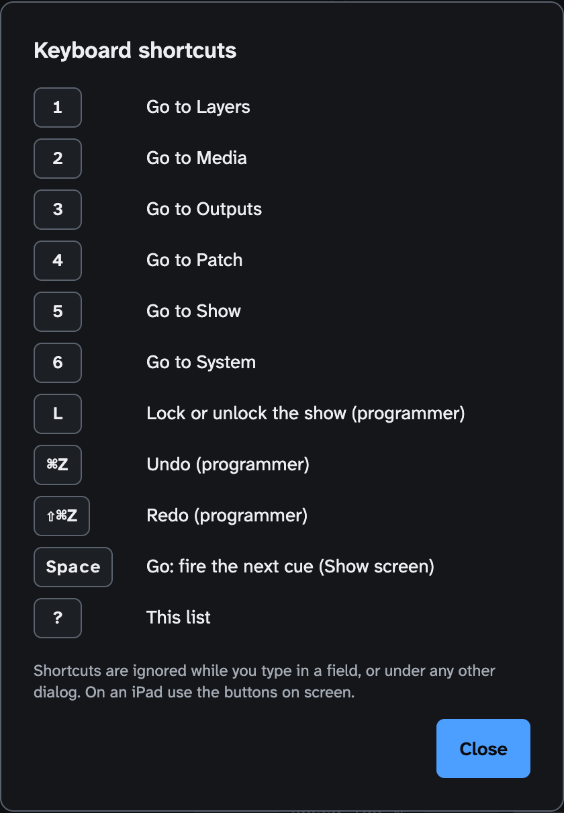

<!-- SPDX-License-Identifier: GPL-3.0-only -->
<!-- Copyright (c) 2026 Tim de Bruijn -->
<!-- Additional terms under GPLv3 §7 apply: see LICENSE-ADDITIONAL-TERMS.md -->

# Fanous user guide

Fanous is a media server for live events. Your lighting console patches it
as a fixture and drives video layers over Art-Net or sACN; Fanous plays the
media, blends, warps and maps it onto projectors and displays, and reports back
what it is doing. This guide describes version 1.0.0-rc.4.

## Who this is for

Operators and programmers of lighting consoles who need to get a show running
on a Mac: patch the fixture, put media in the library, set up the outputs,
program cues, and run the machine reliably on show day. It does not teach
Art-Net, sACN or console programming.

## Requirements

- An Apple Silicon Mac with a hardware ProRes engine. Intel Macs do not run
  Fanous at all. A base M1 has no ProRes engine and is not supported: the
  Supported hardware readiness item fails on it and show mode is refused.
  The M1 Pro is the reference machine; all numbers in this guide that come
  from measurements are from it.
- macOS 15 or newer.
- A lighting console (or software) that sends Art-Net or sACN to the Mac.
- For the web UI on another device: a browser on the same network. An iPad is
  the intended second screen.

## Pages

| Page | What is in it |
|---|---|
| [how-it-works.md](how-it-works.md) | The picture in one page: engine and UI, from console to projector, who controls a value, the project and its versions |
| [getting-started.md](getting-started.md) | Install, first launch, firewall, the main window and status bar, the web UI from an iPad, roles and passwords, where files live |
| [console-setup.md](console-setup.md) | Fixture types, the standard patch, the Patch screen, universe settings, GDTF export, sACN, merging, a first-light walkthrough |
| [media-library.md](media-library.md) | Folder and file naming, built-in content and live inputs (folder 0), formats, import and ingest, thumbnails, performance advice |
| [outputs-and-mapping.md](outputs-and-mapping.md) | Canvases, displays, outputs, blend edges, test patterns, colour, projector walls, corner pin and mesh warp, slices, masks, presets, keystone |
| [show-control.md](show-control.md) | Timecode (LTC, MTC), cues, OSC, MIDI, CITP/MSEX, built-in content, controlling layers from the UI |
| [multi-server.md](multi-server.md) | Several Macs, one picture: the Sync channel, a left/right setup, badges, sync settings, the camera check |
| [show-day-checklist.md](show-day-checklist.md) | A printable checklist for the day of the show, and every readiness check |
| [troubleshooting.md](troubleshooting.md) | Symptoms, causes, fixes, logs, restart, earlier versions and reset |

Reference material outside this guide: [channel-map.md](../channel-map.md) lists
every DMX channel, [DESIGN.md](../DESIGN.md) is the technical design, and
[BACKLOG.md](../BACKLOG.md) lists everything that is known to be missing.

## The seven screens

Switch screens with the left rail or the keys 1 to 7; hover a screen in the
rail to see its key.

| Key | Screen | Purpose | Explained in |
|---|---|---|---|
| 1 | Layers | One row per layer: media, position, intensity, play mode, source; preview of the canvas or the selected layer; the layer panel | [getting-started.md](getting-started.md#the-main-window), [show-control.md](show-control.md#controlling-layers-from-the-ui) |
| 2 | Media | The library: folders, files, built-in content and live inputs, import, transcode, ingest queue | [media-library.md](media-library.md) |
| 3 | Inputs | Cameras, capture cards, displays and Syphon servers: their signal, numbers and Forget, and the permissions they need | [media-library.md](media-library.md#the-inputs-screen-key-3) |
| 4 | Outputs (Outputs & Mapping) | Canvases, outputs, projector walls, blend, warp, slices, masks, presets | [outputs-and-mapping.md](outputs-and-mapping.md) |
| 5 | Patch | Who controls, fixture groups and blocks, universes, DMX monitor, patch sheet, GDTF export | [console-setup.md](console-setup.md#the-patch-screen-key-5) |
| 6 | Show (Show control) | GO, timecode, cues, OSC, MIDI | [show-control.md](show-control.md) |
| 7 | System | Show mode and readiness, live metrics, machine, library root, network, sync, project versions, roles, logs | [show-day-checklist.md](show-day-checklist.md), [troubleshooting.md](troubleshooting.md) |

Other keys: Cmd-Z undo and Shift-Cmd-Z redo (programmer), L lock or unlock the
show (programmer; it only asks first when you unlock while show mode is on),
Space fires the next cue on the Show screen (operator and programmer), ? opens
the list of shortcuts (also the **?** button in the status bar). Keys do
nothing while you type in a field or while a dialog is open.

## Known limitations

Everything below is also in [BACKLOG.md](../BACKLOG.md) under the given number.
The pages that follow repeat the ones that matter for their topic.

- Hot-plugging a display is checked with one external display; with two or
  more it rests on unit tests (B34).
- There is one project per machine; versions of it can be restored (System ›
  Project versions), but there are no project bundles to open or switch
  between, and no diff between two versions.
- Consoles over CITP/MSEX get streams at a fixed size (the canvas at 640x360,
  each layer at 160 pixels wide) and thumbnails at their stored size, whatever
  size the console asks for (B41). No real console has talked to Fanous over
  CITP yet (B40).
- There is no MIDI output (controller lights, MSC replies; not built, DESIGN
  §15.4), and cues cannot be recorded from MIDI (B36). MIDI input and OSC feedback work: see
  [show-control.md](show-control.md).
- Loss of OSC messages sent back to back was seen once and has not been
  reproduced since (B30). If a console's bursts seem partly lost, leave about
  50 ms between messages and report it.
- Show mode does not yet lower the log level, throttle thumbnails or check for
  display mirroring (B42).
- Audio plays on the default output device; there is no device choice and no
  latency compensation (B4). A looping clip whose audio is shorter than its
  video still has a short gap at each loop, and the first moment after a long
  pause can be silent (B3). Audio plays only forward at 100 % speed, where 100 % is
  layer speed × Master speed (for a Sync slave, its master's speed). At any
  other speed, and in Freeze, Scrub and Timecode, the layer is silent; there is
  no varispeed.
- No clean-account install test yet (B50).
- The GDTF file has not been imported into grandMA3, Eos or MagicQ yet (B7).
