<!-- SPDX-License-Identifier: GPL-3.0-only -->
<!-- Copyright (c) 2026 Tim de Bruijn -->
<!-- Additional terms under GPLv3 §7 apply: see LICENSE-ADDITIONAL-TERMS.md -->

# Console setup

How a lighting console takes control of Fanous: the four fixtures, the patch
on both sides, Art-Net or sACN on a show network, what happens when the
console goes silent, and how the console's values combine with Fanous's own.
Every control of the Patch screen is in [screens/patch.md](screens/patch.md);
terms are in the [glossary](reference/glossary.md).

**Before you start.** This page is the console side. Do steps 1 to 3 of
[getting-started.md](getting-started.md#first-light-in-six-steps) first (a
clip in the library, an output on a display, the layer playing from the UI),
then come back here for the desk. Changing the patch needs the programmer
role and is refused while the show is locked
([ui.md](ui.md#roles-and-logging-in)).

## The four fixtures

Fanous is one fixture type, "Fanous", with four modes. Each mode is patched
as its own fixture on the console.

| Fixture | Channels | One per | Controls |
|---|---|---|---|
| **Layer** | 64 | layer | Everything about one layer: intensity, folder and file, play mode, speed, in and out points, dissolve, position, scale, rotation, colour, blend mode, two effects, crop, audio, sync |
| **Master** | 8 | machine | Master intensity (multiplies every output), Freeze all or Blackout, a test pattern on every output, Master speed |
| **Output** | 8 | output (outputs 1 to 8) | Output intensity, Blackout or Freeze, a test pattern, Blend on or Raw, mapping preset and its fade |
| **Keystone** | 16 | output, optional | Moves the output's four corners on top of its alignment ([warp-and-masks.md](warp-and-masks.md#keystone-from-the-console)) |

Every channel with its default and bands: [channel-map.md](../channel-map.md).
Eight layers fill one universe exactly; 16 layers need two, 32 need four.
16-bit values are coarse and fine on adjacent channels, coarse first. Layer
channels 52 to 64 are reserved. Outputs 9 and up have no Output fixture.

### Channels that bite

- **Home values are not zero.** A layer at all zeros is black with a 0 %
  speed, 0 % scale and an out point at the start. The home values the GDTF
  carries: layer intensity 0; out point 65535; speed and scale 32768
  (100 %); position, rotation and the keystone corners 32768 (centre);
  red, green and blue 255; brightness, contrast, saturation and audio pan
  128; Master and Output intensity 65535. A desk that outputs only the
  channels you touched must load the fixtures' home values first.
- **Control bands differ** between the Master and an Output: Master channel
  3 is Freeze all at 64 to 127 and Blackout at 128 to 191; Output channel 3
  is Blackout at 64 to 127 and Freeze at 128 to 191. A preset applied to
  both freezes one and blacks out the other.
- **Master speed** (Master channels 5 and 6, 32768 = 100 %, 0 stops every
  clip, 65535 = 400 %) multiplies the speed of every layer that plays a
  movie. Built-in content, effects and live inputs keep their own pace; the
  Freeze, Scrub and Timecode play modes ignore it; a Sync slave follows its
  Sync master instead.
- **Audio** plays only forward at 100 % (within half a percent), where 100 %
  is layer speed × Master speed. Layer speed 200 % with Master speed 50 %
  still has sound; any other product, Freeze, Scrub, Timecode and the
  reverse half of Bounce are silent.
- **Test patterns** follow the Master and Output intensity and Blackout like
  the picture, so a Grand Master or DBO takes them down too: keep the
  intensities up to focus.
- **Retrigger** (Layer channel 50 at 8 to 15) fires once when the channel
  enters the band; return it to 0 before the next one.
- **Mapping preset and fade** (Output channels 6 and 7): Fanous reads the
  fade at the moment the preset channel changes, so put the fade in an
  earlier cue or give it a fade time of 0
  ([warp-and-masks.md](warp-and-masks.md#mapping-presets)).

## The standard patch

A fresh project is patched like this:

- Layer n on Art-Net universe `(n − 1) ÷ 8` (whole-number division) at
  address `(n − 1) mod 8 × 64 + 1`.
- The Master on the first universe after the layers, at address 1.
- Output n after the Master on the Master's universe, at `1 + 8 × n` (9, 17,
  25, …), patched when the output is added and only when those channels are
  free. A new project has no Output fixtures until an output is added.
- A Keystone is not in the standard patch. **Patch** next to it puts
  Keystone n at `73 + 16 × (n − 1)` on the Master's universe (73, 89, …),
  or on the first free 16 channels after that.

| Fixture | Universe | Addresses |
|---|---|---|
| Layers 1 to 8 | `A 0.0.0` | 1, 65, 129, 193, 257, 321, 385, 449 |
| Master | `A 0.0.1` | 1 |
| Outputs 1 to 3 | `A 0.0.1` | 9, 17, 25 |

In a project laid out as one block with 16 layers, Layers 9 to 16 use
`A 0.0.1` and the Master and the outputs sit on `A 0.0.2` (adding layers to
an 8-layer project does not move them by itself, see
[Add a layer](#add-a-layer-when-its-place-is-taken)).

**Universe numbers.** Fanous writes Art-Net universes as
`A net.subnet.universe` and sACN universes as `S n`. A desk with one Art-Net
universe field asks for the port-address, `net × 256 + subnet × 16 +
universe`: `A 0.0.1` is port-address 1, `A 0.1.0` is 16. A desk whose first Art-Net
universe is 1 and that has no universe 0 counts from 1: it calls
port-address 0 "universe 1". sACN universes are the same number everywhere
and start at 1.

## Tell the console

1. **Decide the layer count, the outputs and the Keystones first** on the
   Patch screen (**+** next to the layer count; outputs on the Outputs
   screen; **Patch** next to a Keystone). The Patch sheet lists only the
   fixtures that exist, and adding layers later can move the Master
   ([below](#add-a-layer-when-its-place-is-taken)).
2. **Export GDTF** on the Patch screen downloads `Fanous.gdtf` (GDTF 1.2):
   the fixture type "Fanous" with its four modes, every channel's bands,
   the 16-bit links and the home values, generated from the same table as
   the channel map. Take it to the desk the way the desk imports fixture
   files (a USB stick, the desk's network share). The file's revision text
   carries the Fanous version; export it again after a Fanous update that
   changes the channel map, and delete the old fixture type on the desk
   before importing the new file, because the fixture type keeps its id.
3. **Patch sheet** on the Patch screen says what to patch: fixture type,
   mode, count, universe and the start addresses, one line per universe a
   block covers; desk fixture 1 of the Layer line is Layer 1. A group with a
   hand-placed fixture gets one line per fixture: press **Re-lay as block**
   first if the desk is to be patched from the sheet. **Copy** puts the sheet
   on the clipboard as tab-separated text for a spreadsheet; **Print** prints
   it alone.

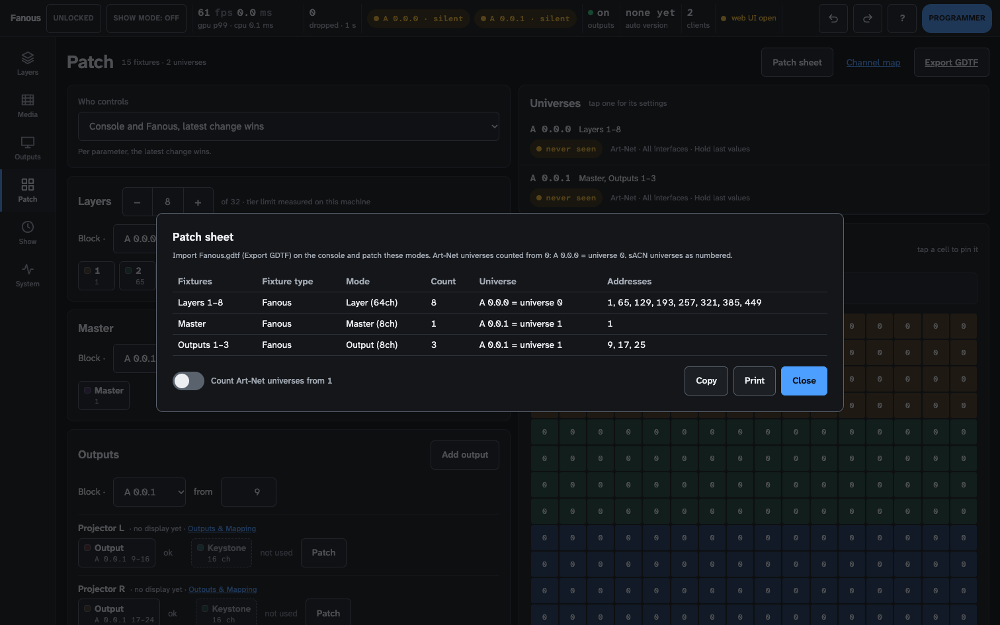

4. **Check the universe count.** The sheet writes `A 0.0.1 = universe 1`;
   with **Count Art-Net universes from 1** on it writes `A 0.0.1 =
   universe 2`, and its header says which count is in use. The switch is
   remembered per browser, so read the header of a sheet someone else
   printed. A universe fed by sACN shows the sACN number (`S 1`); one fed by
   both shows `A 0.0.0 = universe 0 or S 1`.

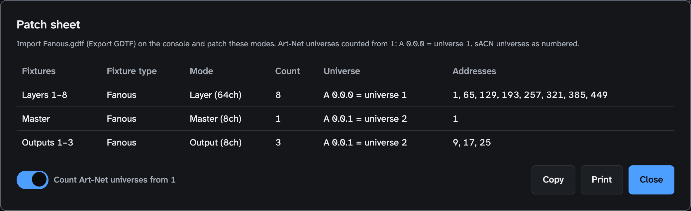

5. **Point the desk at the Mac.** Art-Net: broadcast on the Mac's subnet, or
   unicast to the Mac's address (System › Network). sACN: multicast on the
   patched universe numbers, or unicast to the Mac. Then load the fixtures'
   home values and send.
6. **Check.** The universe's pill in the status bar turns green when packets
   arrive; until then it reads **A 0.0.0 · silent** in yellow, the normal
   state of a fresh install. Set folder, file and intensity on Layer 1 and
   see [getting-started.md](getting-started.md#6-check-layers-key-1) when
   nothing moves.

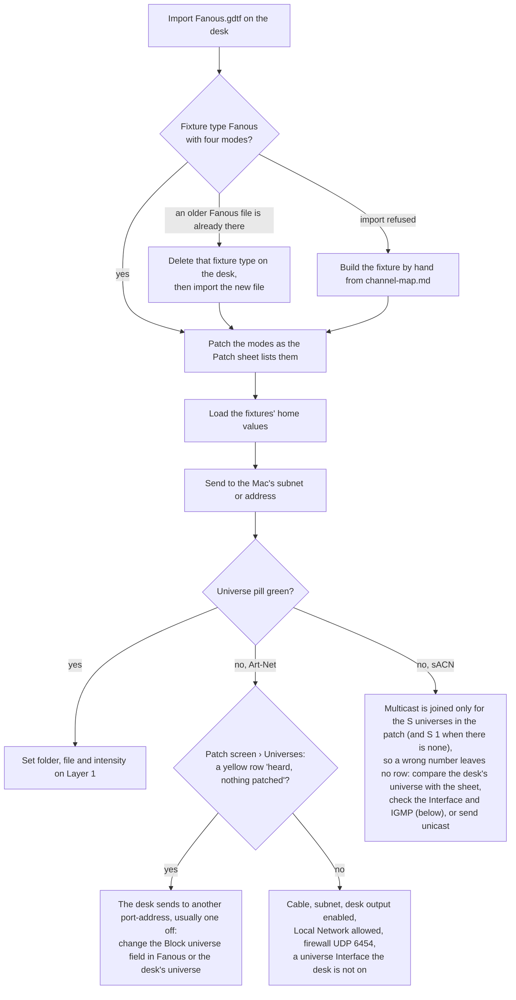

The GDTF import has not been verified on a real grandMA3, Eos or MagicQ yet
([known limitations](reference/known-limitations.md#consoles-and-protocols)).
Over CITP/MSEX a console that speaks it also sees the media list and
thumbnails ([remote-control.md](remote-control.md#citpmsex)).

## Art-Net or sACN

| | Art-Net | sACN (E1.31) |
|---|---|---|
| Port | UDP 6454 | UDP 5568 |
| Reaches the Mac by | broadcast on the subnet, or unicast to the Mac's address | multicast on `239.255.hi.lo` per universe, joined on every interface that can multicast or on one named interface; or unicast to the Mac |
| Universe in Fanous | `A net.subnet.universe`, port-address 0 and up | `S 1` to `S 63999` |
| Two senders on one universe | the latest packet wins, per packet, with no hold: two consoles fight. Send each universe from one console | the highest priority wins; at equal priority the latest packet, or a per-channel merge by highest value when the universe is set to Merge equal (HTP). A source silent for 2.5 s drops out; a source that sends the stream-terminated flag (a clean shutdown) drops out at once |
| Not honoured | ArtSync; a packet with a sequence number 0 to 19 behind the last one from the same sender is dropped (sequence 0 switches the check off) | per-address priority (start code 0xDD), sACN sync, and packets flagged as preview or with another start code; the same 0 to 19 sequence check applies per source |
| What Fanous answers | ArtPoll, with an ArtPollReply as a media server node naming its patched port-addresses, sent back to the poller | nothing; it only listens |
| Port conflicts | another program holding UDP 6454 is only in the engine log | the port is shared with other receivers on the Mac (sACNView, a second engine); unicast reaches only the one that opened it last; a program that holds it exclusively is named by the readiness item **sACN port 5568 available** (`sudo lsof -nP -iUDP:5568` shows who) |

The ArtPollReply names the Mac's first network address, which on a Mac with
Wi-Fi and a show adapter can be the wrong one for a desk that unicasts to
discovered nodes, and carries no MAC address ([known limitations](reference/known-limitations.md#consoles-and-protocols)):
enter the Mac's address on the desk by hand.

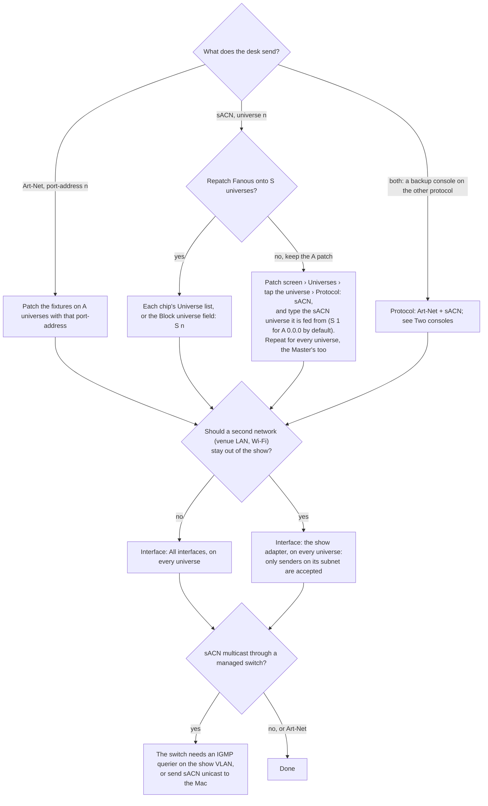

**The show network.** Wi-Fi is not a show network for DMX; use Ethernet. An
unmanaged switch floods every multicast group to every port, which is fine
for a few universes. A managed switch with IGMP snooping forwards sACN only
where a member asked for it, and needs an IGMP querier on that VLAN: without
one, sACN works at first and dies a few minutes later when the switch's
table ages out. Fanous re-joins its groups every 5 s, which does not replace
a querier. Multicast across a router needs multicast routing; across subnets,
send unicast. A universe's Interface set to a named adapter accepts only
senders on that adapter's subnet, Art-Net and sACN alike, so a desk behind a
router is dropped there: use All interfaces then. An unplugged adapter stays
in the setting but receives nothing until it is back; the readiness item
**Universe interfaces usable** warns, and a replugged adapter is joined again
within 5 s.

**Universes you can pick.** A fixture's Universe list offers `A 0.0.0` to
`A 0.0.3`, `S 1` to `S 4`, and every universe that is patched, has been
heard or has settings. For another Art-Net universe, let the desk send to it
once: it appears as "heard". For another sACN universe, patch on an A
universe and type the number into its **sACN universe** field, or type it in
the Block universe field. sACN multicast is joined for every S universe in
the patch and for the sACN universe paired with every A universe fed by
sACN; with none of those, S 1 is joined so the multicast path is ready.

## Universe settings

Every universe has its own receive settings (programmer): tap its row in the
Patch screen's **Universes** panel. They belong to the universe, not to the
fixtures on it, so set them on every universe you use, the Master's too.
They apply at once and are part of the project and of undo.

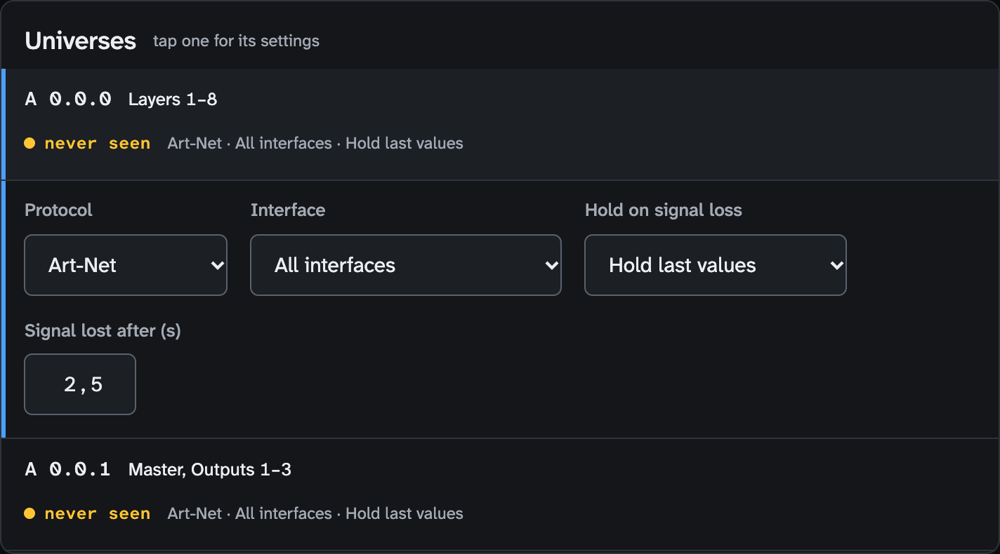

| Setting | Choices | Default | Does |
|---|---|---|---|
| **Protocol** | Art-Net, sACN, Art-Net + sACN | the universe's own | Which protocol feeds the universe. With Art-Net + sACN, Art-Net is one more sACN source at priority 100 |
| **sACN universe** / **Art-Net universe** | a universe of the other protocol | `S n+1` for `A` port-address n | Shown when the protocol is not the universe's own: which universe of the other protocol feeds it. The collision check does not see a fixture on `S 1` and one on `A 0.0.0` fed from `S 1` as the same channels |
| **Interface** | All interfaces, an interface with its addresses (`en0 (10.0.1.20)`) | All interfaces | All: every sender is accepted and sACN multicast is joined on every interface. Named: senders on that subnet only, multicast there alone |
| **Hold on signal loss** | Hold last values, Go to zero, UI and cues take over | Hold last values | What the fixtures do when the universe is lost ([next section](#when-the-console-goes-silent)) |
| **Signal lost after (s)** | 1 to 60 | 2.5 | Silence after which the universe counts as lost. sACN desks that send only on change repeat about every second; Art-Net desks may repeat only every 4 s, so give such a desk 5 s or more |
| **sACN priority** | Highest wins, Merge equal (HTP) | Highest wins | Highest wins: the highest priority wins, and two sources at that priority go to the latest packet. Merge equal: those two merge by highest value per channel. Shown for sACN and Art-Net + sACN |

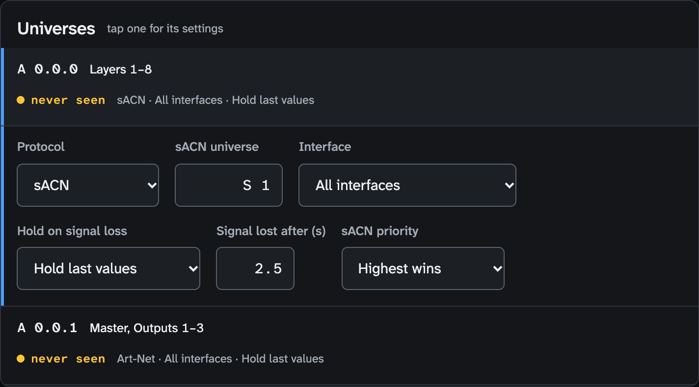

Two timeouts exist. **Signal lost after** is this universe's: when it counts
as lost and Hold on signal loss applies. The sACN **source timeout** is
fixed at 2.5 s by the standard: a source silent that long drops out of the
priority merge (checked every half second, so a takeover lands between 2.5
and 3 s).

## When the console goes silent

A universe that has received packets and then goes quiet:

- The status bar's pill stays green for the universe's Signal lost after
  time, then goes red (for a patched universe); only with a Signal lost
  after below 2.5 s is there a yellow phase with the seconds since the last
  packet, until 2.5 s. The Patch screen's Universes panel and the readiness
  item **All patched universes receiving** go red at Signal lost after.
- The fixtures do what the universe's **Hold on signal loss** says. A
  universe that never received anything is not lost: its fixtures sit at
  their defaults, or follow the UI and cues under the "Console and Fanous"
  settings and under Hold on signal loss **UI and cues take over**.

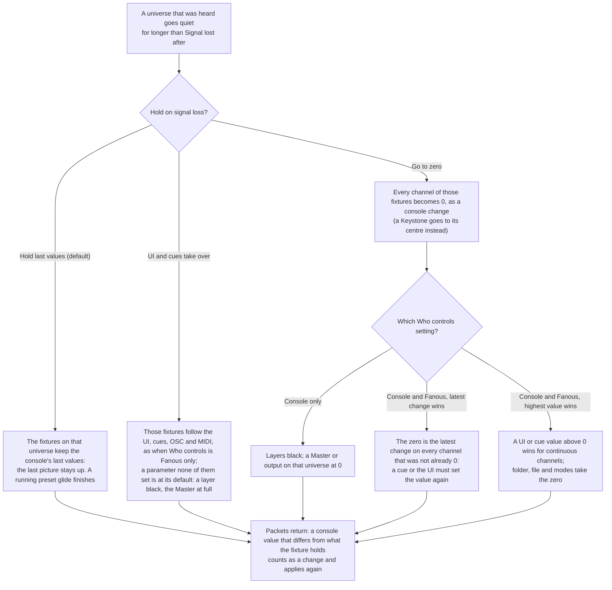

Under Fanous only the console is ignored, so Hold on signal loss changes
nothing. A fixture without an address holds nothing from the console:
unpatching it, or moving it to another universe, drops the console's values
at once. An Output fixture's preset and fade channels follow the same rules
([warp-and-masks.md](warp-and-masks.md#from-the-console)).

## Who controls

The project's **Who controls** on the Patch screen decides how the console's
values combine with values from the UI, cues, OSC and MIDI. The four
settings and the rules the table leaves out:
[how-it-works.md](how-it-works.md#who-wins-the-four-who-controls-settings).

| Choice | Source badge on the Layers screen |
|---|---|
| **Console only** (the default) | Console |
| **Fanous only (UI, cues, OSC, MIDI)** | Fanous |
| **Console and Fanous, latest change wins** | Both · latest |
| **Console and Fanous, highest value wins** | Both · highest |

Two rules a desk programmer meets first. Under latest change wins the console
"moves" a channel only when its value changes: a desk sitting at 100 % does
not win against a cue fired later. Under highest value wins a desk that held
100 % and then died keeps winning with that held value on continuous
channels (Hold last values; folder, file and modes take the latest change):
pick latest change wins for a desk that may go away, or unpatch the fixture
to drop the held value.

**No address means no console control, not no control.** Every layer up to
the layer count, the Master and each output's Output and Keystone fixture
exist whether they are patched or not. Under Console only an unpatched
fixture stays at its defaults (a layer black with no file, the Master at
full, an output normal, a Keystone centred); under the other settings the
UI, cues, OSC and MIDI drive it.

**A show without a console**: set Who controls to **Fanous only**, and
either unpatch the groups (**Unpatch** in each fixture's editor) or let a
programmer acknowledge the readiness item **All patched universes
receiving**, which fails while a patched universe hears nothing. No GDTF is
needed.

## Changing the patch

The Patch screen keeps each group of fixtures as a **block**: fixture n sits
on place n − 1 from the block's start, one footprint apart, moving to
address 1 of the next universe when a place would run past channel 512.
Every control (the block line, the chips, the editor, Re-lay as block, Patch
as block): [screens/patch.md](screens/patch.md#fixture-groups). Each action is
one undo step. Fanous never lets a fixture it places itself land on another
one; it leaves it without an address instead. What you place by hand may
overlap, and is then shown in red.

### Add a layer when its place is taken

With the standard patch of 8 layers the Master and the outputs sit where
Layer 9 would go:

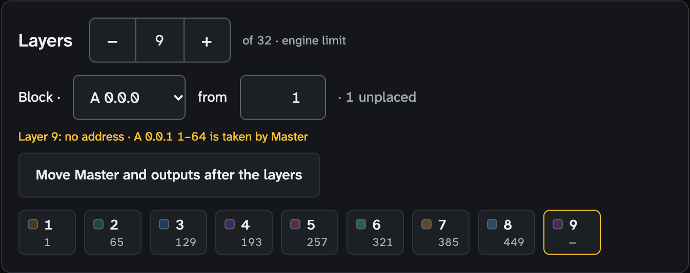

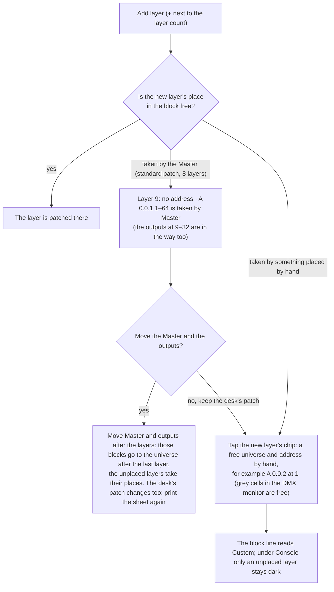

### Fix a collision

The toolbar counts collisions in red; a colliding chip is red, its editor
names the other fixture and the shared channels, and the DMX monitor shows
the cells in red. The Patch sheet lists such a fixture as patched, with a
red line under the table: fix it before patching the desk.

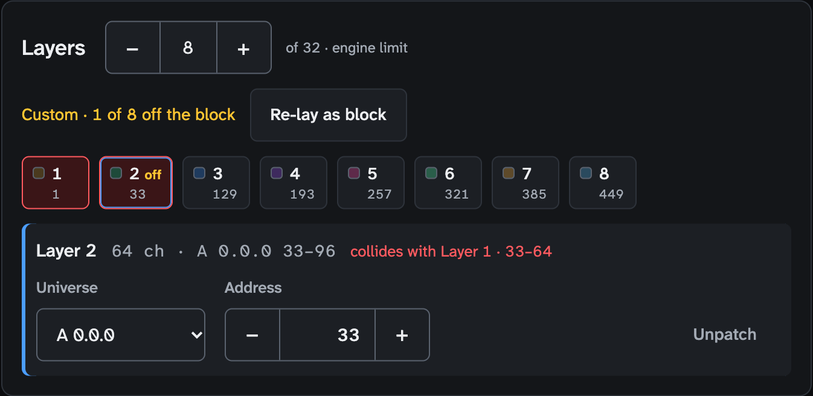

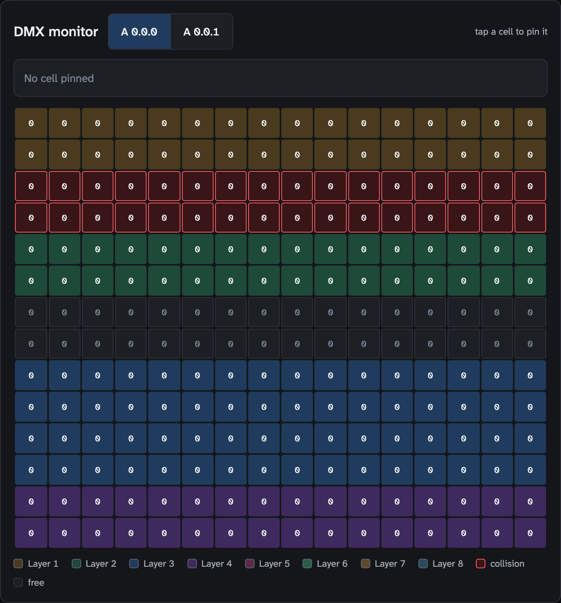

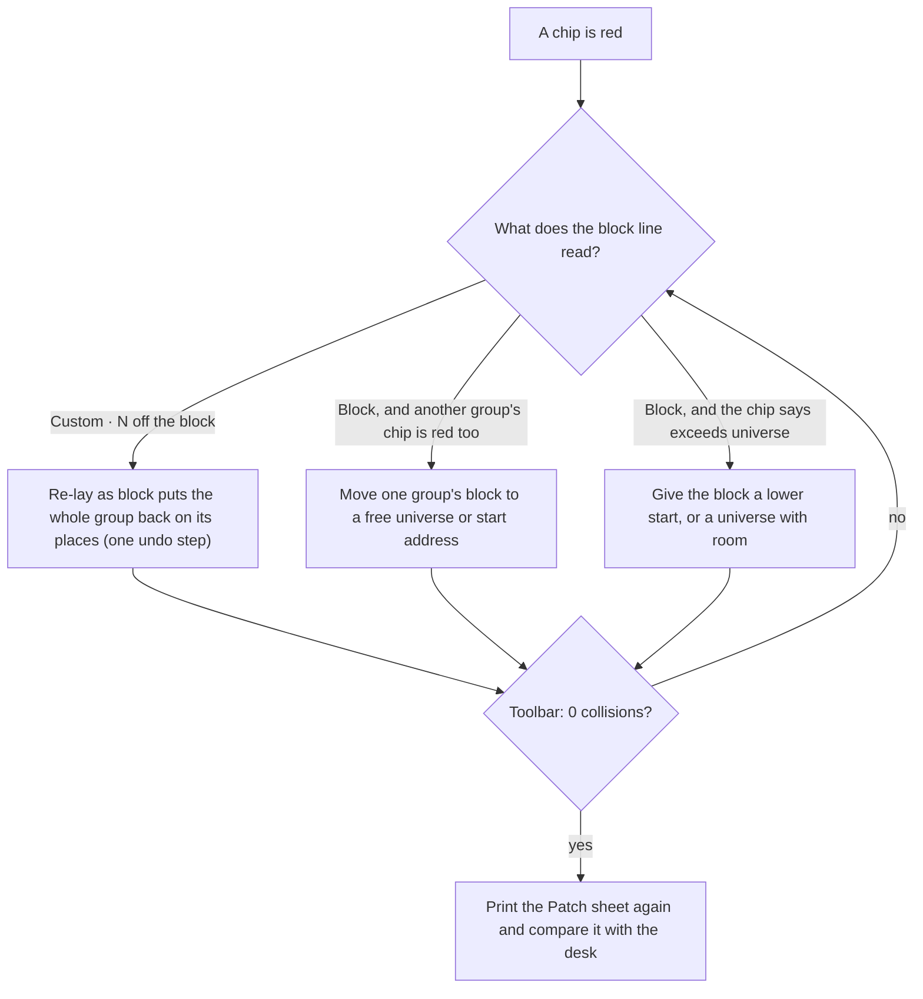

## Two consoles

- **A backup console on sACN.** Both send the same universe; the higher
  priority wins. Give the primary a priority above the backup's (primary
  150, backup 50; both at the default 100 is a tie, and a tie goes to the
  latest packet, so the two fight). When the primary stops, the backup takes
  over after 2.5 to 3 s (at once when the primary shuts down cleanly); when
  the primary returns, it takes over again at once with whatever it holds.
  While the backup streams the universe is never silent, so Hold on signal
  loss does not act. The Universes panel shows only the winning source: check
  that the backup is alive on the desk, not in Fanous.
- **A backup on the other protocol.** Set the universe's Protocol to Art-Net
  + sACN. Art-Net counts as sACN priority 100 on the paired universe (`S 1`
  for `A 0.0.0`): give the sACN console a priority above 100 to make it the
  primary, or below 100 to make it the backup. Equal priorities fight.
- **Hold on signal loss with a backup.** Keep Hold last values. With Go to
  zero and a Signal lost after below the 2.5 s source timeout, the universe
  goes black before the backup takes over.
- **Two Macs** (a left and a right projector from one desk) each have their
  own patch. The same universe and addresses on both give both Macs the same
  values, which is right for a mirrored pair; each Mac needs its own layer
  addresses when the desk must drive them apart, for example to make one
  Mac's layer the Sync master and the other's the Sync slave
  ([multi-server.md](multi-server.md)).

## Before the show

- Every patched universe's pill in the status bar is green while the desk
  runs; the Patch screen's Universes panel shows the winning sender and the
  packet count.
- The toolbar reads 0 collisions.
- Pin a cell in the DMX monitor to see a channel's received value and what
  the engine applies after Who controls; the layer panel on the Layers screen
  shows every channel of a layer with where its value came from.
- The readiness items **All patched universes receiving**, **Universe
  interfaces usable** and **sACN port 5568 available** are green
  ([show-day-checklist.md](show-day-checklist.md#the-readiness-list)).
- When the desk sends and nothing moves:
  [getting-started.md](getting-started.md#6-check-layers-key-1).

What is not there yet on the console side (the GDTF import on a real desk,
CITP with a real console, desk-specific fixture files, NDI, an Art-Net OEM
code): [reference/known-limitations.md](reference/known-limitations.md#consoles-and-protocols).
