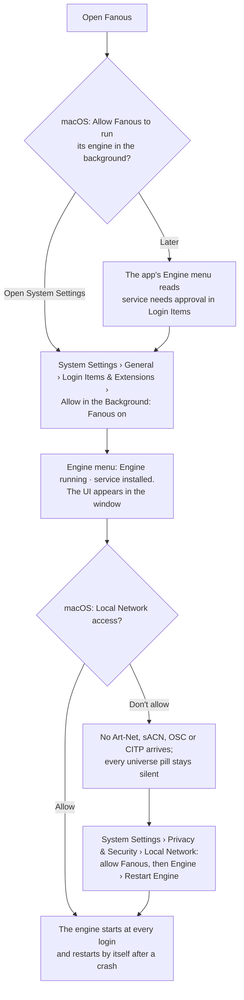
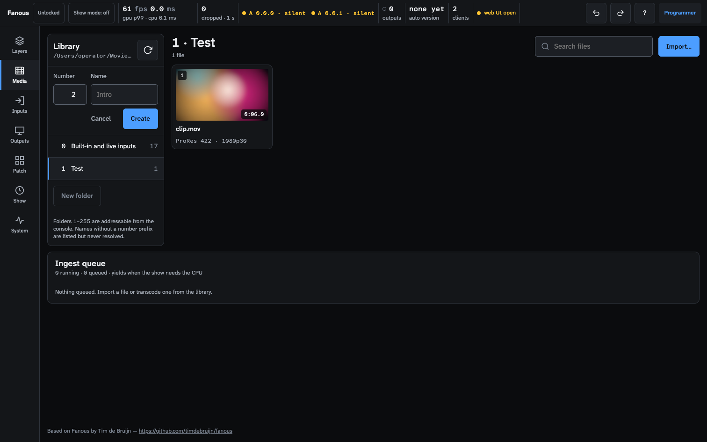
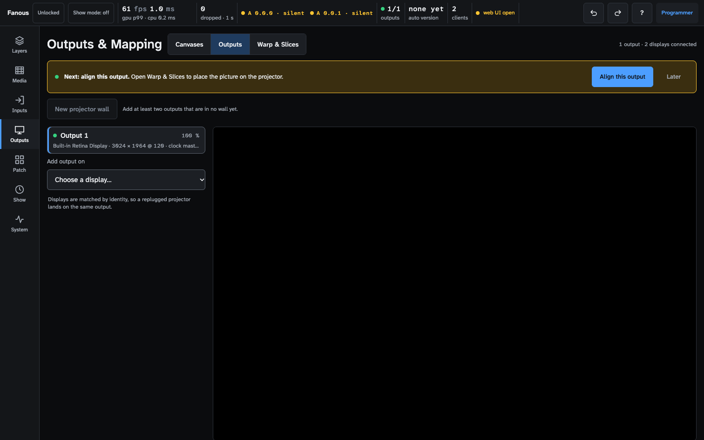
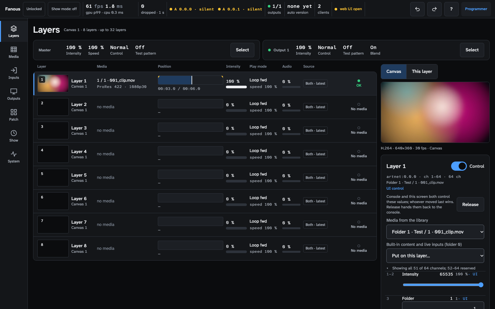
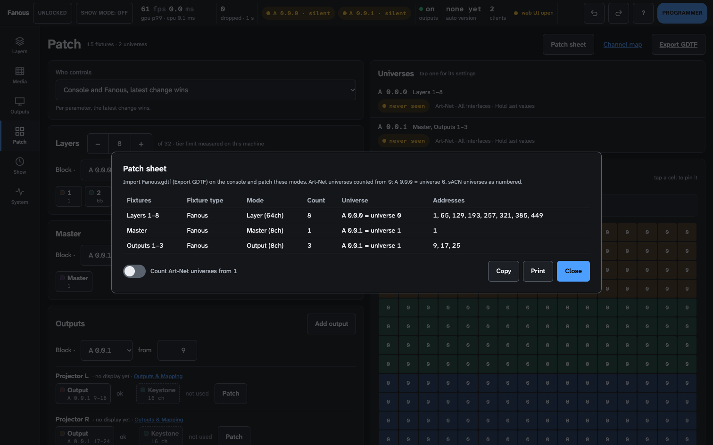
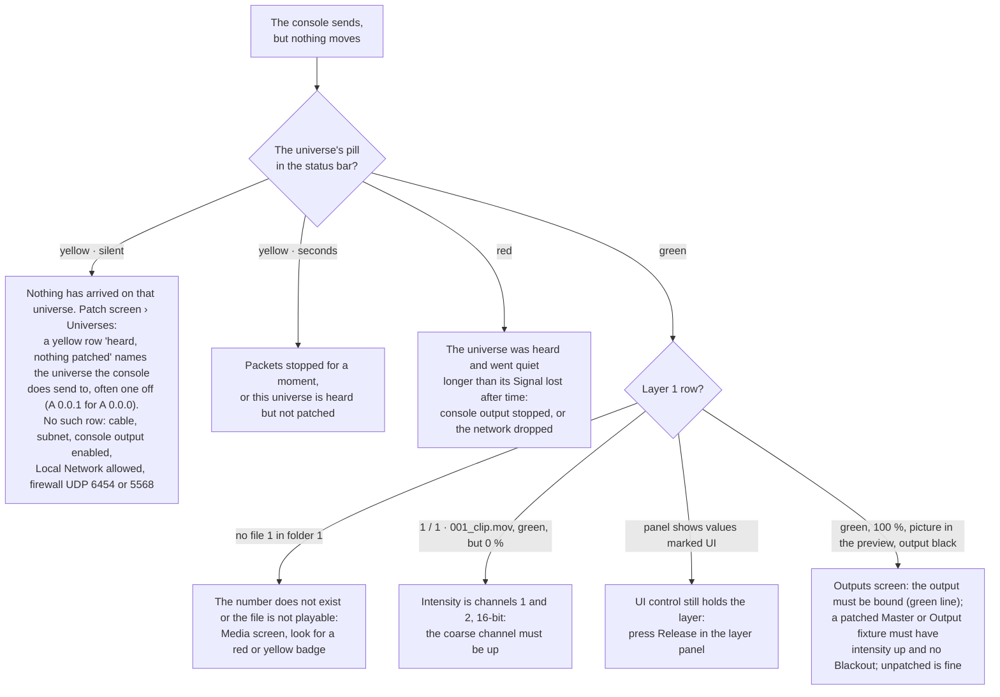

<!-- SPDX-License-Identifier: GPL-3.0-only -->
<!-- Copyright (c) 2026 Tim de Bruijn -->
<!-- Additional terms under GPLv3 §7 apply: see LICENSE-ADDITIONAL-TERMS.md -->

# Getting started

From the download to a picture on a projector driven by your console. The
page explains the video side as it goes; every term is also in the
[glossary](reference/glossary.md).

## What you need

- An **Apple Silicon Mac** with a hardware ProRes engine: any M-series chip
  except the base M1 (M1 Pro, M2, M3 and later). On a base M1 the engine
  refuses show mode. The M1 Pro is the reference machine; a base M2 or M3 has
  fewer decoders than a Pro or Max chip, so it plays fewer layers
  ([hardware.md](../hardware.md)).
- **macOS 15** or newer.
- A lighting console, or software, that sends Art-Net or sACN to the Mac over
  Ethernet, on the same subnet. For the first steps the console can wait: you
  can put media on a layer from the UI.
- A display or projector on one of the Mac's video ports, set to **extended**
  (not mirrored) in System Settings › Displays. The built-in display works for
  a first try, but an output on it covers the app window: then drive the UI
  from a browser on the same Mac (Safari at `https://localhost:8443`) or from
  an iPad. Set the display to its native resolution and refresh rate in
  System Settings › Displays; a 50 Hz projector wants a 50 fps canvas (see
  step 2).
- Optional: an iPad or laptop on the same network as a second screen for the
  UI.

## Install

1. Download `Fanous-<version>.dmg` from
   [Releases](https://github.com/Timdebruijn/fanous/releases), open it and
   drag `Fanous.app` to the Applications folder.
2. Open Fanous from Applications. The disk image and the app are signed and
   notarized and pass Gatekeeper, macOS's check of downloaded apps, on the
   Macs checked so far (a first install on a clean account is not tested yet,
   see [known limitations](reference/known-limitations.md#show-mode-and-the-machine)).
   An app you built yourself without a Developer ID may be refused at the
   first open: allow it under System Settings › Privacy & Security.

`Fanous.app` holds two programs: the app window you see and the engine,
`fanousd`. The engine does all the work; the window only shows the UI.
[how-it-works.md](how-it-works.md) explains why that matters on show day.

## First launch: let the engine run in the background

The app registers the engine as a background service (a LaunchAgent named
`org.fanous.engine`). macOS wants your approval once, then asks for Local
Network access the first time the engine listens.

After that the engine starts when you log in, and macOS restarts it within
about a second if it ever crashes (after a crash in its first ten seconds,
launchd waits ten seconds). **Quitting the app does not stop the engine**: the
outputs keep running. The engine runs inside your login, so a Mac that
reboots after a power cut shows nothing until someone logs in: for an
unattended rig switch on automatic login (System Settings › Users & Groups).

Other prompts come later, the first time a feature needs them: **Microphone**
when you pick an LTC timecode input, **Camera** when a layer shows a camera,
**Screen Recording** when a layer shows one of this Mac's displays. Allow them
before the show, never during it: a prompt nobody answers on show night leaves
that input black. The Inputs screen has an **Authorize** button for each, see
[media-library.md](media-library.md#the-inputs-screen-key-3).

## Firewall and network

If the Mac runs Little Snitch or another firewall, allow `fanousd`:

| Port | For |
|---|---|
| UDP 6454 in | Art-Net |
| UDP 5568 in | sACN |
| UDP and TCP 8000 in | OSC |
| TCP 8443 in | the UI from other devices |
| TCP in, a port the system picks (System › Network, CITP line) | CITP/MSEX for a console that browses media |
| UDP 4809 out to 224.0.0.180 and 239.224.0.180 | CITP announcements |
| UDP 8002 in and out | multi-server sync, only with several Macs |

Art-Net broadcast, sACN multicast and CITP reach the Mac only from the same
subnet; unicast Art-Net or sACN to the Mac's address works across subnets.
sACN multicast through a managed switch needs IGMP snooping with a querier,
or unicast. The Mac's addresses are under System › Network. Every port with
its direction: [reference/files-and-ports.md](reference/files-and-ports.md#ports).

## First light in six steps

The aim: Layer 1 plays a clip of yours on a display, driven by the console.
Each step names its screen; press the key or use the rail on the left. The
pictures show a fresh install with one folder, `001_Test`, and one clip.

### 1. Make a folder and add a clip (Media, key 2)

1. Press **New folder**. The form proposes the lowest free number (1 in an
   empty library); type a name such as `Test` and press **Create**. The engine
   makes `001_Test` in `~/Movies/Fanous Library`.
2. Get a clip into it, either way:
   - **Copy it with Finder** into the folder as `001_clip.mov`. This is the
     normal route for content a media team hands you: a `.mov` in ProRes or
     HAP plays as it is. The library is watched, so the file appears within a
     moment.
   - **Import…** uploads a file from the browser and re-encodes it to ProRes
     (every movie, ProRes included; a still is copied), so anything your
     phone or a web download made works after a wait of a few minutes. The
     ingest queue at the bottom shows the progress.

The console dials this clip as folder 1, file 1. Naming rules, formats and
what to ask a content maker for: [media-library.md](media-library.md).

**What to ask the content maker for.** ProRes 422 HQ in a `.mov` (ProRes
4444 when it needs transparency), or HAP Q; the canvas size (1920 × 1080
unless you change it) at the display's refresh rate; square pixels, Rec.709,
8-bit. Not H.264 or HEVC: those need a transcode first.

### 2. Add an output (Outputs, key 4)

Under **Add output on** choose a display. The output appears in the list with
a green line naming the display and its mode, and the display shows the
canvas: black for now. A yellow bar offers **Align this output**, the warp,
blend and mask work of [outputs-and-mapping.md](outputs-and-mapping.md);
press **Later**, it comes once the picture plays.

A new project renders at 60 fps. If the display runs at 50 Hz (common in
Europe) or 24 Hz, set the canvas **Frame rate** on the Canvases tab to the
same rate, or motion judders. 59.94 and 60 count as the same rate.

### 3. Put the clip on Layer 1 from the UI (Layers, key 1)

Before the console is on site you can drive a layer from the UI:

1. Select the row of Layer 1 and turn on **Control** in the panel on the
   right. A yellow note says that with Who controls at **Console only** your
   values are kept but not shown: press **Use Console and Fanous, latest
   change wins**.

   

2. Under **Media from the library** choose `Folder 1 · Test / 1 · 001_clip`.
   The layer gets the file and intensity full, and the picture appears in the
   preview and on the output.

Who controls now reads **Console and Fanous, latest change wins**: the console
and the UI both drive the layer and whoever moved last wins. Leave it there
for rehearsals with cues; press **Release** in the panel to hand the layer to
the console once it runs. The row's Source badge reads **Both · latest** from
now on (**Console** only under Console only).

### 4. Tell the console what to patch (Patch, key 5)

A new project is already patched: Layers 1 to 8 on Art-Net universe
`A 0.0.0` at addresses 1, 65, 129, 193, 257, 321, 385 and 449 (eight 64-channel
fixtures fill a universe), and the Master fixture on `A 0.0.1` at 1. Output
fixtures are added as you add outputs. Press **Patch sheet** for the list to
type into the console, and **Export GDTF** for the fixture file to import.

On the console:

1. Import `Fanous.gdtf` and patch fixture type **Fanous**, mode **Layer**, at
   `A 0.0.0`, address 1. The sheet prints each universe both as `A 0.0.0` and
   as the single number most consoles ask for, with a switch for consoles that
   count Art-Net universes from 1: check which yours does before you worry
   about a one-off. The GDTF import has not been verified on a real grandMA3,
   Eos or MagicQ yet; if your console refuses the file, build the fixture by
   hand from the [channel map](../channel-map.md) (64 channels, the 16-bit
   pairs are marked).
2. Point the console's Art-Net output at the Mac: broadcast on the Mac's
   subnet, or unicast to the Mac's address (System › Network). The Master and
   Output fixtures need no patch for first light: unpatched they sit at their
   defaults, full and normal.
3. Send. The universe's pill in the status bar turns green when packets
   arrive; until then it reads **A 0.0.0 · silent** in yellow, which is the
   normal state of a fresh install.

### 5. Set the values on the console

| Channel | Parameter | Set to |
|---|---|---|
| 1–2 | Intensity | full: 65535 on the 16-bit pair, or 255 on the coarse channel alone (99.6 %) |
| 3 | Folder | 1 |
| 4 | File | 1 |

Intensity defaults to 0, so a layer that gets no intensity stays black.
Every other channel can stay at its default: the GDTF carries them (speed,
scale and colour default to the middle of their range, 32768 or 255, not to
0). A console that outputs only touched channels must load the fixture's
home values first, or the picture is tiny or black. If you drove the layer
from the UI in step 3, the console takes over as soon as it moves a channel.

### 6. Check (Layers, key 1)

The row of Layer 1 reads `1 / 1 · 001_clip.mov`, the codec and size, intensity
100 % and a green dot; the preview and the output show the picture. The Source
badge says **Both · latest** (or **Console**, if Who controls is still Console
only). The panel on the right shows every channel with the value Fanous reads
and where it came from, so a wrong channel is found there, not on the desk.

## What next

- Set a programmer password before anyone else reaches the UI, and read the
  status bar: [ui.md](ui.md).
- Patch the Master and Output fixtures, choose sACN, set what happens when the
  console goes silent: [console-setup.md](console-setup.md).
- Blend two projectors, warp onto a surface:
  [outputs-and-mapping.md](outputs-and-mapping.md).
- Cues, timecode, OSC and MIDI: [show-control.md](show-control.md).
- Show mode (keeps the Mac and the display awake, runs the readiness list)
  and the day of the show: [show-day-checklist.md](show-day-checklist.md).
