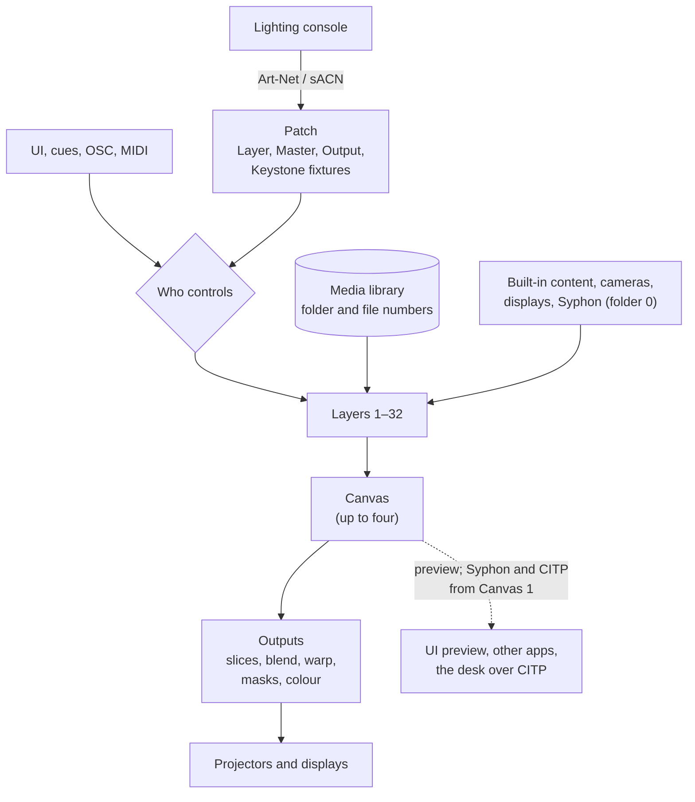

<!-- SPDX-License-Identifier: GPL-3.0-only -->
<!-- Copyright (c) 2026 Tim de Bruijn -->
<!-- Additional terms under GPLv3 §7 apply: see LICENSE-ADDITIONAL-TERMS.md -->

# How Fanous works

Fanous turns a Mac into a media server that your lighting console drives like
any other fixture. This page is the whole picture in one place; the other
pages of this guide go into each part.

## Two programs: the engine and the UI

`Fanous.app` holds two programs.

- **The engine** (`fanousd`) does all the work. It runs as a background
  service, so it starts at login and macOS restarts it after a crash, within
  about a second. It receives DMX, OSC, MIDI and timecode, plays the media,
  renders the picture to the projectors and displays, keeps the project, and
  serves the UI on port 8443.
- **The UI** is a web page served by the engine. The app window on the Mac
  shows it, and so does any browser on the network: an iPad next to the desk,
  a laptop at front of house. Every UI is a remote control. Close all of them
  and the show keeps playing.

Every connected UI shows the same live state: a change made on one shows on
the others at once.

## From console to projector

1. **The console sends DMX.** Fanous listens for Art-Net and sACN on the
   universes in its patch. Each video layer is a 64-channel fixture; the Master
   (8 channels) and one Output fixture per projector (8 channels) control the
   whole picture and each output; an optional Keystone fixture (16 channels)
   moves an output's corners. You patch them on the console from the generated
   GDTF file. See [console-setup.md](console-setup.md).
2. **Who controls decides which value counts.** Besides the console, values
   can come from the UI, from Fanous's own cue list, from OSC and from MIDI.
   The project's **Who controls** setting picks between console only, Fanous
   only, or both (latest change or highest value wins). The layer panel shows,
   per channel, where its value came from. See
   [Sources and merging](console-setup.md#sources-and-merging).
3. **A layer plays one piece of content.** Channels 3 and 4 pick it by number:
   folder and file in the media library (`001_Opening/002_intro.mov` is folder
   1, file 2), or folder 0 for content Fanous draws itself, the cameras and
   displays of this Mac and Syphon from other apps. The layer's other channels
   set how it plays (loop, once, bounce, timecode, speed, in and out points) and
   how it looks (intensity, position, scale, rotation, colour, blend mode, two
   effects, crop, dissolve). See [media-library.md](media-library.md).
4. **Layers stack into a canvas.** Layer 1 is at the bottom, each higher layer
   on top of it, with its blend mode. A new project has one canvas of
   1920 × 1080 at 60 fps; a show can use up to four, for example one for the
   projectors and one for an LED wall.
5. **Outputs cut the canvas up for the screens.** Each output is a display (or
   a region of one) that shows one or more slices of a canvas: blended at the
   edges where projectors overlap, warped to the surface (corner pin, mesh),
   masked, colour-matched. A projector wall sets up several outputs in one go.
   See [outputs-and-mapping.md](outputs-and-mapping.md).
6. **Fanous reports back.** The UI shows a live preview of a canvas, a layer
   or an output. A console that speaks CITP/MSEX gets the media list,
   thumbnails and a preview stream of Canvas 1; OSC can read values back; other
   apps on the Mac can take Canvas 1 over Syphon. See
   [show-control.md](show-control.md).

## The project

Everything you set up is one project per Mac: the patch and the number of
layers, Who controls, canvases, outputs, walls and mapping presets, the cue
list, timecode and MIDI settings. Fanous saves it two seconds after your last
change, and a change to the setup can be undone (Cmd-Z) and redone.

The engine also keeps **versions** of the project: one at every start and on
entering show mode (unless nothing changed since the last one), one every 10
minutes after a change, and named ones you save yourself before doors. Any of
them can be brought back from System › Project versions.

The media is not in the project. The project and the console only know folder
and file numbers, so the same show runs on a spare Mac whose library has the
same numbers. Role passwords and multi-server sync settings belong to the
machine, not the show, and live in its `settings.json`. Where each file is:
[getting-started.md](getting-started.md#where-files-live).

## Safe on show day

- **Show lock** (L, or the lock tag in the status bar) blocks every change to
  the setup while cues, show mode and the timecode switch keep working.
- **Show mode** runs the readiness checks first (power, heat, disk, universes,
  outputs, macOS settings that interrupt a show), then keeps the Mac awake,
  pauses transcoding and hides the cursor on the outputs. See
  [show-day-checklist.md](show-day-checklist.md).
- **Roles** (monitor, operator, programmer) with their own passwords decide
  what each UI may do. See
  [getting-started.md](getting-started.md#roles-and-passwords).
- **Several Macs** can play one picture in step, each its own part of it. See
  [multi-server.md](multi-server.md).

When something goes wrong, [troubleshooting.md](troubleshooting.md) starts
from what you see.
