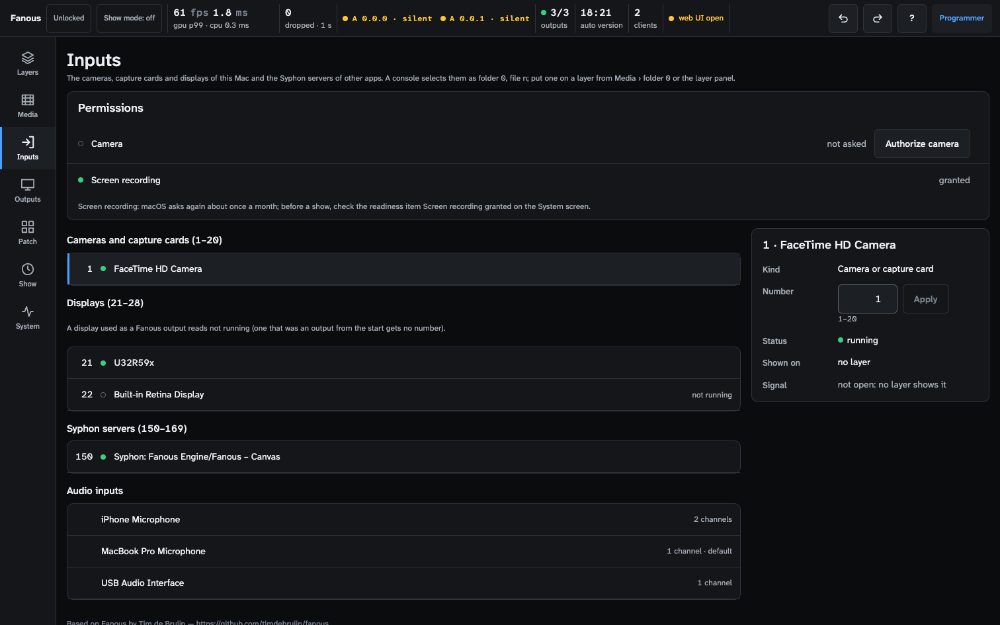
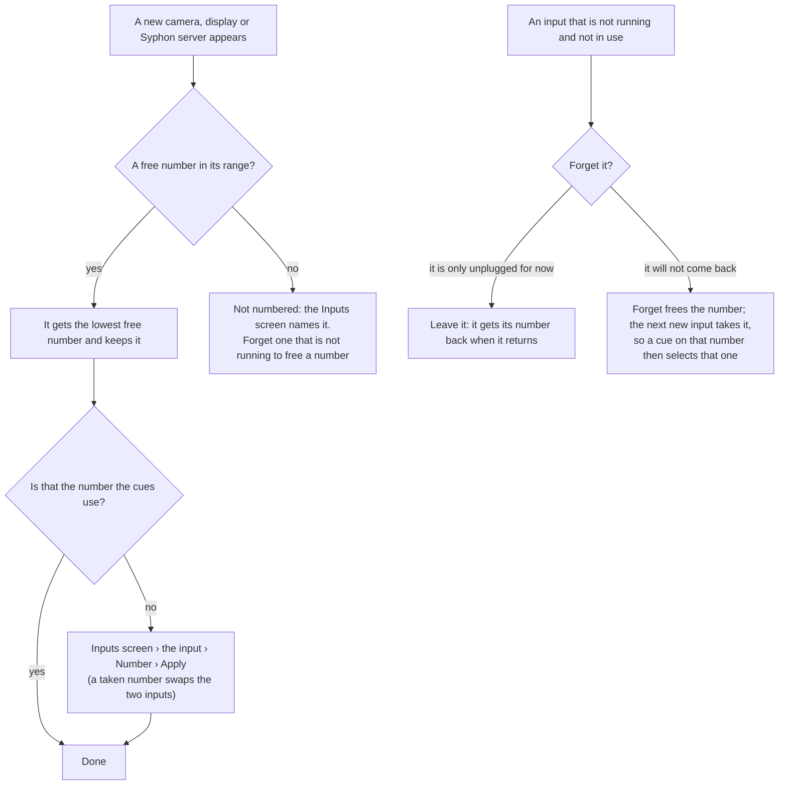
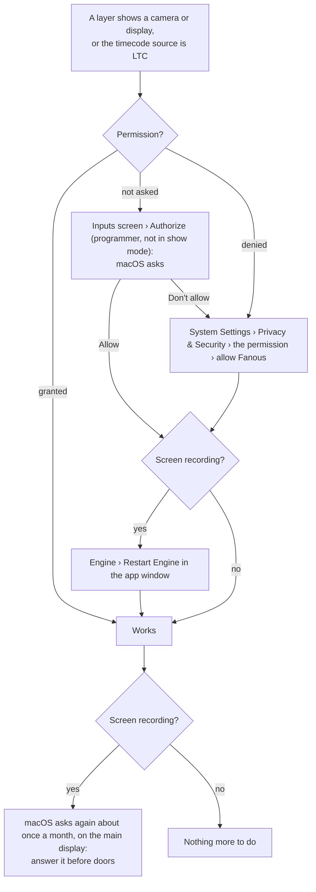
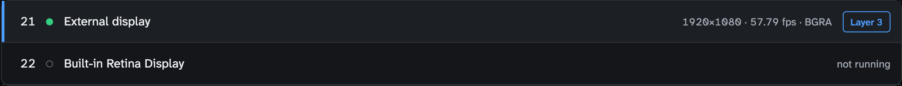
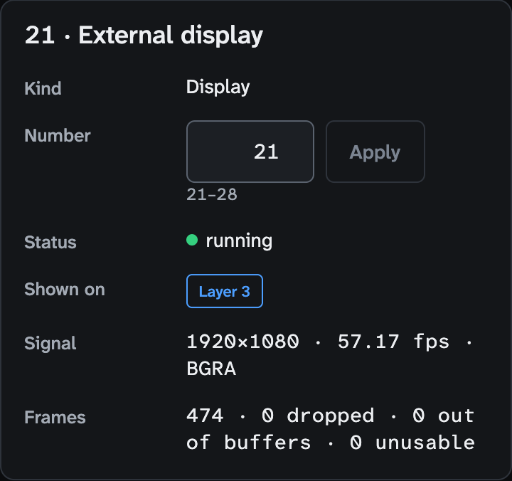

<!-- SPDX-License-Identifier: GPL-3.0-only -->
<!-- Copyright (c) 2026 Tim de Bruijn -->
<!-- Additional terms under GPLv3 §7 apply: see LICENSE-ADDITIONAL-TERMS.md -->

# Live inputs

Use this page to put a camera, a capture card, one of this Mac's displays
or another app's Syphon server on a layer, and to pick the audio input that
carries LTC: how they get their numbers, which permission each needs, what
arrives, and what to rely on for a show. Every control of the Inputs screen is in
[screens/inputs.md](screens/inputs.md); the content Fanous draws itself is
in [reference/built-in-content.md](reference/built-in-content.md). Terms are
in the [glossary](reference/glossary.md).

Authorize, Number, Forget and Use for timecode need the programmer role and
are refused while the show is locked; Authorize and Number (and their Undo)
are also refused in show mode. Putting an input on a layer from the UI is
refused while the show is locked.

## Slides from a laptop through a capture card

The common case, end to end. Any USB HDMI capture stick that works in
FaceTime or Zoom is a UVC device and appears as a camera.

1. Plug the card into the Mac and the laptop's HDMI into the card. On the
   laptop, set the output to the card's resolution and frame rate (1920 ×
   1080 at 60 or 50), as a second display, not mirrored, and switch its
   sleep and screen saver off.
2. Inputs screen: the card appears under **Cameras and capture cards** with
   the lowest free number. On a laptop the built-in camera is usually 1, so
   the card may be 2: read its number there, or give it the number the cues
   use with **Number** and **Apply**.
3. **Authorize camera** under Permissions, before show mode (it is refused
   in show mode).
4. Put it on a layer: Media screen › folder 0 › the card › **Play on layer**,
   or from the console folder 0 and the card's number. The Inputs row then
   shows the signal (`1920×1080 · 60 fps · 2vuy`): the card delivers what the
   laptop sends, and the layer's Fit mode places it in the canvas.
5. Test the cue. A card without a signal for 2 s reads "no signal" on the
   Layers screen and keeps its last frame, so a laptop that sleeps looks like
   a frozen slide: watch the row's state, not the picture.

## Numbers in folder 0

A live input is selected like a clip: folder 0 and a file number (Layer
channels 3 and 4, the plain numbers), from the console, from the layer
panel's **Built-in content and live inputs (folder 0)** list, or from the
Media screen's folder 0 with **Play on layer** (under Who controls Console
only a file put on a layer from the UI is kept but not shown). It goes
through the layer like media: position, scale, colour, effects and dissolves
apply.

| Range | Inputs | Numbered |
|---|---|---|
| 1–20 | Cameras and capture cards | The lowest free number when the engine first sees the device |
| 21–28 | This Mac's displays | The same way; a display that is one of Fanous's outputs is not captured |
| 29–32 | Reserved (windows of other apps, not available) | — |
| 150–169 | Syphon servers of other apps | The lowest free number when the engine first sees the server |

The numbers are kept in the project, also across an engine restart: a camera
you unplug keeps its number and gets it back when it returns; a USB card
moved to another port is found again by its model and name, but only when
exactly one gone card and one new card match (two identical cards both
re-plugged get new numbers); a Syphon server that stops gets its number back
when the same app publishes the same server name again. So a cue on number 1
means "the stage-left camera" whatever order the cameras were plugged in, as
long as you give the numbers once and check them on the Inputs screen after
a re-plug. With two identical cards, plug them in one at a time and number
each before the next.

Do not forget a camera before a show that is only unplugged for a moment:
its number goes to whichever input appears next. Renumbering onto a taken
number swaps the two inputs, which moves the other one's cues too; Apply is
the programmer's, refused in show mode and while the show is locked, and Undo
takes it back.

## A camera cue

A live input behaves differently from a clip when a cue selects it:

- The device is opened when a layer first selects it, so the first frames
  take a moment. Until the first frame arrives the layer keeps showing what
  it showed before (the previous clip, not black). To cut cleanly, select the
  input a few seconds early at intensity 0 and bring the intensity up in the
  cue.
- A card without a signal never delivers a frame: the layer keeps the
  previous picture, and reads "no signal" after 2 s. An unplugged camera
  reads "not running" and the layer is black.
- A selected input stays open while any layer shows it; set the layer to
  another file, or folder 0 file 0, to close it.

## Permissions

macOS asks once per permission, for "Fanous Engine" (listed as "Fanous"
under System Settings › Privacy & Security). Each prompt appears the first
time a feature needs it, so press the **Authorize** buttons on the Inputs
screen before the show and before show mode, which refuses them; a prompt
nobody answers on show night leaves that input black. After Allow the row
reads **granted** with a green dot.

| Permission | Needed for | Where it fails | What to do |
|---|---|---|---|
| **Camera** | cameras and capture cards (1–20) | the layer stays black | **Authorize camera** on the Inputs screen; if denied, allow Fanous under Privacy & Security › Camera |
| **Screen recording** | displays (21–28) | the layer reads "screen permission not granted" and stays black | **Authorize screen**: macOS opens Privacy & Security › Screen & System Audio Recording; allow Fanous, then Engine › **Restart Engine** (macOS applies the grant only to a new engine process; the outputs go black for a moment) |
| **Microphone** | LTC timecode on an audio input | the Timecode panel shows an error and never locks | **Authorize microphone**, or Privacy & Security › Microphone |

Three readiness items look only at inputs in use: **Camera permission
granted** fails while a layer shows a camera without the permission,
**Screen recording granted** fails while a layer shows a display without it
(and warns with it, because of the monthly dialog), **Microphone permission
granted** fails while the timecode source is LTC without it, whatever the
timecode switch says. A failed item blocks show mode until a programmer
acknowledges it ([show-day-checklist.md](show-day-checklist.md#the-readiness-list)).

## Cameras and capture cards (1–20)

Listed are the built-in camera, an iPhone over Continuity Camera, and UVC
capture cards and webcams (Elgato Cam Link 4K and Magewell USB Capture, and
any USB HDMI stick that works in FaceTime, appear as cameras). Blackmagic
DeckLink and AJA cards are not supported.

What arrives: the device is opened only while a layer shows it (opening a
camera just to look could take it from another app), at the canvas frame
rate when the device offers it, else at the device's own rate. A built-in or
Continuity camera is asked for the largest size that fits the canvas; a
capture card or webcam delivers the size of its input, so a card follows
whatever is plugged into it. 8-bit 2vuy, yuvs and 420v frames (420f is
asked for as 420v) are taken as they are; anything else (MJPEG, 10-bit v210)
is decoded to 8-bit first. Any capture input without a frame for 2 s reads
"no signal" on the Layers screen and keeps its last frame. A camera another
app has open (an iPhone in FaceTime) reads "in use by another app" with a
yellow dot. The Inputs screen shows, per input, its signal (size,
rate and pixel format) and the frame counters: delivered, dropped (by the
device, macOS or for want of a free buffer; the out-of-buffers count is
shown apart as well), and refused because of their format.

Not yet: a UVC webcam such as a Logitech C920 may stay at its driver's
default format and look like 640 × 480 on a larger canvas; a capture card
that follows its input is not affected
([known limitations](reference/known-limitations.md#media-and-inputs)).

## Displays (21–28)

A display layer shows one of this Mac's whole displays as it is: without the
pointer, without sound, without the engine's own output windows (the app
window is captured), in 8-bit sRGB, at most at the canvas rate and only
when the picture changes, so the rate on the Layers screen is the rate of
the last changed frames and a still slide keeps the last rate shown; a
display never reads "no signal". A display larger than the
canvas is scaled down to fit it. A display that Fanous uses as an output
reads "not running" and is not captured (it would only show black); one that
was an output from the engine's start is not numbered at all.

For a show-critical slides feed, prefer a capture card ([above](#slides-from-a-laptop-through-a-capture-card)):
it needs no Screen recording permission and is never re-asked.

## Syphon servers (150–169)

Other apps on the same Mac that publish video over Syphon are listed with
their app and server name, a green dot while the server runs and a grey ring
when it has gone. A server that quits goes grey at once; one that crashes,
within about two announce intervals (about 11 s). A layer on a server that has gone keeps its last
picture and reads "Syphon: App/Server · not running"; when the server comes
back the picture returns without selecting it again. Selecting a server that
is not running shows black until it starts. After an engine restart a server
that has not answered yet is listed grey, "not seen since the engine
started". Two servers with the same app and server name (two Fanous canvases
on one Mac) keep their numbers, as Fanous cannot tell them apart. Fanous's own
canvas is not listed; it is published to other apps as "Fanous – Canvas"
([outputs-and-mapping.md](outputs-and-mapping.md#the-canvas-for-other-apps)).

## Audio inputs and LTC

The Inputs screen lists every audio interface and microphone of this Mac
with its channel count. They have no folder 0 number: a layer cannot show
them. One of them carries LTC timecode: select it, pick the channel (1 is
the first) and press **Use for timecode**, which sets the timecode source,
device and channel in one step; the panel then shows the timecode state and
a level meter of that channel ([show-control.md](show-control.md#timecode)).

## On show day

- Give every input its number and test every cue that selects one, with the
  show's media loaded, then run the readiness list: a permission that is
  missing shows there. Authorize before show mode.
- On a backup Mac the permissions must be granted again (Screen recording
  with an engine restart), the library root set under System › Machine, and
  the input numbers checked: a project carries the numbers, not the devices.
- A camera that moves to another port is matched by model and name when only
  one gone device matches; check the number on the Inputs screen after a
  re-plug.
- The monthly Screen recording dialog lands on the main display; with an
  unattended rig that display may be an output.
- Capture cards and cameras add their own delay to the picture; measure it
  with the test card on the source if a cue must land on a beat.
