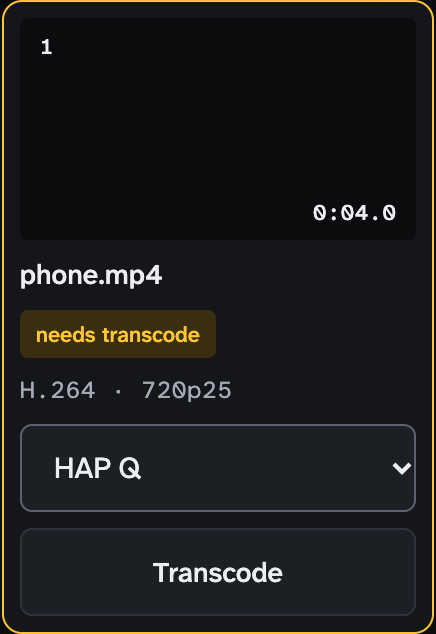
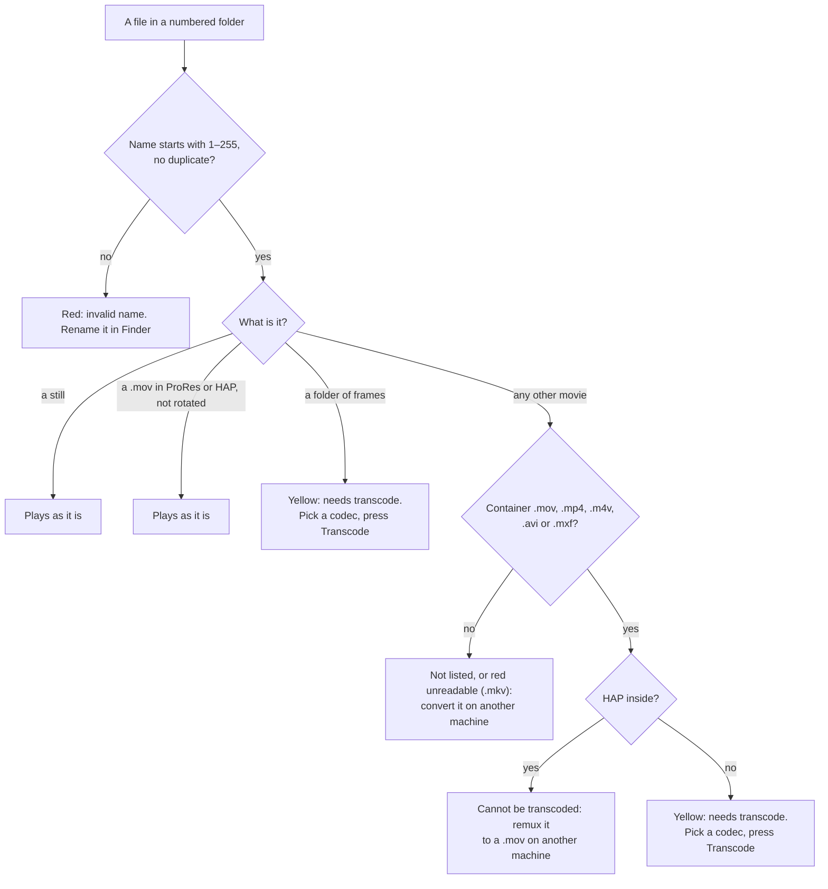
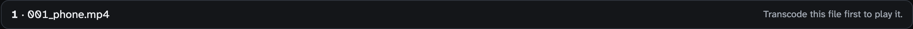
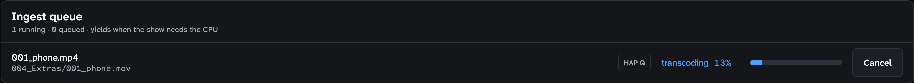
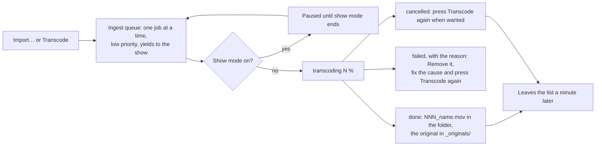
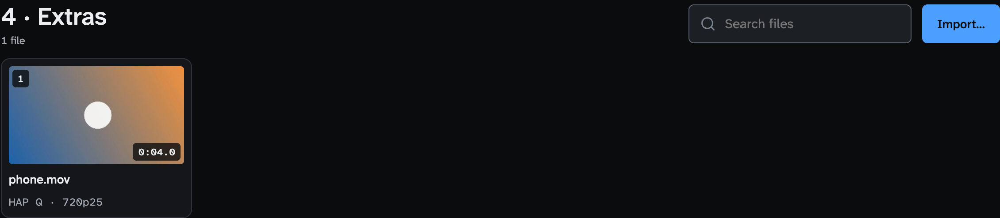
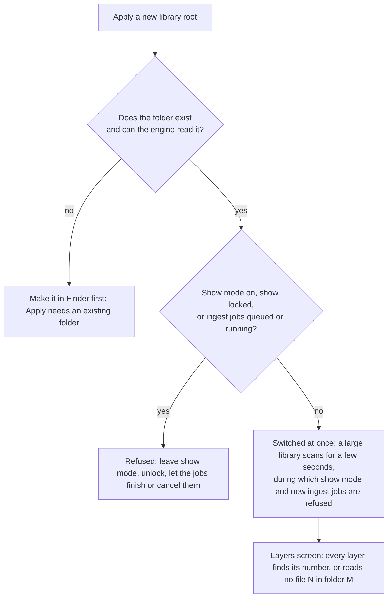

<!-- SPDX-License-Identifier: GPL-3.0-only -->
<!-- Copyright (c) 2026 Tim de Bruijn -->
<!-- Additional terms under GPLv3 §7 apply: see LICENSE-ADDITIONAL-TERMS.md -->

# Media library

Use this page to get a show's content into Fanous and onto a layer: how the
library and its numbers work, which files play as they are, how a file gets
in and what a transcode changes, the library on a second Mac, and what a Mac
can play. Every control of the Media screen is in
[Media screen](screens/media.md); cameras, displays and Syphon are in
[Live inputs](live-inputs.md); the content Fanous draws itself is in
[Built-in content](reference/built-in-content.md). Terms are in
the [glossary](reference/glossary.md).

Creating folders, importing and transcoding need the programmer role; the
show lock does not stop them. Putting a file on a layer from the UI and
changing the library root are refused while the show is locked.

## The library and its numbers

The library is a folder on the Mac's own disk: `~/Movies/Fanous Library`
unless you change it. The console picks media by two numbers, folder and
file (Layer channels 3 and 4, sent as plain values, 1 to 255); the project
and the cue list store those numbers, never paths or names, so a show runs
on any Mac whose library has the same numbers.

```
Fanous Library/
├── 001_Opening/
│   ├── 001_intro_loop.mov
│   ├── 002_title.png
│   ├── 005_Flames/                 an image sequence: flames_0001.png, flames_0002.png, …
│   └── _originals/002_title.psd    ignored
├── 012_Show/
│   └── 004_intro_loop.mov
└── _incoming/                      uploads on their way in
```

| Rule | Detail |
|---|---|
| The number | The first one to three digits of the folder or file name, 1 to 255. Anything may follow: `001_Name`, `12-Show`, `7 intro.mov` |
| Invalid names | No digits in front, 0, above 255, four or more digits, or a duplicate number in the same folder (the name that sorts first keeps the number). Such items are listed with a red **invalid name** badge and the reason, and cannot be reached from the console: rename them in Finder. Every file in a folder with an invalid number is invalid with it |
| Unreadable | A file macOS cannot open at all (a Matroska `.mkv`, a damaged file, a sub-folder that is no image sequence) shows a red **unreadable** badge with the reason and no Transcode button: convert it on another machine |
| Ignored | Folders and files whose names start with `_` or `.`, and files that are not media |
| Watched | A change in Finder shows up within a moment; **Rescan** on the Media screen forces it |
| Folder 0 | Not on disk: built-in content and live inputs ([Built-in content](reference/built-in-content.md)) |

A layer that points at a number that does not exist, or at a file that is
not playable, reads "no file N in folder M" in red on the Layers screen.


## Build the library for a show

1. **Agree the numbers** with whoever programs the console: a list of folder
   and file numbers per cue, before anything is copied. The numbers are what
   the cues store.
2. **Make the folders** on the Media screen with **New folder** (number and
   name), or in Finder. The library folder opens in Finder with Go › Go to
   Folder and `~/Movies/Fanous Library`.
3. **Copy the files in with Finder**, each renamed with its number in front:
   `003_logo.png`, `012_walk-in.mov`. An image sequence goes in as a
   numbered folder of frames (below). The only files you upload with
   **Import…** instead are the ones that need a transcode anyway and sit on
   another computer.
4. **Read the tiles** on the Media screen: no badge means the file plays;
   yellow **needs transcode** means pick a codec and press **Transcode**;
   red **invalid name** means rename it in Finder.
5. **Test every file on a layer**: select the tile, **Play on layer**, and
   look at the Layers screen (the row reads the file with a green dot). From
   the console the same file is folder and file on channels 3 and 4, with
   the fixture's home values loaded
   ([Console setup](console-setup.md#channels-that-bite)). A cue that
   sends the same folder and file again does not restart the clip; that is
   Retrigger (channel 50). A change of file starts at the in point.
6. **Before the show**: no yellow badges left (a layer on such a file reads
   "no file N in folder M" and fails the readiness item **No decoder
   errors**; a tile no layer uses is not checked), the library on the
   internal disk with more than 10 % free, no transcode running.

| You have | Do |
|---|---|
| A `.mov` in ProRes or HAP from an editor or a media team | Copy it in with Finder; it plays as it is. Do not Import it: Import re-encodes it |
| A phone `.mp4` or `.mov`, a web download, anything H.264 or HEVC, a rotated ProRes `.mov` | Copy it in, then **Transcode** on its tile; or **Import…** it from any computer |
| A still (PNG, JPEG, TIFF, HEIF, GIF, BMP, WebP, EXR) | Copy it in; it plays as it is |
| A folder of numbered frames | Copy the folder in as `NNN_name/`; the frames inside need no numbers; then **Transcode** it (25 fps from the tile). Pick ProRes when the frames are not a multiple of 4 wide and high: HAP refuses such a sequence |
| A HAP file in another container than `.mov` | It cannot be transcoded (macOS cannot decode HAP): remux it to a `.mov` on another machine, then copy it in |

## What plays as it is

Fanous plays two codec families directly, both **all-intra** (every frame
stored whole, so the player can jump, scrub, reverse and chase timecode):

| Plays as it is | Notes |
|---|---|
| **ProRes** 422 Proxy, LT, 422, 422 HQ, 4444, 4444 XQ, in a `.mov` | Decoded by the chip's ProRes engine, which is why the base M1 is not supported. A few very small frame sizes (64 × 48, 256 × 64) fall back to the software decoder, which the log notes. 4444 carries alpha |
| **HAP**, HAP Alpha, HAP Q, HAP Q Alpha, HAP Alpha-only, HAP R, in a `.mov` | Unpacked on the CPU, read by the GPU as texture blocks; files several times the size of ProRes |
| **Stills**: PNG, JPEG, TIFF, HEIF, GIF (first frame), BMP, WebP, EXR | Loaded once; 16-bit images become 8-bit |

Everything else shows a yellow **needs transcode** badge and cannot be put
on a layer until it is transcoded: H.264, HEVC and every other codec, also
in a `.mov`; a ProRes or HAP file in another container (`.mp4`, `.m4v`,
`.avi`, `.mxf`); phone footage with a rotation flag; and image sequences.
Long-GOP codecs such as H.264 are refused on purpose: they cannot scrub, run
in reverse or chase timecode reliably. A `.mkv` is listed but macOS cannot
open it, so it reads red **unreadable**; a container Fanous does not list
(`.webm`, `.mpg`, `.wmv`) is not listed at all. Convert both on another
machine. A file that needs a transcode has no thumbnail: its tile is black.





**What to ask a content maker for.** ProRes 422 HQ in a `.mov`, ProRes 4444
when it needs transparency, or HAP Q; the canvas size and frame rate
(1920 × 1080 at 60 fps unless you change them on the Outputs screen's
Canvases tab, [Outputs and mapping](outputs-and-mapping.md#canvas-size-and-frame-rate));
square pixels; Rec.709; 8-bit. Audio as stereo.

## Getting files in

| Way | When | What happens |
|---|---|---|
| **Copy in Finder** into the numbered folder, named `NNN_name.ext` | Anything that plays as it is, and anything you will transcode on the Mac | It is listed within a moment and plays as soon as the engine has probed it |
| **Import…** on the Media screen (programmer) | A file that needs a transcode and sits on another computer | The file is uploaded to `_incoming/`, re-encoded and placed in the folder with the lowest free number (a gap is filled first; any numbered file counts, media or not) and the name `NNN_<original name without its leading digits>`; the temporary copy is removed. Check the number it got when a cue depends on it |

Import re-encodes **every** movie, ProRes included, to ProRes 422 HQ (ProRes
4444 when the source has alpha), so a playable ProRes file gains a
generation of loss and a bigger file: copy it in instead. A still is copied
as it is. One file uploads at a time; the list under the toolbar shows each
as waiting, uploading, queued or failed. A HAP file cannot be imported (macOS
cannot decode it).



## Transcoding

On a **needs transcode** tile pick the codec and press **Transcode**; the
button reads "Queued" while the job waits. The result is `NNN_name.mov`
with the same number, and the original moves to `_originals/` in the folder.

| Codec | Pick it for |
|---|---|
| **HAP Q** (the default) | Most clips: light to play, good quality, large files. Every HAP needs a width and height that are multiples of 4 (854 × 480 and 1366 × 768 are refused): pick ProRes for those |
| **HAP** | Lighter still, lower quality |
| **HAP Alpha** | A clip with transparency, HAP-style |
| **ProRes 422 HQ** | Most clips when disk space matters more than CPU, and any size; what Import uses |
| **ProRes 4444** | A clip with transparency at full quality |

A movie with alpha is promoted to ProRes 4444 or HAP Alpha whatever you
pick; HAP Q Alpha cannot be written. For phone clips at 1080p either HAP Q
or ProRes 422 HQ plays fine; audio survives in both.





A HAP Q transcode of 1080p runs at about 11 frames a second on the M1 Pro,
so a 25 fps clip takes about two and a half times its length; ProRes at
1080p is not measured. The queue survives an engine restart; a job that was running starts over. Jobs can be
queued in show mode, but they wait until it ends. The status bar shows the
running job's progress; do it before the show.



### What a transcode or import changes

| Source | Result |
|---|---|
| Phone footage with a rotation flag (portrait) | Upright: the quarter turn or flip is applied to the pixels exactly, width and height swap, alpha and pixel aspect come along |
| A rotation that is not a quarter turn or flip | Rendered through a composition, which loses alpha and writes the display size with square pixels |
| Anamorphic (non-square pixels, 1440 × 1080 shown as 16:9) | The pixel aspect ratio is kept; the layer draws the file at its display width and the tile shows that width (`1920×1080p25`) |
| Variable frame rate (a screen recording, some phone footage) | Written at a constant rate, the source's fastest frame interval up to 60 fps; one short frame in the source can double the output rate. A constant-rate source keeps its rate, also above 60 |
| Rec.601 colour (SD, some cameras) | Converted to Rec.709, which is what Fanous plays; a 601 file played without a transcode is taken as 709 and looks slightly off |
| 10-bit ProRes | Kept at full precision in ProRes (not on the odd-rotation path, which is 8-bit); HAP is 8-bit |
| Audio | Channels and layout as in the source; compressed audio (AAC) becomes 24-bit LPCM, so the file grows; the sample rate is kept within 8 to 192 kHz |
| An image sequence | A movie in the codec you pick (HAP Q by default, no alpha promotion: pick ProRes 4444 or HAP Alpha for transparency; ProRes when the frames are not a multiple of 4 wide and high), at 25 fps |

## Image sequences

Put a folder of images inside a numbered folder and number the folder like a
file: `001_Opening/005_Flames/` with `flames_0001.png`, `flames_0002.png`, …
The frames themselves need no numbers; at least two, all the same size,
played in name order. The tile reads "N frames" and **needs transcode**.
From the tile the movie is written at 25 fps; another rate needs the
engine's command line on the Mac:

```bash
/Applications/Fanous.app/Contents/MacOS/fanousd ingest ~/Movies/Fanous\ Library/001_Opening/005_Flames ~/Movies/Fanous\ Library/001_Opening/005_flames.mov --fps 30 --codec prores4444
```

Then move the frame folder out of the library (or into `_originals/`), so
the number is not a duplicate.

## Thumbnails and probing

The engine reads each new file once (codec, size, frame rate, duration,
alpha, audio), makes a thumbnail (a playable movie's middle frame, 320
pixels wide; a still's longest side at 320; a sequence's first frame; none
for a file that needs a transcode) and caches both under
`~/Library/Application Support/Fanous/cache/`. A tile reads "probing…" until
then, and a layer pointing at the file shows "no file" until the probe is
done. The same thumbnails go to a console over CITP and stand in on the
Layers screen for a layer that shows nothing. A file that changes, moves or
is renamed is probed again.

## Audio

A movie's audio plays on the Mac's default output device in one stereo mix
with every other layer: no device choice, no routing. Per layer, the Audio
volume channel (48, 0 by default, so a clip is silent until the console or a
cue raises it) and Audio pan (49) apply, and a dissolve crossfades the sound
with the picture; the layer's intensity does not change the volume. A file
with more than two channels and a known layout (5.1, 7.1) is folded to stereo
by Apple's matrix for that layout; a file with a discrete or unknown layout
plays its first two channels. There is no limiter: a loud fold-down can clip
at the device. A layer has sound only while it plays forward at 100 % (layer
speed × Master speed, within half a percent); Freeze, Scrub, Timecode and the
reverse half of Bounce are silent, so sound never follows chased timecode
([Console setup](console-setup.md#channels-that-bite)).

## The library on a second Mac

Copy the folders so every file the show uses has the same folder and file
number on both Macs; the names after the number may differ. The project does
not carry the media. For two Macs that play in step see
[Multi-server sync](multi-server.md).

## Change the library root

System › Machine › Library: type the path of another folder (`~` stands for
your home folder) and press **Apply**. The engine stops watching the old
folder, indexes the new one, and every layer looks its numbers up there at
once; a number that does not exist there reads "no file N in folder M", and
the outputs keep running. Metadata and thumbnails are cached per file, so a
library used before needs no new probing.



Undo and redo work on the root like on any other setting. The monitor role
does not see the path.

## What a Mac can play

All numbers are from the reference MacBook Pro M1 Pro (32 GB), release
build. "Headless" is the engine's own clock with no display; "display" is a
real output. Pass means no missed or late frame and no texture miss in a
10 or 20 s window. The 2026-10-23 runs were idle (macOS 27.0.1); the
2026-11-03 runs were on a 4K display with other work on the Mac (load 5 to
24, macOS 27.2), so they say what a busy Mac manages, not a show Mac.

| Content | Result |
|---|---|
| 16 layers of 1080p60 ProRes 422 HQ | Pass headless (GPU p99 3.9 ms); on the display one texture miss in 1212 frames (2026-10-23); pass under load on the 4K display (2026-11-03) |
| 16 layers of 1080p60 HAP Q | Pass headless and on the display (2026-10-23) |
| 16 layers of 4K30 ProRes 422 HQ | Pass headless (GPU p99 13.3 ms, 2026-10-23); no display run |
| 4K60 ProRes 422 HQ | 3 to 7 layers headless depending on the run, with single texture misses that did not reproduce later (2026-10-23, 2026-11-02); 4 layers pass on the 4K display under load, 7 showed late GPU frames (2026-11-03). Treat 4 as the safe number |
| 4K30 HAP Q | 16 layers headless with the default read-ahead of 8 frames (2026-10-23) |
| 4K60 HAP Q | At least 4 layers headless (2026-10-23); 8 fail on GPU time under load (2026-11-03) |
| Blur and Edge on every layer at 1080p60 | 3 ProRes layers pass, 4 fail; 2 HAP Q layers pass, 3 fail (headless, 2026-10-23, before the blur change of 2026-11-03 that cut the cost of Blur alone by about half) |
| A dissolve (Dissolve channel) | Uses a second decoder: counts as one more layer. 8 layers in permanent 2 s dissolves at 1080p60 pass (2026-10-23) |

Rules of thumb:

- Use ProRes or HAP at the canvas size and frame rate. Larger content costs
  decode time and is scaled anyway.
- Keep the library on the internal disk with more than 10 % free, and switch
  Spotlight off for that volume ([Show-day checklist](show-day-checklist.md)).
  A network or removable volume fails the readiness item **Library on a local
  volume**.
- Watch **dropped** in the status bar and the GPU p99 tile under System ›
  Live metrics while you build the show
  ([System screen](screens/system.md#live-metrics)).
- Which chip the Mac has: Apple menu › About This Mac. A base M2 or M3 has
  fewer decoders than a Pro or Max chip, the base M1 has no ProRes engine and
  is not supported, and the numbers above are the M1 Pro's. The layer limit
  of 32 is the engine's, not a measurement.

Not there yet: no text layer, HAP cannot be imported, 16-bit stills become
8-bit, one stereo mix, and the other library
items in [Known limitations](reference/known-limitations.md#media-and-inputs).
