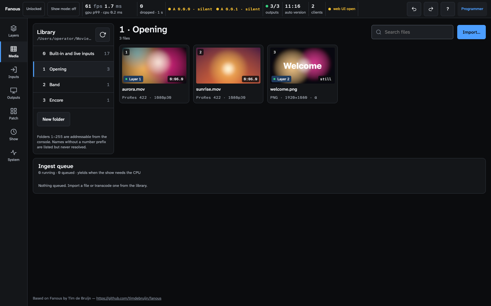

<!-- SPDX-License-Identifier: GPL-3.0-only -->
<!-- Copyright (c) 2026 Tim de Bruijn -->
<!-- Additional terms under GPLv3 §7 apply: see LICENSE-ADDITIONAL-TERMS.md -->

# Media library

The library is a folder on the Mac, `~/Movies/Fanous Library` unless you
choose another one (see "Change the library root" below). The console
picks media by number: channel 3 (Folder) and channel 4 (File) of a Layer. Show
files store those numbers, never paths, so a library on another Mac works as
long as the numbers match.

Use a folder on a local disk. Network volumes are not supported.



The Media screen (key 2) lists the folders on the left, with folder 0 for
built-in content and live inputs first and the number of files after each name.
The selected folder's files are tiles: the file number, a thumbnail, the
duration (or "still"), the codec and size, and a **Layer N** badge for every
layer that plays it. **Search files** filters the tiles by name. Select a tile
to get **Play on layer**, which puts that file on a layer from here (with the
same Who controls rules as the layer panel). The ingest queue is at the bottom.

## Folder and file names

```
Fanous Library/
├── 001_Opening/
│   ├── 001_intro_loop.mov
│   ├── 002_title.png
│   └── _originals/002_title.psd     ignored
├── 012_Show/
│   └── 004_intro_loop.mov
└── _incoming/                       uploads on their way in
```

- The folder number is the first one to three digits of the folder name; the
  file number is the first one to three digits of the file name. Both must be
  **1 to 255**. Anything that is not a digit may follow (`001_Name`, `12-Show`,
  `7 intro.mov`). 0 means "none" on the console.
- Folders and files whose names start with `_` or `.` are ignored. Files that
  are not media are ignored.
- These are **invalid** and can never be reached from DMX: no number prefix,
  number 0 or above 255, four or more digits, and duplicates (when two
  names carry the same number, the one that sorts first alphabetically keeps it).

The Media screen (key 2) shows invalid items in red: a folder row gets an
"N invalid" badge, a file tile gets an "invalid name" badge with the reason
("no 1-255 prefix", "duplicate file number 4", "folder: duplicate folder number
3"), and the header counts "N invalid name". An invalid folder has no number in
the list. The library is watched, so a rename in Finder shows up after a moment;
**Rescan** (the circular arrow) forces it.

A layer that points at a number that does not exist, or at a file that is not
playable, shows the red message "no file N in folder M" on the Layers screen.

The first row of the folder list, **0 · Built-in and live inputs**, is folder
0: the content the engine draws itself, the cameras, capture cards and
displays of this Mac and the Syphon servers of other apps, each with the file
number a console dials (see
[show-control.md](show-control.md#built-in-content-folder-0)).
Select an item and use **Play on layer** to put it on a layer from here. For a
camera, display or Syphon server, **Status on Inputs** opens it on the Inputs
screen.


## The Inputs screen (key 3)

The Inputs screen lists the live inputs of folder 0 by kind: **Cameras and
capture cards (1–20)**, **Displays (21–28)** and **Syphon servers
(150–169)**. A green dot means it runs; a yellow dot with "in use by another
app" means another app has the camera open (an iPhone in FaceTime). A
**Layer N** badge says which layers show it, and while a layer shows a camera
or display the row says what arrives: size, rate and pixel format ("1920×1080 ·
59.94 fps · 2vuy"), or "no signal". A Syphon server on a layer reads
"connected" (Fanous reads no size or rate from it). Select an input for its details on the right: kind,
model, status, the layers that show it, and its signal and frame counters
(frames, dropped, out of buffers, unusable). An input is opened only while a
layer shows it, so one that no layer shows reads "not open: no layer shows
it": opening a camera just to look could take it from another app.


A camera, capture card, display or Syphon server keeps its number, also across
engine restarts, until you forget it: select one that is not running and press
**Forget**. With more than one that is not running, **Forget all not
running** above the Syphon list, or **Forget all not running (cameras and
displays)** above the cameras (it frees both), does them all at once. Its
number is then free for the next new one; **Undo** brings it back.

To give an input another number, type it under **Number** in the panel and
press **Apply**: a free number moves the input there, a taken one swaps the
two. Layers and consoles select by number, so a layer or cue on that number
shows the other input from then on: put the stage-left camera on 1 and a cue
on 1 means that camera, whatever order the cameras were plugged in. A camera
or capture card stays within 1–20, a display within 21–28, a Syphon server
within 150–169. **Undo** takes it back. Not in show mode and not while the
show is locked. Two Syphon servers with the same app and name (two Fanous
canvases) keep their numbers, as Fanous cannot tell them apart; the other
servers can still be renumbered.

**Permissions** at the top of the screen list the camera and screen recording
permissions while this Mac has a camera or a display to number. A dot is
yellow while a layer shows an input that lacks its permission, grey while none
does.

**Cameras and capture cards (1–20)** need the camera permission: press
**Authorize camera** under Permissions (not in show mode). If you denied it
once, allow Fanous under System Settings › Privacy & Security › Camera.

**Displays (21–28)** are whole displays of this Mac: what the display shows,
without the mouse pointer and without sound, at most at the canvas rate. A
display larger than the canvas is scaled down to fit it (aspect kept); colours
come through as the display shows them. A display never reads "no signal", and
the rate on the Layers screen is the rate of changed frames: macOS sends a
frame only when the picture changes. A display that Fanous uses as an output
reads "not running" (one that was an output from the start gets no number):
Fanous leaves its own windows out of a capture, so it would be black.

The first time, displays need the Screen permission: press **Authorize screen**
under Permissions on the Inputs screen (not in show mode). macOS opens
System Settings; allow Fanous under Privacy & Security › Screen & System
Audio Recording, then choose Engine › **Restart Engine** (macOS applies the
grant only to a new engine process; outputs go black for a moment). The row
then says "granted".

macOS asks again about once a month whether Fanous may keep recording
the screen, with a dialog on the main display that nobody answers during an
unattended show. Before a show, check the readiness item **Screen recording
granted** on the System screen. For a show-critical slides feed, prefer a
capture card: a second Mac's HDMI into a capture card needs no Screen
permission and is not re-asked.

**Audio inputs** are listed under the video inputs: every audio interface and
microphone of this Mac with its number of input channels; "default" marks the
system's default input. They have no folder 0 number: a layer does not show
them. One is used for LTC timecode: its row says "Timecode (LTC, channel N)".
Select an input, pick a channel and press **Use for timecode** to read LTC
from it; the panel then shows the timecode state, the time, the rate and a
level meter of that channel (see
[show-control.md](show-control.md#timecode)). While timecode is on LTC,
Permissions also lists **Microphone (LTC)**, which LTC needs.

## Create a folder

On the Media screen press **New folder**, type a number (the first free one is
filled in; 1 to 255) and a name, then **Create**. The engine makes
`NNN_name` under the library root (and the root itself if it is missing). You can
also make folders in Finder. Creating folders is for the programmer role. If the
screen says "The library root does not exist", create a folder this way or make
`~/Movies/Fanous Library` yourself.

## Change the library root

On the System screen (Machine › Library) type the path of another folder and
press **Apply**. `~` stands for your home folder. The change takes effect at
once: the engine stops watching the old folder, indexes the new one and every
layer looks up its folder and file number again in the new library. A layer
whose number does not exist there shows "no file N in folder M"; the outputs
keep running. A file the engine has not seen before shows that message until it
has been probed (a moment per file), then it plays. While the switch runs (the
scan of a large library can take a few seconds), entering show mode and adding
ingest jobs are refused; try again a moment later. Metadata and thumbnails are cached per file, so switching back to
a library that was used before needs no new probing.

- The folder must already exist and be readable; the engine does not create it
  or any numbered folders in it. Make it in Finder first, then create numbered
  folders with **New folder** on the Media screen.
- The change is refused in show mode, under show lock, and while ingest jobs
  are queued or running (they write into the old library): let them finish or
  cancel them first.
- Changing the root is for the programmer role. The monitor role never sees the
  path.
- Undo and redo work on the root like on any other setting.

## Formats

| Plays directly ("native") | Notes |
|---|---|
| ProRes 422 Proxy, LT, 422, 422 HQ; ProRes 4444 and 4444 XQ (alpha) | in a `.mov`; decoded by the Mac's ProRes engine |
| HAP, HAP Alpha, HAP Q, HAP Q Alpha, HAP Alpha-only, HAP R | in a `.mov`; decoded on the CPU |
| Stills: PNG, JPEG, TIFF, HEIF, GIF, BMP, WebP, EXR | loaded once; 16-bit images become 8-bit (B10); a GIF shows its first frame |

Everything else (H.264, HEVC, `.mp4`, `.avi`, `.mkv`, `.mxf` and other codecs)
is listed with a **needs transcode** badge and cannot be played until it is
transcoded. Long-GOP video is refused on purpose: it cannot scrub, run in
reverse or chase timecode reliably. The hardware decoder refuses some small
ProRes frame sizes (64x48 and 256x64, for example; no rule by width, height or
area); such a file opens on the software decoder instead, and the log says
"software ProRes decoder" (B5).

Audio in a movie is played on the Mac's default output device, with the Layer's
Audio volume and Audio pan channels (48 and 49). There is no device choice yet
(B4).

### Image sequences

Put a **folder** of images inside a numbered folder and number it like a file
(`001_Opening/005_Flames/` with `flames_0001.png`, `flames_0002.png`, ...). It
needs at least two images of the same size; they play in name order. It is
listed as "needs transcode" with a frame count. Transcode turns it into a
movie; the Media screen uses 25 frames per second. Choose ProRes 4444 or HAP
Alpha if the images have alpha.

## Import from the browser

Select a numbered folder, press **Import…** and pick one or more files. The
upload is streamed to `_incoming/` and queued; the list under the toolbar shows
each file as waiting, uploading, queued or failed; **Clear** empties the list
when the uploads are done. Only the programmer role can import.

- Every uploaded movie goes through the ingest queue and is re-encoded: ProRes
  422 HQ, or ProRes 4444 if the source has alpha. Stills are copied.
- The file gets the next free number in that folder and the name
  `NNN_<original name without leading digits>`; the temporary copy in
  `_incoming/` is deleted afterwards.
- **HAP files cannot be imported or transcoded** (the macOS decoder cannot read
  them; B20). Copy HAP files into the folder with Finder under the right name.
- Phone footage with a rotation flag (portrait video) is imported upright: the
  quarter turn or flip is applied to the pixels exactly (no resampling), a
  quarter turn swaps width and height, and alpha and the pixel aspect ratio
  come along. Only an odd transform (not a quarter turn or flip) is rendered by
  a composition, which loses alpha and draws the display size with square
  pixels.
- Anamorphic sources (non-square pixels, such as 1440x1080 shown as 16:9) keep
  their pixel aspect ratio: the file is tagged and the layer draws it at its
  display width. The thumbnail has the display shape and the label shows the
  shown size with the rate ("1920×1080p25"); square-pixel movies keep "1080p25".
- A variable-frame-rate source (a screen recording, some phone footage) is
  written at a constant rate, its fastest rate up to 60 fps: each output frame
  shows the source frame that was current at that moment, so the picture
  keeps its timing against the audio. A constant-rate source comes out frame
  for frame.

## Transcode a file that is already in the library

On a "needs transcode" tile choose the codec and press **Transcode** (the
button says "Queued" while the job waits). The choices are HAP Q (the default),
HAP, HAP Alpha, ProRes 422 HQ and ProRes 4444. The result is `NNN_name.mov` with
the same number, and the original is moved to `_originals/` in that folder.
Sources with alpha are promoted to ProRes 4444 or HAP Alpha; HAP Q Alpha cannot
be written (B16).

## The ingest queue

The panel at the bottom of the Media screen shows "N running · N queued". Each
job shows source, destination, codec, state (queued, transcoding with a
percentage, done, failed with the reason, cancelled) and a progress bar, plus
**Cancel** or **Remove**. Jobs run one at a time at low priority and wait while
frames are tight. They are paused while show mode is on (resume by leaving show
mode) and survive an engine restart. A done or cancelled job leaves the list a
minute after it finished; a failed one stays until you remove it. The status
bar shows the progress too.

## Thumbnails

The engine renders one frame from the middle of each file, 320 pixels wide, and
caches it with the file's metadata (codec, size, frame rate, duration, alpha,
audio) in `~/Library/Application Support/Fanous/cache/`. Tiles say "probing…"
until it is done. The same thumbnails go to consoles over CITP, and appear on
the Layers screen for a layer that shows nothing right now; a layer that shows
something has its live picture there instead. A file that changes is probed again.

## Performance advice

- Use all-intra formats only: ProRes or HAP.
- Make the clip the same size as the canvas. **HAP Q** (decoded on the CPU) or
  **ProRes 422 HQ** (decoded by the ProRes engine) at the canvas resolution is
  the safe default.
- Measured on the M1 Pro reference machine (1080p60 canvas): 16 layers of
  ProRes 422 HQ or HAP Q ran without dropped frames; 16 was the limit of the
  test. At 4K30: 16 layers likewise. At 4K60: 4 layers of ProRes 422 HQ ran
  without missed frames, and at 7 some frames finished late on the GPU (B1;
  measured while the Mac was busy with other work). HAP Q at 4K60: at least 4
  layers.
- Effects cost frame time: a 1080p ProRes layer with both Blur and Edge took
  4 to 5 ms of GPU time (p99) on the idle M1 Pro, against about 0.25 ms for a
  plain layer, so 3 such layers ran at 1080p60 and 4 did not (headless
  measurement). Since 2026-11-03 (B2) the blur and edge taps read a converted
  copy of the layer: in a loaded A/B a blurred layer cost 0.9 ms instead of
  2.3 and an edged one 0.3 instead of 1.6, so expect about twice the layers;
  the idle figures are to be re-measured. A dissolve (Dissolve channel) uses a
  second decoder, which counts as one more layer.
- Watch "dropped" in the status bar and the tiles under System › Live metrics while
  you build the show.
- Keep the library on the internal disk with more than 10 % free, and switch
  Spotlight indexing off for that volume (see the show-day checklist).
