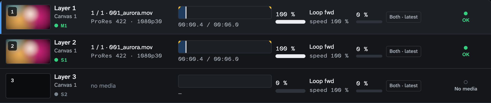
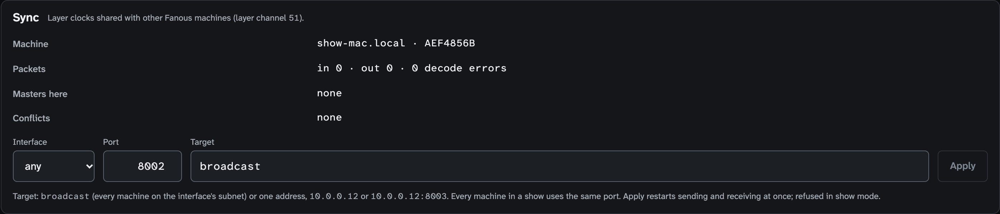
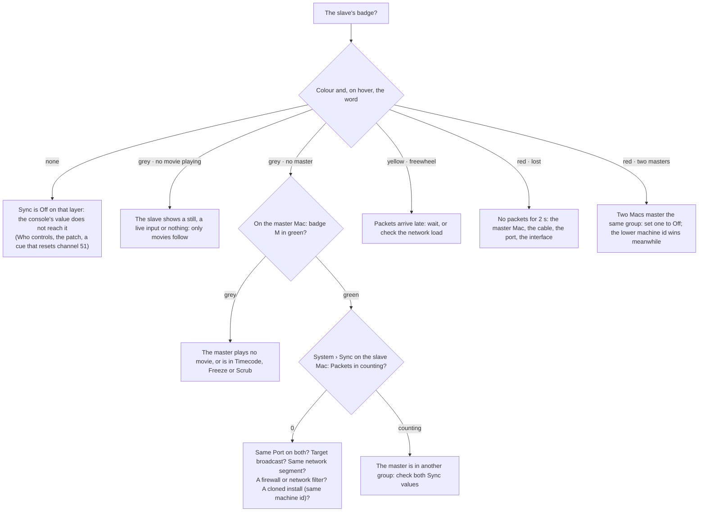

<!-- SPDX-License-Identifier: GPL-3.0-only -->
<!-- Copyright (c) 2026 Tim de Bruijn -->
<!-- Additional terms under GPLv3 §7 apply: see LICENSE-ADDITIONAL-TERMS.md -->

# Multi-server sync

Use this page to make two or more Macs show one picture, each driving its
own projector with its own part of the picture, its own blend and its own
warp, with a layer on one Mac playing in step with a layer on the other.
The console decides which layers follow which with one channel per layer,
**Sync** (layer channel 51). Terms are in the
[glossary](reference/glossary.md#console-protocols-control). For
projectors on one Mac use a projector wall instead
([outputs-and-mapping.md](outputs-and-mapping.md#projector-walls)); sync is
for when one Mac is not enough.

Sync shares one thing: the clock of a layer, that is where in its file it
is, how fast and in which direction it runs. A Sync master layer sends its
clock on the network under a group number (1 to 8); a Sync slave layer in
the same group, on any Mac and any layer number, copies that clock every
frame. Everything else stays local to each Mac: folder and file, intensity,
position, scale, colour, effects, audio, the outputs with their slices,
blend and warp, and the project itself with its cues and timecode settings.

| Sync value | Means |
|---|---|
| 0–9 | Off: the layer plays on its own clock |
| 10–89 | Sync master, group 1 to 8 (10–19 group 1, 20–29 group 2, …) |
| 90–169 | Sync slave, group 1 to 8 (90–99 group 1, 100–109 group 2, …) |
| 170–255 | Off (reserved) |

Good to know: only movies have a clock, so a still, built-in content from
folder 0 and a live input neither send nor follow. A slave ignores its own
Play mode, Speed, In and Out points, timecode chase and Retrigger while it
has a master. The Sync channel is a layer parameter like any other, so Who
controls applies, and its home value is 0: every cue and palette on the
console must hold it.

## Before you start

- Install Fanous on each Mac separately. Copying one Mac's disk to the
  other gives both the same machine id, and sync then ignores the other
  Mac.
- Put the Macs on the same network segment, wired. Both use the same sync
  port (8002 unless you changed it); a firewall or a network filter on the
  Macs must allow `fanousd` on UDP 8002 in and out
  ([reference/files-and-ports.md](reference/files-and-ports.md#ports)).
- Decide how to split the picture ([below](#three-ways-to-split-a-picture));
  the first way fits most shows.

## Two Macs, one picture

Two Mac minis, two projectors side by side with a soft-edge blend, one
console:

1. **Same library numbering on both Macs.** Copy the library (Finder, or
   any sync tool) so every file the show uses has the same folder and file
   number on both ([media-library.md](media-library.md)). With pre-split
   files the numbers are the same and the contents differ; a slave follows
   the clock, not the file.
2. **One set of fixtures per Mac on the console.** The console sends one
   Sync value per layer fixture, and the left Mac must read "master" where
   the right reads "slave", so each Mac needs its own copy of the fixtures
   at different addresses: on the second Mac's Patch screen move its
   layers, Master, Outputs and Keystones to a free range, for example the
   layers on `A 0.0.4` ([console-setup.md](console-setup.md#changing-the-patch)),
   and patch both sets on the console. Keep the layer layout the same on
   both and put each pair of layer fixtures in a console group, so one
   fader sets folder, file and intensity on both.
3. **The console reaches both Macs**: Art-Net broadcast (every Mac on the
   network hears it) or sACN multicast. Both Patch screens show their
   universes green.
4. **Sync channel, on the console**: channel 51 of the left Mac's Layer 1
   fixture to 10 (**Master 1**), of the right Mac's Layer 1 fixture to 90
   (**Slave 1**), held in every cue. Every further pair gets its own group:
   Layer 2 at 20 and 100 (group 2), and so on. Layers that need no sync
   stay at 0.
5. **Split the picture** with slices of one file unless you have a reason
   not to: canvas width 2 × 1920 − 256 = 3584 for two 1920 projectors with
   a 256-pixel overlap, the right Mac's slice at x 3584 − 1920 = 1664.
   Then set the blend on each Mac's Outputs screen: the left output's
   right edge and the right output's left edge get the same Overlap, 256
   ([outputs-and-mapping.md](outputs-and-mapping.md#blend-two-projectors)).
6. **Check** the Layers screen on the right Mac: Layer 1's badge reads
   **S1** in green, "locked to Layer 1 on" the left Mac's id. Enter show
   mode on both Macs. Then run the [camera check](#the-camera-check) once
   per rig.

## Three ways to split a picture

| Way | Canvas on each Mac | Files | Use it when |
|---|---|---|---|
| Slices of one file | The whole picture (3584 × 1080 for two 1920 projectors with a 256 px overlap) | The same full-width file on both Macs | The usual case: one file to make and update, the overlap is just more of the same picture. Each Mac decodes the whole file |
| Pre-split files | One projector's part, overlap included | The left part on the left Mac, the right part on the right Mac, under the same folder and file number | The full file is too heavy to decode on one Mac, or the parts are made separately anyway |
| One canvas per Mac | One projector's part | The same full-width file on both | You want no slices: each Mac's layer places its half with the layer's Fit mode (Native) and Position X |

With slices, each Mac's output keeps one slice and sets its **Source x · w**
to its part of the canvas ([warp-and-masks.md](warp-and-masks.md#slices)):
on the left Mac x 0, w 1920; on the right Mac x 1664, w 1920. The overlap
is the 256 pixels both slices share, and the blend edge Overlap is 256 on
both outputs.

## Cues, timecode and the show controller on two Macs

The project is per Mac: each has its own cue list, timecode settings, show
mode and show lock, and only the layer clock crosses the network. So:

- Build the cue list once and copy the project to the other Mac (a named
  version restored there, or the same cues built twice), with the same cue
  numbers and triggers.
- Send the show controller's OSC or MSC GO to both Macs, or split the LTC
  feed to both; a GO on one Mac's screen fires that Mac only.
- Enter show mode and lock the show on each Mac.
- Let the console carry every layer value, including the Sync channel; a
  cue on one Mac that changes a layer reaches that Mac only.

## What the screens show

Layer 1 is a Sync master (green M1), Layer 2 a Sync slave locked to it
(green S1), Layer 3 a slave of a group without a master (grey S2). Hover a
badge, or open the layer's panel, for the state in words: a slave reads
"locked to Layer 1 on 415FF791, −0.2 ms", with the master's layer, its Mac
(the name for a master on the same Mac, the first 8 characters of its
machine id otherwise) and the correction of the last frame.

| Badge | Sync master | Sync slave |
|---|---|---|
| green | Its group's clock, sending | Locked: following the master |
| yellow | | Freewheel: packets are late; running on at the master's last rate |
| red | A second master in the group (one wins) | Lost: no packets for 2 s; or two masters in the group (it follows the winner) |
| grey | Not sending: no movie playing, Play mode Timecode, Freeze or Scrub, or another layer on this Mac holds the group | No master in the group, or no movie playing on the slave |

The status bar reads "sync lost" in red while any slave on this Mac is
lost, and links to the Layers screen.

System › Sync shows the **Machine** (this Mac's name and the first 8
characters of its id; the lower id wins a group with two masters),
**Packets** in, out and decode errors counting up live (out counts at the
frame rate while a master plays, one a second otherwise; in stays 0 on a
Mac that hears no other), **Masters here**, **Conflicts**, and the settings
below ([screens/system.md](screens/system.md#sync)). While nothing renders
on this Mac the panel says so and shows no settings.

## Sync settings

System › Sync (programmer; refused while the show is locked or show mode
is on). Leave all three at their defaults unless a badge never goes green;
set the same Port on every Mac. **Apply** saves them on this Mac, not in
the project, and restarts sending and receiving at once.

| Setting | Default | Means |
|---|---|---|
| Interface | any | The interface the packets go out on: **any** is the first active interface with broadcast, or pick one (en0); receiving listens on every interface |
| Port | 8002 | The UDP port, the same on every Mac of the show; the ports of Art-Net (6454), sACN (5568) and OSC (8000, 8001) are refused |
| Target | broadcast | **broadcast** reaches every Mac on the interface's network; one IPv4 address (`10.0.0.12`, or `10.0.0.12:8003`) reaches one Mac only, so with more than two Macs every other one stops hearing the master |

If another program holds the port you apply, the settings are saved but
this Mac receives nothing until you apply a port that works; the message on
screen and the log say so.

## When the slave does not follow

- A packet that is late (1.5 frames, at least 50 ms) puts the slave in
  freewheel: it runs on at the master's last rate, so a late packet never
  stutters the picture; the next packet puts it back on the exact
  position. After 2 seconds without a packet the slave is lost: it keeps
  freewheeling, the badge turns red, the status bar says "sync lost" and
  the readiness item warns. The first packet that arrives relocks it;
  there is nothing to reset. If the master Mac goes away for good, set the
  slave's Sync to Off (it then plays on its own clock) or make another
  layer master of the group.
- A network filter that judges programs by their code signature (Little
  Snitch and the like) can hold a newly installed engine's packets without
  a dialog: Packets out counts, nothing arrives, and the log says "sync
  packets dropped". Allow `fanousd` in the filter.
- Two Sync masters in one group on different Macs: the lower machine id
  wins and the other's slaves follow it. On one Mac the later layer holds
  the group and the other's badge reads grey.

Two readiness items cover sync, both warnings that never block show mode,
because a slave without a master still plays: **Sync groups have one
master** (a slave in use has no master, or a group has two) and **Sync
packets arriving** (a slave in use has had no packet for 2 s).

## The camera check

Once per rig, before the first show:

1. Make a test movie with the frame number burned into every frame (any
   editor's timecode burn-in), as the same folder and file number on both
   Macs; folder 0's clock cannot be used, because only movies sync.
2. Play it on Layer 1 on both: Master 1 on the left Mac, Slave 1 on the
   right, both on their projector.
3. Film both projections at once with a phone at 240 fps (slow motion):
   several clips of about 30 seconds, spread over 10 minutes.
4. Step through the clips. Pass: the numbers are never more than one frame
   apart, the difference does not grow over the 10 minutes, and the slave
   never stutters.

Background: the slave sets its position from the master's packet every
frame and never adds up small errors, so the offset after an hour is the
same as after a second. What remains is that the Macs' displays are not
locked to each other (no genlock), so one projector may show a frame up to
one frame time before the other. Both show the same frame of the file; the
difference does not grow.

## Before the show

- Both Macs installed separately, on one network segment, with the same
  Port; Packets in counting on each.
- Every pair's badges green: M on one Mac, S locked on the other; the
  readiness items **Sync groups have one master** and **Sync packets
  arriving** green on both.
- The Sync channel held in every cue on the console; the cue list, show
  mode and the show lock on each Mac.
- A plan for a master Mac that dies: the slave's Sync to Off from the
  console.
