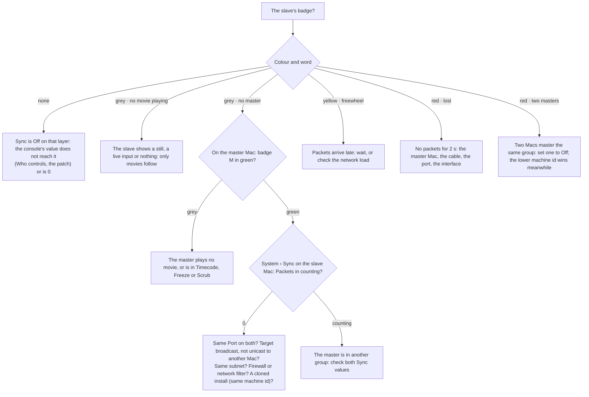

<!-- SPDX-License-Identifier: GPL-3.0-only -->
<!-- Copyright (c) 2026 Tim de Bruijn -->
<!-- Additional terms under GPLv3 §7 apply: see LICENSE-ADDITIONAL-TERMS.md -->

# Multi-server sync

Use this page to make two or more Macs show one picture, each driving its
own projector with its own part of the picture, its own blend and its own
warp, with a layer on one Mac playing in step with a layer on the other.
The console decides which layers follow which with one channel per layer,
**Sync** (layer channel 51). Terms are in the
[glossary](reference/glossary.md#console-protocols-control).

Sync shares one thing: the clock of a layer, that is where in its file it
is, how fast and in which direction it runs. A master layer sends its clock
on the network under a group number (1 to 8); a slave layer in the same
group, on any Mac and any layer number, takes that clock every frame.
Everything else stays local: folder and file, intensity, position, scale,
colour, effects, audio, and the outputs with their slices, blend and warp.
OSC, MIDI, cues fired from one Mac's UI and timecode reach that Mac only:
drive everything that must happen on both from the console.

## Two Macs, one picture

Two Mac minis, two projectors side by side with a soft-edge blend, one
console:

1. **Same library numbering on both Macs.** Copy the library so every file
   the show uses has the same folder and file number on both
   ([media-library.md](media-library.md)). The contents may differ (a
   pre-split left and right half under the same number): a slave follows
   the clock, not the file.
2. **One set of layer fixtures per Mac.** The Sync channel must read
   "master" on one Mac and "slave" on the other, so the two Macs' layer
   fixtures need different addresses: on the second Mac's Patch screen move
   its layers to a free range, for example Layer 1 to 8 on `A 0.0.4`, and
   patch both sets on the console ([console-setup.md](console-setup.md#changing-the-patch)).
   Keep the layer layout the same on both, so one console group sets
   folder, file and intensity on both at once.
3. **The console reaches both Macs**: Art-Net broadcast, or sACN
   multicast. Both Patch screens show their universes green.
4. **Sync channel**: on the left Mac, Layer 1 Sync = **Master 1**; on the
   right Mac, Layer 1 Sync = **Slave 1**. Every further pair gets its own
   group: Layer 2 Master 2 and Slave 2, and so on. Layers that need no sync
   stay Off.
5. **Split the picture** ([below](#three-ways-to-split-a-picture)) and set
   the blend on each Mac's Outputs screen: the left output's right edge and
   the right output's left edge get the same Overlap
   ([outputs-and-mapping.md](outputs-and-mapping.md#blend-two-projectors)).
6. **Check** the Layers screen on the right Mac: Layer 1's badge reads
   **S1** in green, "locked to Layer 1 on" the left Mac's id. Then run the
   [camera check](#the-camera-check) once per rig.

Both Macs need the same sync port (8002 unless you changed it) on the same
network segment, so the broadcast reaches them. A firewall on the Macs must
allow `fanousd` UDP 8002 in and out
([reference/files-and-ports.md](reference/files-and-ports.md#ports)). Each
Mac needs its own install: a cloned disk gives both the same machine id,
and each then throws the other's packets away as its own.

| Sync value | Means |
|---|---|
| 0–9 | Off: the layer plays on its own clock |
| 10–89 | Master, group 1 to 8 (10–19 group 1, 20–29 group 2, …) |
| 90–169 | Slave, group 1 to 8 (90–99 group 1, 100–109 group 2, …) |
| 170–255 | Off (reserved) |

The Sync channel is a layer parameter like any other, so Who controls
applies: under **Fanous only** the console's Sync value is ignored, under
**Console only** a cue's. A group also works inside one Mac: Layer 3 as
Slave 1 follows Layer 1 as Master 1 on the same machine, with no offset at
all.

- A slave ignores its own Play mode, Speed, In and Out points, timecode
  chase and Retrigger while it has a master; a Retrigger on the master
  reaches the slave as a jump. A master in Timecode, Freeze or Scrub stands
  still, and so does its slave.
- Different frame rates are fine: a 25 fps file follows a 50 fps master and
  keeps the same time. Files of different length drift apart at the loop
  point.
- Only movies have a clock: a still, built-in content from folder 0 and a
  live input neither send nor follow. During a dissolve the incoming file
  is shared, not the outgoing one.
- A slave's audio plays while its master runs at normal speed, forward.
- Two masters in one group on different Macs: the Mac with the lower
  machine id wins, slaves follow it, and the badge and the readiness list
  say so. Two master layers in one group on one Mac: the later one holds
  the group and the other's badge reads grey.

How close: the slave sets its position from the master's packet every
frame and never adds up small errors, so the offset after an hour is the
same as after a second: the packet jitter, well under a millisecond on a
wired network. What remains is one frame of display phase: the Macs have no
genlock, so the two projectors refresh at slightly different moments, up to
one output frame apart. Both show the same frame of the file, not at the
same microsecond. That is the floor.

## Three ways to split a picture

| Way | Canvas on each Mac | Files | Use it when |
|---|---|---|---|
| Slices of one file | The whole picture (3584 × 1080 for two 1920 projectors with a 256 px overlap) | The same full-width file on both Macs | The usual case: one file to make and update, the overlap is just more of the same picture. Each Mac decodes the whole file |
| Pre-split files | One projector's part, overlap included | The left part on the left Mac, the right part on the right Mac, under the same folder and file number | The full file is too heavy to decode on one Mac, or the parts are made separately anyway |
| One canvas per Mac | One projector's part | The same full-width file on both | You want no slices: each Mac's layer places its half with the layer's Fit mode (Native) and Position X |

With slices, each Mac's output keeps one slice and sets its **Source x · w**
to its part of the canvas ([warp-and-masks.md](warp-and-masks.md#slices)):
on the left Mac x 0, w 1920; on the right Mac x 1664, w 1920 for the
example above. The overlap is the 256 pixels both slices share, and the
blend edge Overlap is 256 on both outputs.

## What the screens show

A layer with Sync on gets a badge under its name: **M** for master or **S**
for slave, then the group. Hover it, or open the layer's panel, for the
state in words: a slave reads "locked to Layer 1 on 415FF791, −0.2 ms",
with the master's layer, its Mac (the name for a master on the same Mac,
the first 8 characters of its machine id otherwise) and the correction of
the last frame.

| Badge | Master | Slave |
|---|---|---|
| green | Its group's clock, sending | **locked**: following the master |
| yellow | | **freewheel**: packets are late; running on at the master's last rate |
| red | A second master in the group (one wins) | **lost**: no packets for 2 s; or two masters in the group (it follows the winner) |
| grey | Not sending: no movie playing, or another layer on this Mac holds the group | **no master** in the group, or no movie playing on the slave |

The status bar reads "sync lost" in red while any slave on this Mac is
lost, and links to the Layers screen.

**System › Sync** shows the **Machine** (this Mac's name and the first 8
characters of its id; the lower id wins a group with two masters),
**Packets** in, out and decode errors counting up live (out counts at the
frame rate while a master plays, one a second otherwise; in stays 0 on a
Mac that hears no other), **Masters here**, **Conflicts**, and the settings
below. While nothing renders on this Mac the panel says so and shows no
settings.

## When the slave does not follow

- A packet that is late (1.5 frames, at least 50 ms) puts the slave in
  freewheel: it runs on at the master's last rate, so a late packet never
  stutters the picture; the next packet puts it back on the exact
  position. After 2 seconds without a packet the slave is lost: it keeps
  freewheeling, the badge turns red, the status bar says "sync lost" and
  the readiness item warns. The first packet that arrives relocks it;
  there is nothing to reset. If the master Mac goes away for good, set the
  slave's Sync to Off (it then plays on its own clock) or make another
  layer master of the group.
- A network filter that judges programs by their code signature (Little
  Snitch and the like) can hold a newly installed engine's packets without
  a dialog: Packets out counts, nothing arrives, and the log says "sync
  packets dropped". Allow `fanousd` in the filter.

Two readiness items cover sync, both warnings that never block show mode,
because a slave without a master still plays: **Sync groups have one
master** (a slave in use has no master, or a group has two) and **Sync
packets arriving** (a slave in use has had no packet for 2 s).

## Sync settings

System › Sync (programmer; refused while the show is locked or show mode
is on). **Apply** saves them on this Mac, not in the project, and restarts
sending and receiving at once.

| Setting | Default | Means |
|---|---|---|
| Interface | any | The interface the packets go out on: **any** is the first active interface with broadcast, or pick one (en0); receiving listens on every interface |
| Port | 8002 | The UDP port, the same on every Mac of the show; the ports of Art-Net (6454), sACN (5568) and OSC (8000, 8001) are refused |
| Target | broadcast | **broadcast** reaches every Mac on the interface's network; one IPv4 address (`10.0.0.12`, or `10.0.0.12:8003`) reaches one Mac only |

Broadcast is right for almost every show: a unicast target reaches the Mac
it names, so with more than two Macs every other one stops hearing the
master. If another program holds the port you apply, the settings are saved
but this Mac receives nothing until you apply a port that works; the
message on screen and the log say so.

## The camera check

Once per rig, before the first show:

1. Make a test movie with the frame number burned into every frame, as the
   same folder and file number on both Macs.
2. Play it on Layer 1 on both: Master 1 on the left Mac, Slave 1 on the
   right, both on their projector.
3. Film both projections at once with a phone at 240 fps (slow motion) for
   10 minutes.
4. Step through the video. Pass: the numbers are never more than one frame
   apart, the difference does not grow, the slave never stutters, and the
   blend seam does not breathe.
