<!-- SPDX-License-Identifier: GPL-3.0-only -->
<!-- Copyright (c) 2026 Tim de Bruijn -->
<!-- Additional terms under GPLv3 §7 apply: see LICENSE-ADDITIONAL-TERMS.md -->

# Outputs and mapping

Use this page to get the canvas onto a projector or display, to blend two
or more projectors into one picture, to tune the seams of a projector wall,
and to match colour between projectors. Placing the picture on the surface
(corner pin, mesh, slices, masks, presets, the Keystone fixture) is
[Warp, slices and masks](warp-and-masks.md). Every control of the Outputs screen
is in [Outputs screen](screens/outputs.md); terms are in the
[glossary](reference/glossary.md#mapping).

Everything here needs the Fanous programmer role (a login level, not the
console: [The user interface](ui.md#roles-and-logging-in)). While the show is locked the
wall, preset, Remote and Colour controls are greyed out with the reason and
the engine refuses the rest; a canvas change is also refused in show mode.

First picture on one projector, in four steps: plug the projector in
and set it to extended in System Settings › Displays; Outputs screen, **Add
output on**, pick it; press **Output ID** under the output settings and
read the number on the projector; then play a layer
([Getting started](getting-started.md)). The rest of this page is what
comes after.

## One output per projector

Layers are drawn into a canvas (1920 × 1080 at 60 fps in a new project).
An output takes the canvas to one display: the whole display or a region of
it, with an intensity, blend edges on the sides that overlap a neighbour, a
warp, one or more slices with their masks, and a colour match. A new output
shows the whole canvas, unblended and unwarped. Everything an output does
runs on the GPU in the last step, so it costs no layer capacity. Each
output is also an 8-channel Output fixture on the console
([Console setup](console-setup.md#the-four-fixtures)): intensity,
blackout and freeze (channel 3), test pattern (channel 4), Raw (channel 5),
mapping preset and fade (channels 6 and 7). Console control covers outputs
1 to 8; outputs 9 and up are driven from the UI only.

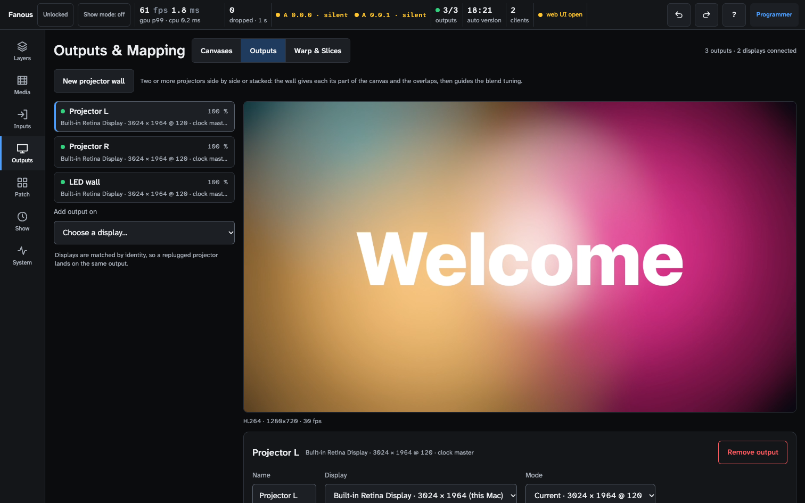

The preview on top shows the selected output in its own shape, as the
projector sees it; on the Canvases tab it shows the canvas. Do not judge
colour or smoothness on it, judge on the projector
([The user interface](ui.md#the-window)).

Do the work in this order: hang and focus the projectors, align each one
on its own (warp), then blend, then black lift, then colour. The blend
works in the projector's own pixels after the warp, so hang and lens-shift
so that the overlap is a straight vertical or horizontal strip in each
projector; use the warp for the fine trim, not to square up a big rotation.

## Add an output and bind it to a display

1. Plug the projector in and set it to extended in System Settings ›
   Displays (a mirrored display cannot be an output of its own). Set its
   resolution and refresh rate there, or leave that to a
   [display mode](#display-modes).
2. Outputs screen, **Add output on**: pick the display, or "Unassigned
   (assign later)" to prepare an output on a Mac without the projector. Do
   not pick this Mac's own display unless another device already drives
   the UI: the output covers the app window.
3. The output appears in the list with a green dot and its display line,
   and shows the whole canvas: black until a layer plays. Press **Output
   ID** under the output settings: the projector shows its number on a
   coloured field, so you know the output works before any content does.
   A yellow bar offers **Align this output**, which opens Warp & Slices
   for it ([Warp, slices and masks](warp-and-masks.md)); **Later** keeps it for
   now. The bar appears only for an output added on this screen, not for
   one added on the Patch screen.
4. Name it after the projector (**Name** under the list). When one display
   carries several outputs, set the **Region** each output draws on, in
   display pixels: a 3840 × 2160 port into a splitter that feeds four
   1920 × 1080 projectors gets 0 · 0 · 1920 · 1080, 1920 · 0 · 1920 · 1080,
   0 · 1080 · 1920 · 1080 and 1920 · 1080 · 1920 · 1080.
5. Leave **Intensity** at 100 %: the console's Output and Master intensity
   multiply with it.

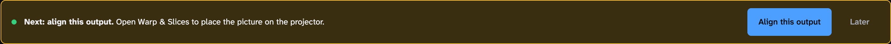

An output is tied to its display by identity, not by port or position: a
projector you unplug and plug in again, on any port, lands on the same
output. A replaced projector shows as missing until you pick the new
display in the output's **Display** field. With several identical
projectors, check the binding with **Output ID** after a replug or a cable
swap. Plugging displays in and out while the engine runs is checked with
one external display; with two or more, test it on your machine before the
show ([known limitations](reference/known-limitations.md#outputs-and-mapping)).

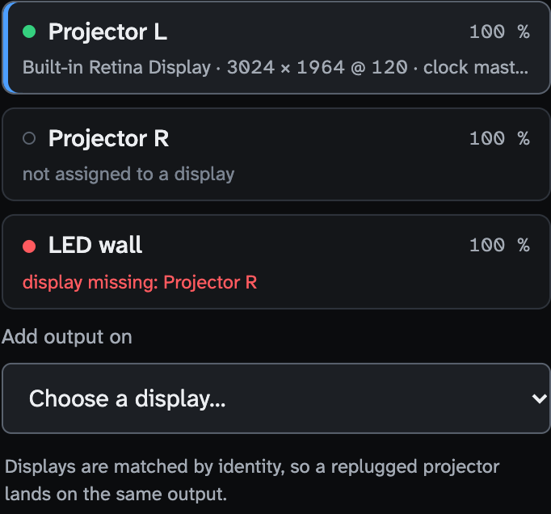

| Row | State | Means |
|---|---|---|
| green dot, `display · W × H @ Hz` | bound | The output draws on that display. "· clock master" marks the display that paces the engine ([below](#which-display-paces-the-engine)) |
| grey ring, "not assigned to a display" ("binding…" for a moment) | unassigned | No display chosen, or it is being bound. Settings can be edited |
| red dot, "display missing: name" | lost | The display went away. A red banner says so; the other outputs keep running. Plug it back in and it rebinds by itself |

### Which display paces the engine

Fanous does not genlock to the projectors. The engine renders at the
canvas frame rate and hands each frame to the clock master display first:
the first bound output, unless you pick another under **Clock master** on
the Canvases tab. Set it to the display that matters most; the others get
the latest finished frame. Displays are not locked to each other either:
two projectors can show frames up to one refresh apart, so a fast move
across a seam can shear by that much. For a seam that must be frame-exact,
feed those projectors from one display (a 4K port into a splitter, with a
Region per output). Even with matching rates an occasional frame is
repeated or skipped ([known limitations](reference/known-limitations.md#outputs-and-mapping)).

## Canvas size and frame rate

On the Canvases tab, **Size w × h** sets the canvas in pixels (a preset:
1920 × 1080, 3840 × 2160, 1280 × 720, or any even size from 320 to 8192)
and **Frame rate** the rate the engine renders at: 23.976, 24, 25, 29.97,
30, 50, 59.94 or 60 fps. Make the frame rate equal to the projectors'
refresh rate, which the output row shows (`@ 60`): 60 fps for 60 Hz, 50
fps for 50 Hz. For one projector, make the canvas its resolution; for
projectors side by side, the width is the sum of their widths minus the
overlaps ([below](#blend-two-projectors)). **Apply** asks first and
re-creates the canvas: every output blanks for a moment, so do it before
the show. It is refused in show mode and while the show is locked;
**Revert** drops the edits and Undo goes back.

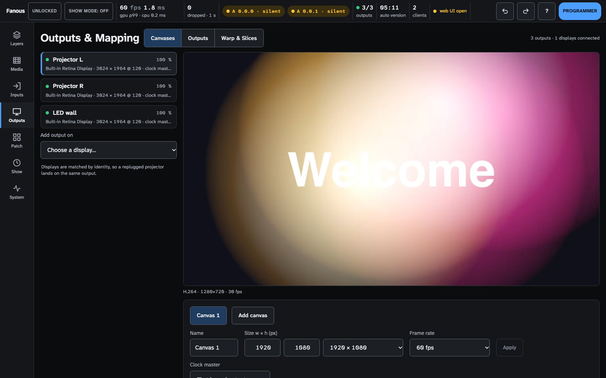

Outputs keep their display, blend, warp and slices across a size change: a
slice keeps its relative place on the canvas. Content made for the old size
is scaled by each layer's Fit mode. A canvas change from an undo, redo or
project load during show mode waits until show mode ends; the tab says
which canvas is rendering meanwhile. If the engine cannot make the new
canvas (not enough memory), the old one keeps running and the tab shows
the error.

### Several canvases

**Add canvas** adds a second to fourth canvas, for example layers 1 to 4 on
Canvas 1 for the projectors and layers 5 to 8 on Canvas 2 for an LED wall
(all canvases together at most four times 3840 × 2160 pixels). Every layer
is on Canvas 1 until you pick another in the list under its name on the
Layers screen; the list appears once there are two canvases. Every slice
has a **Canvas** list on Warp & Slices, so one output can mix slices from
different canvases. All canvases run at Canvas 1's frame rate, and the
clock master is set on Canvas 1. Adding, removing or resizing a canvas
blanks the outputs briefly. **Remove canvas** moves its layers and slices
to Canvas 1 in one undoable step; a canvas the engine cannot make goes back
to what renders, and what was on it moves to Canvas 1.

### The canvas for other apps

To send Canvas 1 to another app on this Mac, choose the Syphon server
**Fanous – Canvas** in that app. The other canvases are not published.
Other apps' Syphon servers are layer content in folder 0, files 150 to 169
([Live inputs](live-inputs.md#syphon-servers-150169)).

## Display modes

Skip this section until a projector must run at a fixed resolution and
refresh rate. Outside show mode Fanous uses whatever mode a display runs.
**Mode** in the output settings asks for one from the display's own list;
the output row then warns in yellow, and show mode
([Show control](show-control.md)) switches every display with a Mode,
all at once, and switches them back when it ends or when the engine stops.
After an engine crash in show mode the displays keep their show modes until
you leave show mode.

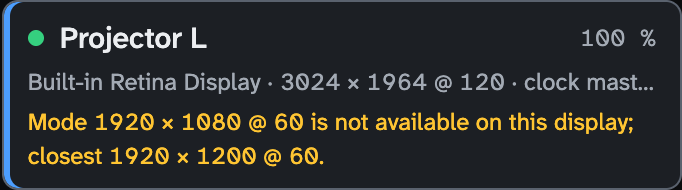

| Row note | Means | Do |
|---|---|---|
| "Mode differs: … wanted …. Applied in show mode." | The display runs another mode now | Nothing: show mode applies it |
| "Mode … is not available on this display; closest …" | The display does not offer that mode | Pick the closest, or set the projector itself |
| "N Hz is not a multiple of the canvas M fps: motion judders" | The wanted refresh rate, or without a Mode the display's current one, and the canvas rate do not match | Change the Mode or the canvas frame rate |
| "Conflicts with Output N on the same display" | Two outputs on one display want different modes | The first output with a Mode wins; make them agree |
| "Not applied: screen locked: modes applied when unlocked" | macOS refuses display changes on a locked screen | Unlock the Mac; the mode follows while show mode is on |

The judder warning, and the readiness item **Outputs in their desired
display mode**, check the Mode's rate, or the display's current rate for an
output without a Mode. 59.94 and 60 Hz count as the same rate
(so do 29.97/30 and 23.976/24); the exact one is used when the display
offers it. Resolution means pixels: on a HiDPI display the current scaling
is kept when both a scaled and a 1:1 mode have the asked size. A display
unplugged and replugged during show mode gets its mode again. Any other
macOS refusal shows its error in the row and in the readiness list.

## Blend two projectors

Two projectors side by side overlap by a strip; each fades out across the
strip so the sum stays flat
([soft-edge blend](reference/glossary.md#mapping)). For two or more
projectors in a row or a grid, use **New projector wall**
([below](#projector-walls)): it sizes the slices and the overlaps for you
and walks you through the tuning. Set a blend by hand only for a layout
that is not a grid. The hand route, for two 1920 × 1080 projectors with a
15 % overlap (288 px):

1. Hang, focus and align each projector on its own
   ([Warp, slices and masks](warp-and-masks.md#corner-pin)), with **Grid** on
   both (the test pattern buttons under the output settings): the grid
   lines must meet across the overlap before you blend.
2. Canvases tab: **Size** 3552 × 1080 (2 × 1920 − 288), **Apply**.
3. Left output, Warp & Slices › Slices: slice 1 **Source** 0 · 0 · 1920 ·
   1080. Right output: 1632 · 0 · 1920 · 1080. The two sources share a
   288-pixel strip.
4. Outputs tab: on the left output, the **Right** blend edge gets
   **Overlap** 288; on the right output, its **Left** edge gets 288. The
   overlap in pixels must equal the strip the two sources share, or the
   seam doubles or jumps.
5. **Blend check** on both: a flat 50 % grey with each projector's grid
   lines in its own colour. A bright band in the seam: **Gamma** down on
   both edges; a dark band: up. Set it to the projector's gamma (2.2 is
   usual) so the two ramps add up to a flat field. A visible edge where
   the overlap starts: **Power** up softens the start of the ramp, down
   makes it more linear. Change one value at a time in small steps and
   look after each. Done when no band or line shows from where the
   audience sits.
6. **Grey 0 %** on both: the overlap is a lighter stripe, because two
   projectors' blacks add up there. Raise **Black lift** (under the four
   edge cards) on both outputs until the rest of the picture is as light as
   the stripe; **Lift feather px** softens where the lift ends.
7. **Grey 25 %**, **Grey 75 %** and **White**: one projector darker or
   tinted is a [colour](#colour) job, not a blend job.

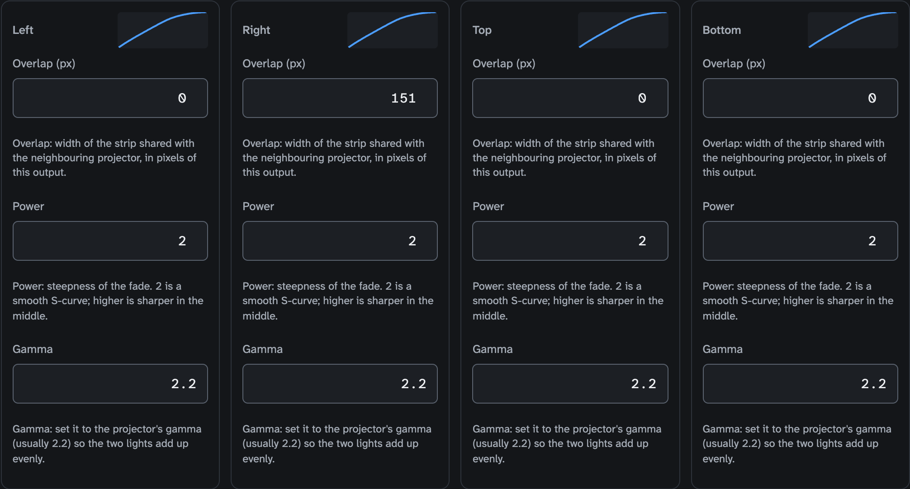

The curve drawing on each card shows the ramp. **Power** (0.1 to 10, 2 to
start) is how steep the S-curve is; **Gamma** (0.5 to 5, 2.2 to start) is
the projector's gamma. In the engine's own test the summed light of two or
four ideal gamma-2.2 projectors stays within 3 % of white for two and 3.5 % for four; real
projectors decide the rest, so tune by eye.

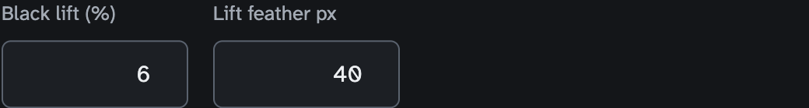

**Black lift** (0 to 50 %) raises the black outside the overlaps until it
matches the overlaps. Set it on Grey 0 % at 100 % output intensity;
brighter pictures need no further adjustment, because the lift adds light
the way a second projector's black does. On a wall with rows and columns
the lift is matched to the corner where four projectors overlap, so match
to the corners there. The lift and the black offset scale with the output's
intensity (the Output fixture and the Intensity field), while the
projectors' own black does not: dim with the Master or the layers if the
seams must stay invisible. A mask or a gap between slices has no lift
either.

## Test patterns

The buttons under the output settings put a pattern on the selected output;
the Output fixture's Test pattern channel (per projector) and the Master's
(every output) override them, so a cue can call them up. Patterns follow
the corner pin, mesh and keystone and show the blend. **Raw** (the Output
fixture's Blend channel, 5, at 128 or more) bypasses all mapping: no blend,
black lift, masks, warp or keystone, so you see what the projector alone
does.

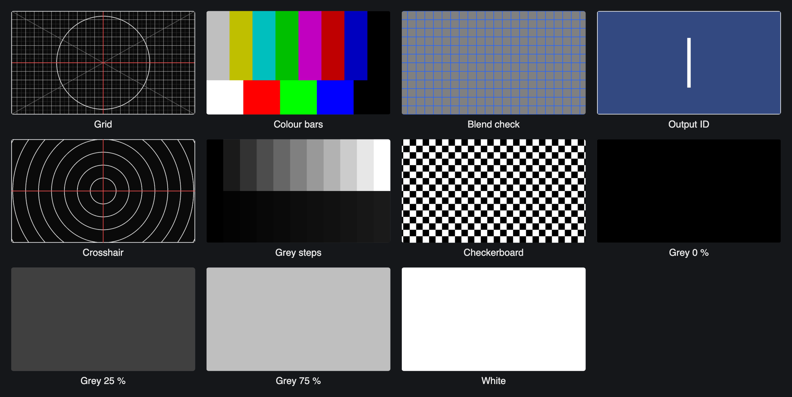

| Pattern | Use it for |
|---|---|
| Grid | Alignment: square cells, a border for overscan, a centre cross, a circle for the aspect ratio, diagonals |
| Colour bars | 75 % SMPTE bars with 100 % white, red, green, blue and black: colour and level between projectors |
| Blend check | Flat 50 % grey: a seam shows as a bright or dark band; the grid lines in this output's own colour let two overlapping projectors be laid over each other |
| Output ID | The output number, large, on the output's colour: which projector is which |
| Crosshair | Centre and focus; circles every eighth of the height |
| Grey steps | 0 to 100 % in 10 % steps above, 0 to 10 % in 1 % steps below: gamma, black level, black lift |
| Checkerboard | Focus and pixel geometry |
| Grey 0 % | Black floor: a seam lighter than the rest wants more black lift next to it |
| Grey 25 %, Grey 75 % | Dark and light grey match: a projector darker or tinted than its neighbours, or a colour shift only inside a seam |
| White | Full level: brightness and colour of each projector, a seam that stays bright or dark at full |

Line widths and cells follow the output's height, so a pattern reads the
same on a monitor and on a 4K projector. Patterns dim and black out with
the picture: the output's Intensity and the Output and Master fixtures'
Intensity dim them, a Blackout makes them black, also in Raw. A console's
grand master or DBO therefore takes a pattern down with the rest; to align,
bring the Output and Master intensity up (both are 100 % when nothing is
patched). Freeze holds the picture, not the pattern.

The flat fields are signal levels, on the same scale as Blend check's 50 %
grey: on a gamma-2.2 projector Grey 25 % is about 5 % of white's light
and Grey 75 % about 53 %. From the console, Test pattern is channel 4 of
the Output and Master fixtures in bands of 16: 0–15 Off, 16–31 Grid, 32–47
Colour bars, 48–63 Blend check, 64–79 Output ID, 80–95 Crosshair, 96–111
Grey steps, 112–127 Checkerboard, 128–143 Grey 0 %, 144–159 Grey 25 %,
160–175 Grey 75 %, 176–191 White ([channel map](../channel-map.md)). The
first seven patterns and a moving test card are also layer content in
folder 0 ([Built-in content](reference/built-in-content.md)).
The output is 8-bit with a noise dither; a long gradient across a ramp can
band.

## Colour

**Colour**, under the test patterns, matches this projector to the others
by eye: put Colour bars, Grey steps, Grey 25 %, Grey 75 % or White on every
projector at once and turn the one that is off. White looks green on
projector 2: lower its **Gain G** a few percent until it matches projector
1. Projector 2 is darker all over: raise all three gains, or lower the
others'.

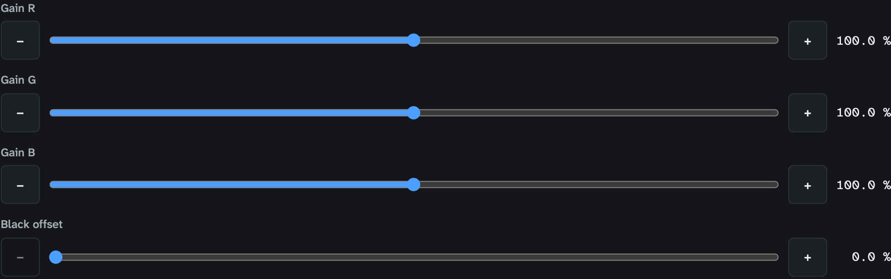

| Control | Range (start) | Does |
|---|---|---|
| **Gain R, G, B** | 0–200 % (100 %) | Scales that colour of everything this output shows |
| **Black offset** | 0–20 % (0 %) | Raises this projector's black over the whole output, overlaps included: for a projector whose black is darker than its neighbours' |

The gain scales the signal, not the light: 50 % gain is about a fifth of
the light on a gamma-2.2 projector, so tune in small steps (**−** and **+**
are 0.5 % gain and 0.1 % black offset; a drag is one Undo step). Colour
applies to the picture and the test patterns, also in Raw: it belongs to
the projector, not to the mapping. An Output or Master Blackout, or an
intensity at 0, is black, black offset included.

Three black controls, two settings. A seam lighter than the rest:
**Black lift** (output settings, 0 to 50 %), which the wall panel calls
**Black floor** (0 to 20 %): one setting, two names. A whole projector
whose black is darker than its neighbours': **Black offset** (Colour, 0 to
20 %), overlaps included. Both add light as a projector's black does,
computed for a gamma-2.2 projector, so a value set on Grey 0 % stays right
on brighter pictures
([known limitations](reference/known-limitations.md#outputs-and-mapping)).

## Projector walls

A projector wall is two to sixteen projectors that show one picture: side
by side, stacked, or a grid, at most 4 × 4 (so 5, 7, 11, 13, 14 or 15
projectors make no grid). The wall keeps two kinds of
work apart:

- Geometry is computed. From the grid and the overlap the wall gives
  each projector its part of the canvas (slice 1's Source) and the overlap
  of its inner blend edges, equal on both sides of every seam. That is
  right for projectors hung as that grid, so you do not type it.
- Tuning is by eye. Gamma and curve per seam, black floor and colour
  per projector: no start value fits every room, because projector age,
  ambient light and the surface differ. The [seam check](#seam-check) walks
  you through it.

Each output of the wall must have a known resolution (bind it to a display,
or give it a Region or a Mode), the same for all of them. Console control
reaches outputs 1 to 8: in a wall of more projectors the rest have no
Output or Keystone fixture and no console preset. All wall controls need
the programmer role and grey out with the reason while the show is locked.

### New projector wall

**New projector wall**, above the output list on the Outputs tab, opens a
two-step wizard; it is greyed with "Add at least two outputs that are in no
wall yet." until there are.

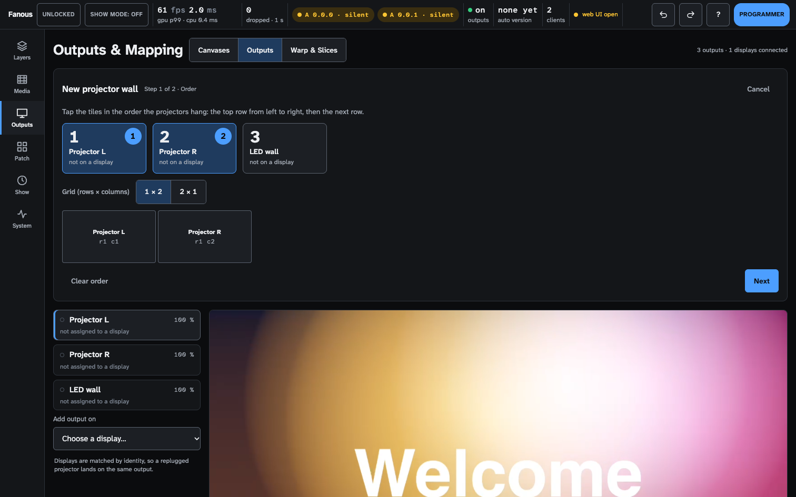

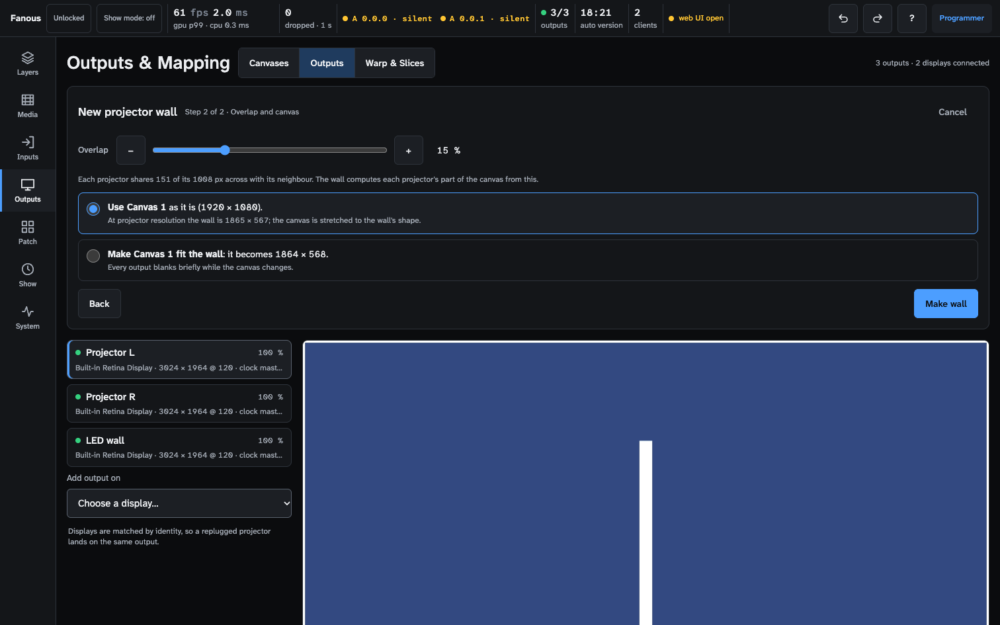

1. **Order.** The wizard shows one tile per output, and every projector
   shows its Output ID, large. Look at the projectors, then tap the tiles
   in the order they hang: the top row from left to right, then the next
   row (a second tap takes a tile out, **Clear order** starts over). Pick
   the **Grid (rows × columns)**: only grids that fit the number of tiles
   are offered, for four tiles 1 × 4, 2 × 2 and 4 × 1. The drawing shows
   where each output lands.
2. **Overlap and canvas.** The **Overlap** is a percentage of one
   projector, 15 % to start, with the pixel count under it; below 10 % or
   above 25 % a yellow line says why that is unusual. Then choose **Make
   Canvas N fit the wall** when the content is not made yet or the canvas
   is only for this wall: the canvas becomes the wall's size, shown before
   you apply, and every output blanks briefly (not in show mode). Choose
   **Use Canvas N as it is** when the content is already made at a fixed
   size: the wall stretches over the canvas, and the wizard shows the
   wall's size at projector resolution so you can see whether the shapes
   match.
   **Make wall** ends the wizard: Blend check appears on every projector
   of the wall and the wall's panel opens on the seam check. **Undo** right
   after takes the wall away again; **Cancel** at any step changes nothing.

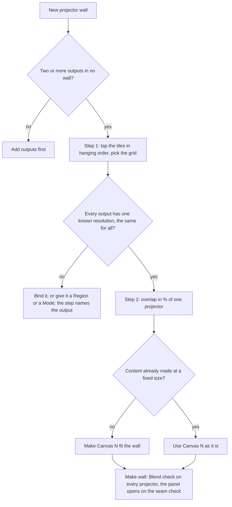

Give the content maker the wall's size in canvas pixels (the wizard shows
it: columns × projector width minus the overlaps, the same down); a smaller
canvas is scaled up, and the content must continue under the overlaps.

### The wall panel

Each wall has a panel above the output list, built around a map of the
wall: one tile per projector (Output ID, name, row and column) and a seam
button between neighbours with its gamma (**RGB** when each colour has its
own). The header has the wall's name, "rows × columns · canvas · overlap"
and the **Seam check** and **Geometry** switches.

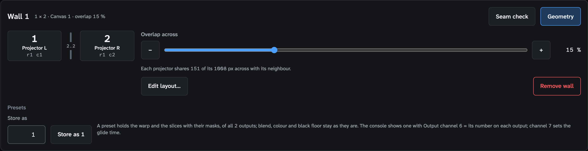

Tap a seam for its controls; both sides of the seam always follow:

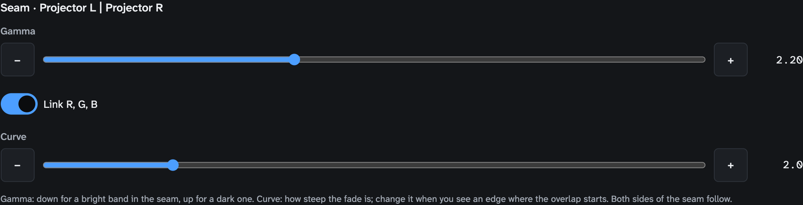

- **Gamma** (0.5 to 5, 2.2 to start): down for a bright band in the seam,
  up for a dark one.
- **Link R, G, B** on gives one gamma for all three colours. Off, **Gamma
  R**, **G** and **B** replace it, each starting at its value, for a colour
  shift only inside the seam; linking again drops the per-colour values.
- **Curve** (0.1 to 10, 2 to start): the same value as the edge's Power in
  the output settings; up softens the start of the ramp, down makes it more
  linear.
- **Apply to all seams** (with more than one seam) gives every seam these
  values.

Tap a projector for its black floor and colour:

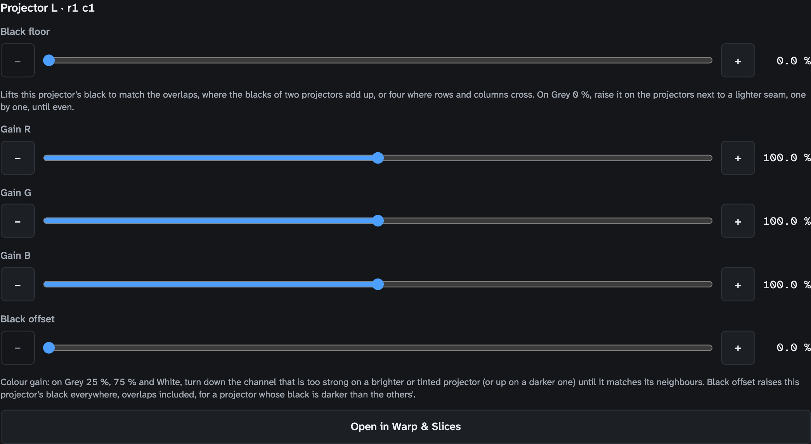

- **Black floor** (0 to 20 %) is the output's Black lift under another
  name: on Grey 0 %, raise it on the projectors next to a lighter seam, one
  by one, until even.
- **Gain R, G, B** and **Black offset** are the output's [Colour](#colour).
- **Open in Warp & Slices** goes to that projector's warp.

**Geometry** holds **Overlap across** and **Overlap down** (0 to 50 %, with
the pixel line), **Edit layout…** (the wizard again, filled in: change the
order, the grid, the overlap or the canvas) and **Remove wall** (the outputs
keep their slices and blend edges; Undo brings the wall back). The sliders
wait until every output of the wall has one known resolution. In the output
list a wall member carries a badge such as **Wall 1 · r1 c2**.

Fields the wall manages can be taken by hand:

- An inner edge's overlap typed in the output settings, or slice 1's Source
  changed on Warp & Slices, becomes **manual** (a yellow chip): the wall
  leaves it alone from then on, also when you change the wall's overlap.
- **Back to wall** next to the chip hands the field back to the wall.
- A power or gamma typed on an inner edge goes to its seam, so the
  neighbour follows.
- Recalling a preset whose slice 1 no longer matches the wall marks it
  manual too.

Drag a slider or tap **−** and **+** for fine steps; a drag, or taps less
than a second apart, are one Undo step.

### Seam check

**Seam check** on the wall panel steps through six test patterns on every
projector of the wall at once. Each step says what to look for; tap the
line that matches what you see, then the seam or projector on the map that
shows it, and its control opens, outlined. Fanous has no camera, so your
eye picks the seam. You are done when all six steps look even from where
the audience sits; press **End seam check**.

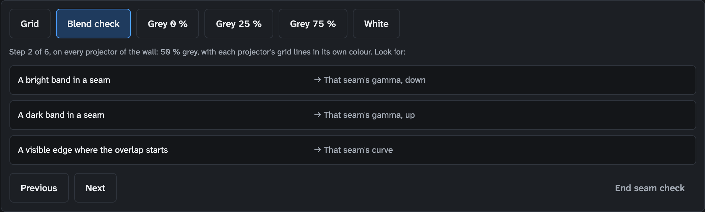

| Step | You see | Turn |
|---|---|---|
| 1 Grid | Lines that do not meet across a seam | The warp, not the blend: tapping the projector opens Warp & Slices |
| 2 Blend check | A bright band in a seam | That seam's gamma, down |
| 2 Blend check | A dark band in a seam | That seam's gamma, up |
| 2 Blend check | A visible edge where the overlap starts | That seam's curve |
| 3 Grey 0 % | Seams lighter than the rest | The black floor of the projectors next to it, up, one by one |
| 3 Grey 0 % | One projector's black darker everywhere | That projector's black offset |
| 4 Grey 25 %, 5 Grey 75 %, 6 White | One projector darker, or tinted | That projector's gain, the colour that is off |
| 4 Grey 25 %, 5 Grey 75 %, 6 White | A colour shift only inside a seam | Unlink R, G, B on that seam; tune the colour that is off |

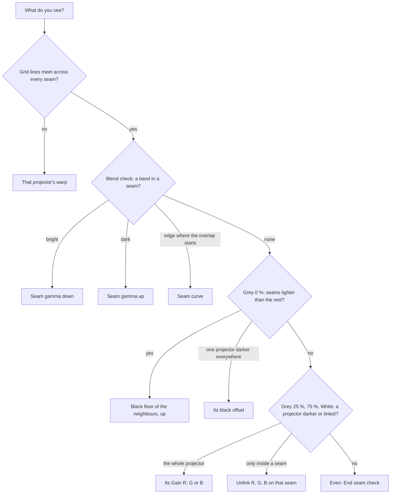

You can switch to Warp & Slices during the check: a yellow banner there
says the check is running and takes you back. **End seam check**, or
leaving the Outputs screen, takes the patterns off (leaving also cancels
the wizard); a hidden page takes them off until it is visible again. The
check's patterns are not stored and are no Undo step: each output's own
test pattern stays as it was. They show only for the programmer and are
off in show mode and under the show lock. Two people checking the same
wall see the patterns alternate: finish on one device first.

## Before the show

- Every output bound (green), none lost; the clock master on the display
  that matters most.
- A Mode on every output that must run at a fixed rate; the canvas frame
  rate equal to the projectors' refresh rate, read from each output row;
  the readiness item **Outputs in their desired display mode** green or
  acknowledged ([Show-day checklist](show-day-checklist.md)).
- Seam check done, test patterns off (the Output and Master fixtures'
  Test pattern channels at 0), every output's own test pattern **Off**.
- Black lift set at 100 % output intensity; dimming from the Master or the
  layers.
- **Hold on signal loss** at Hold last values for the universes that carry
  the Output, Master and Keystone fixtures, unless you want black on loss
  ([Console setup](console-setup.md#when-the-console-goes-silent)).
- Walls and presets stored again after any layout change: a wall changed
  later does not change the presets stored before
  ([Warp, slices and masks](warp-and-masks.md#mapping-presets)).
- The UI on another device when an output uses the Mac's own display.
- Something wrong on the night: [Troubleshooting](troubleshooting.md).
