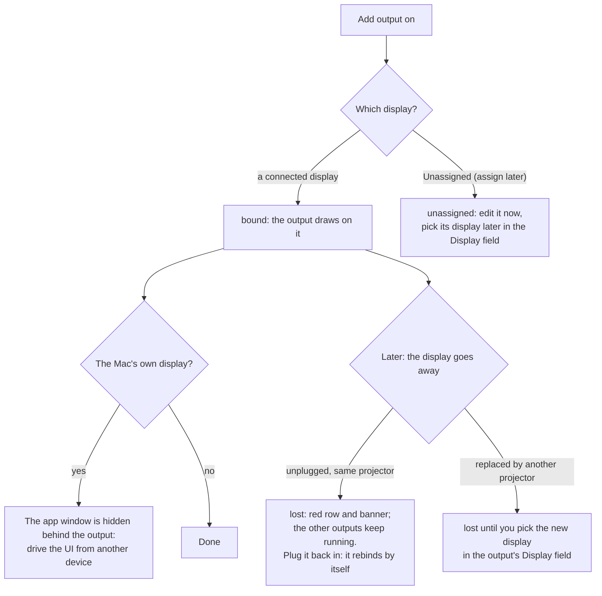
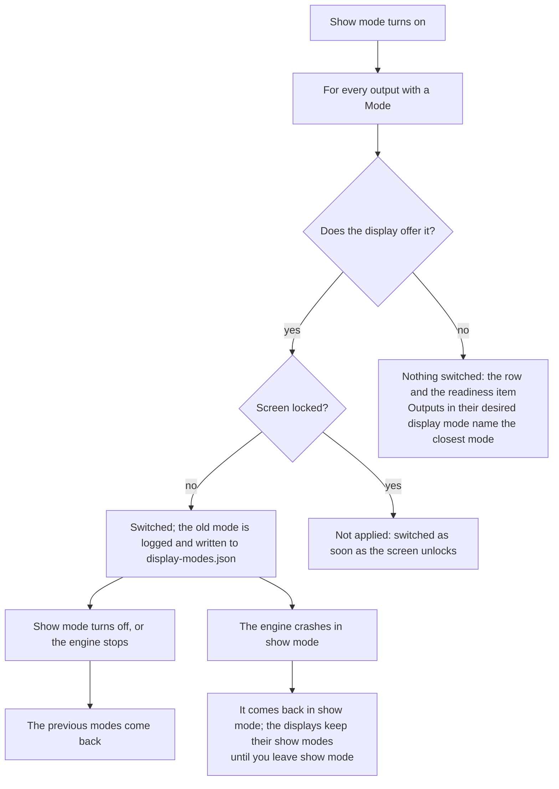
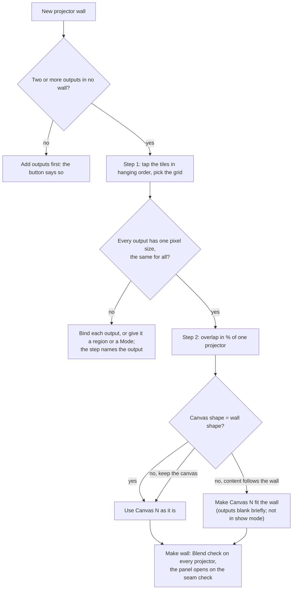
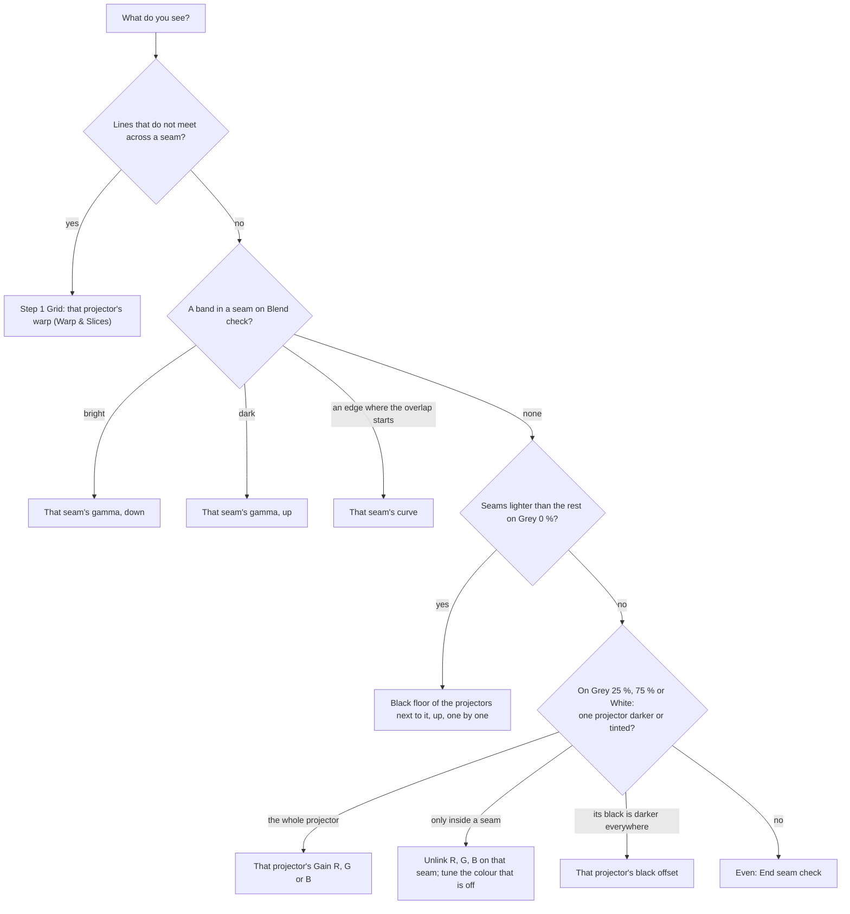

<!-- SPDX-License-Identifier: GPL-3.0-only -->
<!-- Copyright (c) 2026 Tim de Bruijn -->
<!-- Additional terms under GPLv3 §7 apply: see LICENSE-ADDITIONAL-TERMS.md -->

# Outputs and mapping

Use this page to get the canvas onto a projector or display, to blend two
projectors into one picture, to build a projector wall and tune its seams,
and to match colour between projectors. Placing the picture on the surface
(corner pin, mesh, slices, masks, presets, the Keystone fixture) is
[warp-and-masks.md](warp-and-masks.md). Every control of the Outputs screen
is in [screens/outputs.md](screens/outputs.md); terms are in the
[glossary](reference/glossary.md#mapping).

Everything on this page needs the programmer role. The engine refuses it
while the show is locked, and the wall, preset, Remote and Colour controls
grey out with the reason; a canvas change is also refused in show mode.

## One output per projector

Layers are drawn into a **canvas** (1920 × 1080 at 60 fps in a new project).
An **output** takes the canvas to one display: the whole display or a region
of it, with an intensity, blend edges on the sides that overlap a neighbour,
a warp, one or more slices with their masks, and a colour match. A new
output shows the whole canvas, unblended and unwarped. Everything an output
does runs on the GPU in the last step, so it costs no layer capacity. Each
output is also an 8-channel Output fixture on the console, which sets its
intensity, blackout, freeze, test pattern, Raw and mapping preset
([console-setup.md](console-setup.md#the-four-fixtures)).

The preview on top shows the selected output in its own aspect ratio (4:3,
16:10, an ultra-wide LED wall), as the projector sees it; on the Canvases
tab it shows the canvas. It is at most 1280 pixels wide and no colour
reference ([ui.md](ui.md#the-window)).

## Add an output and bind it to a display

1. Plug the projector in and set it to **extended** in System Settings ›
   Displays (a mirrored display cannot be an output of its own). Set its
   resolution and refresh rate there, or leave it to a display mode
   ([below](#display-modes)).
2. Outputs screen, **Add output on**: pick the display, or "Unassigned
   (assign later)" to prepare an output on a Mac without the projector.
3. The output appears in the list with a green dot and its display line
   (`Projector · 1920 × 1080 @ 60`), and shows the whole canvas: black
   until a layer plays. A yellow bar offers **Align this output**, which
   opens Warp & Slices for it ([warp-and-masks.md](warp-and-masks.md));
   **Later** keeps it for now. The bar appears only for an output added on
   this screen, not for one added on the Patch screen.
4. Name it after the projector (**Name** under the list) and, when one
   display carries several outputs (a 4K port into a splitter that feeds
   four projectors), set the **Region** each output draws on.
5. Set **Intensity** and leave it: the console's Output and Master
   intensity multiply with it ([console-setup.md](console-setup.md)).

An output is tied to its display by identity, not by port or position: a
projector you unplug and plug in again, on any port, lands on the same
output. The list shows one of three states per output:

| State | Row | Means |
|---|---|---|
| **bound** | green dot, `display · W × H @ Hz` | The output draws on that display. "· clock master" on the display that paces the engine ([below](#which-display-paces-the-engine)) |
| **unassigned** | grey ring, "not assigned to a display" ("binding…" for a moment) | No display chosen, or it is being bound. Settings can be edited |
| **lost** | red dot, "display missing: name" | The display went away. A red banner says so; the other outputs keep running |

Hot-plugging is checked with one external display; with two or more, test
it on your machine before the show
([known limitations](reference/known-limitations.md#outputs-and-mapping)).

### Which display paces the engine

The engine renders at the canvas frame rate and hands each frame to the
**clock master** display first: the first bound output, unless you pick
another under **Clock master** on the Canvases tab. The other displays get
the most recent finished frame. A display whose refresh rate is not a whole
multiple of the canvas rate (a 50 Hz projector on a 60 fps canvas) judders;
match the canvas rate to the projectors
([below](#canvas-size-and-frame-rate)). The clocks are not locked even when
the rates match: a frame is repeated or skipped now and then
([known limitations](reference/known-limitations.md#outputs-and-mapping)).

## Display modes

Outside show mode Fanous uses whatever mode a display runs. **Mode** in the
output settings asks for a resolution and refresh rate from the display's
own list; the output row then warns in yellow, and **show mode** switches
every display with a Mode, all at once, and switches them back when it
ends.

| Row note | Means | Do |
|---|---|---|
| "Mode differs: … wanted …. Applied in show mode." | The display runs another mode now | Nothing: show mode applies it |
| "Mode … is not available on this display; closest …" | The display does not offer that mode | Pick the closest, or set the projector itself |
| "N Hz is not a multiple of the canvas M fps: motion judders" | The refresh rate and the canvas rate do not match | Change the Mode or the canvas frame rate |
| "Conflicts with Output N on the same display" | Two outputs on one display want different modes | The first output with a Mode wins; make them agree |
| "Not applied: screen locked: modes applied when unlocked" | macOS refuses display changes on a locked screen | Unlock the Mac; the mode follows while show mode is on |

59.94 and 60 Hz count as the same rate (so do 29.97/30 and 23.976/24); the
exact one is used when the display offers it. Resolution means pixels: on a
HiDPI display the current scaling is kept when both a scaled and a 1:1 mode
have the asked size. A display unplugged and replugged during show mode gets
its mode again. Any other macOS refusal shows its error in the row and in
the readiness list.

## Canvas size and frame rate

On the Canvases tab, **Size w × h** sets the canvas in pixels (a preset:
1920 × 1080, 3840 × 2160, 1280 × 720, or any even size from 320 to 8192)
and **Frame rate** the rate the engine renders at: 23.976, 24, 25, 29.97,
30, 50, 59.94 or 60 fps. Match the frame rate to the projectors' refresh
rate (50 fps for 50 Hz projectors) and the size to the content. **Apply**
asks first and re-creates the canvas: every output blanks for a moment, so
do it before the show, not during it. It is refused in show mode and while
the show is locked; **Revert** drops the edits and Undo goes back.

Outputs keep their display, blend, warp and slices across a size change:
slices are stored as fractions of the canvas, so a slice that showed the
left half still shows the left half. Content made for the old size is
scaled by each layer's Fit mode. An undo, redo or project load that changes
the canvas during show mode waits until show mode ends; the tab says which
canvas is rendering meanwhile. If the engine cannot make the new canvas
(not enough memory), the old one keeps running and the tab shows the error.

### Several canvases

**Add canvas** adds a second to fourth canvas, for example layers 1 to 4 on
Canvas 1 for the projectors and layers 5 to 8 on Canvas 2 for an LED wall
(all canvases together at most four times 3840 × 2160 pixels). Every layer
is on Canvas 1 until you pick another in the list under its name on the
Layers screen (the list appears once there are two canvases). Every slice
has a **Canvas** list on Warp & Slices, so one output can mix slices from
different canvases. All canvases run at Canvas 1's frame rate, and the
clock master is set on Canvas 1. Adding, removing or resizing a canvas
blanks the outputs briefly, like a size change; **Remove canvas** moves its
layers and slices to Canvas 1 in one undoable step. A canvas that cannot
be made for want of memory goes back to what renders, and what was on it
moves to Canvas 1.

## Blend two projectors

Two projectors side by side overlap by a strip; each fades out across the
strip so the sum stays flat. For two projectors set it by hand here; for
more, or for a grid, make a [projector wall](#projector-walls), which sets
the overlaps and the slices for you.

1. Hang the projectors so their pictures overlap by 10 to 25 % of a
   projector's width, and put **Grid** on both ([test patterns](#test-patterns))
   to line the overlap up: lines that do not meet are the warp's job
   ([warp-and-masks.md](warp-and-masks.md)), not the blend's.
2. On the left projector's output, give the **Right** blend edge an
   **Overlap** in pixels of this output (288 for 15 % of 1920); on the right
   projector, the same on its **Left** edge. On Warp & Slices give each
   output its part of the canvas as slice 1's Source, overlap included.
3. Put **Blend check** on both: a flat 50 % grey with each projector's grid
   lines in its own colour. A bright band in the seam: **Gamma** down on
   both edges; a dark band: up. A visible edge where the overlap starts:
   change **Power**. Set **Gamma** to the projector's gamma (2.2 is usual)
   so the two ramps add up to a flat field.
4. Put **Grey 0 %** on both: the overlap is lighter than the rest, because
   two projectors' blacks add up there. Raise **Black lift** on each output
   until the rest matches; **Lift feather** softens where the lift ends.
5. Check **Grey 25 %**, **Grey 75 %** and **White**: one projector darker
   or tinted is a [colour](#colour) job, not a blend job.

The curve drawing on each card shows the ramp. **Power** (0.1 to 10, 2 to
start) is how steep the S-curve is; **Gamma** (0.5 to 5, 2.2 to start) is
the projector's gamma. In tests a flat field over two or four projectors
stayed within 2 % across the overlap.

**Black lift** (0 to 50 %) raises the black of the area outside the overlaps
to the level where two projectors add up; on a wall with rows and columns it
rises to the level of the corner where four overlap, so the two-projector
overlaps show the lift value and the single-projector area about 1.6 times
it, and the feather softens each step. The lift adds light, as a second
projector's black does: set it on Grey 0 %, and a brighter picture gets only
that bit of light more (a lift of 8 % raises Grey 25 % from code 64 to 66
of 255, not to 84). Grids work: a corner pixel gets the product of the
horizontal and vertical ramps.

## Test patterns

The buttons under the output settings put a pattern on the selected output;
the Output fixture's Test pattern channel (per projector) and the Master's
(every output) override them, so a cue can call them up. Patterns follow
the corner pin, mesh and keystone and show the blend; the Output fixture's
**Blend** channel at 128 or more shows **Raw**: the output without blend,
black lift, masks, warp and keystone, for a look at the projector itself
([console-setup.md](console-setup.md#the-four-fixtures)).

| Pattern | Use it for |
|---|---|
| Grid | Alignment: square cells, a border for overscan, a centre cross, a circle for the aspect ratio, diagonals |
| Colour bars | 75 % SMPTE bars with 100 % white, red, green, blue and black: colour and level between projectors |
| Blend check | Flat 50 % grey: a seam shows as a bright or dark band; the grid lines in this output's own colour let two overlapping projectors be laid over each other |
| Output ID | The output number, large, on the output's colour: which projector is which |
| Crosshair | Centre and focus; circles every eighth of the height |
| Grey steps | 0 to 100 % in 10 % steps above, 0 to 10 % in 1 % steps below: gamma, black level, black lift |
| Checkerboard | Focus and pixel geometry |
| Grey 0 % | Black floor: a seam lighter than the rest wants more black lift next to it |
| Grey 25 %, Grey 75 % | Dark and light grey match: a projector darker or tinted than its neighbours, or a colour shift only inside a seam |
| White | Full level: brightness and colour of each projector, a seam that stays bright or dark at full |

Line widths and cells follow the output's height, so a pattern reads the
same on a monitor and on a 4K projector. Patterns follow the same dimmer
and blackout as the picture: the output's Intensity, the Output and Master
fixtures' Intensity dim them, and a Blackout makes them black, also in Raw.
A console's grand master or DBO therefore takes a pattern down with the
rest; to align, bring the Output and Master intensity up (both are 100 %
when nothing is patched). Freeze holds the picture, not the pattern.

The flat fields are signal levels: Grey 25 % is code 64 of 255, Grey 75 %
is 191, with every intensity at 100 %, on the same scale as Blend check's
50 % grey. On a gamma-2.2 projector Grey 25 % is about 5 % of white's
light and Grey 75 % about 53 %. From the console, Test pattern channel 4:
16 Grid, 32 Colour bars, 48 Blend check, 64 Output ID, 80 Crosshair, 96
Grey steps, 112 Checkerboard, 128 Grey 0 %, 144 Grey 25 %, 160 Grey 75 %,
176 White. The first seven patterns and a moving test card are also layer
content in folder 0 ([reference/built-in-content.md](reference/built-in-content.md)).

## Colour

**Colour**, under the test patterns, matches this projector to the others
by eye: put Colour bars, Grey steps, Grey 25 %, Grey 75 % or White on every
projector at once and turn the one that is off.

| Control | Range (start) | Does |
|---|---|---|
| **Gain R, G, B** | 0–200 % (100 %) | Scales that colour of everything this output shows: lower the one that is too strong on a tinted projector, or all three on one that is too bright |
| **Black offset** | 0–20 % (0 %) | Raises this projector's black over the whole output, overlaps included: for a projector whose black is darker than its neighbours' |

The gain scales the signal, not the light: 50 % gain is about a fifth of
the light on a gamma-2.2 projector, so tune in small steps (**−** and **+**
are 0.5 % gain and 0.1 % black offset; a drag is one Undo step). Colour
applies to the picture and the test patterns, and also in Raw: it belongs
to the projector, not to the mapping. An Output or Master Blackout, or an
intensity at 0, is black, black offset included.

**Three black controls.** **Black lift** (output settings, 0 to 50 %) and
**Black floor** (the wall panel, 0 to 20 %) are one setting: the black
outside the overlaps, raised to where the projectors add up. **Black
offset** (Colour) is another: the black of the whole output, overlaps
included. All three add light as a projector's black does, computed for a
gamma-2.2 projector, so a value set on Grey 0 % stays right on brighter
pictures ([known limitations](reference/known-limitations.md#outputs-and-mapping)).

## Projector walls

A **projector wall** is two to sixteen projectors that show one picture:
side by side, stacked, or a grid of up to 4 × 4. The wall keeps two kinds
of work apart:

- **Geometry is computed.** From the grid and the overlap the wall gives
  each projector its part of the canvas (slice 1's Source) and the overlap
  of its inner blend edges, equal on both sides of every seam. That is
  right for projectors hung as that grid, so you do not type it.
- **Tuning is by eye.** Gamma and curve per seam, black floor and colour
  per projector: no start value fits every room, because projector age,
  ambient light and the surface differ. The [seam check](#seam-check) walks
  you through it.

The outputs of one wall need one pixel size each (a connected display, a
region or a display mode) and the same size as each other. All wall
controls need the programmer role and grey out with the reason while the
show is locked.

### New projector wall

**New projector wall**, above the output list on the Outputs tab, opens a
two-step wizard; it is greyed with "Add at least two outputs that are in no
wall yet." until there are.

1. **Order.** Every output on a display shows its Output ID, large, on the
   projector. Tap the tiles in the order the projectors hang: the top row
   from left to right, then the next row (a second tap takes a tile out,
   **Clear order** starts over). Pick the **Grid (rows × columns)**: only
   grids that fit the number of tiles are offered, for four tiles 1 × 4,
   2 × 2 and 4 × 1. The drawing shows where each output lands.
2. **Overlap and canvas.** The **Overlap** is a percentage of one projector,
   15 % to start, with the pixel count under it; below 10 % or above 25 % a
   yellow line says why that is unusual. Then choose **Use Canvas N as it
   is** (the wall stretches over the canvas; the wizard shows the wall's
   size at projector resolution, so you see whether the shapes match) or
   **Make Canvas N fit the wall** (the canvas becomes the wall's size, shown
   before you apply; every output blanks briefly; not in show mode).
3. **Make wall.** Blend check appears on every projector of the wall and the
   wall's panel opens on the seam check. **Undo** right after takes the
   wall away again; **Cancel** at any step changes nothing.

### The wall panel

Each wall has a panel above the output list, built around a **map** of the
wall: one tile per projector (Output ID, name, row and column) and a seam
button between neighbours with its gamma (**RGB** when the colours are set
apart). The header has the wall's name, "rows × columns · canvas · overlap"
and the **Seam check** and **Geometry** switches.

**Tap a seam** for its controls; both sides of the seam always follow:

- **Gamma** (0.5 to 5, 2.2 to start): down for a bright band in the seam,
  up for a dark one.
- **Link R, G, B** on gives one gamma for all three colours. Off, **Gamma
  R**, **G** and **B** replace it, each starting at its value, for a colour
  shift only inside the seam; linking again drops the per-colour values.
- **Curve** (0.1 to 10, 2 to start): how steep the fade is; change it when
  you see an edge where the overlap starts. It is the same value as the
  edge's Power in the output settings.
- **Apply to all seams** (with more than one seam) gives every seam these
  values.

**Tap a projector** for its black floor and colour:

- **Black floor** (0 to 20 %) is the output's Black lift under another
  name: on Grey 0 %, raise it on the projectors next to a lighter seam, one
  by one, until even.
- **Gain R, G, B** and **Black offset** are the output's [Colour](#colour).
- **Open in Warp & Slices** goes to that projector's warp.

**Geometry** holds **Overlap across** and **Overlap down** (0 to 50 %, with
the pixel line), **Edit layout…** (the wizard again, filled in: change the
order, the grid, the overlap or the canvas) and **Remove wall** (the outputs
keep their slices and blend edges; Undo brings the wall back). The sliders
wait until every output of the wall has one pixel size. In the output list
a wall member carries a badge such as **Wall 1 · r1 c2**.

**Manual fields.** An inner edge's overlap typed in the output settings, or
slice 1's Source changed on Warp & Slices, becomes **manual**: a yellow
chip, and the wall leaves that field alone from then on, also when you
change the wall's overlap. **Back to wall** next to the chip hands it back.
A power or gamma typed on an inner edge goes to its seam, so the neighbour
follows. Recalling a preset whose slice 1 no longer matches the wall marks
it manual too. Drag a slider or tap **−** and **+** for fine steps; a drag,
or taps less than a second apart, are one Undo step.

### Seam check

**Seam check** on the wall panel steps through six test patterns on every
projector of the wall at once. Each step says what to look for; tap the
line that matches what you see, then the seam or projector on the map that
shows it, and its control opens, outlined. Fanous has no camera, so your
eye picks the seam.

| Step | Shows | You see | Turn |
|---|---|---|---|
| 1 Grid | The alignment grid | Lines that do not meet across a seam | The warp, not the blend: tapping the projector opens Warp & Slices |
| 2 Blend check | 50 % grey with each projector's grid lines in its colour | A bright band in a seam | That seam's gamma, down |
| | | A dark band in a seam | That seam's gamma, up |
| | | A visible edge where the overlap starts | That seam's curve |
| 3 Grey 0 % | Black: the light a projector gives at black | Seams lighter than the rest | The black floor of the projectors next to it, up, one by one |
| 4 Grey 25 %, 5 Grey 75 %, 6 White | Dark grey, light grey, full white | One projector darker, or tinted | That projector's gain, the colour that is off |
| | | A colour shift only inside a seam | Unlink R, G, B on that seam and tune the colour that is off |

You can switch to Warp & Slices during the check: a yellow banner there
says the check is running and takes you back. **End seam check**, or
leaving the Outputs screen, takes the patterns off (leaving also cancels
the wizard); hiding the page takes them off until it is visible again. The
wizard's and the check's patterns are never stored and are no Undo step:
each output's own test pattern stays as it was. They show only for the
programmer and are off in show mode and under the show lock. When the page
is closed or the connection drops they go within 5 seconds. Two people on
the same wall take turns: on different steps the patterns alternate about
every second, and ending the check on one device takes them off until the
other puts its own back, within 2 seconds.

## Before the show

- Every output bound (green), none lost; the clock master on the display
  that matters most.
- A Mode on every output that must run at a fixed rate, and the canvas
  frame rate a divisor of the projectors' refresh rate; the readiness item
  **Outputs in their desired display mode** is green or acknowledged
  ([show-day-checklist.md](show-day-checklist.md)).
- Seam check done, test patterns off (the Output and Master fixtures'
  Test pattern channels at 0), every output's own test pattern **Off**.
- Walls and presets stored again after any layout change: a wall changed
  later does not change the presets stored before
  ([warp-and-masks.md](warp-and-masks.md#mapping-presets)).
- The UI on another device when an output uses the Mac's own display.
