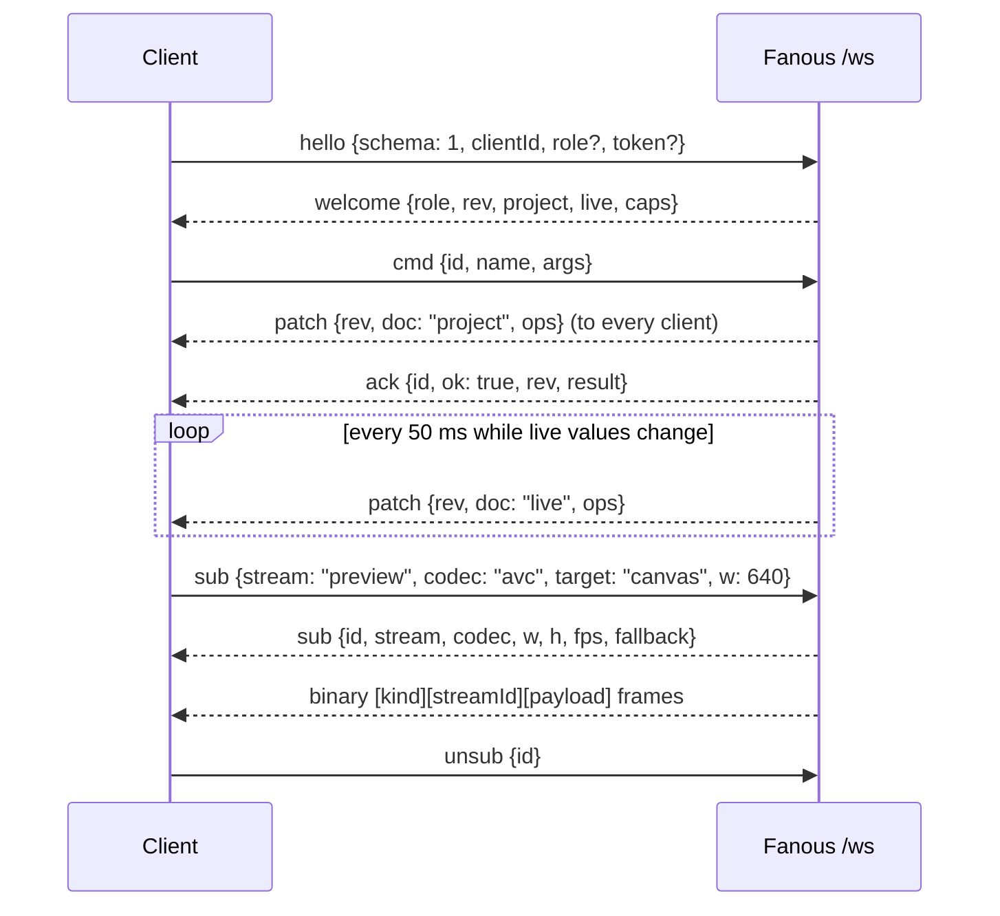

<!-- SPDX-License-Identifier: GPL-3.0-only -->
<!-- Copyright (c) 2026 Tim de Bruijn -->
<!-- Additional terms under GPLv3 §7 apply: see LICENSE-ADDITIONAL-TERMS.md -->

# REST and WebSocket API

For integrators: what the engine serves over HTTPS, how a client logs in,
and the WebSocket protocol the web UI itself uses, with every command. OSC
is [osc.md](osc.md); files, ports and the command line are
[files-and-ports.md](files-and-ports.md). Back to the [index](../README.md).

## Transport

| Item | Value |
|---|---|
| Port | 8443, HTTPS and WSS on one TCP port, on every interface; `fanousd --port N` changes it (the app window always opens 8443); `--no-network` binds 127.0.0.1 only |
| TLS | TLS 1.2 or newer, a self-signed ECDSA P-256 certificate made at first start, valid 10 years, for `localhost`, the host name, `<host>.local`, `127.0.0.1`, `::1` and the Mac's IPv4 addresses at that time. The certificate is `~/Library/Application Support/Fanous/tls/certificate.der`, its SHA-256 `fingerprint.sha256` next to it and on System › Network; `fanousd reset-tls` makes a new one. Clients pin the fingerprint or accept the certificate once |
| Discovery | Bonjour `_fanous._tcp` and `_https._tcp` under the host name (not with `--no-network`) |
| Requests | HTTP/1.1; request head at most 16 KiB; a body at most 1 MiB, except an upload, which streams to disk |
| Headers | `Server: fanousd/<version>` and `X-Content-Type-Options: nosniff` on every answer; no CORS headers, so a browser page from another origin cannot read the answers |
| Origin | The WebSocket upgrade is refused when the request's `Origin` host does not match its `Host`; native clients without an Origin pass |

## Roles and logging in

Three roles, monitor < operator < programmer, each with an optional
password set on the System screen. A role without a password is open to
anyone who reaches the port; a new install has no passwords at all
([ui.md](../ui.md#roles-and-logging-in)). A client is one of three things:

| Credential | Gives | How |
|---|---|---|
| The shell token | programmer | 64 hex characters in `~/Library/Application Support/Fanous/shell-token` (mode 0600). REST: `Authorization: Bearer <token>`; WebSocket: `token` in the `hello` message |
| A session cookie | The role logged in | `POST /api/login` with `{"role": "operator", "password": "…"}` answers 204 and sets `fanous_session` (24 hours, in memory, gone at an engine restart). 401 for a wrong password; 5 attempts a minute per address, then 429 |
| Nothing | Every open role | |

A client that asks for a role gets the highest role it is entitled to at or
below it; it fails only when none is. REST answers 403 with a plain-text
body when the role is missing; the WebSocket answers `authRequired` and
closes with code 4401. Documents are redacted per role: the library root
and the ingest jobs, the host name and the addresses from operator; Bonjour
and the TLS fingerprint from programmer.

## REST

| Route | Method | Role | Does |
|---|---|---|---|
| `/healthz` | any | none | `{"status":"ok","version":"…","uptimeSeconds":N,"chip":"…"}` |
| `/metrics` | any | none | The last second as JSON: frames, missed, late, texture misses, CPU and GPU ms (p50, p99, max), DMX-to-photon ms, clients, show mode, uptime, totals, audio, sync and preview counters |
| `/api/metrics` | any | none | The 10-second summary as text |
| `/api/live` | any | none | Every universe, fixture value with its source, policy and UI expiry; exposes the DMX senders' addresses |
| `/api/patch` | any | none | The patch as JSON |
| `/api/session` | any | none | `{"role": "<role>" or null, "open": [...]}`; the role comes from the cookie only ([known limitations](known-limitations.md#the-web-ui-and-security)) |
| `/api/login`, `/api/logout` | POST | none | Log in to a role (above); log out drops the cookie |
| `/api/logs` | any | programmer | The last 64 KiB of `~/Library/Logs/Fanous/fanousd.log`; `?download=1` sends the whole file |
| `/api/gdtf` | any | none | `Fanous.gdtf` for the console |
| `/api/channel-map.md`, `/api/channel-map.json` | any | none | The channel map as Markdown or JSON (per fixture mode: name, key, channel, bits, default, group, unit, bands) |
| `/api/library` | any | none; full from operator | The library index: root, folders with their items, counts. Below operator the root is empty and the paths relative |
| `/api/library/rescan` | any | none | Rescans the disk |
| `/api/library/folder` | POST | programmer | `{"number": 1–255, "name": "…"}` makes `NNN_name` under the root; 409 when the number exists |
| `/api/thumbnail/<hash>.jpg` | any | none | A thumbnail from the cache |
| `/api/ingest` | GET | operator | The ingest jobs (with file paths) |
| `/api/ingest` | POST | programmer | `{"source": "<absolute path>", "folder": 1–255, "file"?, "name"?, "codec"?: "prores4444" \| "prores422hq" \| "prores422" \| "hap" \| "hapalpha" \| "hapq" \| "hapalphaonly", "fps"?: 1–240, "keepOriginal"?}`: queues a transcode (a folder source is an image sequence, a still is kept as it is); 202 with the job, 404 when the source is missing, 409 when the folder is full |
| `/api/ingest/<id>/cancel`, `/api/ingest/<id>/remove` | POST | programmer | Cancels or removes a job |
| `/api/upload/<folder>/<name>` | PUT | programmer | The body is the file: it lands in `_incoming` and is queued into the folder; 202 with the job |

Every route except `/api/logs` and the ingest and upload writes is readable
without a login, whatever passwords are set.

## WebSocket

`wss://<host>:8443/ws`. Text frames carry JSON messages with a `t` field;
binary frames carry streams. The first message must be `hello`; the
server answers `welcome` with both documents, then sends `patch` messages
as they change. Everything the web UI does goes through this protocol, so
anything the UI can do a client can do. The message and command types are
generated from the engine's registry into `web/src/lib/protocol.d.ts` in
the source tree, the authoritative shape list.

| Message | Direction | Fields |
|---|---|---|
| `hello` | to Fanous | `schema` (1), `clientId` (free text, shown in the logs), `role` (monitor, operator or programmer; monitor when absent), `token` (the shell token). The role granted is fixed for the connection |
| `welcome` | from Fanous | `role`, `rev`, `project`, `live` (both redacted for the role), `caps` (`schema`, `version`, `chip`, `maxLayers`, `fps`) |
| `snapshot` | both | To Fanous: asks for the documents again (after a gap in `rev`). From Fanous: `rev`, `project`, `live` |
| `cmd` | to Fanous | `id` (echoed back), `name`, `args` (an object; `{}` when absent) |
| `ack` | from Fanous | `id`, `ok`; on success `rev` and `result` (null when the command returns nothing); on failure `error` with `code` and `message` |
| `patch` | from Fanous | `rev`, `doc` (`project` or `live`), `ops` (RFC 6902 add, remove and replace with RFC 6901 paths). Project patches go out at once on every change; live patches are collected and sent every 50 ms, latest value per path |
| `sub` | to Fanous | `stream`: `dmx` with `universe` (`artnet:0.0.1` or `sacn:1`); `preview` with `codec` (`avc` or `jpeg`), `target` (`canvas`, `canvas:2`, `output:1`, `layer:3`) and `w` (160–1280, rounded up to 320, 640, 960 or 1280); or `thumbs` |
| `sub` | from Fanous | The stream's `id` and what it delivers: for a preview `codec`, `w`, `h`, `fps` and `fallback` (true when the request was served from another stream or as JPEG at the encoder limit); for thumbs `w` 160 and `fps` 4 |
| `stream` | from Fanous | For an H.264 preview: `codec` (`avc1.…`), the `description` (avcC, base64), `w`, `h`, `fps`; sent before the first frame and when the description changes |
| `unsub` | to Fanous | `id` |
| `error` | from Fanous | `code` and `message`; with `id` and `stream` for a refused subscription, with `id` alone when a stream went away |

Binary frames: `[u8 kind][u32 stream id, big-endian][payload]`. Kind 1 is
an H.264 access unit (`[u8 key frame][u64 timestamp in µs][AVCC data]`),
kind 2 a JPEG (for thumbs: `[u8 layer][u16 width][u16 height][JPEG]`, size
0 when the layer shows nothing), kind 3 the 512 slot bytes of a DMX
universe, every 50 ms. At most 4 H.264 encoders run at once, shared by
every viewer of the same target and size; beyond that a viewer gets an
existing stream or JPEG at 5 fps.

A client whose send queue falls more than 256 KiB behind has live patches
and binary frames dropped (the engine counts it as lagging); past 1 MiB,
or when a project patch cannot be queued, it is disconnected with close
code 1008. Other close codes: 1002 protocol error or wrong schema, 1007
invalid text, 1009 message too large (16 MiB), 4401 auth required.

Error codes in an `ack`: `unknownCommand`, `forbidden` (the role is below
the command's), `showLocked` (the command changes the configuration and
the show is locked), `showMode` (refused in show mode), `notReady` (show
mode blocked by readiness items), `invalidArgs`, `nothingToUndo`,
`historyConflict`, `notFound`, `corrupt`, `liveChanged`, `ingestBusy`,
`failed`. In a message: `badMessage`, `helloFirst`, `schema`,
`authRequired`, `badStream`, `noPreview`, `badTarget`.

Undo and redo are global: 500 steps, and edits of the same path from the
same connection within a second are one step. Commands marked not undoable
are never recorded.

## Commands

The minimum role, whether the show lock refuses the command, and whether
Undo records it. Every command below the programmer's level also works
while the show is locked.

| Command | Args | Does | Role | Lock | Undo |
|---|---|---|---|---|---|
| `canvas.add` | `width, height, fps?, name?` | Adds a canvas (4 at most, together at most 4 × 3840 × 2160); refused in show mode; returns the id | programmer | refused | yes |
| `canvas.remove` | `id` | Removes a canvas (not 1); its layers and slices move to Canvas 1; refused in show mode | programmer | refused | yes |
| `canvas.set` | `id, path: /name or /clockMaster, value` or `id, width, height, fps` | Name, clock master, or size and rate (on Canvas 1 for every canvas; outputs blank briefly; refused in show mode) | programmer | refused | yes |
| `capture.authorize` | `kind: camera, screen or microphone` | Asks macOS for the permission; refused in show mode | programmer | refused | no |
| `capture.forget` | `file?` | Frees the number of a capture device or display that is not running, or of every one | programmer | refused | yes |
| `capture.renumber` | `file, to` | Moves a device or display to another number; a taken one swaps; refused in show mode | programmer | refused | yes |
| `cue.add` | `number, name, fade?, values?, trigger?, follow?` | Adds a cue; a value is `{fixture, parameter, raw, fade?}`; the trigger is `hh:mm:ss:ff@rate` with the rate written `24`, `25`, `29.97 DF`, `29.97 NDF` or `30` | programmer | refused | yes |
| `cue.set` | `id, cue` | Replaces a cue by id | programmer | refused | yes |
| `cue.remove` | `id` | Removes a cue | programmer | refused | yes |
| `cue.go`, `cue.back` | none | The next or previous cue | operator | allowed | no |
| `cue.goto` | `number` | That cue | operator | allowed | no |
| `fixture.set` | `fixture, parameter, raw` | Sets a parameter from the UI (`Layer n`, `Master`, `Output n`, `Keystone n`) | programmer | refused | no |
| `fixture.release` | `fixture?` | Drops the UI and MIDI values of one fixture, or all | programmer | allowed | no |
| `fixture.keep` | `fixture` | Restarts the 10-minute expiry of a fixture's UI values | programmer | refused | no |
| `layer.set` | `layer, canvas` | The canvas a layer renders into | programmer | refused | yes |
| `layers.setCount` | `count` | The number of layers, 1 to 64; layers above 32 get no address | programmer | refused | yes |
| `midi.set` | `source?, mscDevice?, mscFormat?` | The MIDI source (null for all), the MSC device id (0–111) and format (0–127, null for video 0x30–0x3F) | programmer | refused | yes |
| `midi.map.set` | `id?, source?, channel, kind: note, cc, cc14 or pc, number?, target, cue?, curve?, pickup?, low?, high?` | Adds or replaces a map entry; `low` and `high` are 0 to 1 of the parameter's range (the panel has no fields for them); returns the id | programmer | refused | yes |
| `midi.map.remove` | `id` | Removes a map entry | programmer | refused | yes |
| `midi.learn` | `target?, cue?` | Maps the next note, controller or program change to the target; no target cancels | programmer | refused | no |
| `output.add` | `display?` | Adds an output, optionally bound; its Output fixture is patched next to the Master when free | programmer | refused | yes |
| `output.remove` | `id` | Removes an output (not a wall member) and unpatches its fixtures | programmer | refused | yes |
| `output.set` | `id, path, value` | One value inside an output by JSON pointer: name, display, region, mode, intensity, `blend/*`, `warp/*`, `slices/*`, testPattern, `color/*` | programmer | refused | yes |
| `output.pattern` | `patterns: [{id, pattern}]` | The wizard's and seam check's test patterns, a 5-second lease the UI renews every 2 s; pattern 0 ends it; refused in show mode except to end | programmer | refused | no |
| `output.overlay` | `id, on, selected?` | Show on output, a 5-second lease; refused in show mode except to end | programmer | refused | no |
| `output.show` | `ids, preset` | Hold to compare, a 5-second lease on outputs 1–8; preset 0 ends it; refused in show mode | programmer | refused | no |
| `output.preset.store` | `ids, number, name?` | Stores the warp and slices of each output as preset 1–255; an existing number is replaced | programmer | refused | yes |
| `output.preset.recall` | `ids, number` | Copies the preset into each output's mapping | programmer | refused | yes |
| `output.preset.rename` | `ids, number, name` | Renames it (1–64 characters) | programmer | refused | yes |
| `output.preset.remove` | `ids, number` | Removes it | programmer | refused | yes |
| `patch.set` | `fixture, universe, address` | Patches a fixture (`artnet:0.0.1` or `sacn:1`; address 0 unpatches) | programmer | refused | yes |
| `patch.setMany` | `entries` | Several in one step; one bad entry refuses all | programmer | refused | yes |
| `project.set` | `path, value` | One project value: name, policy (`dmx`, `internal`, `ltp`, `htp`), `library.root`, `ui.*` | programmer | refused | yes |
| `project.snapshot` | `name?` | Saves a version now; named ones never expire | programmer | allowed | no |
| `project.versions` | none | Lists the versions, newest first | monitor | allowed | no |
| `project.revert` | `id` | Restores a version (the current project is saved first); refused in show mode | programmer | refused | yes |
| `project.deleteVersion` | `id` | Deletes a named version | programmer | refused | no |
| `readiness.run` | none | Runs the readiness checks | operator | allowed | no |
| `readiness.acknowledge` | `id` | Acknowledges a failed item so show mode can start | programmer | allowed | no |
| `roles.setPassword` | `role, password or null` | Sets or clears a role's password | programmer | refused | no |
| `show.lock`, `show.unlock` | none | The show lock | programmer | allowed | no |
| `show.mode` | `on` | Enters or leaves show mode; refused with the blocking items | operator | allowed | no |
| `sync.set` | `interface?, port?, target?` | The sync settings; refused in show mode | programmer | refused | no |
| `syphon.forget` | `file?` | Frees a Syphon number | programmer | refused | yes |
| `syphon.renumber` | `file, to` | Moves a Syphon server to another number; refused in show mode | programmer | refused | yes |
| `timecode.set` | `path, value` | `/source` (`off`, `ltc`, `mtc`), `/device`, `/channel` (0-based), `/offset` (frames), `/freewheel` (s), `/layerOffsets/<n>` (frames) | programmer | refused | yes |
| `timecode.enable` | `on` | The timecode switch | operator | allowed | no |
| `universe.set` | `id, path, value` | A universe's `/protocol`, `/interface`, `/holdOnLoss`, `/lossTimeout`, `/sacnPriorityMode` or `/pair` | programmer | refused | yes |
| `wall.add` | `cols, rows, outputs, overlap: {x, y}, canvas?, fit: canvas or makeCanvas, name?` | Makes a projector wall; returns the id | programmer | refused | yes |
| `wall.set` | `id, cols?, rows?, outputs?, overlap?, canvas?, name?, fit?, resetManual?` | Changes a wall's geometry and compiles it again | programmer | refused | yes |
| `wall.seam` | `id, a, b, power?, gamma?, gammaRGB?` | Tunes one seam | programmer | refused | yes |
| `wall.seams` | `id, power?, gamma?, gammaRGB?` | Tunes every seam | programmer | refused | yes |
| `wall.remove` | `id` | Removes a wall; its outputs stay | programmer | refused | yes |
| `undo`, `redo` | none | The global history | programmer | refused | no |

## Limits

| Limit | Value |
|---|---|
| Login attempts | 5 a minute per address |
| Session | 24 hours, in memory |
| WebSocket clients | No cap; `/metrics` counts them and the lagging ones |
| Live patches | Every 50 ms, latest value per path |
| DMX stream | One 512-byte frame per subscription every 50 ms |
| H.264 preview encoders | 4 in total, shared per target and size; the preview width is 160–1280 in four classes |
| Undo history | 500 steps |
| Layers | 1–64; `caps.maxLayers` reports 32, the number with console addresses |
| Canvases | 4, together at most 4 × 3840 × 2160 pixels |
| Library folders and file numbers | 1–255 |
