<!-- SPDX-License-Identifier: GPL-3.0-only -->
<!-- Copyright (c) 2026 Tim de Bruijn -->
<!-- Additional terms under GPLv3 §7 apply: see LICENSE-ADDITIONAL-TERMS.md -->

# Folder 0: built-in content and live inputs

What a layer shows when its Folder channel is 0, by file number. Built-in
content is drawn by the engine, with no file; it goes through the layer like
media, so position, scale, colour, effects and dissolves apply. Select it
from the console (channel 3 at 0, channel 4 at the number), from the layer
panel's **Built-in content and live inputs (folder 0)** list, or from the
Media screen's folder 0 with **Play on layer**. Live inputs:
[Live inputs](../live-inputs.md). Back to the [index](../README.md).

| File | Content |
|---|---|
| 1–20 | Cameras and capture cards of this Mac |
| 21–28 | Displays of this Mac |
| 29–32 | Reserved (not available) |
| 100 | Solid colour |
| 101–107 | The seven alignment test patterns as layer content |
| 110 | Test card |
| 111 | Colour sweep |
| 112 | Clock |
| 113 | Motion test |
| 150–169 | Syphon servers of other apps on this Mac |

A number without an input reads "no capture device numbered N", "no
display numbered N" or "no Syphon server numbered N" on the Layers screen;
any other number reads "no built-in content N in folder 0". File 0 means
nothing. The pictures below are the layer preview, about 16:9, of the demo
canvas; a preview is no colour reference.

## 100 · Solid colour

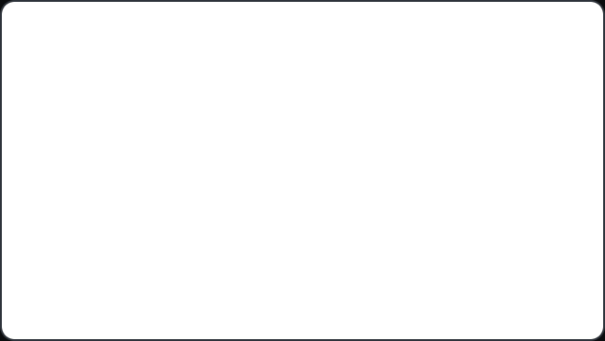

White, multiplied by the layer's Red, Green and Blue channels (30 to 32,
255 by default; a console that leaves them at 0 gets black), then through
brightness, contrast, saturation and hue like any picture: a flat colour for
a wash, a backing or a flash. Dim it with the layer's intensity.

## 101 to 107 · Test patterns as a layer

The same seven patterns an output can show for alignment
([Outputs and mapping](../outputs-and-mapping.md#test-patterns)), but as
the content of one layer: they go through the layer's position, scale and
colour, and through the outputs' blend and warp like any picture. Use them
to send a grid or bars to every output from a cue, or as a test picture with
a known geometry. As layer content, Output ID always reads 1 and Blend check
always uses output 1's colour; for an ID per projector use the output's own
test pattern. For a flat grey use Solid colour with equal RGB values.

| File | Pattern | Shows |
|---|---|---|
| 101 | Grid | 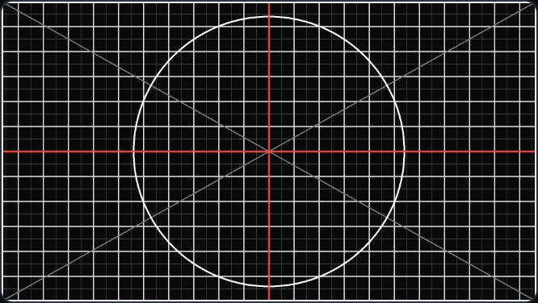 |
| 102 | Colour bars | 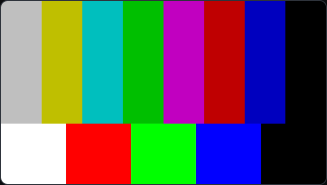 |
| 103 | Blend check | 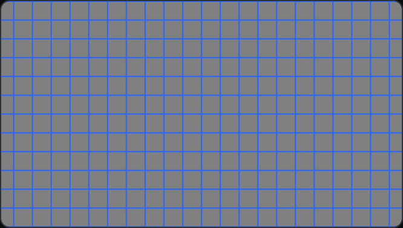 |
| 104 | Output ID | 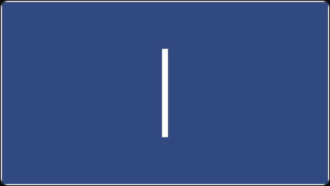 |
| 105 | Crosshair | 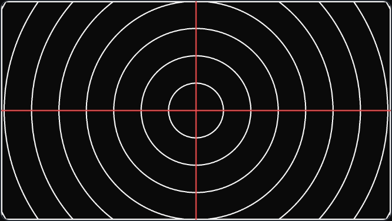 |
| 106 | Grey steps | 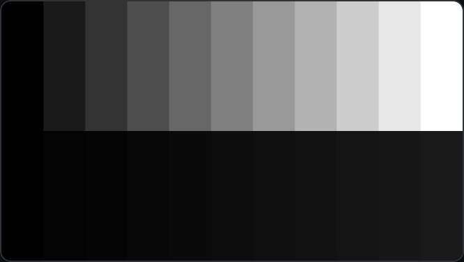 |
| 107 | Checkerboard | 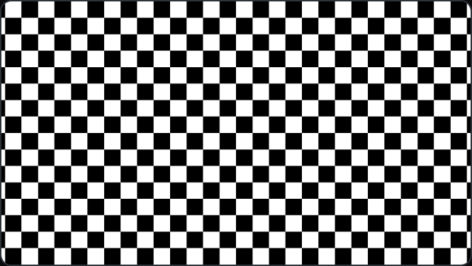 |

## 110 · Test card

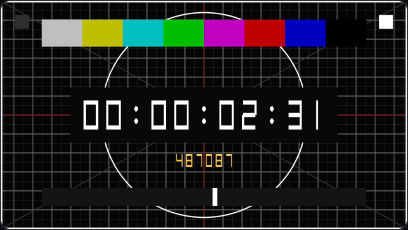

A grid with a border and an aspect circle, colour bars, and three motion
checks: a running time counted from the moment a moving built-in was first
shown after the engine started, wrapping at 24 hours (or the incoming
timecode while it runs), with the engine's frame counter under it, a bar that
sweeps once a second, and two squares that swap every frame. In a photo with
an exposure longer than a frame a dropped or doubled frame shows as both
squares lit or both dark; a wrong frame rate as a sweep that does not take
one second. Put it on the source you want to measure and film the output to
measure a delay.

## 111 · Colour sweep

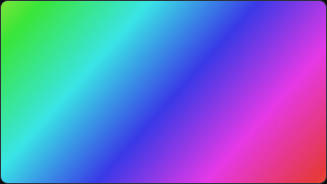

A slow-moving hue gradient over the whole layer, one cycle every 20 s: a
look for a backing. For banding on a projector use Grey steps (106).

## 112 · Clock

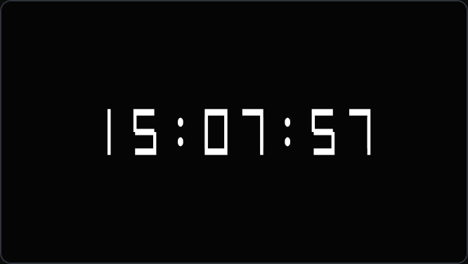

The Mac's time of day, `hh:mm:ss`, in large digits: a house clock on a
screen, or a check that the engine's clock and the desk's agree.

## 113 · Motion test

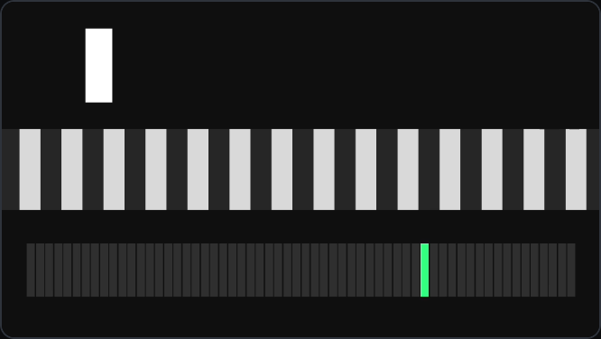

A bar that moves 32 px per frame and stripes that scroll 16 px per frame on
a 1080p canvas (half that at 540 lines, double at 2160; at other heights the
steps are not whole pixels), and a strip of 60 cells with one lit per frame,
so at 60 fps the lit cell goes round once a second. At a steady rate every
step is equal; a dropped or doubled frame shows as a jump or a stop. Judge
it on an output, not in the preview: the preview is at most 30 frames a
second and shows only every second frame of a 60 fps canvas, so moving
content always looks jerky there.
