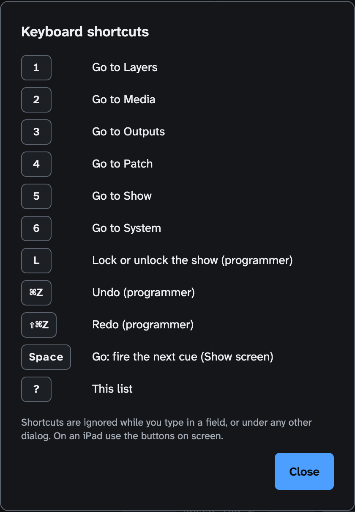

<!-- SPDX-License-Identifier: GPL-3.0-only -->
<!-- Copyright (c) 2026 Tim de Bruijn -->
<!-- Additional terms under GPLv3 §7 apply: see LICENSE-ADDITIONAL-TERMS.md -->

# Keyboard shortcuts and touch equivalents

Every key the UI answers to and what to tap instead on an iPad. Press **?**
on any screen, or the **?** button in the status bar, for the list in the UI.
How the screens fit together: [ui.md](../ui.md#keys).

## Everywhere

| Key | Does | Role | On an iPad |
|---|---|---|---|
| `1` to `7` | Go to Layers, Media, Inputs, Outputs, Patch, Show, System | any | tap the rail |
| `L` | Lock or unlock the show. Unlocking while show mode is on asks first | programmer | tap the Locked / Unlocked tag |
| `⌘Z` | Undo the last setup change | programmer | Undo in the status bar |
| `⇧⌘Z` | Redo | programmer | Redo in the status bar |
| `Space` | GO: fire the next cue, on the Show screen only. Ignored while a field or button has the focus: click an empty part of the screen first | operator, programmer | the GO button |
| `?` | This list; also closes it | any | the ? button |
| `Esc` | Close a dialog; in the warp editor, let go of the selected point | any | Cancel or Close; tap the empty preview |
| `Shift` + click on − or + of the address stepper (Patch) | Step by 10 | programmer | type the address in the field |

Keys do nothing while you type in a field or while a dialog is open (except
`?` to close the list). Space is also ignored while a modifier key is held,
when the key repeats, and while a field or button has the focus: click an
empty part of the Show screen first. Ctrl+Z and Ctrl+Shift+Z work like ⌘Z
and ⇧⌘Z.

## Warp & Slices (Outputs screen)

| Key | Does | On an iPad |
|---|---|---|
| Arrow keys | Move the selected point by one output pixel | nudge pad arrows |
| `Shift` + arrow | Move by ten pixels | the **10 px** key in the middle of the pad |
| (nudge pad only) | Move by 0.25 pixel | hold a pad arrow for half a second |
| `Tab`, `Shift+Tab` | Select the next or previous point (a mask: point, then its in and out handles) | **Previous** and **Next** in Remote mode |
| `Backspace`, `Delete` | Remove the selected mask point (a mask keeps at least three), or the selected curve handle | **Remove point**, **Remove handle** |
| Double-click a mask point | Make it smooth, or a corner again | double-tap, or **Smooth point** |
| Double-click a mask edge | Add a point there | **Add points**, then tap |

The warp editor is one tab stop: click or tap it once before the arrow keys
act. See [outputs-and-mapping.md](../outputs-and-mapping.md#warp--slices-tab).

## Layer panel (Layers screen)

| Action | Does |
|---|---|
| Double-click a slider | Back to the channel's default |
| `Enter` or `Space` on a layer row | Select it |

On an iPad there is no double-click: type the default into the number field
next to the slider, or send the value from the console.

## The app window (Mac)

| Key | Does |
|---|---|
| `⌘R` | Engine › Reload UI |
| `⌘Q` | Quit; asks whether to keep the engine running |
| `⌘Z`, `⇧⌘Z` | Edit › Undo, Redo (the same as above) |
| `⌘M` | Minimize |
