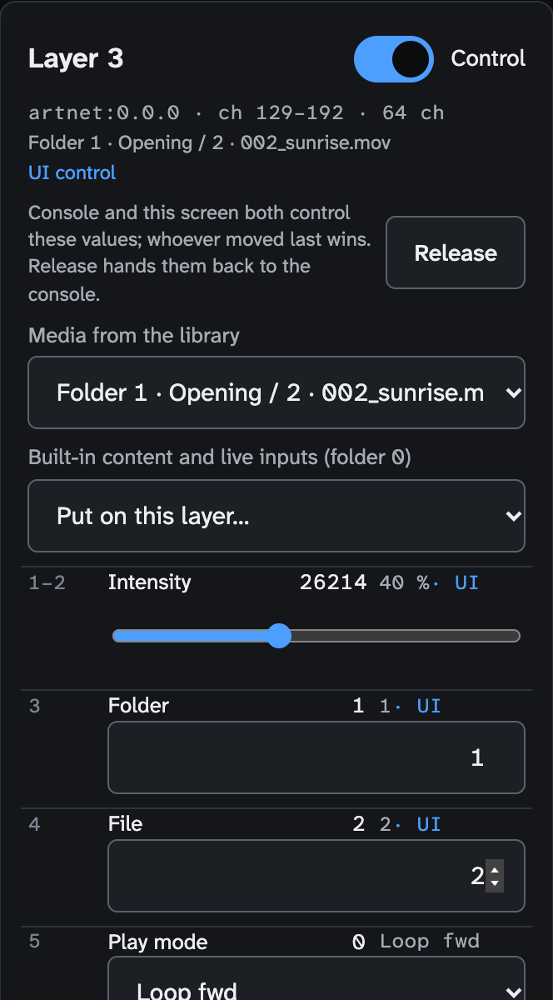
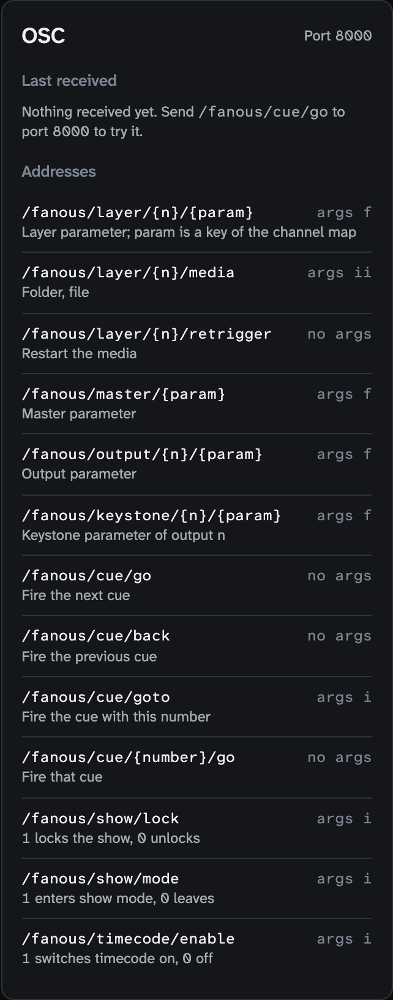
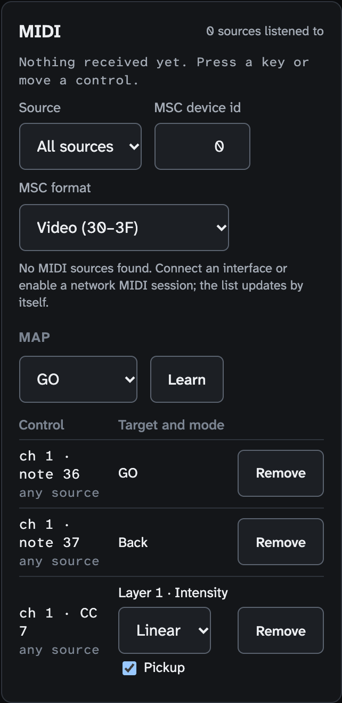
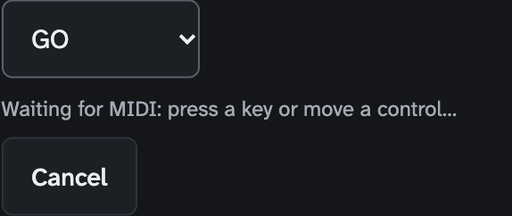

<!-- SPDX-License-Identifier: GPL-3.0-only -->
<!-- Copyright (c) 2026 Tim de Bruijn -->
<!-- Additional terms under GPLv3 §7 apply: see LICENSE-ADDITIONAL-TERMS.md -->

# Remote control and the other ways in

Use this page to drive Fanous without a lighting console, or next to one:
from the web UI on any device, from a show controller or button box over
OSC (and to read the state back), from a MIDI controller or MIDI Show
Control, and to let a console browse the library over CITP/MSEX. Cues and
timecode are [show-control.md](show-control.md); the full OSC address list
is [reference/osc.md](reference/osc.md), the REST and WebSocket API for
integrators [reference/api.md](reference/api.md).

| Way in | Typical use | Reads state back | Login | Values expire |
|---|---|---|---|---|
| The web UI | A person at a laptop, iPad or phone | Yes, it is the UI | A role | After 10 min of masking a console |
| OSC | A button box, a show controller, a script | Yes, ask or subscribe | None | No |
| MIDI | A controller with pads and faders | No | None | After 10 min of masking a console |
| MIDI Show Control | A show controller's GO | No | None | Fires cues only |
| CITP/MSEX | A console browsing the library | Yes, to the console | None | Reads only |
| REST and WebSocket | Integrators | Yes | A role or the shell token | As the UI |

## Who controls

Everything on this page enters Fanous as its own values, next to the
console's. The project's **Who controls** (Patch screen) decides what shows
([console-setup.md](console-setup.md#who-controls)):

| Who controls | The UI, OSC, MIDI and cues | The console |
|---|---|---|
| **Console only** (new project) | Kept, not shown; the screens say so in yellow | Shows |
| **Fanous only (UI, cues, OSC, MIDI)** | Show | Ignored |
| **Console and Fanous, latest change wins** | Whoever moved a parameter last shows it; a running cue fade counts as moving | Same |
| **Console and Fanous, highest value wins** | The higher value shows for continuous parameters; the latest change for folder, file and modes | Same |

Without a console, choose **Fanous only**; with a console and Fanous
together, **latest change wins**. UI and MIDI values are "controller"
values: while the console is also sending a value for the same parameter
they expire after 10 minutes without a change (**Keep** restarts the
count, **Release** drops them). Cue and OSC values do not expire.

## From the UI

Reach the UI from another device: `https://<the Mac's name>.local:8443`,
accept the certificate once, log in with the role's password when one is
set ([ui.md](ui.md#the-ui-on-an-ipad-or-another-computer)). Then open the
Layers screen, select a layer and turn on **Control** in its panel. Every
channel gets a control: a slider for continuous values (double-click: the
default), a list for modes, numbers for folder and file, and **Media from
the library** lists every playable file ("Folder 3 · Intro / 12 ·
loop.mov") and puts it on the layer. **Release** hands the layer back to
the console; the panel says "UI control · console active, releases in
7:42" while a console is masked. The Master and the outputs have the same
**Control** switch in their strips. UI control is the programmer's and
refused while the show is locked. The same from the Media screen: select a
file and pick **Play on layer** ([media-library.md](media-library.md)).



## OSC

OSC is a network message: an address that looks like a path,
`/fanous/cue/go`, with optional values. Anything that sends OSC (Bitfocus
Companion, QLab, TouchOSC, a console's OSC output) sends it to the Mac's
address on port 8000, UDP or TCP. Values are `f`, a decimal number from 0
to 1 of the parameter's range (0.5 on intensity is half); `i`, a whole
number, the raw console value (0–255 or 0–65535); `s`, text.

OSC has no login and no roles: anyone on the network can move a layer, and
parameter messages are never refused by the show lock. Put the show
network on its own VLAN or firewall port 8000. The port and the interface
cannot be changed, and OSC is off with `--no-network`.

The OSC panel on the Show screen shows the port, the last received cue,
show, timecode and project-load commands (parameter messages are not
listed) and the control addresses. Try `/fanous/cue/go` first.



| Address | Args | Does |
|---|---|---|
| `/fanous/layer/{n}/{key}` | f or i | A layer parameter; the keys are the "OSC key" column of the [channel map](../channel-map.md): `intensity`, `playMode`, `speed`, `positionX`, `red`, `audioVolume` … |
| `/fanous/layer/{n}/media` | i i | Folder, file |
| `/fanous/layer/{n}/retrigger` | none | Restart the media |
| `/fanous/master/{key}` | f or i | A Master parameter |
| `/fanous/output/{n}/{key}` | f or i | An Output parameter (`intensity`, `testPattern`, `blend`, `preset`, `fade`), outputs 1 to 8 |
| `/fanous/keystone/{n}/{key}` | f or i | A Keystone parameter (`topLeftX` … `bottomLeftY`) |
| `/fanous/cue/go`, `/fanous/cue/back` | none | The next or the previous cue |
| `/fanous/cue/goto` | i or f | The cue with that number (2.5 works) |
| `/fanous/cue/{number}/go` | none | That cue |
| `/fanous/show/lock`, `/fanous/show/mode` | i | 1 locks or enters, 0 unlocks or leaves |
| `/fanous/timecode/enable` | i | The timecode switch |
| `/fanous/project/load` | s | The newest named project version with that name (or a version id); refused in show mode and while the show is locked |

Parameter messages show or not by Who controls. Cue, show-mode and
timecode messages run as the operator and show lock as the programmer, so
all of them work while the show is locked; a refusal (show mode blocked by
the readiness list, project load under the lock) is logged, not sent back.
Leave about 50 ms between messages sent back to back from one socket
([known limitations](reference/known-limitations.md#consoles-and-protocols));
bundles, timetags and the other details are in
[reference/osc.md](reference/osc.md).

### Reading state back

Skip this section if your controller only sends. A controller that shows
state (the current cue on a button, a fader that follows a layer) asks
once or subscribes.

Ask once: add `/get` to an address. `/fanous/layer/3/intensity/get`
answers `/fanous/layer/3/intensity 0.75`; `/fanous/layer/3/get` answers
with every value of layer 3; `/fanous/get` with a summary (version, show
mode and lock, ready, current cue, fps, missed frames). The answer goes
back to the address and port the question came from.

Subscribing means Fanous sends changes to the controller as they happen.
So that a stranger cannot make Fanous stream to someone else, it takes two
steps: the controller asks, Fanous sends a one-time code (the cookie) to
the address the controller named, and the controller sends that code back
within 5 seconds. Companion and TouchOSC can do this ([below](#bitfocus-companion)).

```mermaid
sequenceDiagram
  participant C as Controller
  participant F as Fanous :8000
  C->>F: /fanous/subscribe host port [prefix]
  F-->>C: /fanous/subscribe/confirm cookie (to host:port)
  C->>F: /fanous/subscribe/ack cookie (within 5 s, from host)
  F-->>C: every current value under the prefix, once
  loop every 50 ms while something changed
    F-->>C: the changed values, latest only
  end
  C->>F: /fanous/ping every 30 s (a subscription lasts 60 s; /fanous/subscribe renews it too)
  F-->>C: /fanous/pong
  C->>F: /fanous/unsubscribe
```

The host must be the sender's own IP address (a name fails), else
`/fanous/error` comes back. A value goes out at most 20 times a second,
always as its latest value, so a console fading a layer does not flood the
controller; every cue go sends the cue addresses again. Values come in the
units you send: a parameter as 0 to 1, so a fader can follow a layer and
send the same value back. The readable addresses are in
[reference/osc.md](reference/osc.md#reading-state-and-subscribing): every
parameter, `/fanous/cue/current` and `/fanous/cue/next` with their names,
`/fanous/show/ready`, `/fanous/timecode/state`, the outputs' state, the
engine's version, fps and missed frames.

### Bitfocus Companion

Add a *Generic OSC* connection with the Fanous Mac's address and port 8000,
and a button with *Send message* `/fanous/cue/go`: that fires the next
cue. For feedback, let Companion listen for OSC on a port of its own, say
9000 (the field names differ between Companion versions), then take the
simplest route, a fixed target:

1. On the Fanous Mac, open `~/Library/Application Support/Fanous/settings.json`
   in a text editor (the folder is hidden: in Finder, Go › Go to Folder).
2. Add, next to the `passwords` that are already there:

   ```json
   "oscFeedback": { "host": "<Companion's address>", "port": 9000, "prefix": "/fanous/cue" }
   ```

3. Engine › **Restart Engine** in the app window. From then on every
   change under the prefix, and the answer to every `/get`, goes to that
   port for as long as the engine runs. There is no field for it on the
   System screen.

Or subscribe, when you cannot edit the file: a trigger that runs every 30
seconds sends *Send message* `/fanous/subscribe` with the arguments
`<Companion's address>` (string), `9000` (integer) and `/fanous/cue`
(string); store the received `/fanous/subscribe/confirm` argument in a
variable (as text: the code can look like a number), and let a trigger on
that variable changing send `/fanous/subscribe/ack` with it as a string.
Once confirmed, the 30-second subscribe only renews. Then received
`/fanous/cue/current/name` and `/fanous/cue/next/name` fill variables for
the button ("Next: Chorus"), and a feedback on `/fanous/show/ready` = 0
turns a button red before show mode. The recipe follows the protocol; it
has not been tried against a given Companion version.

### TouchOSC

TouchOSC sends from and listens on the same port: it gets the cookie on
that port, from port 8000, and answers with the ack (a small script on a
control: on `/fanous/subscribe/confirm`, send `/fanous/subscribe/ack` with
the same argument); changes then come from port 8000 too.

## MIDI

A MIDI controller (an APC, a Launchpad, a nanoKONTROL, a keyboard) fires
cues and moves parameters; a show controller fires cues with MIDI Show
Control. MIDI sends three kinds of message: a note (a pad or key pressed
and released), a controller or CC (a fader or knob, 0 to 127) and a
program change (a patch number); Learn works out which one your control
sends. Fanous sends no MIDI back: no controller lights, no MSC replies.
The MIDI panel on the Show screen lists every source with a green dot when
Fanous listens to it (**Source** is All sources or one), the last message
(`APC mini · ch 1 · CC 48 = 127`), the MSC settings and the map.



### Learn a control

1. Plug the controller in: it appears in the MIDI panel's source list with
   a green dot within a second.
2. Choose the target: **GO**, **Back**, **Go to cue** (then the cue) or
   **Parameter** (then the fixture and the parameter).
3. **Learn**, then press the key or move the control. "Waiting for MIDI:
   press a key or move a control…" shows until the first message arrives;
   **Cancel** stops waiting. A controller numbered 0 to 31 is learned on
   the next message: as a fine-resolution (14-bit) fader when that is its
   partner (controller + 32), else as a plain controller. Keep moving the
   fader, or press the button twice.
4. The row appears in the map and "Learned: …" confirms it. Learning the
   same control for the same target again replaces the row.
5. For a parameter, pick the **Mode** and **Pickup** on the row.



| Control | Cue target | Parameter target |
|---|---|---|
| Note | Fires on key down | **Linear**: the velocity while held, back to 0 on release. **Toggle** (learned by default): every press switches between 0 and full |
| CC | Fires when it rises past half way (a button sending 127/0 fires once per press) | **Linear**: 0–127 across the range. **Toggle**: every rise past half way switches |
| CC 14-bit | As CC | 16 384 steps: the coarse controller sets the value, its fine partner refines it |
| Program change | Fires | The program number across the range |

**Pickup** (Linear only): the control is ignored until it reaches the value
the parameter shows now, then takes over; when something else changes the
value (the console, a cue, the UI) it lets go until it is reached again. Use
it on faders so a layer does not jump when you touch one. A controller
unplugged, or a row removed, drops what it was holding. The map and Learn
are the programmer's and refused while the show is locked; a locked show
still follows its controllers. A row that fires cue *program + 1* from a
program change cannot be learned; the API makes one
([reference/api.md](reference/api.md#commands), `midi.map.set` with kind
`pc` and no cue).

An APC mini, with Who controls not on Console only:

1. Target **GO**, Learn, press the bottom-right pad.
2. Target **Back**, Learn, the pad left of it.
3. Target **Go to cue** 1, Learn, the top-left pad; the same for cues 2, 3
   … along the top row.
4. Target **Parameter**, Layer 1 · Intensity, Learn, move fader 1; Mode
   Linear, Pickup on. The same for Layer 2 to 8 with faders 2 to 8.
5. Target **Parameter**, Master · Intensity, Learn, the ninth fader.

Learn finds the note and controller numbers for you. A controller
unplugged leaves the list and whatever it held is released. Without a
controller at hand, turn on the IAC Driver in Audio MIDI Setup › MIDI
Studio and send to it from any MIDI app.

### MIDI Show Control

MSC is a command a show controller sends over MIDI: "GO cue 3 on device
0". Two settings must match the controller: **MSC device id** (0–111, 0 to
start; the all-call id 127 is always answered) and **MSC format**. A
lighting desk usually sends the Lighting format: set **MSC format** to
**Lighting (01)** for it, or its GO is ignored. **Video (30–3F)** is the
start value, the format a show controller sends to a media server;
**Sound (10)**, **Video general (30) only** and **All types (7F) only** are
the other choices, and the all-types format 7F is answered whatever the
setting. If a lighting desk also sends MSC to its own fixtures, keep
Fanous on Video, or it fires Fanous cues as well.

| GO arrives | Fanous |
|---|---|
| To another device id, or a group id (112–126) | Ignores it |
| In another command format | Ignores it |
| Without a cue number | Fires the next cue |
| With a cue number such as `3` or `1.5` | Fires that cue; the cue list and path fields are ignored |
| With a cue that is not a number (`1.2.3`, a stray byte) | Nothing; it never becomes a plain GO |
| STOP, RESUME, LOAD, FIRE, ALL_OFF, the rest | Shown as the last message, nothing happens |

MSC respects the **Source** selection like every other MIDI message.

## CITP/MSEX

A console that speaks CITP/MSEX (grandMA2, MagicQ, Hog 4, Onyx, Titan
among others) lists Fanous as a media server by itself, so the programmer
browses folders and files with thumbnails instead of typing numbers. The
console and the Mac must be on the same network segment. Software CITP
clients have been checked; a hardware console has not
([known limitations](reference/known-limitations.md#consoles-and-protocols)).

| The console gets | Detail |
|---|---|
| Fanous in its media server list | Announced every 5 seconds on the CITP multicast groups (224.0.0.180 and 239.224.0.180, UDP 4809), under the Mac's host name; MSEX over TCP on a port the system picks (System › Network, CITP line, with the connected consoles and open streams) |
| One DMX source per layer and the layer status | Four times a second |
| Libraries and elements | The numbered folders and files with name, size, frame rate and length, as indexes from 0 without gaps; the folder or file number is in the DMX range. Folder 0 and missing media report library and element 255 |
| Thumbnails | 320 pixels wide, as in the library |
| A canvas stream, one stream per layer | Canvas 1 as JPEG, 640 wide in the canvas's aspect, at most 5 new pictures a second; each layer 160 wide, 4 a second; each only while a console asks. The size a console asks for is ignored |
| MSEX 1.0 to 1.2 | Negotiated; a console that sends no client information within 2 seconds is taken as 1.0 |

## Before the show

- Lock the show (L): OSC, MIDI and MSC keep working, and nobody can change
  a map or a cue from the UI.
- Test every button and fader against the real controller, and one
  `/fanous/cue/go` from the show controller; read the OSC panel's "Last
  received" line and the MIDI panel's last message to see them arrive.
- Keep OSC on the show network, and the feedback target or subscription
  renewing.
