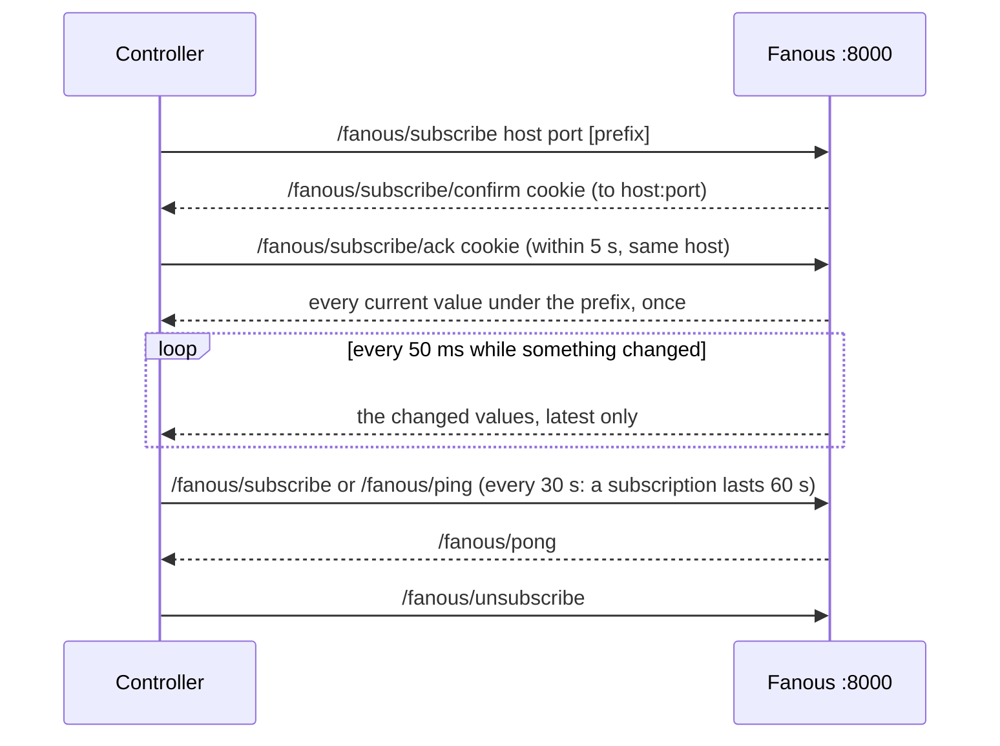
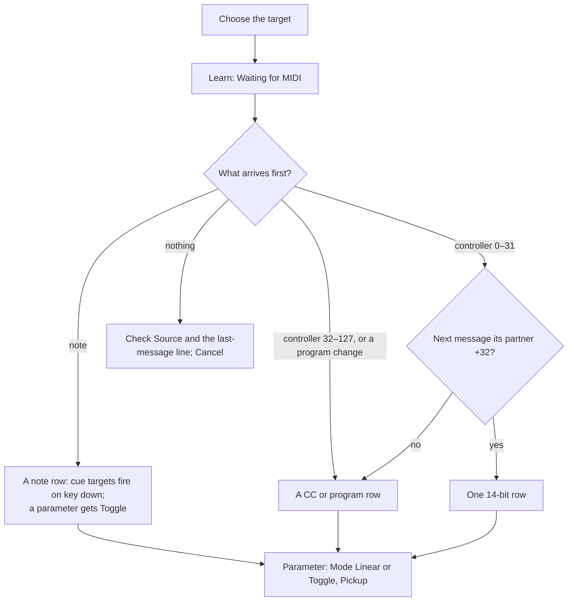

<!-- SPDX-License-Identifier: GPL-3.0-only -->
<!-- Copyright (c) 2026 Tim de Bruijn -->
<!-- Additional terms under GPLv3 §7 apply: see LICENSE-ADDITIONAL-TERMS.md -->

# Remote control without a console

Use this page to drive Fanous without a lighting console, or next to one:
from the web UI, from a show controller or button box over OSC (and to read
the state back), from a MIDI controller or MIDI Show Control, and to let a
console browse the library over CITP/MSEX. Cues and timecode are
[show-control.md](show-control.md); the full OSC address list is
[reference/osc.md](reference/osc.md), the REST and WebSocket API for
integrators [reference/api.md](reference/api.md).

## Who controls

Everything on this page enters Fanous as its own values, next to the
console's. The project's **Who controls** (Patch screen) decides what shows
([console-setup.md](console-setup.md#who-controls)):

| Who controls | The UI, OSC, MIDI and cues | The console |
|---|---|---|
| **Console only** (new project) | Kept, not shown; the screens say so in yellow | Shows |
| **Fanous only (UI, cues, OSC, MIDI)** | Show | Ignored |
| **Console and Fanous, latest change wins** | Whoever moved a parameter last shows it; a running cue fade counts as moving | Same |
| **Console and Fanous, highest value wins** | The higher value shows for continuous parameters; the latest change for folder, file and modes | Same |

UI and MIDI values are "controller" values: while they mask a live console
they expire after 10 minutes without a change (**Keep** restarts the
count, **Release** drops them). Cue and OSC values do not expire.

## From the UI

Open the Layers screen, select a layer and turn on **Control** in its
panel. Every channel gets a control: a slider for continuous values
(double-click: the default), a list for modes, numbers for folder and
file, and **Media from the library** lists every playable file ("Folder 3 ·
Intro / 12 · loop.mov") and puts it on the layer. **Release** hands the
layer back to the console; the panel says "UI control · console active,
releases in 7:42" while a console is masked. The Master and the outputs
have the same **Control** switch in their strips. UI control is the
programmer's and refused while the show is locked. The same from the Media
screen: select a file and pick **Play on layer**.


## OSC

Fanous listens on port 8000, UDP and TCP (SLIP framing), on every
interface; the port cannot be changed, and OSC is off with `--no-network`.
There are no passwords: keep OSC on the show network. The OSC panel on the
Show screen shows the port, the last received cue, show, timecode and
project-load commands (parameter messages are not listed) and the control
addresses.


Try `/fanous/cue/go` first. The control addresses:

| Address | Args | Does |
|---|---|---|
| `/fanous/layer/{n}/{key}` | f or i | A layer parameter; the keys are the "OSC key" column of the [channel map](../channel-map.md): `intensity`, `playMode`, `speed`, `positionX`, `red` … |
| `/fanous/layer/{n}/media` | i i | Folder, file |
| `/fanous/layer/{n}/retrigger` | none | Restart the media |
| `/fanous/master/{key}` | f or i | A Master parameter |
| `/fanous/output/{n}/{key}` | f or i | An Output parameter (`intensity`, `testPattern`, `blend`, `preset`, `fade`) |
| `/fanous/keystone/{n}/{key}` | f or i | A Keystone parameter (`topLeftX` … `bottomLeftY`) |
| `/fanous/cue/go`, `/fanous/cue/back` | none | The next or the previous cue |
| `/fanous/cue/goto` | i or f | The cue with that number (2.5 works) |
| `/fanous/cue/{number}/go` | none | That cue |
| `/fanous/show/lock`, `/fanous/show/mode` | i | 1 locks or enters, 0 unlocks or leaves |
| `/fanous/timecode/enable` | i | The timecode switch |
| `/fanous/project/load` | s | The newest named project version with that name (or a version id); refused in show mode and while the show is locked |

A float is 0 to 1 of the parameter's range (0.5 on `intensity` is half);
an int is the raw console value (0–255 or 0–65535); values out of range are
clamped. Parameter messages are never refused: Who controls decides whether
they show. Cue, show and timecode messages run as the operator, so they
work while the show is locked; a refusal (show mode blocked by the
readiness list, project load under the lock) is logged, not sent back.
Bundles work, nested up to 8 deep; a timetag 1 ms to one hour ahead runs
the contents at that time, any other runs them at once. Leave about 50 ms
between messages sent back to back from one socket
([known limitations](reference/known-limitations.md#consoles-and-protocols)).

### Reading state back

A controller can ask once or subscribe. **Ask once**: add `/get` to an
address. `/fanous/layer/3/intensity/get` answers `/fanous/layer/3/intensity
0.75`; `/fanous/layer/3/get` answers with every value of layer 3; `/fanous/
get` with a summary (version, show mode and lock, ready, current cue, fps,
missed frames). The answer goes to the address and port the question came
from; at most 256 addresses per question, so ask per layer.

**Subscribe** takes two steps, so nobody can make Fanous stream to a
computer that did not ask:



The host must be the sender's own address, else `/fanous/error` comes back.
A value goes out at most 20 times a second, always as its latest value, so
a console fading a layer does not flood the controller; every cue go sends
the cue addresses again. Values come in the units you send: a parameter as
0 to 1, so a fader can follow a layer and send the same value back. The
readable addresses are in [reference/osc.md](reference/osc.md#feedback):
every parameter, `/fanous/cue/current`, `/fanous/cue/next` with their
names, `/fanous/show/ready`, `/fanous/timecode/state`, the outputs' state,
the engine's version, fps and missed frames.

A controller that cannot subscribe gets a **fixed target** in
`~/Library/Application Support/Fanous/settings.json` (next to `passwords`,
which stay), then an engine restart:

```json
{
  "oscFeedback": { "host": "10.0.1.30", "port": 9000, "prefix": "/fanous/cue" }
}
```

That target gets every change under the prefix for as long as the engine
runs, and the answers to every `/get`. There is no field for it on the
System screen.

### Bitfocus Companion

Add a *Generic OSC* connection with the Fanous Mac's address and port 8000,
and let Companion listen for OSC on a port of its own, say 9000 (the field
names differ between Companion versions). Then:

- the simplest: put the Companion computer in `settings.json` as the fixed
  target (`"host": "<Companion's address>", "port": 9000`);
- or subscribe: a trigger that runs every 30 seconds sends *Send message*
  `/fanous/subscribe` with the arguments `<Companion's address>` (string),
  `9000` (integer) and `/fanous/cue` (string); store the received
  `/fanous/subscribe/confirm` argument in a variable, and let a trigger on
  that variable changing send `/fanous/subscribe/ack` with it as a string.
  Once confirmed, the 30-second subscribe only renews;
- a button with *Send message* `/fanous/cue/go` fires the next cue;
- received `/fanous/cue/current/name` and `/fanous/cue/next/name` fill
  variables for the button ("Next: Chorus"), and a feedback on
  `/fanous/show/ready` = 0 turns a button red before show mode.

TouchOSC sends from and listens on the same port: it gets the cookie on
that port, from port 8000, and answers with the ack (a small script on a
control: on `/fanous/subscribe/confirm`, send `/fanous/subscribe/ack` with
the same argument); changes then come from port 8000 too.

## MIDI

A MIDI controller (an APC, a Launchpad, a nanoKONTROL, a keyboard) fires
cues and moves parameters; a show controller fires cues with MIDI Show
Control. Fanous sends no MIDI back: no controller lights, no MSC replies.
The MIDI panel on the Show screen lists every source with a green dot when
Fanous listens to it (**Source** is All sources or one), the last message
(`APC mini · ch 1 · CC 48 = 127`), the MSC settings and the map.


### Learn a control

1. Choose the target: **GO**, **Back**, **Go to cue** (then the cue) or
   **Parameter** (then the fixture and the parameter).
2. **Learn**, then press the key or move the control. "Waiting for MIDI:
   press a key or move a control…" shows until the first note, controller
   or program change arrives; **Cancel** stops waiting. A controller 0 to
   31 waits for the next message, to tell a 14-bit pair (controller and
   its partner 32 to 63, fine faders) from a plain one.
3. The row appears in the map and "Learned: …" confirms it. Learning the
   same control for the same target again replaces the row.
4. For a parameter, pick the **Mode** and **Pickup** on the row.




| Control | Cue target | Parameter target |
|---|---|---|
| Note | Fires on key down | **Linear**: the velocity while held, back to 0 on release. **Toggle** (learned by default): every press switches between 0 and full |
| CC | Fires when it rises past half way (a button sending 127/0 fires once per press) | **Linear**: 0–127 across the range. **Toggle**: every rise past half way switches |
| CC 14-bit | As CC | 16 384 steps: the coarse controller sets the value, its fine partner refines it |
| Program change | Fires; a hand-written row **Go to cue (program + 1)** fires cue *program + 1* | The program number across the range |

**Pickup** (Linear only): the control is ignored until it reaches the value
the parameter shows now, then takes over; when something else changes the
value (the console, a cue, the UI) it lets go until it is reached again. Use
it on faders so a layer does not jump when you touch one. A controller
unplugged, or a row removed, drops what it was holding. The map and Learn
are the programmer's and refused while the show is locked; a locked show
still follows its controllers.

Example, an APC mini: Who controls not on Console only. Target **GO**,
Learn, press the bottom-right pad. Target **Back**, Learn, the pad left of
it. Target **Go to cue** 1, Learn, the top-left pad; the same for cues 2, 3
… along the top row. Target **Parameter**, Layer 1 · Intensity, Learn,
move fader 1; Mode Linear, Pickup on; the same for Layer 2 to 8 with faders
2 to 8, and Master · Intensity on the ninth. Learn finds the note and
controller numbers for you.

Plug and unplug: a controller plugged in while the engine runs appears in
the list within a second with a green dot; unplugged, it leaves the list
and whatever it held is released. Without a controller at hand, turn on
the IAC Driver in Audio MIDI Setup › MIDI Studio and send to it from any
MIDI app.

### MIDI Show Control

A show controller fires cues with MSC **GO**. Fanous answers a message when
its device id matches **MSC device id** (0–111, 0 to start) or the all-call
id 127, and its command format matches **MSC format**: **Video (30–3F)** to
start, or **Lighting (01)** when the controller sends lighting-format GOs
that should fire Fanous cues too, **Sound (10)**, **Video general (30)
only** or **All types (7F) only**; the all-types format 7F is answered
whatever the setting.

| GO arrives | Fanous |
|---|---|
| To another device id, or a group id (112–126) | Ignores it |
| In another command format | Ignores it (a lighting GO meant for the desk does not fire Fanous cues) |
| Without a cue number | Fires the next cue |
| With a cue number such as `3` or `1.5` | Fires that cue |
| With a cue that is not a number (`1.2.3`, a stray byte) | Nothing; it never becomes a plain GO |
| STOP, RESUME, LOAD, FIRE, ALL_OFF, the rest | Shown as the last message, nothing happens |

MSC respects the **Source** selection like every other MIDI message.

## CITP/MSEX

Fanous announces itself to consoles every 5 seconds on the CITP multicast
groups 224.0.0.180 and 239.224.0.180 (UDP port 4809, same subnet only),
under the Mac's host name, and serves MSEX over TCP on a port the system
picks (System › Network, CITP line, with the connected consoles and open
streams). A console sees one DMX source per layer and the layer status
four times a second; the libraries and elements (numbered folders and
files with name, size, frame rate and length, as indexes from 0 without
gaps; the folder or file number is in the DMX range; folder 0 and missing
media report library and element 255); thumbnails, 320 pixels wide; a
canvas stream of Canvas 1 (JPEG, 640 wide in the canvas's aspect, at most
5 new pictures a second) and one stream per layer (160 wide in its canvas
aspect, 4 a second), each only while a console asks. MSEX 1.0 to 1.2 is
negotiated; a console that sends no client information within 2 seconds
is taken as 1.0. The sizes a console asks for are ignored, and no real
console has been tried ([known limitations](reference/known-limitations.md#consoles-and-protocols)).
