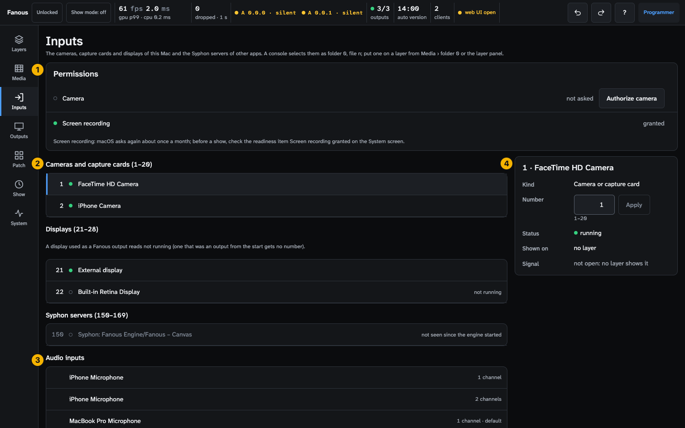
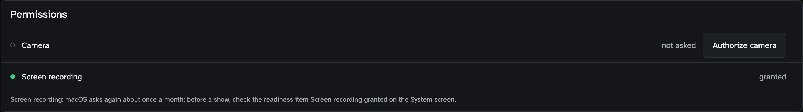
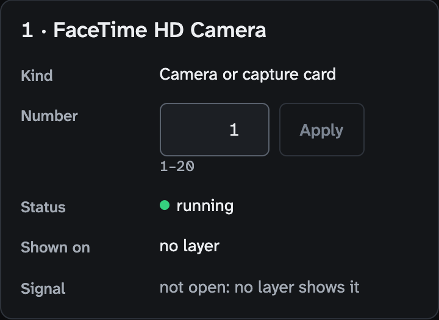
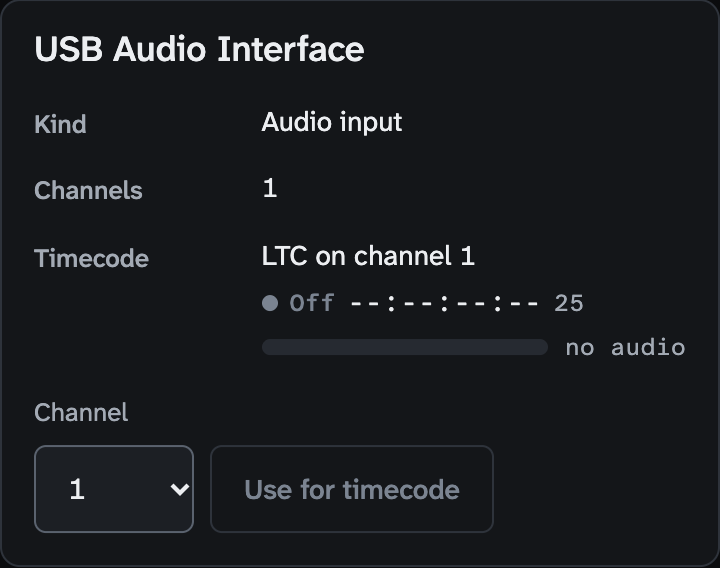

<!-- SPDX-License-Identifier: GPL-3.0-only -->
<!-- Copyright (c) 2026 Tim de Bruijn -->
<!-- Additional terms under GPLv3 §7 apply: see LICENSE-ADDITIONAL-TERMS.md -->

# Inputs screen (key 3)

Every control on the screen that lists the live inputs of this Mac: cameras
and capture cards, displays, Syphon servers of other apps, and the audio
inputs that carry LTC timecode. For the tasks (numbering, permissions, a
camera on a layer, LTC) see
[Live inputs](../live-inputs.md) and
[Show control](../show-control.md#timecode). Terms are in the
[glossary](../reference/glossary.md).

Everything marked "programmer" is greyed out or refused for the operator and
monitor roles; "refused while the show is locked" means the status bar's tag
reads **Locked** (a programmer presses L to unlock). Hover a greyed control
for its reason: [The user interface](../ui.md#why-is-this-control-greyed-out).
On this screen the operator and monitor roles can look; Authorize, Number,
Apply, Forget and Use for timecode are the programmer's.

1. **Permissions**: the macOS permissions the inputs need.
2. **Inputs** by kind: cameras and capture cards, displays, Syphon servers.
3. **Audio inputs**.
4. **Selected input**: the details of the input you tapped.

Below 900 px wide the panel moves under the lists. A console selects a live
input as folder 0, file n; put one on a layer from Media › folder 0 or from
the layer panel.

## Permissions

One row per permission this Mac can need: **Camera** (when it has a camera
or capture card), **Screen recording** (when it has a display to number) and
**Microphone (LTC)** (when the timecode source is LTC).

| Part | Does |
|---|---|
| Dot | Green: granted. Yellow: a layer shows an input of this kind without the permission (for the microphone: the timecode source is LTC without it). Grey: nothing of this kind is in use |
| Word | **granted**, **not asked**, **denied**; rarely **restricted** (a profile forbids it) or **pending** (the prompt is open) |
| **Authorize camera / screen / microphone** | Asks macOS (programmer; refused while the show is locked and in show mode, "Leave show mode first"). Screen recording opens System Settings › Privacy & Security › Screen & System Audio Recording: allow Fanous, then Engine › Restart Engine |
| Notes | "Camera denied: allow Fanous under System Settings › Privacy & Security › Camera.", the same for the microphone, and "Screen recording: macOS asks again about once a month; before a show, check the readiness item Screen recording granted on the System screen." |

## Inputs by kind

| Group | Numbers | Rows |
|---|---|---|
| **Cameras and capture cards** | 1–20 | Every camera and UVC capture card the engine has seen |
| **Displays** | 21–28 | Every display of this Mac. A display that Fanous uses as an output reads "not running" and is not captured; a display that was an output from the engine's start is not numbered at all |
| **Syphon servers** | 150–169 | Every Syphon server another app has published |

| Part | Does |
|---|---|
| Row | Number, a dot (green: present, see below; yellow "in use by another app"; grey ring: gone), name, a caption with the signal while a layer shows it (`1920×1080 · 59.94 fps · 2vuy`: size, rate and pixel format; "waiting for the first frame"; "connected" for Syphon) or the reason ("not running", "not seen since the engine started"), and Layer badges |
| **Forget all not running** (Syphon) and **Forget all not running (cameras and displays)** | Free the numbers of every input of that kind that is not running (programmer, refused while the show is locked; Undo brings them back). Shown when more than one is not running |
| Notes | "Not numbered, all 20 numbers are taken: …" when a new Syphon server got no number; "A display used as a Fanous output reads not running …" |

Empty texts say that a new camera or server appears with the lowest free
number and keeps it, also across engine restarts, until you forget it here.

**What a capture input delivers.** A camera or capture card is opened only
while a layer shows it, at the canvas frame rate or the nearest rate the
device offers. A built-in or Continuity camera is asked for the largest size
that fits the canvas; a UVC capture card or webcam delivers the size of its
input. 8-bit 2vuy, yuvs and 420v frames (420f is read as 420v) are taken as
they are; anything else (MJPEG, 10-bit
v210) is decoded to 8-bit BGRA first. A display is captured as 8-bit BGRA in
sRGB, without the pointer, without sound and without Fanous's own windows,
at most at the canvas rate, and only when its picture changes.

## Audio inputs

Every audio interface and microphone of this Mac, with its channel count and
"default" on the system's default input. One of them can carry LTC: its row
reads **Timecode (LTC, channel N)**. Audio inputs have no folder 0 number; a
layer cannot show them. Empty: "No audio inputs found. An audio interface or
microphone connected to this Mac appears here; LTC timecode comes in on one
of its channels."

## Selected input

Tap a row to open it on the right; the address bar follows (`#/inputs/1`), so
a tapped input can be bookmarked. Empty: "Select an input to see its status.
An input is opened only while a layer shows it: opening a camera just to look
could take it from another app."

| Part (video input) | Does |
|---|---|
| Kind | Camera or capture card, Display, Syphon server |
| **Number** and **Apply** | Give the input another number in its range (1–20, 21–28, 150–169): a free number moves it, a taken one swaps the two; the line under the field says which ("moves to 3, a free number", "swaps with 3 · name"). Apply is greyed until you type a different number. Programmer; refused while the show is locked and in show mode. Undo takes it back |
| Model | The camera's model when it differs from the name |
| Status | **running**: the device is present (a Syphon server answered in the last 6 s); it is opened only while a layer shows it, so running does not mean a picture is coming in. **in use by another app**, **not running**, **not seen since the engine started** |
| Shown on | The layers that show it, or "no layer" |
| Signal | "not open: no layer shows it", or the size, rate and pixel format |
| Frames | `N · N dropped · N out of buffers · N unusable`: frames delivered, dropped by the device or macOS, dropped because the engine had no free buffer, and refused because of their format |
| **Forget** | Frees the number of an input that is not running and not in use (programmer, refused while the show is locked; Undo brings it back). The number then goes to whichever new input appears next, so a cue on it selects that input: do not forget a camera that is only unplugged for a moment before a show |

| Part (audio input) | Does |
|---|---|
| Kind | Audio input, with "(system default)" on the system's default input |
| Channels | The number of input channels |
| Timecode | "not used", or "LTC on channel N" with the state (Locked, Freewheel, Lost, Off), the time and the rate while this input is the LTC device |
| Level meter (the LTC device only) | The chosen channel's peak over the last tenth of a second, −60 to 0 dBFS; yellow above −3 dBFS (hot, not clipping); "no audio" when nothing arrives, "timecode switched off" while the switch is off |
| Channel list | 1 is the first input channel |
| **Use for timecode** | Sets the timecode source to LTC, this device and this channel in one step (programmer, refused while the show is locked; disabled when already set). The Timecode on/off switch on the Show screen stays as it is |
