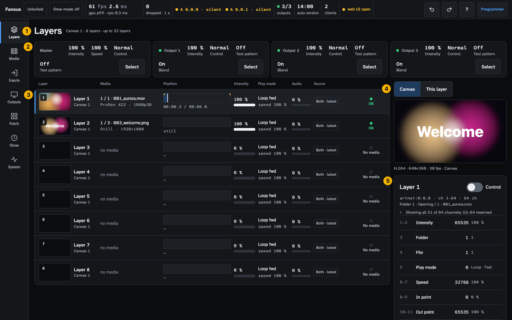
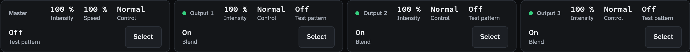
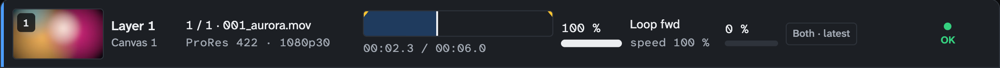
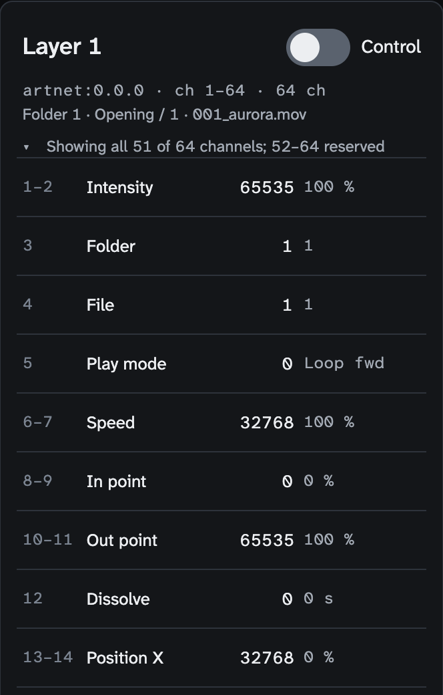
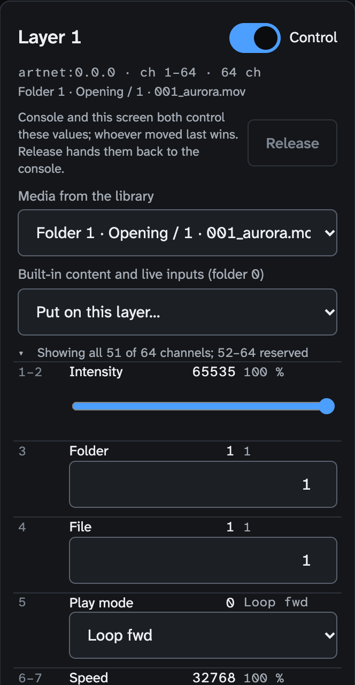

<!-- SPDX-License-Identifier: GPL-3.0-only -->
<!-- Copyright (c) 2026 Tim de Bruijn -->
<!-- Additional terms under GPLv3 §7 apply: see LICENSE-ADDITIONAL-TERMS.md -->

# Layers screen (key 1)

Every control on the screen that shows what each layer plays. For the tasks
(driving a layer from the UI, reading its state, the preview) see
[show-control.md](../show-control.md#controlling-layers-from-the-ui) and
[getting-started.md](../getting-started.md). Terms are in the
[glossary](../reference/glossary.md).

Everything marked "programmer" is greyed out or refused for the operator and
monitor roles; "refused while the show is locked" means the status bar's tag
reads **Locked** (a programmer presses L to unlock). Hover a greyed control
for its reason: [ui.md](../ui.md#why-is-this-control-greyed-out).
On this screen the operator and monitor roles can look and select; every
control in the layer panel is the programmer's. "Control" means two things
here: the **Control** switch in the panel (set values from the UI) and the
Control channel of the Master and Output fixtures (Normal, Freeze, Blackout).

1. **Header**: `Layers`, then the canvas (or "N canvases"), the layer count
   and "up to 32 layers", the engine's limit on every Mac (hover it for the
   note). What a Mac plays without dropping frames can be lower.
2. **Strips**: one for the Master fixture, one per Output fixture.
3. **Layer rows**: one per layer in the project.
4. **Preview switch**: the canvas, or the selected layer alone.
5. **Layer panel**: the selected layer, output or Master with every channel.

With no layers in the project the list says so and offers **Go to Patch**.
Below 1320 px wide the rows become tiles without column heads; below 1100 px
the panel moves under the list; below 600 px the channel list starts folded.

## Strips

| Control | Shows | Select |
|---|---|---|
| **Master** | Intensity (multiplies every output), Speed, Control (Normal, Freeze all, Blackout), Test pattern | puts the Master in the panel: Intensity and Speed can be set from the UI |
| **Output n** | a dot (always green: decoration, not the output's state; that is in the status bar and under System › Machine), Intensity, Control (Normal, Blackout, Freeze), Test pattern, Blend (**On**, or **Raw** when the console holds the Blend channel at 128 or more: the output without blend, black lift, masks, warp and keystone, for alignment; set it back to On for the show) | puts the output in the panel: Intensity and Test pattern can be set from the UI |

The values are what the engine applies: from the console, or from the UI, a
cue, OSC or MIDI according to Who controls. **Selected** marks the strip in
the panel; select a layer row to go back to a layer.

## Layer rows

| Column | Shows |
|---|---|
| Picture | A live picture of this layer alone (a 160-pixel JPEG four times a second) while the engine renders and the layer shows something; the file's library thumbnail when it shows nothing (no media, intensity 0). Live pictures stop while the tab is in the background |
| Layer | `Layer N`, and under it the canvas it is drawn into. With several canvases this is a list (programmer; refused while the show is locked); a canvas that no longer exists reads "Canvas N · missing". A Sync pill `M1` or `S1` appears when the Sync channel is set: see [multi-server.md](../multi-server.md#what-the-screens-show) |
| Media | `folder / file · name`, then the codec and size (`ProRes 422 · 1080p30`, `Still · 1920×1080`, `Live · 1920×1080`), or "no media", "no live data", or the engine's error in red ("no file 2 in folder 3", "File missing") |
| Position | A scrubber with the playhead and the in and out points for a movie, and `mm:ss.s / mm:ss.s` under it; "still" for a still, "live" for an input, "—" with no media. The scrubber only shows the position |
| Intensity | The percentage and a bar |
| Play mode | The mode (Loop fwd, Once hold, Bounce, Freeze, Timecode, …) and the speed |
| Audio | The audio volume parameter as a percentage; no level meter |
| Source | **Console**, **Fanous**, **Both · latest** or **Both · highest**: the project's Who controls as it applies to this layer ([how-it-works.md](../how-it-works.md#who-wins-the-four-who-controls-settings)). Under **Console** a value set from the UI is kept but not shown |
| State | A dot and a word: **OK** (green), **Live** (green, a live input), **No media** (grey), **Missing file** (red), **Decoder error** (red), or the reason a live input fails ("Not running", "Could not connect") |

Click or tap a row (Enter or Space on the keyboard) to select it; the panel
and the preview follow. The last column has no heading: it is the state.

A layer that shows nothing, in the order to check: intensity 0 (the Intensity
column), no media (the Media column reads "no media" or an error in red), the
Master or Output fixture at Blackout or 0 (the strips), the output not bound
(the status bar's outputs item).

## Preview

Shown only while the engine renders an output; otherwise the switch and the
picture are absent.

| Control | Does |
|---|---|
| **Canvas** (one button per canvas when there are several) | The whole canvas, as the outputs show it before their slices, blend and warp |
| **This layer** | Only the selected layer, in its own canvas frame over black: its media with position, scale, rotation, fit, crop, colour, effects and intensity; its blend mode shown as Normal. With the Master or an output selected the preview shows the canvas and says "(no layer selected)" |

The caption under the picture says what you see: `H.264 · 640×360 · 30 fps ·
Canvas`, or "JPEG 5 fps" when the browser cannot decode H.264, "no preview ·
reason" when the engine renders nothing, "starting…" and "connecting…" while
it comes up, "· no new frames" after 2 s without a frame, "H.264 encoders
busy" when the engine's four encoders are taken (each size class and target
across every browser costs one). The browser remembers the choice. The
preview is 320, 640, 960 or 1280 pixels wide, at most 30 frames a second
(every second frame of a 60 fps canvas), at a low bitrate and not in step
with the output: judge motion, banding and colour on an output.

## Layer panel

| Part | Does |
|---|---|
| Title | `Layer N`, `Master` or `Output n` |
| **Control** switch | Set these values from here, without a console (programmer; refused while the show is locked). It stays on when you select another layer row and goes off when you select the Master or an output. See [show-control.md](../show-control.md#controlling-layers-from-the-ui) |
| Patch line | `artnet:0.0.1 · ch 145–208 · 64 ch`, or "no address" |
| Library line | `Folder 3 · Intro / 12 · loop.mov`: the names behind the numbers the layer plays |
| Note | "UI control" or "MIDI control" while such values are set; "· console active, releases in 7:42" with **Keep** while they hide a live console value. At 0:00 the UI and MIDI values are dropped and the console's values show again; **Keep** restarts the 10 minutes (programmer; refused while the show is locked) |
| Release bar (Control on) | "Console and this screen both control these values; whoever moved last wins." and **Release**, which hands the layer back to the console (programmer; greyed when no UI or MIDI value is set, and greyed in the UI while the show is locked, although the engine's release command itself is not refused by the lock) |
| Yellow note (Control on) | Who controls is **Console only**, so values set here are kept but not shown; **Use Console and Fanous, latest change wins** changes it (programmer) |
| **Media from the library** (Control on, layers) | Every library file that is not invalid or unreadable, as `Folder 3 · Intro / 12 · loop.mov`; puts folder and file on the layer and intensity to full when it was 0. "No media in the library yet (Media screen)" when the library is empty |
| **Built-in content and live inputs (folder 0)** (Control on, layers) | The same for folder 0, grouped: built-in content, cameras and capture cards (1–20), displays (21–28), Syphon servers (150–169) |
| Channel list | "Showing all 51 of 64 channels; 52–64 reserved" (a layer) or "N values" (Master, output); folds. The Master panel has Intensity and Speed; an output panel Intensity and Test pattern |
| Channel row | The DMX channel (`3` or `1–2`), the parameter, its raw value and its meaning, and "· UI" or "· MIDI" when that source set it. A missing file shows the folder and file values in red |
| Channel row, Control on | A list for modes, a number field 0–255 for folder and file, a slider for the rest (double-click: the default) |
| Sync line | Under the Sync channel of a layer: its sync state in words ([multi-server.md](../multi-server.md#what-the-screens-show)) |

Values from the UI go out at most twenty times a second per parameter, the
last value always.
