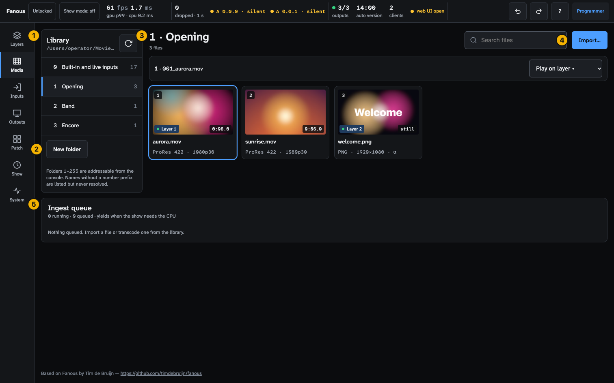
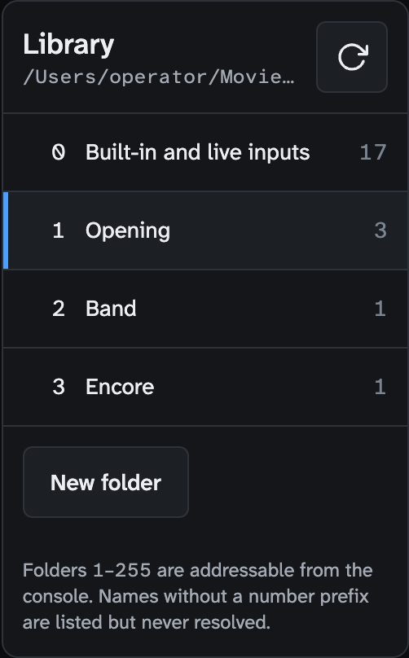
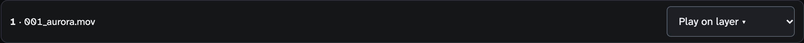
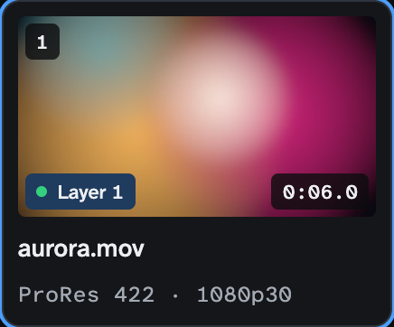
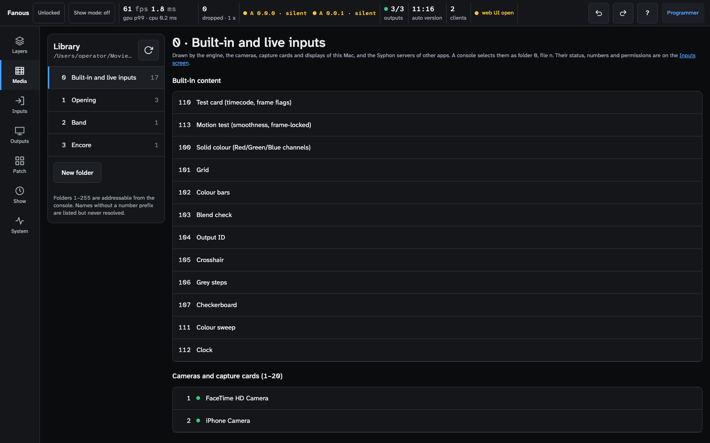

<!-- SPDX-License-Identifier: GPL-3.0-only -->
<!-- Copyright (c) 2026 Tim de Bruijn -->
<!-- Additional terms under GPLv3 §7 apply: see LICENSE-ADDITIONAL-TERMS.md -->

# Media screen (key 2)

Every control on the screen that shows the library. For the tasks (naming,
formats, import, transcode, the library root) see
[media-library.md](../media-library.md). Terms are in the
[glossary](../reference/glossary.md).

Everything marked "programmer" is greyed out or refused for the operator and
monitor roles; "refused while the show is locked" means the status bar's tag
reads **Locked** (a programmer presses L to unlock). Hover a greyed control
for its reason: [ui.md](../ui.md#why-is-this-control-greyed-out).
On this screen the operator and monitor roles can browse; nothing here
changes anything for them.

1. **Library panel**: the root path and the folders.
2. **New folder**.
3. **Files**: the selected folder's files as tiles, with the selected file's
   bar above them.
4. **Search files** and **Import…**.
5. **Ingest queue**: imports and transcodes.

Below 900 px wide the panel and the files stack.

## Library panel

| Part | Does |
|---|---|
| Root path | The library folder (hover for the whole path); change it under System › Machine › Library |
| **Rescan** (circular arrow) | Re-reads the disk. The library is watched, so a change in Finder shows up by itself; Rescan forces it |
| **0 · Built-in and live inputs** | Folder 0, with its item count: see below |
| Folder rows | Number, name without its number, a red **N invalid** badge when files in it have no valid number, and the file count. A folder without a valid number is dimmed and listed last |
| **New folder** (programmer) | Opens the form: **Number** (the lowest free one filled in, 1–255), **Name** (placeholder "Intro"), **Cancel**, **Create**. Makes `NNN_name` on disk, and the root itself when it is missing. Disabled when every number is taken |
| Footnote | "Folders 1–255 are addressable from the console. Names without a number prefix are listed but never resolved." |

Empty: "No folders yet. Press New folder below to create the first one (the
console addresses folders by number), then Import… to add files."

## Files

| Control | Does |
|---|---|
| Heading | `N · name` and "N files · N invalid names" |
| **Search files** | Filters the tiles by name |
| **Import…** (programmer) | Picks one or more files and uploads them, one at a time; reads "Uploading…" meanwhile. Disabled with "Select a numbered folder to import into" while the folder has no valid number. The uploads list under the toolbar shows each file as waiting, uploading, queued or failed; **Clear** empties it when they are done |
| Selected-file bar | Appears when you tap a tile: `number · name` and **Play on layer ▾** (Layer 1 to N; programmer, refused while the show is locked). A result line says "Layer 3 now plays 1 / 2 · name." Tap the tile again to deselect |
| Selected-file bar, not playable | "Transcode this file first to play it." or "This file cannot be played on a layer." instead of the list |
| Yellow note | Who controls is **Console only**, so files put on a layer from here are kept but not shown; **Use Console and Fanous, latest change wins** changes it |

### A tile

| Part | Shows |
|---|---|
| Number | The file number; red, or "—", when the name has no valid one |
| Duration | `m:ss.s`, "still", or "N frames" for an image sequence |
| Layer badges | A green dot and `Layer N` for every layer that plays the file |
| Name | Without its number |
| Detail line | `codec · 1080p25 · α · 48k`: the codec, the height and rate (the width too, as `1920×1080p25`, when the pixels are not square), **α** when the file has alpha, the audio sample rate when it has audio |
| Badges | **invalid name** (red, with the reason: "no 1–255 prefix", "duplicate file number 4", "folder: duplicate folder number 3"; rename the file in Finder), **unreadable** (red, with the reason), **needs transcode** (yellow), "probing…" while the engine reads the file |
| What plays as it is | A `.mov` in ProRes (422 Proxy, LT, 422, 422 HQ, 4444, 4444 XQ) or HAP (HAP, HAP Alpha, HAP Q, HAP Q Alpha, HAP Alpha-only, HAP R) without a rotation flag, and every still. Everything else needs a transcode: H.264, HEVC and other codecs, `.mp4`, `.m4v`, `.avi`, `.mkv` and `.mxf`, rotated phone footage, and image sequences |
| Transcode controls (needs transcode) | A codec list and **Transcode**, which reads "Queued" once the job is in the queue (programmer). HAP Q (the default) or ProRes 422 HQ for a plain clip; HAP Alpha or ProRes 4444 when it has transparency; HAP plays lighter than HAP Q at lower quality. An image sequence is always written at 25 frames per second. The original moves to `_originals/` in the folder |

Empty states: "No files in this folder. Press Import… to add files, or copy
them into the folder on disk; the list updates by itself.", "No files here.
Select a numbered folder, then press Import…", `No files match "…"`.

## Folder 0 · Built-in and live inputs

The first row of the folder list opens folder 0: the content Fanous makes
itself and the live inputs of this Mac, each with the file number a console
dials ([show-control.md](../show-control.md#built-in-content-folder-0)).
Folder 0 has no Search and no Import.

| Part | Shows |
|---|---|
| Groups | **Built-in content** (100 Solid colour, 101–107 the test patterns, 110 Test card, 111 Colour sweep, 112 Clock, 113 Motion test), **Cameras and capture cards (1–20)**, **Displays (21–28)**, **Syphon servers (150–169)**. The camera group appears once the engine reports a camera, the display group once there is a display |
| Row | Number, a dot for live inputs (green running, yellow "in use by another app", grey ring gone), name, a caption ("not running", "not seen since the engine started") and Layer badges |
| Selected-item bar | `number · name`, **Play on layer ▾**, and for a camera, display or Syphon server **Status on Inputs**, which opens it on the Inputs screen |

## Ingest queue

| Part | Shows |
|---|---|
| Caption | "N running · N queued · yields when the show needs the CPU" |
| Job row | The source file, the destination, a codec badge (or "Still"), the state (queued, transcoding with a percentage, done, failed with the reason, cancelled), a progress bar, and **Cancel** (running or queued) or **Remove** (finished); programmer |
| Empty | "Nothing queued. Import a file or transcode one from the library." |

Jobs run one at a time at low priority and pause in show mode. A done or
cancelled job leaves the list a minute later; a failed one stays until you
remove it. The status bar shows the running job's progress too.

## Messages

Yellow banners with **Dismiss**: "Cannot load the library: …", "Cannot create
the folder: …", "Rescan failed: …", "Cannot transcode …: …", "Could not cancel
the job: …", "Could not remove the job: …". A yellow banner without Dismiss,
"The library root does not exist: …", stays until you create a folder with
New folder or make the folder in Finder.
