<!-- SPDX-License-Identifier: GPL-3.0-only -->
<!-- Copyright (c) 2026 Tim de Bruijn -->
<!-- Additional terms under GPLv3 §7 apply: see LICENSE-ADDITIONAL-TERMS.md -->

# Outputs screen (key 4)

Every control on the screen titled "Outputs & Mapping": canvases, outputs,
projector walls, warp, slices, masks and presets. For the tasks see
[outputs-and-mapping.md](../outputs-and-mapping.md) (a projector, a blend, a
wall, the seam check, colour) and [warp-and-masks.md](../warp-and-masks.md)
(corner pin, mesh, slices, masks, Remote, presets, keystone). Terms are in the
[glossary](../reference/glossary.md): seam, gamma, black lift, black floor,
black offset, corner pin, mesh, slice, mask, Raw.

Everything marked "programmer" is greyed out or refused for the operator and
monitor roles; "refused while the show is locked" means the status bar's tag
reads **Locked** (a programmer presses L to unlock). Hover a greyed control
for its reason: [ui.md](../ui.md#why-is-this-control-greyed-out).
On this screen the operator and monitor roles can look and switch tabs;
nothing here changes anything for them.

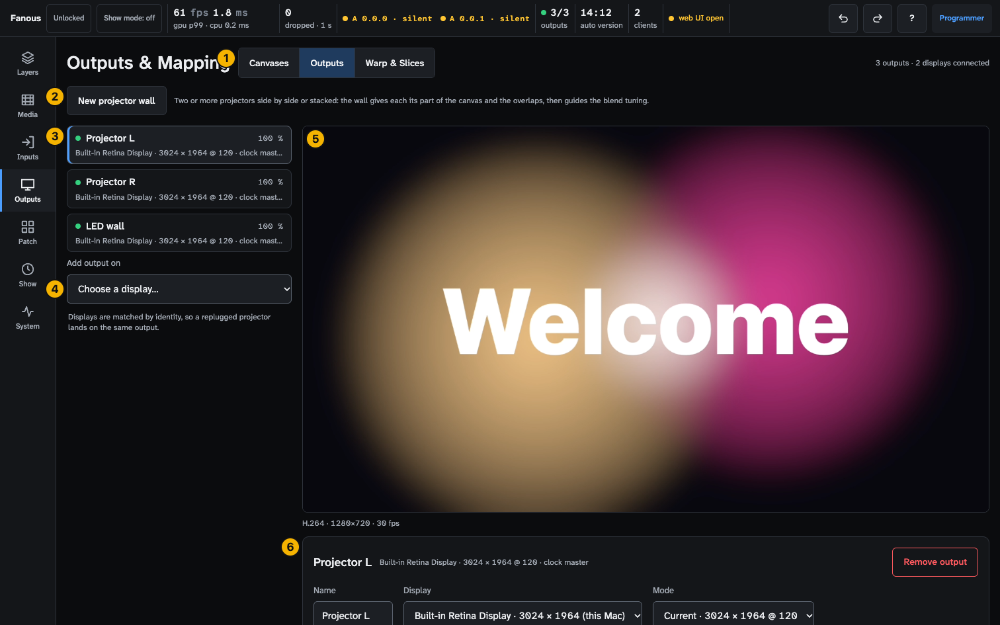

1. **Tabs**: **Canvases**, **Outputs**, **Warp & Slices**. The caption at
   the right reads "N outputs · N displays connected".
2. **New projector wall**, or the panel of each wall.
3. **Output list**: one row per output.
4. **Add output on**.
5. **Preview**: the canvas on the Canvases tab, the selected output on the
   other two, in its own aspect ratio. It shows the mapping as you edit it;
   a preset the console shows, or the keystone, is on the projector only.
6. **Settings** of the selected output (Outputs tab) or its warp editor
   (Warp & Slices).

While the show is locked the wall, preset, Remote and Colour controls grey
out with the reason; the canvas, output and warp fields stay enabled and the
engine refuses with the yellow banner. Below 900 px wide the list takes the
full width and stacks above the rest.

Leaving the screen ends a running seam check, the wall wizard and Show on
output: the test patterns and the lines go off the projectors. Come back to
the screen to put them on again.

## Banners

| Banner | Means |
|---|---|
| Red **Output N lost** · "… is not connected; the other outputs keep running" | The output's display went away. Re-plugging rebinds it |
| Yellow **Next: align this output.** with **Align this output** and **Later** | An output was just added on this screen. Align opens Warp & Slices for it |
| Yellow **Seam check on Wall 1** with **Back to the seam check** | A seam check runs while you are on another tab |
| "No preview: the engine is not rendering outputs …" with **Open System** | No output is bound to a display, so nothing renders; settings can still be edited |

## Output list

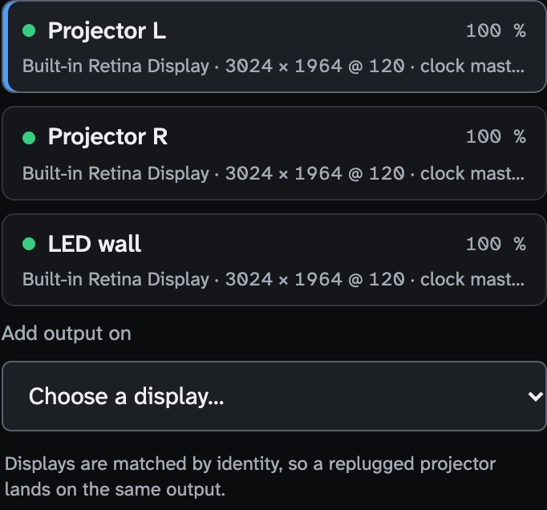

| Part | Shows |
|---|---|
| Dot and status line | The output's state: **bound** (green `Built-in Retina Display · 3024 × 1964 @ 120`, the refresh rate rounded to a whole number, with "· clock master" on every output of the display that paces the compositor), **unassigned** (grey "not assigned to a display", or "binding…" for a moment), or **lost** (red "display missing: name") |
| Intensity | The output's intensity in percent |
| Yellow mode note | "Mode differs: … wanted … Applied in show mode."; "N Hz is not a multiple of the canvas M fps: motion judders" (a display must refresh at the canvas rate or a whole multiple of it); "Mode X is not available on this display; closest Y"; "Conflicts with Output N on the same display"; "Not applied: …" in show mode. Modes are switched when show mode turns on and put back when it ends |
| Preset badges | **Preset N (console)**: the console's channel 6 shows preset N. **Preset N (compare)**: Hold to compare shows it. **Preset N missing**: the console asks for a preset the output does not have, so the edited mapping shows. **Preset A → B**, **Edited → Preset B**, **Preset A → edited**: a glide between presets runs |
| Keystone badges | **Keystone active**: the Keystone fixture moves the output. **Keystone invalid**: the corners the console sent would fold the picture, so the last valid ones stay |
| Overlay badges (Warp & Slices) | **Overlay hidden: a preset shows** or **Overlay hidden: Raw**: Show on output is not drawn while a preset or the raw canvas shows |
| Wall badge | **Wall 1 · r1 c2**: the output's row and column in its wall |
| **Add output on** | "Choose a display…", then the connected displays as `name · W × H (this Mac)` and "Unassigned (assign later)". "Displays are matched by identity, so a replugged projector lands on the same output." |

Empty: "No outputs yet. Add one for each projector or display with Add output
on below; a new output shows the whole canvas."

## Canvases tab

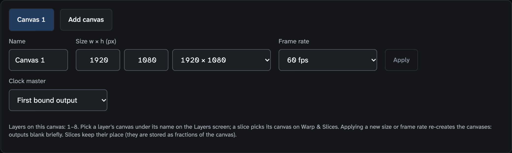

| Control | Does |
|---|---|
| Canvas picker | One button per canvas; **Add canvas** (up to four; disabled with "At most 4 canvases" or "Leave show mode to add a canvas"); **Remove canvas** (not Canvas 1; disabled in show mode) |
| **Name** | Free text |
| **Size w × h (px)** | Two fields, 320–8192, even, or a preset: 1920 × 1080, 3840 × 2160, 1280 × 720, Custom |
| **Frame rate** | 23.976, 24, 25, 29.97, 30, 50, 59.94, 60 fps; set on Canvas 1 only, and every canvas runs at Canvas 1's rate |
| **Apply**, **Revert** | Apply asks first ("The canvases are re-created: every output blanks briefly …") and blanks every output for a moment: do it before the show, not during it; disabled in show mode. Revert drops the edits |
| **Clock master** | Canvas 1 only: "First bound output" or an output; the display the compositor hands its frames to first ([glossary](../reference/glossary.md#mapping)) |
| Lines under the form | Which layers are on this canvas; "Canvas change failed, the previous canvas is still running: …"; "Rendering W × H at F fps. The project canvas applies when show mode ends." |

Field errors: "Width must be a whole number from 320 to 8192.", "Height must
be even." Removing a canvas asks first and shows a toast with Undo.

## Outputs tab

### Projector walls

**New projector wall** opens the wizard; it is disabled with "Add at least
two outputs that are in no wall yet." Each wall has a panel here instead.
The wizard, the wall panel and the seam check, step by step:
[outputs-and-mapping.md](../outputs-and-mapping.md#projector-walls).

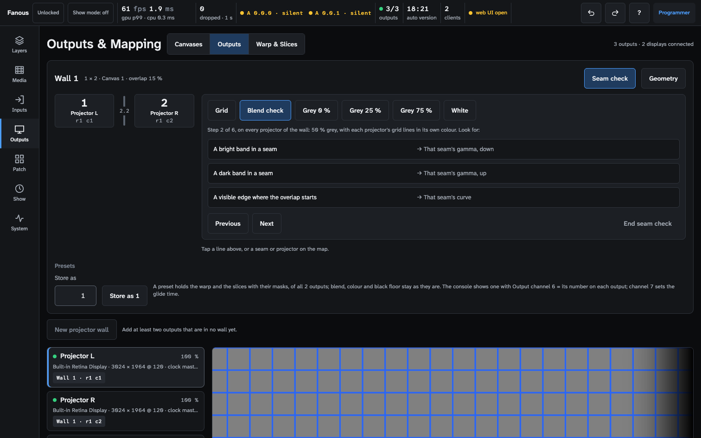

| Wall panel part | Does |
|---|---|
| Header | The wall's name, "R × C · canvas · overlap X / Y %", **Seam check** and **Geometry** toggles |
| Map | One tile per projector (Output ID, name, row and column, a **manual** badge when a field was typed by hand) and a seam button between neighbours showing its gamma, or "RGB" when the colours are set apart |
| Seam controls (tap a seam) | **Gamma** 0.5–5, **Link R, G, B** switch, **Gamma R / G / B**, **Curve** 0.1–10 (the same value as an edge's Power on the Outputs tab), **Apply to all seams** (with more than one seam) |
| Projector controls (tap a tile) | **Black floor** 0–20 % (the same setting as the output's Black lift on the Outputs tab, which runs to 50 %), **Gain R / G / B**, **Black offset**, **manual** lines with **Back to wall**, **Open in Warp & Slices** |
| Geometry | **Overlap across** and **Overlap down** 0–50 %, the pixel caption, **Edit layout…** (the wizard again), **Remove wall** (the outputs keep their slices and blend edges) |
| Seam check card | Six steps (Grid, Blend check, Grey 0 %, Grey 25 %, Grey 75 %, White), "Step N of 6" with what each pattern shows, one hint button per symptom ("a bright band in a seam → that seam's gamma, down"), **Previous**, **Next**, **End seam check**. "The test patterns are off in show mode." |
| Presets strip | Store and recall for every output of the wall at once |

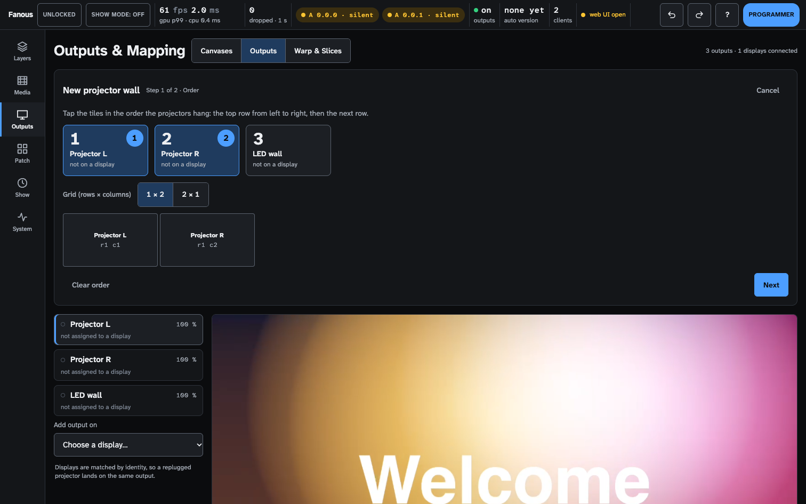

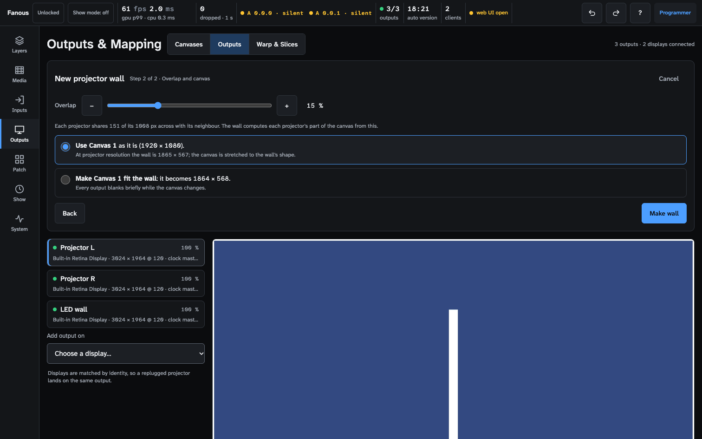

| Wizard part | Does |
|---|---|
| Step 1 · Order | Every output on a display shows its Output ID; tap the tiles in the order the projectors hang; **Grid (rows × columns)** offers the grids that fit (up to 4 × 4); **Clear order**, **Next**. Yellow lines name an output without a pixel size or a tile count that makes no grid |
| Step 2 · Overlap and canvas | **Overlap** 0–50 % (15 to start) with the pixel line and a hint below 10 % or above 25 %; a **Canvas** list with several canvases; "Use Canvas N as it is" or "Make Canvas N fit the wall" (not in show mode); **Back**, **Make wall** (or **Apply layout** when editing) |

### Output settings

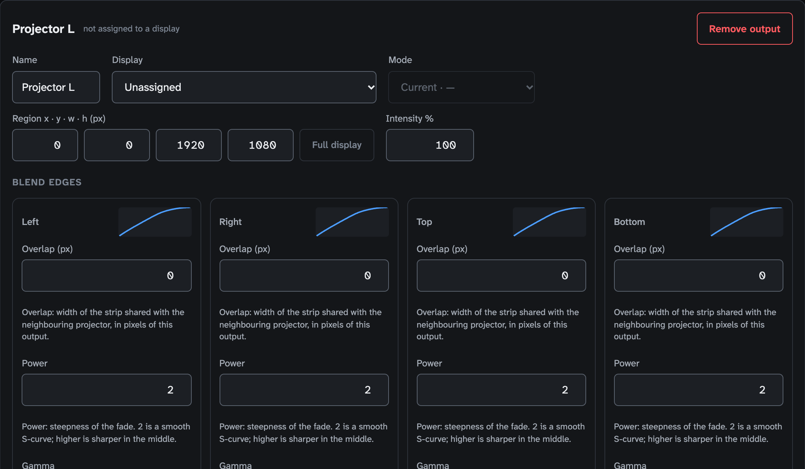

| Control | Does |
|---|---|
| Header | The name, the status line, **Remove output** (toast with Undo) |
| **Name** | Free text |
| **Display** | Unassigned, the connected displays, or `name · missing` for a display that went away |
| **Mode** | "Current · W × H @ hz" or one of the display's modes; applied in show mode; disabled without a display |
| **Region x · y · w · h (px)** | The part of the display this output draws on; **Full display** resets it |
| **Intensity %** | 0–100, multiplied with the Output fixture's and the Master's intensity |
| Yellow notes | The mode note; "This output uses the Mac's own display: the local UI shell will be hidden behind it." |
| **Blend edges** | One card per edge (left, right, top, bottom) with a curve drawing, **Overlap (px)**, **Power** 0.1–10 (the steepness of the fade; the wall panel calls it Curve), **Gamma** 0.5–5 (the projector's gamma, so the two ramps add up evenly), or the read-only "Gamma R · G · B" with **One gamma for R, G, B**, and a **manual** badge with **Back to wall** on a wall member; then **Black lift (%)** 0–50 and **Lift feather px** |
| **Test pattern** | Off, Grid, Colour bars, Blend check, Output ID, Crosshair, Grey steps (0–100 % in 10 % steps above, 0–10 % in 1 % steps below), Checkerboard, Grey 0 %, Grey 25 %, Grey 75 %, White (flat fields at that signal level: 25 % is code 64 of 255, 75 % is 191). The Output fixture's and the Master's Test pattern channels override the buttons; the Output fixture's Blend channel at 128 or more shows the output **Raw**: the output without blend, black lift, masks, warp and keystone, for alignment |
| **Colour** | **Gain R / G / B** 0–200 % (steps of 0.5), **Black offset** 0–20 % (steps of 0.1), each a slider with − and + |

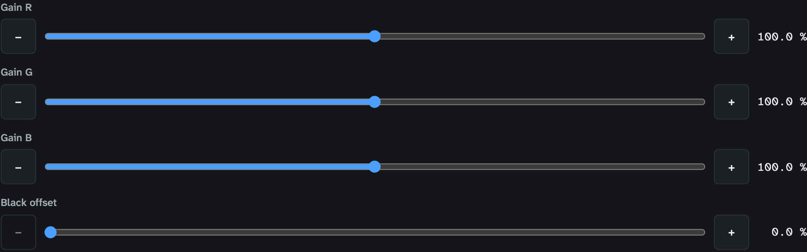

**Three black controls.** **Black lift** (this tab, 0–50 %) and **Black
floor** (the wall panel, 0–20 %) are one setting: it raises the black
outside the overlaps to the level where two (or four) projectors add up, and
the feather softens where it ends. **Black offset** (Colour, 0–20 %) is
another setting: it raises the black of the whole output, overlaps included.
Both add light in linear terms for a gamma-2.2 projector, so a value set on
Grey 0 % stays right on brighter pictures. A lift above 20 % typed here is
kept but cannot be shown on the wall panel's slider.

## Warp & Slices tab

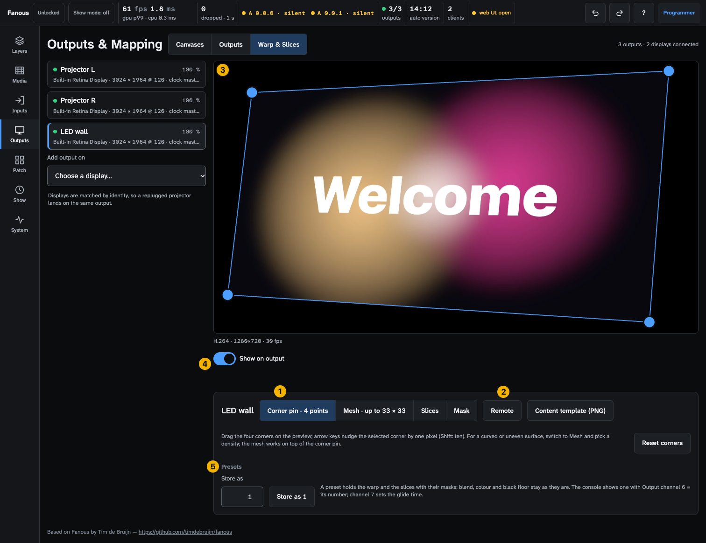

1. **Edit** modes: **Corner pin · 4 points**, **Mesh · up to 33 × 33**,
   **Slices**, **Mask**. With one point selected, **Selected point (px)**
   shows its x and y.
2. **Remote**: the iPad layout
   ([warp-and-masks.md](../warp-and-masks.md#remote-aligning-from-an-ipad));
   **Content template (PNG)** downloads the slice and mask layout at canvas
   size.
3. **Preview** with the handles. Drag them; arrow keys nudge by 1 px, Shift
   by 10, Tab and Shift+Tab select the next and previous point, Esc lets go,
   Backspace or Delete removes a mask point. A nudge pad appears under the
   mode buttons once a point is selected: arrows move 1 px, the **10 px** key
   makes every press move ten, holding an arrow for half a second moves
   0.25 px. **Selected point (px)** is in output pixels; a slice's Source is
   in canvas pixels.
4. **Show on output**: draws the warp, outlines and the selected point on
   the projector. It switches itself off after 10 minutes without an edit,
   in show mode and while the show is locked; the badge next to it says why
   it is hidden.
5. **Presets** strip.

| Mode | Controls |
|---|---|
| Corner pin | The four corners; **Reset corners** |
| Mesh | **Density** (Off, 2 × 2, 3 × 3, 5 × 5, 9 × 9, 17 × 17, 33 × 33), **Reset mesh**. Changing the density keeps the shape |
| Slices | **Slice** list, **Canvas** list (`name · W × H`, or "Canvas N · missing (black)"), **Source x · y · w · h (canvas px)** with a **manual** badge on a wall member, **Opacity %**, **Add slice**, **Reset slice**, **Spread canvas** (two slices or more), **Triangle**, **Circle**, **Remove slice** (an output keeps at least one) |
| Mask, tools | **Slice** list; **Polygon**, **Rectangle**, **Ellipse**, **Freehand**, and an **Image mask** list of the library's stills; while drawing, **Done**, **Undo last corner**, **Cancel**, or **10 % inside** for the box tools |
| Mask, list | Per mask: an **Add** or **Subtract** badge, the point count or the image (a greyscale still: black hides, white shows), **Invert** (switches between add and subtract), **Feather px** (drawn masks only), **Redraw**, **Remove**; point tools **Add points**, **Smooth point**, **Remove point** / **Remove handle** |

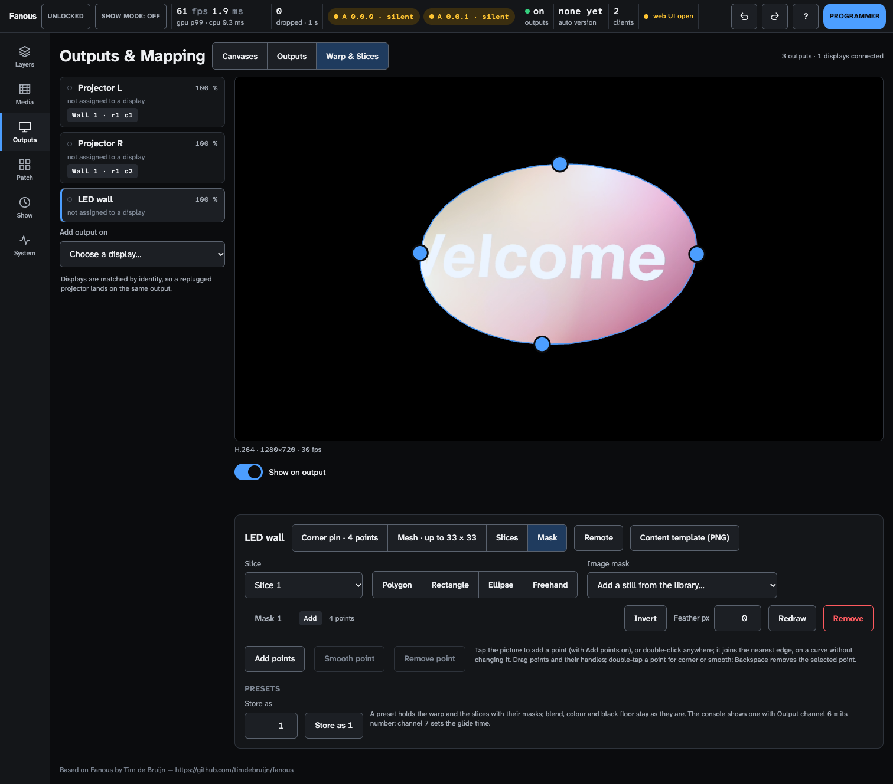

Toasts name each one-step edit ("Slice 2 reset to the whole canvas.", "Canvas
spread over the slices, left to right.") with Undo.

### Presets strip

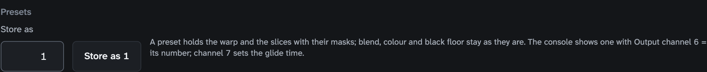

| Control | Does |
|---|---|
| **Store as N** / **Replace N** | Stores the warp and the slices with their masks under the number in the field (1–255, the lowest free one filled in) |
| **Preset** list, **Name**, **Recall**, **Remove** | Appear once the output (or every output of the wall) has a preset. Recall copies the preset's warp, slices and masks into the mapping you edit (Undo takes it back); blend, colour and black lift are not in a preset and stay as they are |
| **Hold to compare** | Shows the preset on the output while you hold the button; greyed with "Compare is off in show mode", the lock reason, or "Compare reaches outputs 1–8" on output 9 and up |

The console shows a preset with Output channel 6; channel 7 sets the glide
time ([warp-and-masks.md](../warp-and-masks.md#from-the-console)).
