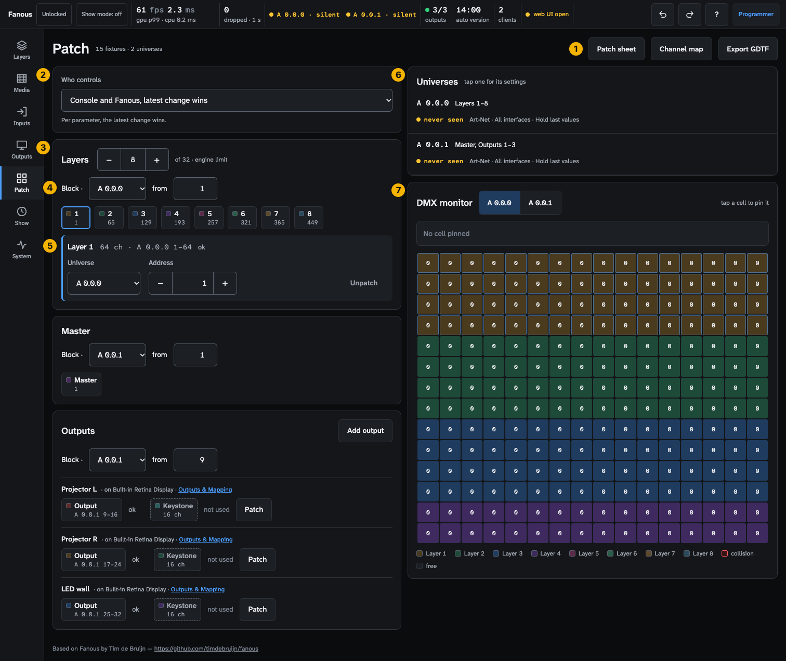
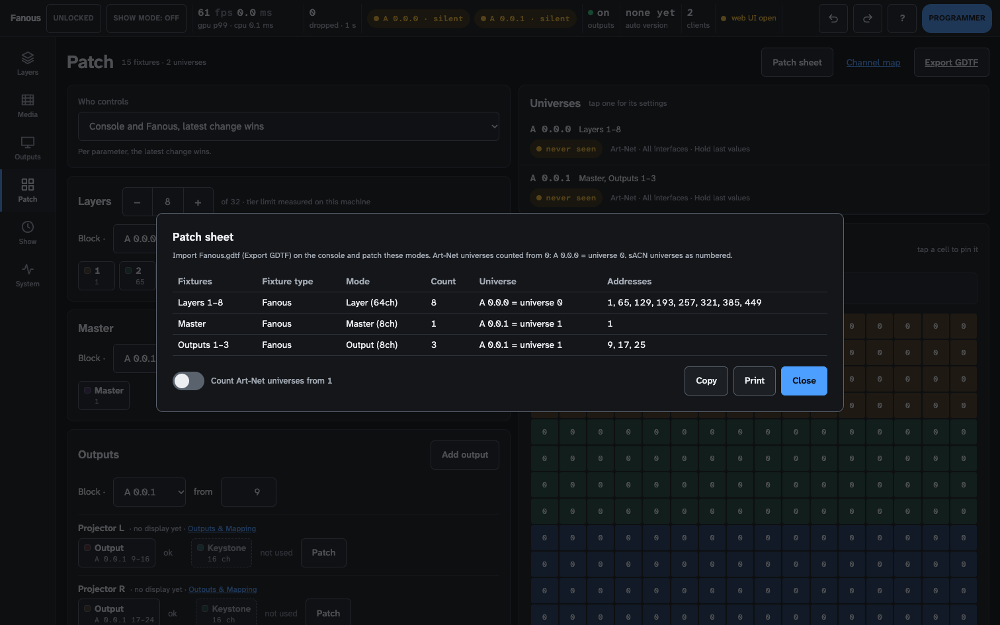
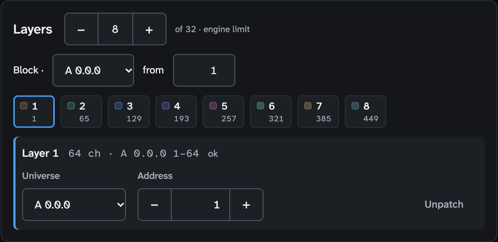
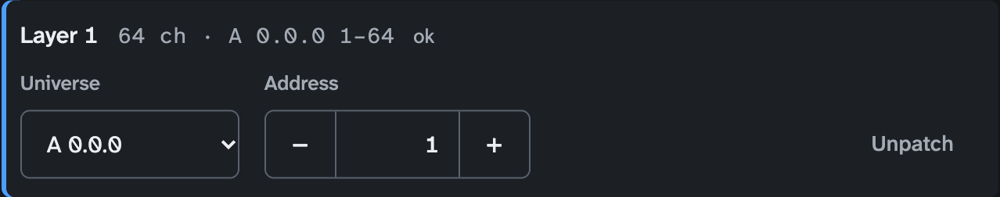
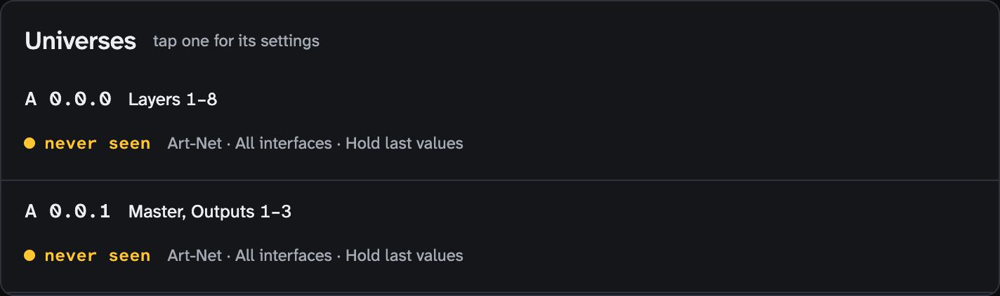
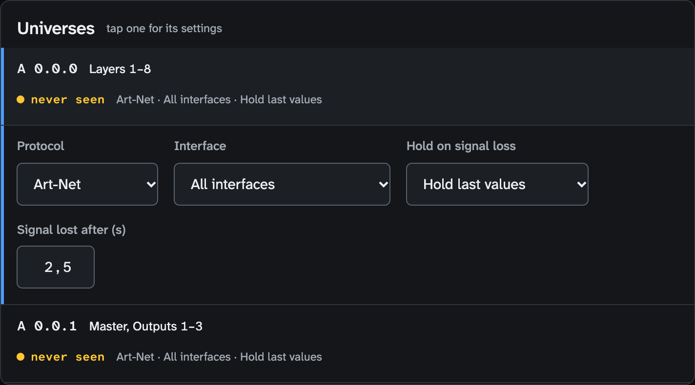
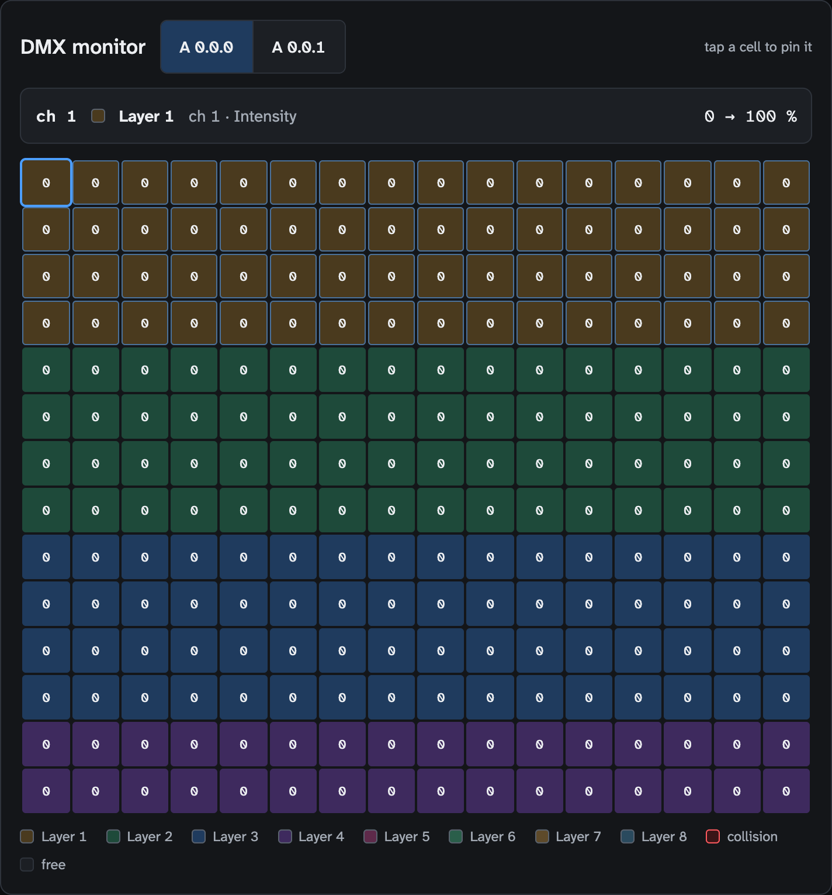

<!-- SPDX-License-Identifier: GPL-3.0-only -->
<!-- Copyright (c) 2026 Tim de Bruijn -->
<!-- Additional terms under GPLv3 §7 apply: see LICENSE-ADDITIONAL-TERMS.md -->

# Patch screen (key 5)

Every control on the screen that holds the DMX patch: Who controls, the
fixture groups, the universes and the DMX monitor. For the tasks (patching
on a console, GDTF, Art-Net or sACN, signal loss) see
[console-setup.md](../console-setup.md). Terms are in the
[glossary](../reference/glossary.md).

Everything marked "programmer" is greyed out or refused for the operator and
monitor roles; "refused while the show is locked" means the status bar's tag
reads **Locked** (a programmer presses L to unlock). Hover a greyed control
for its reason: [ui.md](../ui.md#why-is-this-control-greyed-out).
On this screen the operator and monitor roles can read everything, open a
chip's editor and the Patch sheet, and pin cells in the monitor; every change
is the programmer's.

Three words as this screen uses them. A **fixture** is one unit of the
console's patch: every layer is a 64-channel fixture of the Fanous GDTF, the
Master an 8-channel one, each output an 8-channel Output and a 16-channel
Keystone. The **patch** here is Fanous's own map of where it listens; the
console's patch must say the same, which is what the Patch sheet is for. A
**block** is a run of fixtures laid out one footprint apart from one start
address, as a console patches "8 fixtures from 1".

1. **Toolbar**: "N fixtures · N universes" and the number of collisions in
   red; **Patch sheet**, **Channel map**, **Export GDTF**.
2. **Who controls**.
3. **Fixture groups**: Layers, Master, Outputs, each with its block line.
4. **Block line** of a group.
5. **Fixture editor**, under the group, for the tapped chip.
6. **Universes**.
7. **DMX monitor**.

In a wide window the left column has Who controls and the groups, the right
column Universes and the monitor; in a narrow one they stack in that order.
`A 0.0.0` is Art-Net port-address 0, the desk's universe 0 or 1 depending on
where it counts from; `S 1` is sACN universe 1 ([README](../README.md#conventions)).

## Toolbar

| Control | Does |
|---|---|
| **Patch sheet** | A dialog with what to patch on the console: fixture type, mode, count, universe and addresses per block, with the universe as `A 0.0.1 = universe 1`; a switch **Count Art-Net universes from 1** (the browser remembers it); **Copy** (tab-separated text) and **Print**. A collision or a fixture past channel 512 is named in red under the table |
| **Channel map** | Opens the channel list the engine serves |
| **Export GDTF** | Downloads `Fanous.gdtf` |

## Who controls

A list with the four settings (**Console only**, **Fanous only (UI, cues,
OSC, MIDI)**, **Console and Fanous, latest change wins**, **Console and
Fanous, highest value wins**) and a line that explains the current one
([how-it-works.md](../how-it-works.md#who-wins-the-four-who-controls-settings)).
Latest change wins is LTP per channel between the console and Fanous's own
sources; highest value wins is HTP for continuous channels. Neither has to do
with sACN priority, which merges consoles.

## Fixture groups

| Part | Does |
|---|---|
| Group header | **Layers** with **−** and **+** next to the count ("Remove layer N", "Add layer"; stops at the engine's limit, "of 32 · engine limit"); **Master**; **Outputs** with **Add output** (a new output without a display; its Output fixture's editor opens) |
| Block line, **Block · A 0.0.0 from 1** | Every patched fixture sits on its place. The universe and the address are fields: change one to move the whole group; "· N unplaced" counts fixtures without an address |
| Block line, **Custom · N of M off the block** (yellow) | Some fixtures were placed by hand; **Re-lay as block** puts every one on its place |
| Block line, **No address** | Nothing in the group is patched; **Patch as block** puts it where the standard patch does |
| Block line, "Layer 9: no address · A 0.0.1 1–64 is taken by Master" | Add layer found the new layer's place taken; **Move Master and outputs after the layers** moves those blocks (this changes the console patch too) |
| Block line, red notice | A block would run past the last universe; nothing was patched |
| Chips (Layers, Master) | The fixture's colour, number (or name), its address, "A 0.0.1 · 1" when it sits on another universe than the block's start, **off** when placed by hand, "—" when unpatched. The colour tone is its status; hover for the words |
| Rows (Outputs) | Per output: `name · on display · Outputs & Mapping` (a link), then its Output chip with the range (`A 0.0.1 9–16`) and status, and its Keystone chip with **Patch** while unpatched ("not used") |
| Footers | "Layers above 32 do not render and have no console channels.", "Outputs above 8 have no console channels." |

Status words, in the chip's tooltip and in the editor:

| Word | Means | What to do |
|---|---|---|
| **ok** | Patched, no overlap | — |
| **collides with Layer 2 · 65–128** (red) | Two fixtures share channels | Change an address, move the block, or unpatch one |
| **exceeds universe** (red) | The fixture runs past channel 512 | Give it a lower address |
| **no address · stays dark** (yellow) | A layer without an address under Console only: it never plays | Patch it, or change Who controls |
| **no address · at defaults** | The Master or an Output without an address under Console only: full and normal | Patch it only when the console must control it |
| **no address · Fanous only** | No address, and the UI, cues, OSC and MIDI drive it | Nothing, unless the console must control it |
| **no address · A 0.0.1 1–64 is taken by Master** (yellow) | The layer's place in the block is occupied | **Move Master and outputs after the layers** |
| **not used** | A Keystone fixture without an address; it is optional | **Patch** when the console should move the corners |

### Fixture editor

Tap a chip to open it under the group; tap it again to close.

| Control | Does |
|---|---|
| Header | The name, `64 ch · A 0.0.0 1–64` and the status word |
| **Universe** | `A 0.0.0` to `A 0.0.3`, `S 1` to `S 4`, and every universe that is patched, heard or set up |
| **Address** | A stepper (Shift+click: steps of 10); 0 means unpatched |
| **Unpatch** / **Patch at A 0.0.1 1** / **Patch** | Removes the address, or gives the fixture its place in the block |
| **Remove output** | Output fixtures only: removes the output with its mapping (Undo brings it back) |

A refused change puts the fields back and the yellow banner says why.

## Universes

One row per universe that a fixture is patched to, that a console sends to
now, or that has settings. Tap a row for its settings; the DMX monitor
switches to it.

| Part | Shows |
|---|---|
| Name and fixtures | `A 0.0.0 · Layers 1–8, Master`; or "heard, nothing patched" (yellow), "feeds A 0.0.0" (the other protocol's universe of a patched one), "not used" (settings without a fixture) |
| Health pill | Green `N packets · sender`: receiving. Yellow **never seen**: nothing has arrived since the engine started (the status bar says "silent" for the same state). Yellow **1.2 s**: the time since the last packet, less than the universe's Signal lost after. Yellow **quiet**: an unpatched universe that went quiet. Red **lost**: a patched universe quiet for longer than Signal lost after |
| Summary line | Protocol · interface · hold, for example "Art-Net · All interfaces · Hold last values" |

| Setting | Choices |
|---|---|
| **Protocol** | Art-Net, sACN, Art-Net + sACN; then **sACN universe** or **Art-Net universe** for the paired one when the protocol is not the universe's own |
| **Interface** | All interfaces, an interface with its addresses (`en0 (10.0.1.20)`), or one marked "(not present)" |
| **Hold on signal loss** | Hold last values, Go to zero, UI and cues take over |
| **Signal lost after (s)** | 1–60, steps of 0.5; 2.5 to start |
| **sACN priority** | Highest wins, Merge equal (HTP); shown for sACN and Art-Net + sACN |

A red line says "Interface X is not on this Mac: the universe receives
nothing until it is connected." Empty: "No universe is patched, heard or set
up yet." What each setting does:
[console-setup.md](../console-setup.md#universe-settings).

## DMX monitor

| Part | Does |
|---|---|
| Universe switcher | One button per universe in the panel above |
| Grid | 512 cells with the value as received from the console, in a scrolling box; a colour per fixture from a short palette (two fixtures can share a colour), red where fixtures collide, grey where free; the selected fixture is outlined and scrolled into view |
| Pin bar | Tap a cell: the fixture, its channel inside the fixture, the parameter, the received value and what the engine applies ("17 → Loop rev"); "collision" with the owners; "free"; "No cell pinned". The two can differ: the grid is the DMX wire, the meaning is the value after Who controls (0 → 100 % when the UI holds the intensity). The fine byte of a 16-bit pair has no meaning of its own |
| Legend | One swatch per fixture, plus collision and free |

Empty: "No universe is patched or heard yet. Patch a fixture to watch its
universe here." The values are live only while the UI is connected.
