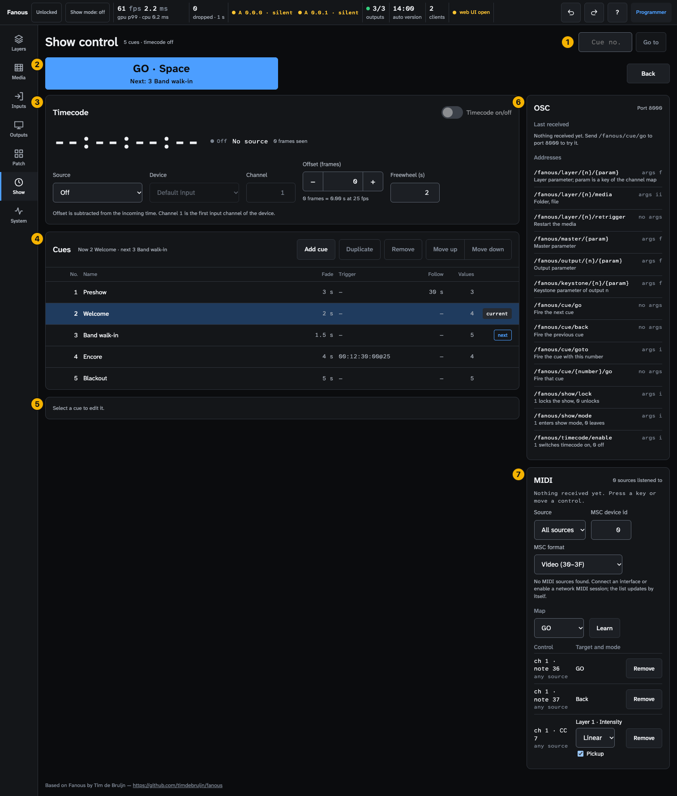
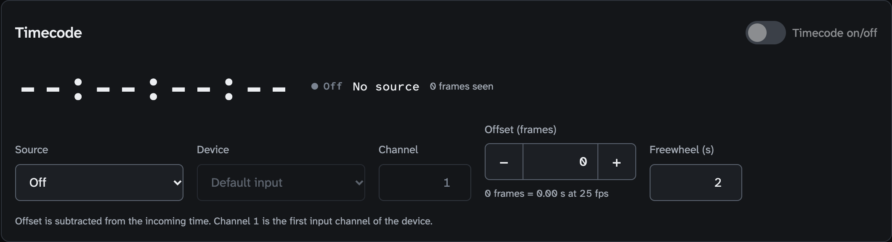
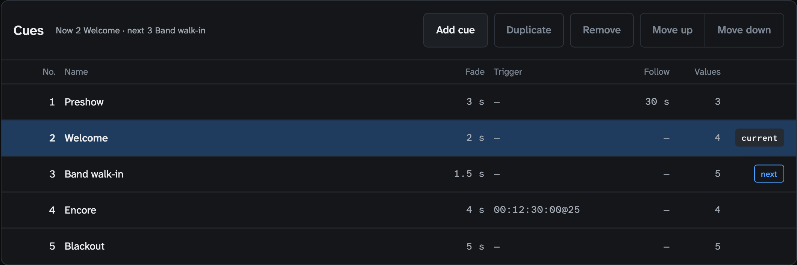
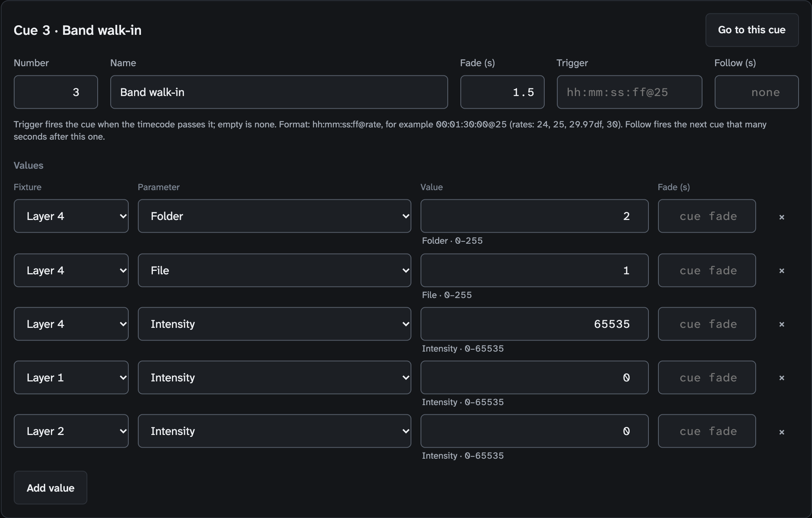
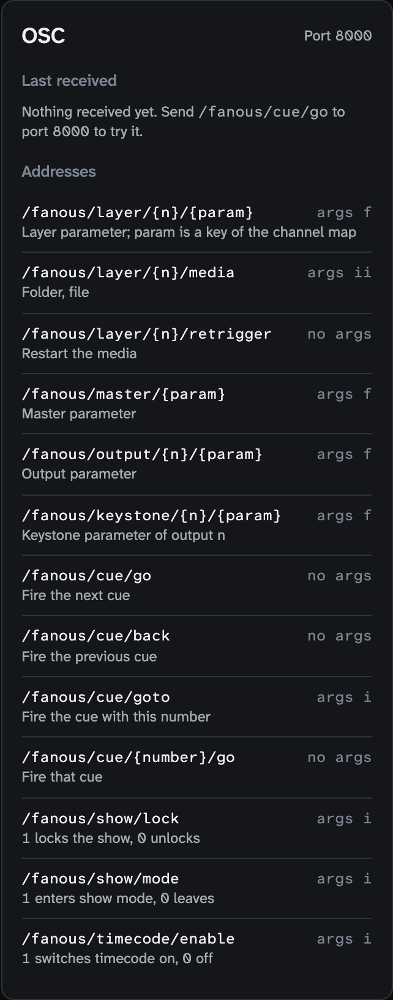
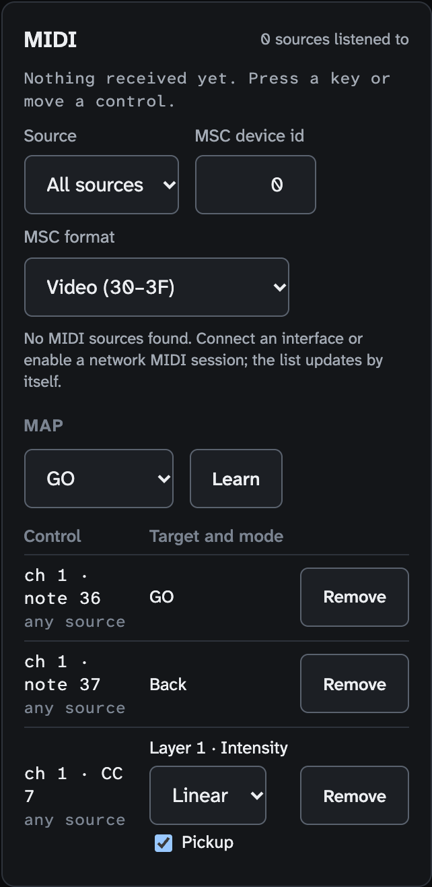

<!-- SPDX-License-Identifier: GPL-3.0-only -->
<!-- Copyright (c) 2026 Tim de Bruijn -->
<!-- Additional terms under GPLv3 §7 apply: see LICENSE-ADDITIONAL-TERMS.md -->

# Show screen (key 6)

Every control on the screen titled "Show control": GO, timecode, the cue
list, OSC and MIDI. For the tasks see [Show control](../show-control.md)
(cues, LTC and MTC) and [Remote control](../remote-control.md) (OSC, MIDI,
MSC). Terms are in the
[glossary](../reference/glossary.md).

Everything marked "programmer" is greyed out or refused for the operator and
monitor roles; "refused while the show is locked" means the status bar's tag
reads **Locked** (a programmer presses L to unlock). Hover a greyed control
for its reason: [The user interface](../ui.md#why-is-this-control-greyed-out).

1. **Cue no.** and **Go to**.
2. **GO · Space**; **Back** sits at the far right, under Go to.
3. **Timecode**.
4. **Cues**: the list with Add, Duplicate, Remove, Move up and Move down.
5. **Cue editor** for the selected cue.
6. **OSC**: port, last received, the addresses.
7. **MIDI**: source, MSC, Learn and the map.

A Fanous cue sets only the values it holds, with its fade; everything else
stays as it was, and nothing is released when a later cue fires. The header
caption reads "N cues · timecode off / locked / freewheel / lost". Go, Back, Go to, Go to this cue and the timecode switch are the
operator's and work while the show is locked; everything else is the
programmer's and is refused while the show is locked. Duplicate, Remove, Move
up and Move down are greyed until a cue is selected, Move up on the first
cue and Move down on the last. Below about 1100 px the
right column with OSC and MIDI moves under the left one.

## Transport

| Control | Does |
|---|---|
| **GO · Space** | Fires the next cue; the second line says which ("Next: 3 Band walk-in", or "Next: no further cue"). Before the first GO the next cue is the first in the list. Space does the same while no field or button has the focus, no dialog is open and no modifier key is held |
| **Back** | Fires the previous cue (nothing at the first); placed apart from GO so it is not hit by mistake |
| **Cue no.** and **Go to** | Fires the cue with that number; the caption under the field names the cue or says "no such cue" |
| Yellow note | Who controls is **Console only**, so cues are kept but not shown; **Use Console and Fanous, latest change wins** changes it (programmer) |

## Timecode

| Control | Does |
|---|---|
| **Timecode on/off** | The operator's switch; disabled while the Source is Off ("Choose a source first") |
| Readout | `hh:mm:ss:ff` in big digits; the state pill **Locked** (green), **Freewheel** (yellow), **Lost** (red) or **Off**; the source line ("No source", `LTC · device · 25 fps`); "N frames seen" |
| Level meter (LTC) | The LTC channel's peak over the last tenth of a second, −60 to 0 dBFS, yellow above −3; "no audio" or "timecode switched off" |
| Error line | Red, from the engine: "MTC source … is not connected", "no MIDI source connected", or why an LTC input could not open |
| **Source** | Off, LTC (audio input), MTC (MIDI) |
| **Device** | "Default input" or an audio input for LTC; "All sources" or a MIDI source for MTC; a stored device that is gone reads "(not connected)" |
| **Channel** (LTC) | The input channel, 1 is the first |
| **Offset (frames)** | − and + around a field; subtracted from the incoming time for the whole project. The line under it gives the same offset in seconds at the current rate ("+25 frames = +1.00 s at 25 fps", or "assuming 25 fps until a source locks") |
| **Freewheel (s)** | How long a dropped signal is bridged, 0.1 or more; 2 by default |
| Footnote | "Offset is subtracted from the incoming time. Channel 1 is the first input channel of the device." and, for LTC, that it needs the microphone permission (Inputs screen) |

A wrong Channel or Freewheel entry snaps back without a message. The
settings are the programmer's; the switch is the operator's.

## Cues

| Control | Does |
|---|---|
| Caption | "Now 2 Welcome · next 3 Band walk-in", "(fading)" while a fade runs, or "No cue fired yet" |
| **Add cue** | A new cue numbered one above the highest whole number, named "Cue N", selected |
| **Duplicate** | A copy named "… (copy)", numbered halfway to the next cue, with the fade and values but not the trigger and follow |
| **Remove** | Removes the selected cue; a toast offers Undo for 8 seconds |
| **Move up**, **Move down** | Swap numbers with the neighbour (the swap takes three steps, so three Undos put it back) |
| List | No., Name ("Unnamed" when empty), Fade, Trigger, Follow, Values (the count), sorted by number; badges **current**, **fading**, **next**. Tap a row to select it for the editor |

Empty: "No cues yet. Add one, then give it values and a fade."

## Cue editor

| Control | Does |
|---|---|
| Header | "Cue 3 · Band walk-in" and **Go to this cue** (operator) |
| **Number** | 0 or more, decimals allowed (2.5), unique |
| **Name** | Free text |
| **Fade (s)** | The cue's fade; empty is 0 |
| **Trigger** | A timecode trigger, `hh:mm:ss:ff@rate`, for example `00:01:30:00@25`; rates 24, 25, 29.97df (drop frame), 29.97ndf (non-drop), 30; without `@rate` 25 |
| **Follow (s)** | Fires the next cue that many seconds after this one; empty is none |
| Values, **Fixture** | Layer 1 to N, Master, and the patched Output n and Keystone n |
| Values, **Parameter** | Grouped as the channel map groups them |
| Values, **Value** | A number in the parameter's DMX range (0–255 for an 8-bit channel, 0–65535 for a 16-bit pair), or a list for parameters with named bands such as Play mode; a stored number outside every band reads "Raw N" |
| Values, **Fade (s)** | Per value, overriding the cue fade (placeholder "cue fade"); **×** removes the row; **Add value** adds one |

Validation lines appear in red under a field: "A cue number is a number from
0 up.", "Cue N already exists.", "A fade time is seconds, 0 or more.", "Use
hh:mm:ss:ff@rate, for example 00:01:30:00@25 (rates: 24, 25, 29.97df, 30)",
"Unknown rate …", "Hours go to
23, minutes and seconds to 59", "Frames go to 24 at 25 fps". "This cue
changes nothing yet. Add a value for each parameter it should set." when the
cue has no values. The engine's own refusals come as the yellow banner.

## OSC

| Part | Shows |
|---|---|
| Port | 8000 |
| **Last received** | The newest messages first, with their time; "Nothing received yet. Send /fanous/cue/go to port 8000 to try it." |
| **Addresses** | The thirteen control addresses with their argument types (`f` a float from 0 to 1 of the parameter's range, `i` an integer, `ii` two integers, "no args" none) and one line each: layer, master, output and keystone parameters, media, retrigger, cue go, back, goto and `{number}/go`, show lock, show mode, timecode enable. `/fanous/cue/goto` is listed with `i` but takes any number, so 2.5 works, as does `/fanous/cue/2.5/go` |

The panel is read-only. The feedback addresses (`/get`, subscribe) and
`/fanous/project/load` are not listed here:
[OSC reference](../reference/osc.md).

## MIDI

| Control | Does |
|---|---|
| Caption | "N sources listened to" |
| Last message | `hh:mm:ss  APC mini · ch 1 · CC 48 = 127`, or "Nothing received yet. Press a key or move a control."; a red line under it lists map entries the engine cannot use ("entry 3: …") |
| **Source** | All sources, or one; a stored source that is gone reads "(not connected)" |
| **MSC device id** | 0–111; messages to this id or to 127 are answered |
| **MSC format** | Which MIDI Show Control command format Fanous answers: **Video (30–3F)** (the default, what a show controller sends to a media server), **Lighting (01)** when your controller sends lighting-format GOs that should fire Fanous cues too, **Sound (10)**, **Video general (30) only**, **All types (7F) only**. "All types" (7F) is always answered |
| Source list | A green dot on every source Fanous listens to; the **timecode** badge on the MTC source |
| **Map** | The target list (GO, Back, Go to cue with a cue list, Parameter with a fixture and parameter list), **Learn** (disabled until the cue or parameter is chosen), then "Waiting for MIDI: press a key or move a control…" with **Cancel**, then "Learned: …" |
| Map rows | **Control** (`ch 1 · note 36`, `any ch · CC 1/33 (14-bit)`, `ch 10 · any program`, with the source under it), **Target and mode**, **Remove** |
| **Mode** (parameter targets) | **Linear**: the control's position is the value. **Toggle**: every press switches between 0 and full |
| **Pickup** (Linear only; greyed in Toggle) | The control is ignored until it reaches the value the parameter has now, so a fader does not make the layer jump when you touch it |

Empty: "No MIDI sources found. Connect an interface or enable a network MIDI
session; the list updates by itself." and "No controls mapped. Choose a
target, press Learn and touch the control."
