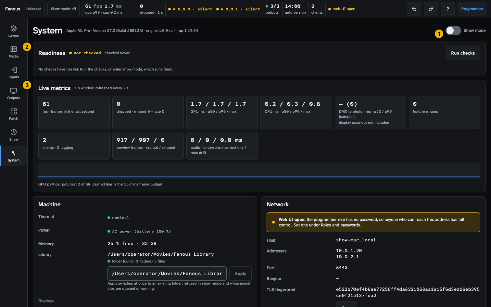
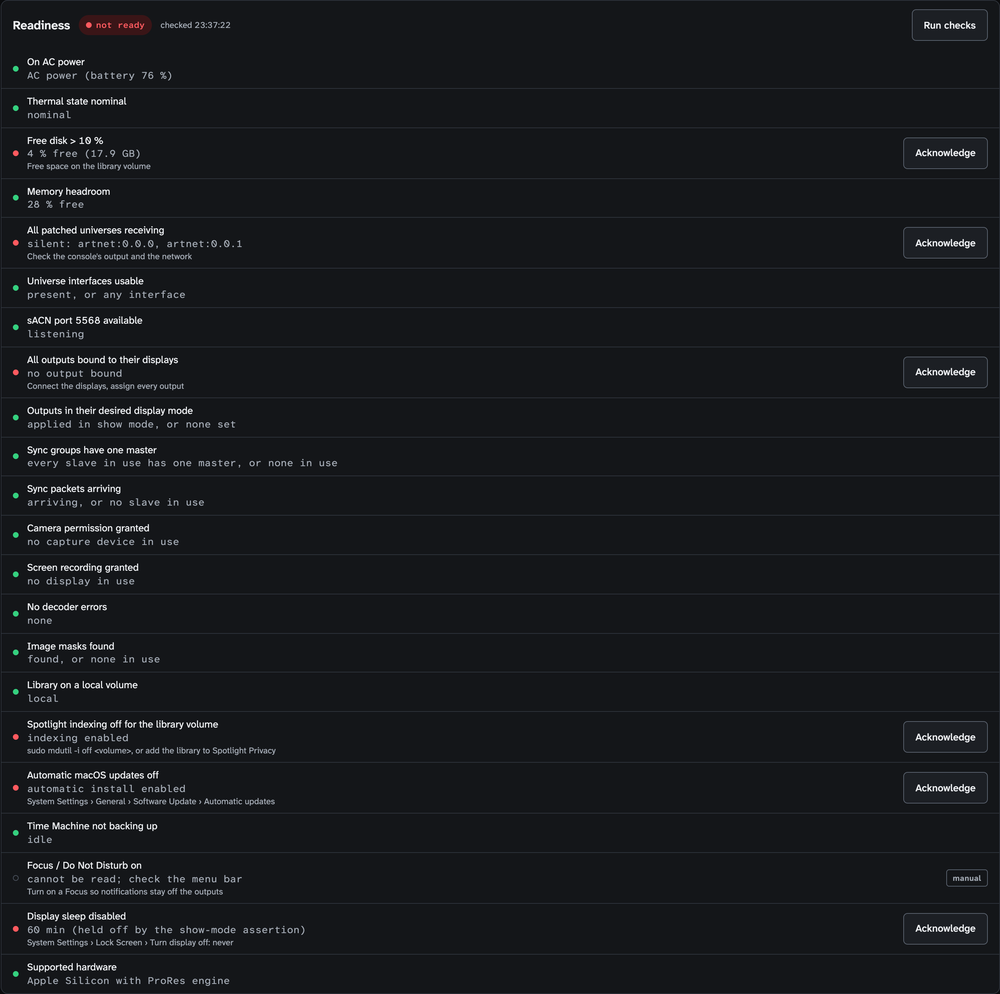
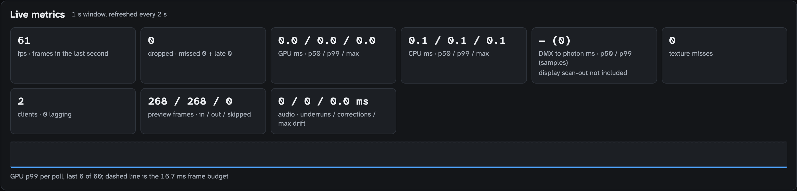
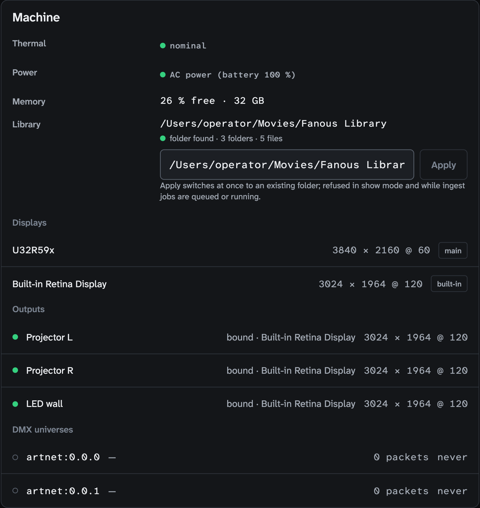
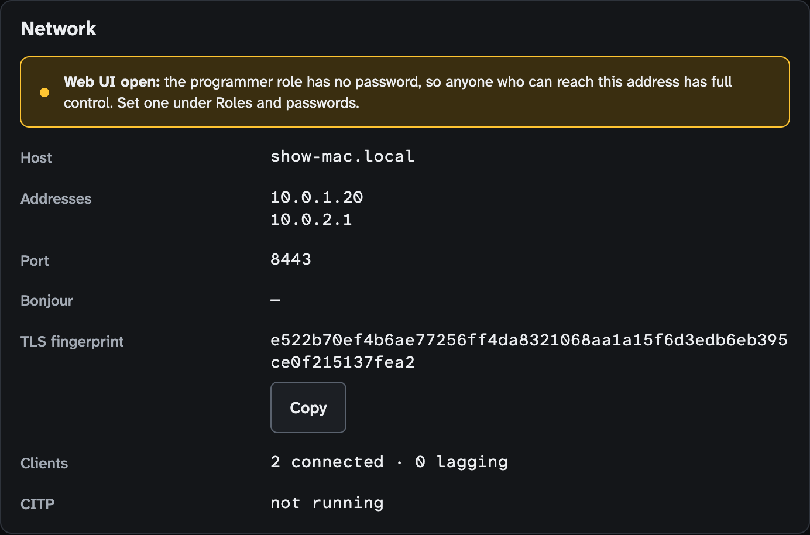
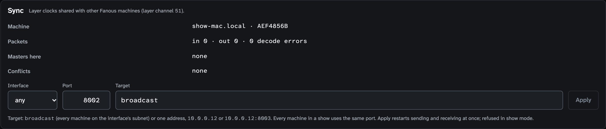
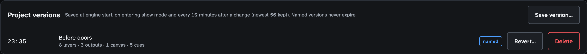
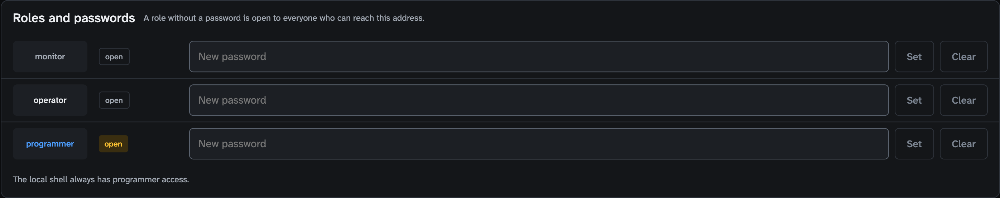
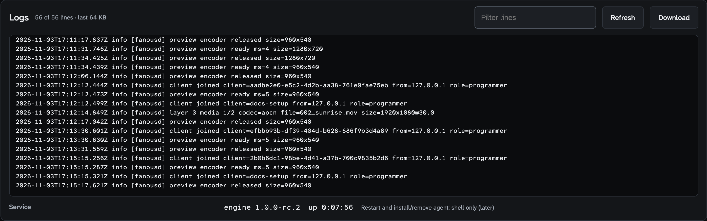

<!-- SPDX-License-Identifier: GPL-3.0-only -->
<!-- Copyright (c) 2026 Tim de Bruijn -->
<!-- Additional terms under GPLv3 §7 apply: see LICENSE-ADDITIONAL-TERMS.md -->

# System screen (key 7)

Every control on the screen that watches the machine: show mode and the
readiness list, live metrics, the machine, the network, sync, project
versions, roles and passwords, and the log. For the tasks (show day, finding
a fault, going back to a version) see
[Show-day checklist](../show-day-checklist.md) and
[Troubleshooting](../troubleshooting.md). Terms are in the
[glossary](../reference/glossary.md): p50 and p99, frame budget, DMX to
photon, texture miss, Sync master.

Everything marked "programmer" is greyed out or refused for the operator and
monitor roles; "refused while the show is locked" means the status bar's tag
reads **Locked** (a programmer presses L to unlock). Hover a greyed control
for its reason: [The user interface](../ui.md#why-is-this-control-greyed-out).
On this screen the operator can switch show mode and run the readiness list;
Acknowledge, the library root, sync, versions and passwords are the
programmer's.

1. **Show mode** switch, next to the header caption: the chip, the macOS
   version and build, the engine version and its uptime.
2. **Readiness**.
3. **Live metrics**.

Further down: **Machine** and **Network** side by side, then **Sync**,
**Project versions**, **Roles and passwords** and **Logs**. The panels stack
on a narrow screen.

## Show mode

The switch is the operator's and the programmer's. Turning it on runs the
readiness list; when an item blocks, the switch snaps back, the page scrolls
to Readiness and the yellow banner names the items. The status bar's tag does
the same with a popover. While show mode is on the Mac and the displays stay
awake, the ingest queue is paused, the cursor is hidden on the outputs, each
display runs the mode its output asks for, and the state is written to disk
every 30 s so the engine resumes show mode after a crash, a restart, or a
power cut within two hours
([Show-day checklist](../show-day-checklist.md#what-comes-back-after-the-engine-stops));
a planned Restart, Shut Down or Log Out leaves show mode.

## Readiness

| Part | Does |
|---|---|
| Header pill | **ready** (green), **not ready** (red), **not checked** (yellow); "checked hh:mm:ss" or "checked never" |
| **Run checks** | Runs the list now (operator); show mode runs it when it turns on and every 30 s while on |
| Banners (show mode on) | Yellow "Show mode resumed after the engine restarted at HH:MM. The engine stopped uncleanly during the show; check the outputs and the log."; red "Show mode is on with blocking items: …" |
| Item row | A dot, the title, what it found in monospace, a fix hint when it is not ok, and **Acknowledge** (programmer) for a failed item, or a badge. Acknowledging accepts the risk: show mode can then start although the item still fails. Do it only for something you decided on purpose, such as a spare display that is not connected |
| Badges | **warning** (yellow, never blocks), **blocking** (red, cannot be acknowledged: Supported hardware), **acknowledged** (yellow), **manual** (grey outline: Fanous cannot read it, check by hand). A **failed** item (red dot) shows the Acknowledge button instead of a badge |

The 23 items with their thresholds and fixes:
[Readiness items](../reference/readiness.md). An
acknowledgement holds until the engine restarts. Empty: "No checks have run
yet. Run the checks, or enter show mode, which runs them."

## Live metrics

Refreshed every 2 s; the polling pauses while the tab is hidden. The frame,
GPU, CPU, DMX and texture tiles cover the last second; the preview and audio
tiles are totals since the engine started. A yellow "metrics unavailable: …"
badge appears when a poll fails.

| Part | Shows |
|---|---|
| fps | Frames rendered in the last second, divided by the span between the first and the last of them, so it reads one above the canvas rate now and then (61 on a 60 fps canvas) |
| dropped | Missed (the display's tick passed before a frame was ready) and late (the GPU finished after the tick) frames in the last second; red in show mode, yellow before it, when above 0. Any number above 0 during a show is a frame the audience did not get: see [Troubleshooting](../troubleshooting.md#dropped-frames) |
| GPU ms, CPU ms | p50 / p99 / max of the frame times; p99 against the frame budget is the one to watch |
| DMX to photon ms | From a changed DMX frame arriving to the time the frame that shows it is scheduled to appear, p50 / p99 with the sample count (one per changed DMX frame); the display's own delay is not included; "—" without samples |
| texture misses | How often a visible layer had no decoded frame ready, summed over every frame of the second (60 on one layer is one second of a stuck layer); the previous frame is shown again; yellow above 0 |
| clients | Connected browsers and windows, and how many lag |
| preview frames | in / out / skipped since the engine started, or "no encoder running" |
| audio | underruns / corrections / max drift since the engine started, or "no mixer running"; yellow once an underrun happened, until the engine restarts |
| Graph | GPU p99 per poll over the last 60 polls (two minutes) against the dashed frame budget of Canvas 1 |

## Machine

| Part | Does |
|---|---|
| Thermal | nominal (green), fair (yellow; readiness still passes it), serious or critical (red) |
| Power | AC power, or on battery (yellow) |
| Memory | The free share of memory as a percentage, and the total |
| Library | The root path, "folder found" or "folder not found", the folder and file counts and "N invalid" when names are invalid; a field with **Apply** (greyed until the text differs) to switch to another existing folder at once (programmer; refused in show mode and while ingest jobs are queued or running). Every layer then looks its folder and file number up in the new library |
| Displays | Every display with its mode and the badges **main** and **built-in** |
| Outputs | Every output with a dot (green bound, red lost, grey unassigned), its display and mode |
| DMX universes | Every patched or heard universe, with the sender's address, the packet count and the age of the last packet ("never" while nothing has arrived); "No DMX universes seen. …" with the first things to check |

## Network

| Part | Shows |
|---|---|
| Yellow banner | "Web UI open: the programmer role has no password, so anyone who can reach this address has full control. Set one under Roles and passwords." |
| Host, Addresses, Port | Where the UI is: `https://<host>:<port>` |
| Bonjour | The name the Mac announces, or "—" |
| TLS fingerprint | The certificate's SHA-256 with **Copy**, to confirm a browser's warning |
| Clients | "N connected · N lagging" |
| CITP | `TCP <port> · N consoles · N streams` with one line per console, or "not running" |

## Sync

| Part | Does |
|---|---|
| Machine | This Mac's name and the first 8 characters of its machine id (hover for all of it) |
| Packets | in · out · decode errors, counting live |
| Masters here | The Sync groups this Mac is the Sync master of, with the layer |
| Conflicts | Sync groups in which another Mac also sends a Sync master; the lower machine id wins |
| **Interface**, **Port**, **Target**, **Apply** | The settings, saved on this Mac, not in the project; programmer, refused while the show is locked and in show mode. Interface: "any" (the default) or an interface that can broadcast and multicast. Port: 1–65535, 8002 by default, the same on every Mac of the show. Target: `broadcast` (the default) or one address, `10.0.0.12` or `10.0.0.12:8003`. Apply is greyed until something changed |

While nothing renders the panel says "Sync runs with the outputs: nothing is
rendering on this machine." and hides the form. What the settings mean:
[Multi-server sync](../multi-server.md#sync-settings).

## Project versions

| Control | Does |
|---|---|
| **Save version…** | A dialog with a **Name** (up to 80 characters); a named version is kept until you delete it (programmer; works while the show is locked) |
| Row | The time, the name, a summary ("8 layers · 2 outputs · 1 canvas · 12 cues"), the badge **automatic** or **named** |
| **Revert…** | Asks first, then puts the project back to that version; the current project is saved as a version first and Undo takes the revert back (programmer; refused while the show is locked and in show mode) |
| **Delete** | Named versions only; asks first (programmer; refused while the show is locked) |

The caption says when automatic versions are saved: at engine start, on
entering show mode and every 10 minutes after a change, the newest 50 kept.

## Roles and passwords

One row per role: monitor, operator, programmer ([The user interface](../ui.md#roles-and-logging-in)). A role without a password is open to everyone who can reach the address.

| Control | Does |
|---|---|
| State | **open** (yellow for the programmer role), **password set**, or **unknown** when the request failed |
| **New … password** and **Set** | Sets the role's password (programmer; refused while the show is locked) |
| **Clear** | Removes it after a confirmation; disabled while the role is open |

"The local shell always has programmer access": the app window needs no
password.

## Logs

| Control | Does |
|---|---|
| Caption | "N of M lines · last 64 KB" |
| **Filter lines** | Keeps the lines that contain the text, case-insensitive |
| **Refresh** | Reloads; the view loads once when you open the screen and does not follow the log live |
| **Download** | The whole current log file, `fanousd.log` |
| Service line | The engine version and its uptime; a short uptime you did not expect means it restarted. The note "Restart and install/remove agent: shell only (later)" says those are in the app's Engine menu, not here |

"Could not load the log: …", "No lines match the filter.", "The log is
empty." Where the file is and how it rotates:
[Files, ports and the command line](../reference/files-and-ports.md#logs).
