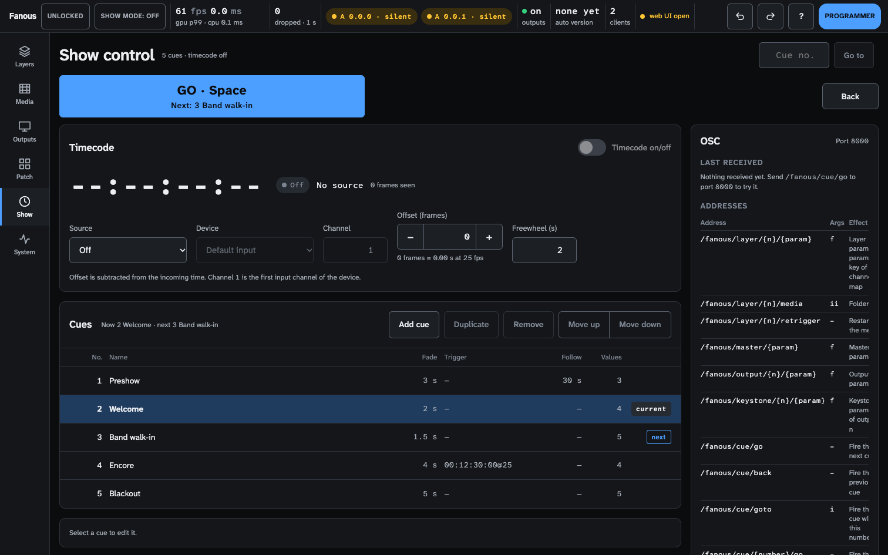
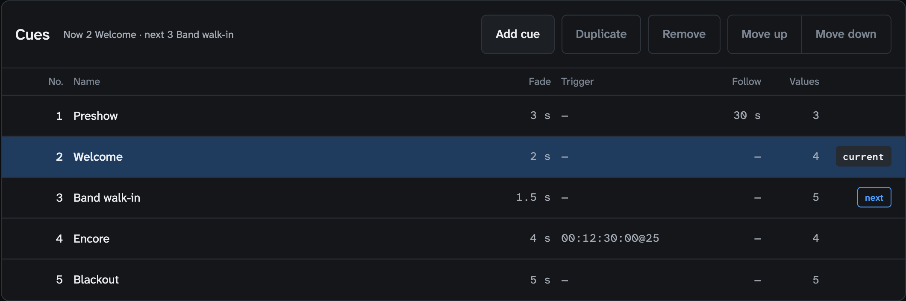
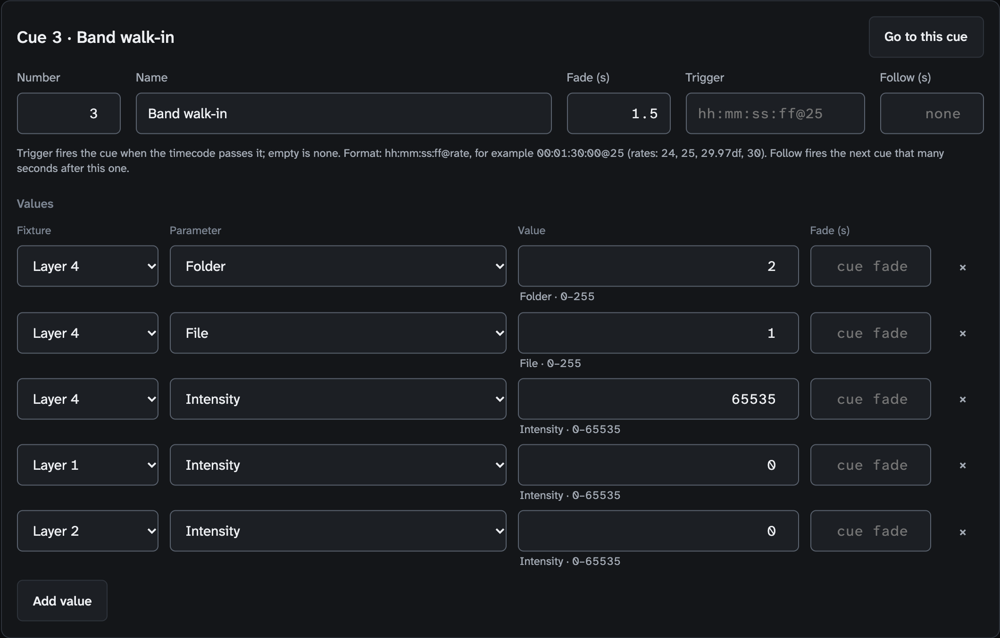
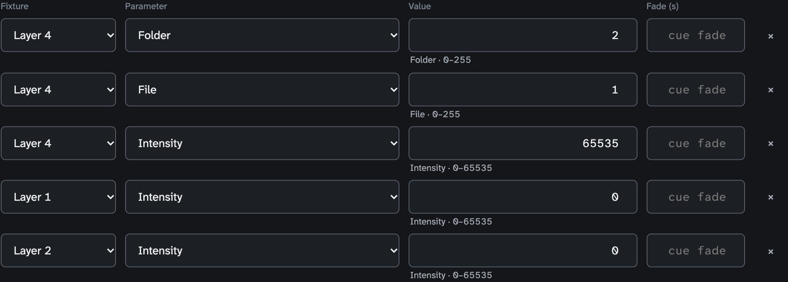
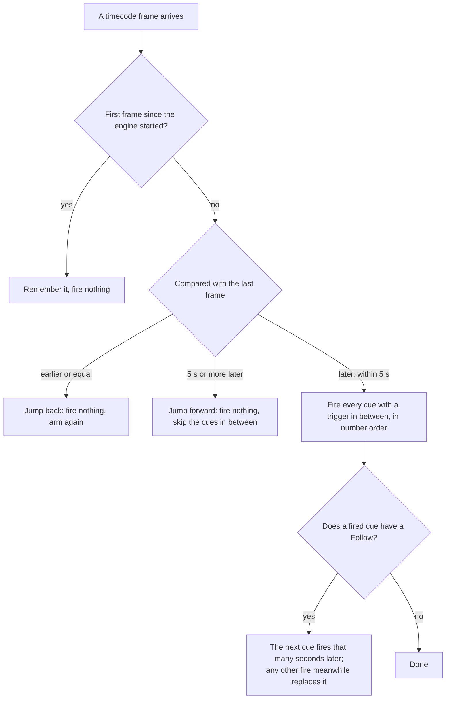
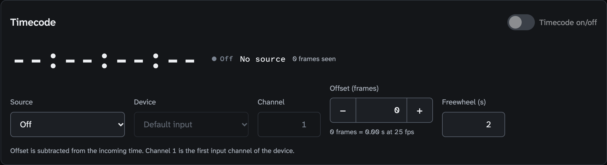
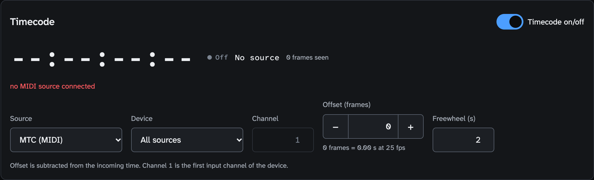
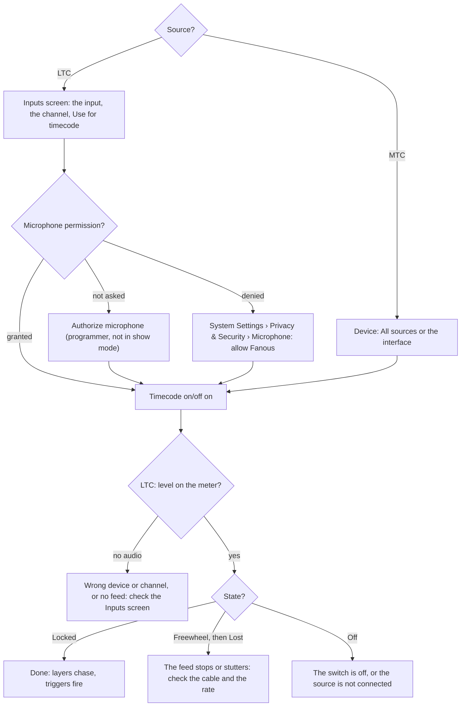
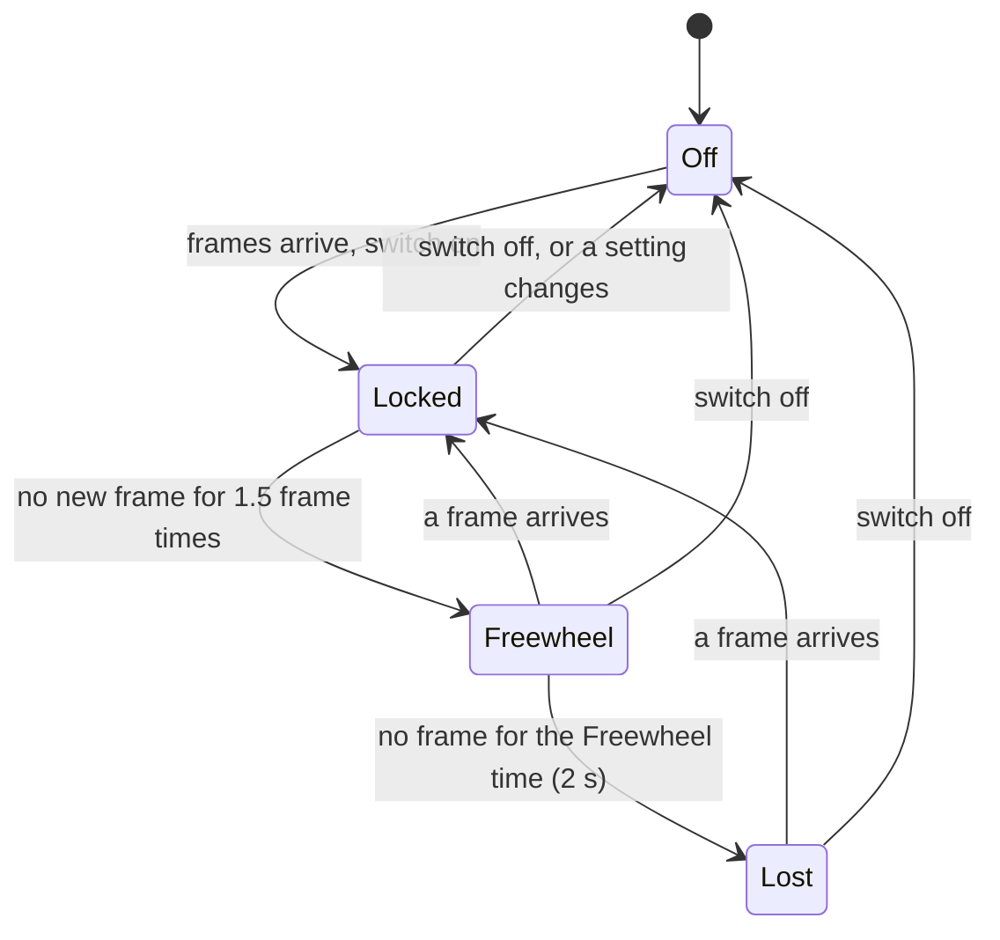

<!-- SPDX-License-Identifier: GPL-3.0-only -->
<!-- Copyright (c) 2026 Tim de Bruijn -->
<!-- Additional terms under GPLv3 §7 apply: see LICENSE-ADDITIONAL-TERMS.md -->

# Show control: cues and timecode

Use this page to run a show from the Show screen, to build cues, and to let
timecode (LTC or MTC) fire them and drive the layers. Driving Fanous without
a console from the UI, OSC, MIDI and MSC, and letting a console browse it
over CITP, is [remote-control.md](remote-control.md); two Macs playing in
step is [multi-server.md](multi-server.md). Every control of the Show screen
is in [screens/show.md](screens/show.md); terms are in the
[glossary](reference/glossary.md#console-protocols-control).

A cue or a timecode trigger moves a layer only when the project's **Who
controls** (Patch screen) lets Fanous's own values through: **Console and
Fanous, latest change wins**, **Console and Fanous, highest value wins** or
**Fanous only (UI, cues, OSC, MIDI)**. With the default **Console only** the
cue list runs, but the layers keep showing the console; the Show screen says
so in yellow and offers **Use Console and Fanous, latest change wins**
([console-setup.md](console-setup.md#who-controls)).

Running the show (GO, Back, Go to, the timecode switch) is the operator's
and works while the show is locked. Building cues and the timecode settings
are the programmer's and are refused while the show is locked
([ui.md](ui.md#roles-and-logging-in)).

## Run the show

- **GO · Space** fires the next cue; its second line says which ("Next: 3
  Band walk-in", or "Next: no further cue" at the end). Before the first
  GO the next cue is the first in the list. Space does the same while no
  field or button has the focus, no dialog is open and no modifier key is
  held; a click on a button leaves the focus, so Space still means GO.
- **Back** fires the previous cue, by its own values only: it does not
  rebuild what earlier cues set. It sits at the far right so it is not hit
  by mistake.
- **Cue no.** and **Go to** fire the cue with that number, in any
  direction; the caption names the cue or says "no such cue".
- A fired cue sets only the values it holds, with its fade. Everything else
  stays as the last cue left it, and nothing is released when a later cue
  fires: Fanous cues track. A cue fired from timecode becomes current, and
  the next GO continues after it.
- After an engine restart no cue is current ("No cue fired yet"); the first
  GO fires the first cue.

## Build a cue

1. **Add cue**: the new cue gets the number one above the highest whole
   number (cues 1, 2 and 5 give 6; a highest cue 2.5 gives 3) and the name
   "Cue N". Numbers may have decimals (2.5, three at most) and must be
   unique; the editor says "Cue N already exists." when not.
2. **Name** it after what it does, and give it a **Fade (s)**: linear, for
   every continuous value in the cue; 0 cuts.
3. **Add value** for each parameter the cue sets: **Fixture** (Layer 1 to
   N, Master, and the Output and Keystone fixtures that are in the patch),
   **Parameter**, **Value** (a number in the parameter's console range,
   0–255 or 0–65535, or a list for parameters with named bands such as
   Play mode), and an optional **Fade (s)** for that value alone.
4. A cue that changes a layer's media (Folder and File) with a fade: give
   its **Dissolve** value a Fade of 0, or set the Dissolve in an earlier
   cue. The media switches at once, and the dissolve is read when the new
   file's first frame is ready, so a Dissolve that is still fading in the
   same cue is read on its way. The same holds for an output's Mapping
   preset and Mapping fade.
5. **Go to this cue** to test it. Give it a [trigger or a follow](#triggers-and-follows)
   when timecode or the previous cue should fire it.
6. **Duplicate** makes "name (copy)" numbered halfway to the next cue, with
   the fade and the values but not the trigger and follow. **Move up** and
   **Move down** swap numbers with the neighbour. **Remove** shows a toast
   with Undo for 8 seconds.

How a fade runs: a continuous value (intensity, position, speed, colour,
dissolve) moves in a straight line from the cue engine's own last value for
that parameter (the parameter's default when no cue has set it yet) to the
new one; it does not start from what the console shows. Parameters that are
choices (play mode, blend mode, effects, fit, folder, file, mapping preset)
switch when the fade starts. Firing a cue during a fade starts from where
the fade is. Under **Console and Fanous, latest change wins** a running fade
holds against the console until it ends.

## Triggers and follows

A **Trigger** fires the cue from timecode: `hh:mm:ss:ff@rate`, for example
`00:01:30:00@25`, with the rates 24, 25, 29.97df (drop frame), 29.97ndf
and 30; without `@rate` it means 25. A **Follow (s)** fires the next cue in
the list that many seconds after this one (0 fires it at once; empty is
none).

| Timecode does | The trigger |
|---|---|
| Passes the trigger time while running | Fires; several cues in the same frame fire in number order |
| Jumps back, or is repeated | Nothing fires; the cues after the new position are armed again |
| Jumps forward by 5 s or more, or returns after a gap of 5 s or more | Nothing fires: the cues in between are skipped, not caught up |
| Is the first value after the engine started | Nothing fires |
| Is in Freewheel or Lost | Nothing fires; triggers come from decoded frames only |
| Passes midnight | Counts as a jump back and arms every cue again |

Triggers use the incoming time as it is: the **Offset** on the Timecode
panel moves the layers that chase timecode, not the triggers. Write the
triggers at the times the timecode really shows. A follow is set each time
the cue fires, so follows chain; a GO, Back or trigger in between replaces
the pending follow. A cue that follows onto a number that does not exist
does nothing.

## Timecode

Timecode comes in as LTC on an audio input or as MTC over MIDI; there is no
internal clock. Layers chase it with Play mode **Timecode** (channel 5 at
128 to 143) and show the file at `(timecode − Offset)` at the file's own
rate, looped between the In and Out points; cues fire from it by their
trigger.

Setting up LTC:

1. Plug the LTC feed into an audio input of the Mac. On the Inputs screen,
   select that input, pick the channel (1 is the first) and press **Use for
   timecode**: Source, Device and Channel are set in one step. The same
   fields are on the Show screen's Timecode panel.
2. Press **Authorize microphone** under Permissions on the Inputs screen,
   before show mode: LTC needs the Microphone permission, and the readiness
   item **Microphone permission granted** blocks show mode without it while
   the Source is LTC, whatever the switch says
   ([live-inputs.md](live-inputs.md#permissions)).
3. **Timecode on/off** on. The level meter under the readout shows the LTC
   channel's level in dBFS: "no audio" means the input could not open or
   nothing arrives on that channel. The rate (24, 25, 29.97 drop or
   non-drop, 30) is detected by itself.
4. The state pill reads **Locked** in green, the readout runs, and the
   source line reads `LTC · device · 25 fps`.

Setting up MTC: Source **MTC (MIDI)**, Device **All sources** or one MIDI
source; the MIDI panel marks the MTC source with a "timecode" badge. MTC
carries its rate (24, 25, 29.97 drop frame or 30; never 29.97 non-drop). A
missing source reads in red under the readout.

| State | Layers that chase | Triggers | Shown |
|---|---|---|---|
| **Locked** (green) | Follow the time | Fire | Readout runs; status bar `timecode · locked` |
| **Freewheel** (yellow) | Keep running at the last rate | Do not fire | Readout keeps counting |
| **Lost** (red) | Hold their position | Do not fire | Status bar red while the show is locked |
| **Off** | Play by their own Play mode | Do not fire | Readout dashed |

| Field | Does |
|---|---|
| **Source**, **Device**, **Channel** | Off, LTC (audio input, with its channel) or MTC (MIDI source) |
| **Offset (frames)** | Subtracted from the incoming time for every layer that chases; the line under it shows it in seconds at the current rate. Not applied to cue triggers |
| **Freewheel (s)** | How long a dropped signal is bridged before Lost; 2 to start, 0.1 at least |
| **Timecode on/off** | The operator's switch; off, the engine treats the source as Off |

Any change to the settings, also the Offset, restarts the input: the state
drops to Off for a moment and comes back Locked. The settings are the
programmer's and are refused while the show is locked; set them before you
lock. The per-layer offsets the engine also supports have no field on the
screen ([reference/api.md](reference/api.md), `timecode.set`).

## Before the show

- Every cue tested with **Go to this cue**, with the show's media loaded;
  Who controls not on Console only.
- Timecode Locked, with the level meter showing a healthy level for LTC;
  the Microphone permission granted; the triggers written at the incoming
  time, not the offset one.
- The show locked (L), so a stray click cannot change a cue; GO, Back, Go
  to and the timecode switch keep working.
- After a crash or an engine restart no cue is current: fire the right one
  with Go to.
- Something wrong on the night: [troubleshooting.md](troubleshooting.md).
