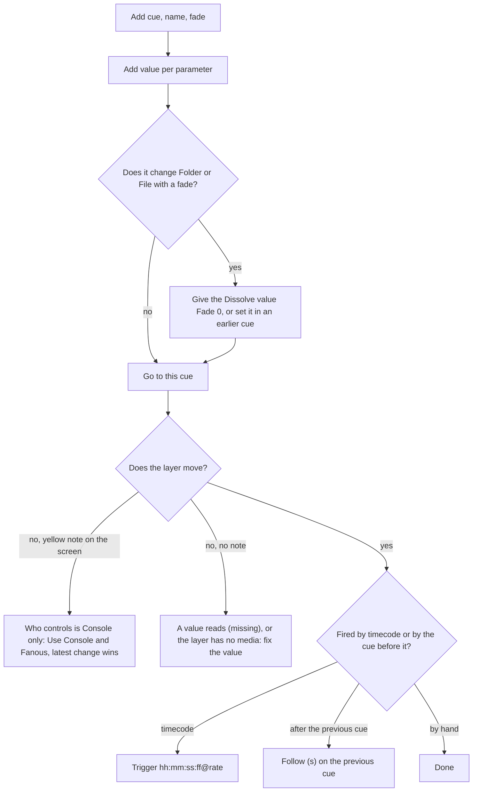
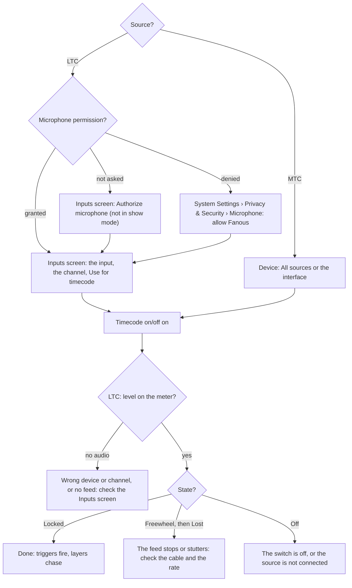
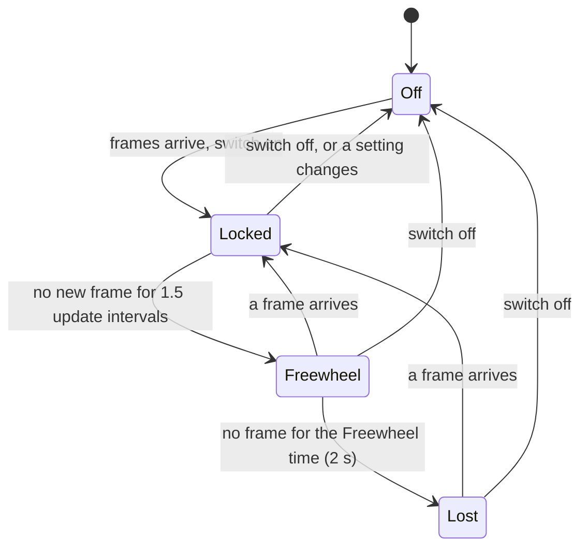

<!-- SPDX-License-Identifier: GPL-3.0-only -->
<!-- Copyright (c) 2026 Tim de Bruijn -->
<!-- Additional terms under GPLv3 §7 apply: see LICENSE-ADDITIONAL-TERMS.md -->

# Show control: cues and timecode

Use this page to run a show from the Show screen, to build cues, and to let
timecode (LTC or MTC) fire them and drive the layers. Driving Fanous without
a console from the UI, OSC, MIDI and MSC, and letting a console browse it
over CITP, is [remote-control.md](remote-control.md); two Macs playing in
step is [multi-server.md](multi-server.md). Every control of the Show screen
is in [screens/show.md](screens/show.md); terms are in the
[glossary](reference/glossary.md#console-protocols-control).

Before you start: open the Show screen (key 6); have media in the library
([media-library.md](media-library.md)) and the layers patched
([console-setup.md](console-setup.md)); and when the Show screen shows a
yellow note about Who controls, press **Use Console and Fanous, latest
change wins** once. With the default **Console only** the cue list runs but
the layers keep showing the console ([remote-control.md](remote-control.md#who-controls)).

Running the show (GO, Back, Go to, the timecode switch) is the operator's
and works while the show is locked. Building cues and the timecode settings
are the programmer's and are refused while the show is locked
([ui.md](ui.md#roles-and-logging-in)).

## Run the show

- **GO · Space** fires the next cue by number after the current one; its
  second line says which ("Next: 3 Band walk-in", or "Next: no further
  cue"). Before the first GO the next cue is the first in the list. Space
  also fires GO, except while you type in a field or a dialog is open;
  after a click on a button Space still means GO.
- **Back** fires the cue before the current one, by its own values only: it
  does not undo what later cues set. The next GO then continues after it.
  It sits at the far right so it is not hit by mistake.
- **Cue no.** and **Go to** fire the cue with that number, in any
  direction, and make it current; the caption names the cue or says "no
  such cue".
- Fanous cues track: a cue sets only the values it holds, with its fade,
  and every other value stays where the last cue left it. A cue that must
  take a layer out needs its Intensity at 0. Nothing is released when a
  later cue fires; removing a cue from the list releases what it held.
- Jumping into the middle (Go to after a restart, a rehearsal from scene
  three) does not rebuild what the cues before it set. Give the first cue of
  each section every value it needs: folder, file, intensity and dissolve.
  After an engine restart no cue is current ("No cue fired yet").

## Build a cue

1. **Add cue**: the new cue gets the number one above the highest whole
   number (cues 1, 2 and 5 give 6; a highest cue 2.5 gives 3) and the name
   "Cue N". Numbers may have decimals (2.5, three at most) and must be
   unique; the editor says "Cue N already exists." when not.
2. **Name** it after what it does, and give it a **Fade (s)**: linear, for
   every continuous value in the cue; 0 cuts.
3. **Add value** for each parameter the cue sets: **Fixture** (Layer 1 to
   N, Master, and the Output and Keystone fixtures that are in the patch),
   **Parameter**, **Value**, and an optional **Fade (s)** for that value
   alone. The range is printed under the field: 0–255 for an 8-bit
   parameter, 0–65535 for a 16-bit one such as Intensity, or a list for a
   parameter with named bands such as Play mode. A value whose fixture or
   parameter no longer exists reads "(missing)": fix or remove it.
4. Changing media with a fade? Give the layer's **Dissolve** value a Fade
   of 0, or set the Dissolve in an earlier cue. Dissolve is the layer
   parameter that sets how long a new file crossfades in; the media
   switches at once and the dissolve is read when the new file's first
   frame is ready, so a Dissolve fading in the same cue is read on its way.
   The same holds for an output's Mapping preset and Mapping fade.
5. **Go to this cue** to test it. Give it a [trigger or a follow](#triggers-and-follows)
   when timecode or the previous cue should fire it.
6. **Duplicate** makes "name (copy)" numbered halfway to the next cue, with
   the fade and the values but not the trigger and follow. **Move up** and
   **Move down** swap numbers with the neighbour. **Remove** shows a toast
   with Undo for 8 seconds.

A three-cue show, Layer 1 playing folder 1 file 1 and Layer 2 taking over:

| Cue | Fade | Values |
|---|---|---|
| 1 Opening | 2 | Layer 1 Folder 1, Layer 1 File 1, Layer 1 Intensity 65535 |
| 2 Fade out | 3 | Layer 1 Intensity 0 |
| 3 Band | 0 | Layer 2 Folder 1, Layer 2 File 2, Layer 2 Intensity 65535 |

Press GO three times. Cue 2 needs Layer 1's intensity explicitly, because
cue 3 would otherwise leave Layer 1 where cue 1 put it.

How a fade runs: a continuous value moves in a straight line from the last
value any cue set for that parameter (the parameter's default when none
has) to the new one; it does not start from what the console shows.
Parameters that are choices (play mode, blend mode, effects, fit, folder,
file, mapping preset) switch when the fade starts. A cue fired during a
fade starts from where the fade is. Under **Console and Fanous, latest
change wins** a running fade holds against the console until it ends.

## Triggers and follows

A **Trigger** fires the cue from timecode: `hh:mm:ss:ff@rate`, for example
`00:01:30:00@25`. The rate is the timecode's frame rate: copy it from the
Timecode panel's source line (`LTC · device · 25 fps`); 24, 25, 29.97df,
29.97ndf and 30 are accepted, and without `@rate` it means 25. Use 29.97df
(drop frame) only when the source says so; frames count from 0 to one
below the rate. A **Follow (s)** fires the next cue in the list that many
seconds after this one fires, not after its fade ends: a 5 s fade with
Follow 5 fires the next cue as the fade ends. 0 fires it at once; empty is
none.

| Timecode does | The trigger |
|---|---|
| Passes the trigger time while running | Fires; several cues in the same frame fire in number order |
| Starts, after an engine start or a jump back, exactly at the trigger time | Nothing fires: a trigger needs a frame before it. Write the first trigger at least one frame after the time the timecode starts at |
| Jumps back, or repeats | Nothing fires; the cues after the new position are armed again |
| Jumps forward by 5 s or more in its value | Nothing fires: the cues in between are skipped, not caught up. A pause that resumes at the same value is no jump |
| Is in Freewheel or Lost | Nothing fires; triggers come from decoded frames only. After a gap of less than 5 s in the value, the triggers passed in the gap fire together on the first frame back |
| Passes midnight | Counts as a jump back and arms every cue again |

Start the timecode running before the first trigger and let it play
through. A locate on the playback skips the cues between the old and the
new position, which is intended; fire a skipped cue with Go to. Triggers
use the incoming time as it is: the **Offset** on the Timecode panel moves
the layers that chase timecode, not the triggers, so write the triggers at
the times the timecode really shows. A follow is set each time the cue
fires, so follows chain; a GO, Back or trigger in between replaces the
pending follow. A Follow on the last cue in the list does nothing.

## Timecode

Timecode is a clock, `hh:mm:ss:ff`, that a sound desk, a playback computer
or a console sends out so that everything runs in step. Fanous only
follows one; it has no clock of its own. It arrives as LTC, an audio
signal on one channel of an audio input, or as MTC over MIDI; ask the
sound or playback operator which you get. Timecode does two separate
things: it fires cues whose trigger it passes, and it can make a layer's
video play at the timecode position ("chase"), with Play mode **Timecode**
(channel 5 at 128 to 143): the layer shows the file at `(timecode −
Offset)` at the file's own rate, looped between its In and Out points. Skip
the chase if you only need triggers.

Setting up LTC:

1. Press **Authorize microphone** under Permissions on the Inputs screen,
   before show mode: LTC needs the Microphone permission, and the readiness
   item **Microphone permission granted** blocks show mode without it while
   the Source is LTC, whatever the switch says
   ([live-inputs.md](live-inputs.md#permissions)).
2. Plug the LTC feed into an audio input of the Mac. On the Inputs screen,
   select that input, pick the channel (1 is the first) and press **Use for
   timecode**: Source, Device and Channel are set in one step. The same
   fields are on the Show screen's Timecode panel.
3. **Timecode on/off** on. The level meter under the readout shows the LTC
   channel's level in dBFS; "no audio" means the input could not open or
   nothing arrives on that channel. The rate (24, 25, 29.97 drop or
   non-drop, 30) is detected by itself.
4. Done when the state pill reads **Locked** in green, the readout counts,
   and the source line reads `LTC · device · 25 fps`.

Setting up MTC:

1. Connect the MIDI source (a USB interface, or a network MIDI session in
   Audio MIDI Setup). It appears in the MIDI panel's source list.
2. Source **MTC (MIDI)**, Device **All sources** or that source; the MIDI
   panel marks it with a "timecode" badge. No permission is needed. MTC
   carries its rate (24, 25, 29.97 drop frame or 30; never 29.97 non-drop).
3. **Timecode on/off** on.
4. Done when the pill reads **Locked** and the source line shows the rate.
   A missing source reads in red under the readout.

| State | Layers that chase | Triggers | Shown |
|---|---|---|---|
| **Locked** (green) | Follow the time | Fire | Readout runs; status bar `timecode · locked` |
| **Freewheel** (yellow): the clock keeps counting for a moment after the signal dropped | Keep running at the last rate | Do not fire | Readout keeps counting |
| **Lost** (red): no signal for the Freewheel time | Hold their position | Do not fire | Status bar red while the show is locked |
| **Off** | Stand still; other layers play as set | Do not fire | Readout dashed |

| Field | Does |
|---|---|
| **Source**, **Device**, **Channel** | Off, LTC (audio input, with its channel) or MTC (MIDI source) |
| **Offset (frames)** | Subtracted from the incoming time for every layer that chases, one value for the project; the line under it shows it in seconds at the current rate. Not applied to cue triggers |
| **Freewheel (s)** | How long a dropped signal is bridged before Lost; 2 to start, 0.1 at least |
| **Timecode on/off** | The operator's switch; off, the engine treats the source as Off |

Show timecode usually starts at 01:00:00:00. A layer that chases then
needs an Offset of one hour (90000 frames at 25 fps), else it shows the
file one hour in, wrapped; the triggers are written at 01:00:… whatever
the Offset. Any change to the settings, also the Offset, restarts the
input: the state drops to Off for a moment and comes back Locked. The
settings are the programmer's and are refused while the show is locked,
so set them before you lock. The per-layer offsets the engine also
supports have no field on the screen ([reference/api.md](reference/api.md#commands),
`timecode.set`).

## Before the show

- Test every cue with **Go to this cue**, with the show's media loaded, and
  the first cue of every section with every value it needs.
- Leave Who controls on a setting that shows Fanous's values, not Console
  only.
- Lock timecode and keep it Locked, with a healthy level on the meter for
  LTC and the Microphone permission granted; write the triggers at the
  incoming time, with a frame to spare after the start.
- Lock the show (L), so a stray click cannot change a cue; GO, Back, Go to
  and the timecode switch keep working.
- After a crash or an engine restart fire the section's first cue with Go
  to: no cue is current, and Go to does not rebuild earlier cues.
- Something wrong on the night: [troubleshooting.md](troubleshooting.md).
