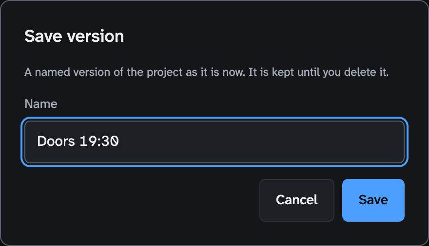
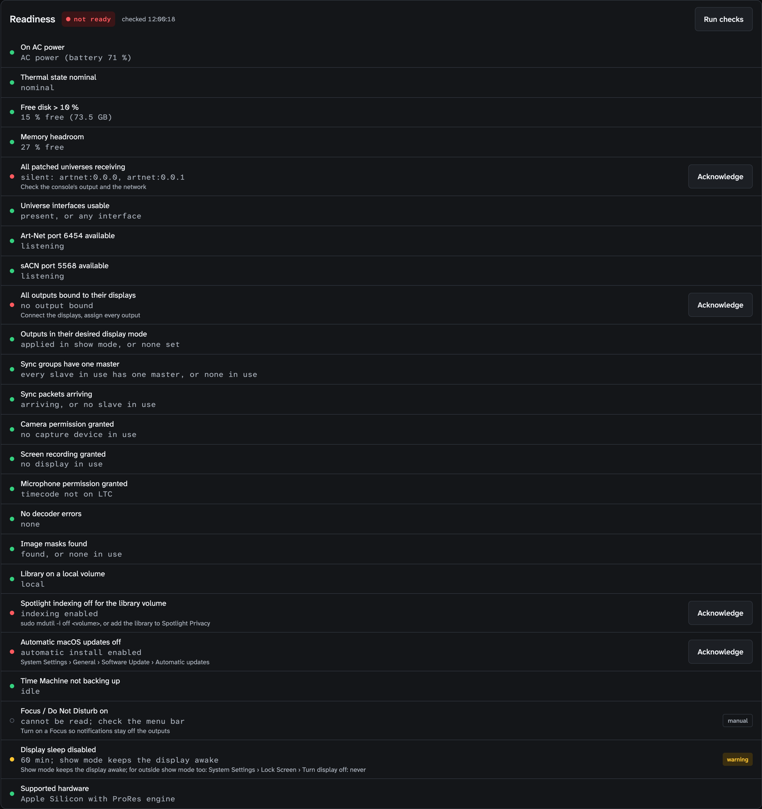
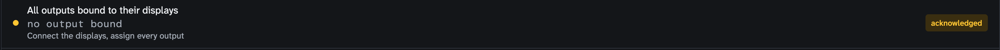
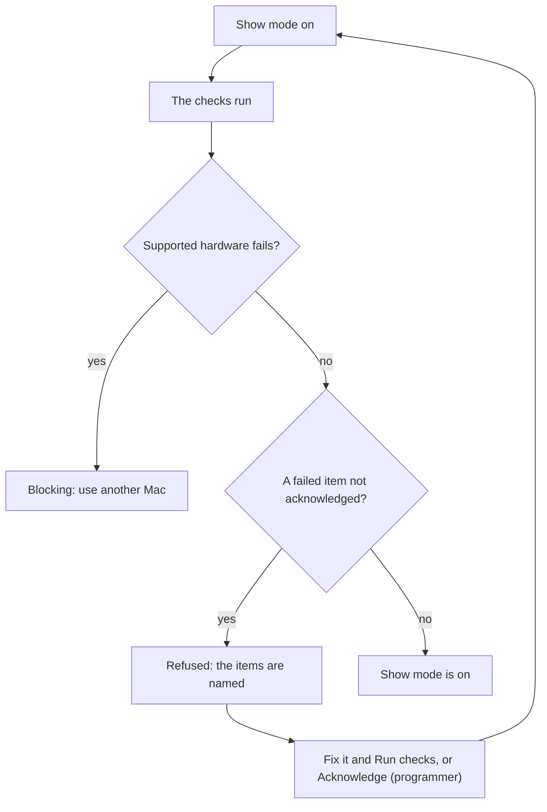
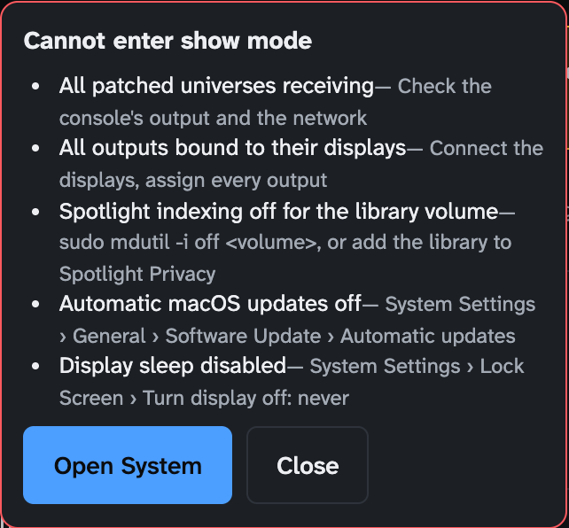
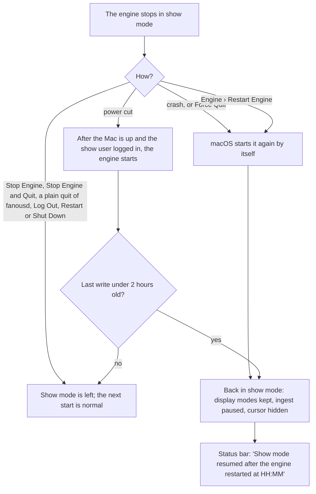

<!-- SPDX-License-Identifier: GPL-3.0-only -->
<!-- Copyright (c) 2026 Tim de Bruijn -->
<!-- Additional terms under GPLv3 §7 apply: see LICENSE-ADDITIONAL-TERMS.md -->

# Show-day checklist

Print the boxes (this page up to "How it works"). Date: ______________
Venue: ______________________ Mac: ______________ Fanous: ______________
Programmer: ______________________ Phone: ______________________

Every readiness item with its threshold and fix is in
[reference/readiness.md](reference/readiness.md); when something is wrong
on the night, [troubleshooting.md](troubleshooting.md).

## The day before

- [ ] Every file the show uses in the library, with more than 10 % of the
      library's volume free; on an external disk only on purpose
      (acknowledge the readiness item) ([media-library.md](media-library.md)).
- [ ] Layers screen: every layer in use shows its file and a green dot.
- [ ] Patch screen: no collisions; every universe in use green with the
      console running ([console-setup.md](console-setup.md#before-the-show)).
- [ ] Outputs screen: every output bound, blend, warp and masks checked
      with the test patterns ([outputs-and-mapping.md](outputs-and-mapping.md#before-the-show)).
- [ ] Every cue tested with Go to; timecode Locked if used
      ([show-control.md](show-control.md#before-the-show)).
- [ ] The permissions the show uses granted on the Inputs screen (camera,
      screen recording with an engine restart after it, microphone); they
      cannot be asked in show mode.
- [ ] Sound output device chosen in macOS (System Settings › Sound) and a
      level test on the PA; a replugged HDMI display can switch it.
- [ ] A full run in show mode with the show locked, on this Mac.
- [ ] System screen: **Run checks**; the list green except what you
      acknowledge on purpose.
- [ ] A named version saved: System › Project versions › **Save version…**
      ("Day before"); a copy of `~/Library/Application Support/Fanous` and
      of the library on another disk ([reference/files-and-ports.md](reference/files-and-ports.md)).
- [ ] No macOS update planned before the show.

## Mac settings, once per show machine

- [ ] AC power; cooling and airflow.
- [ ] Automatic login for the show user, and FileVault off, so the engine
      comes back after a power cut without anyone at the keyboard; a desktop
      Mac set to start after a power failure (System Settings › Energy).
- [ ] Display sleep off: System Settings › Lock Screen › Turn display off:
      Never, and "Require password" set to Never. Any other display sleep
      fails the readiness item.
- [ ] Spotlight off for the library's volume: Terminal (Applications ›
      Utilities), `sudo mdutil -i off /` for a library on the internal disk;
      it asks for the Mac's administrator password and prints "Indexing
      disabled". Without that password, acknowledge the item. Spotlight
      Privacy does not count ([reference/readiness.md](reference/readiness.md)).
- [ ] Automatic updates off: System Settings › General › Software Update ›
      Automatic updates.
- [ ] Time Machine off for the show, not only paused.
- [ ] Focus on: Control Centre › Focus › Do Not Disturb; Fanous cannot
      read it.
- [ ] One network interface for the console network: Wi-Fi off when the
      console is on Ethernet, or the universe's Interface set to it (Patch ›
      Universes).
- [ ] Displays extended, not mirrored (Fanous does not check this); each
      output's Mode set, so show mode applies it.
- [ ] Firewall allows `fanousd` ([getting-started.md](getting-started.md#firewall-and-network));
      done when the iPad loads the UI.
- [ ] Engine menu first line reads "Engine <version> running · service
      installed".

## Before doors

- [ ] Console sending: every patched universe pill green.
- [ ] Programmer password set (System › Roles and passwords), the "Web UI
      open" notice gone; an operator password when an iPad or a second
      computer is in the room.
- [ ] System screen: **Run checks**; every row green, acknowledged on
      purpose, or manual and checked by you.
- [ ] Show mode on (the status bar's tag, or the switch on the System
      screen); it refuses while an item blocks and names the items.
- [ ] Timecode on and **Locked**, if used.
- [ ] Lock the show: L (programmer); the status bar's tag reads **Locked**.
- [ ] "dropped" in the status bar reads 0 for a full minute with a looping
      cue running.
- [ ] A named version saved: **Save version…**, "Doors 19:30"; it works
      while the show is locked.

## During the show

- [ ] Watch the status bar: a universe pill red, "dropped" above 0,
      timecode lost, an output lost.
- [ ] Lock the show again after every fix: the status bar's red marks for
      dropped frames, timecode and outputs show only while it is locked.
- [ ] No imports or transcodes; ingest is paused in show mode anyway.
- [ ] Engine died: [the steps below](#the-engine-died-during-the-show).

| Who | May, also while the show is locked |
|---|---|
| Operator (an iPad) | GO, Back, Go to; the timecode switch; show mode on or off; Run checks; read every screen |
| Programmer | Everything above, Acknowledge, Release, Save version, unlock (L), the Engine menu on the Mac |

## After the show

- [ ] Leave show mode; unlock the show (L) to edit.
- [ ] System › Logs › **Download** the log if anything odd happened; copy
      it before any restart.
- [ ] Automatic updates and Time Machine back on if you want them.

---

## How it works

### The readiness list

Show mode runs the checks when it turns on, every 30 seconds while it is
on, once after a resumed show mode and after a display mode switch in show
mode; **Run checks** runs them at any time, and nothing else does: after an
engine start the list is empty until you run it. Each row shows the item,
what it found, a fix hint when it is not green, and **Acknowledge** or a
badge. Nothing alerts you when an item turns red during the show: only the
System screen shows it.

| Row | Means | Do |
|---|---|---|
| Green dot | OK | Nothing |
| Yellow dot, **warning** | Noted, never blocks | Read the detail; decide |
| Red dot, **Acknowledge** | Failed: blocks show mode | Fix it, or press Acknowledge (programmer; an operator sees no button) to accept the risk on purpose |
| Yellow dot, **acknowledged** | Failed, accepted | Nothing; it no longer blocks |
| Grey ring, **manual** | Fanous cannot read it | Check it yourself |
| Red dot, **blocking** | Cannot be accepted | Only Supported hardware: use a Mac with a ProRes engine |

An acknowledgement is kept in the engine's memory: it survives Run checks
and leaving show mode, is lost at an engine restart, and sticks to the
item, so an item that recovers and fails again later is still acknowledged.

### Show mode

While show mode is on:

- the Mac does not go to idle sleep (display and system); the engine is
  exempt from App Nap;
- the ingest queue is paused, the cursor hidden over the outputs, every
  display on its output's Mode;
- a canvas change, a library root change and a version revert are refused
  or wait; entering saved an automatic version when the project changed.

Leaving it resumes ingest and puts the previous display modes back, so the
projectors may blank for a moment.

### What comes back after the engine stops

The engine writes its show-mode state to disk every 30 seconds.

After a crash macOS restarts the engine at once, or after 10 seconds when
it crashed within 10 seconds of starting. A locked show stays locked. A
crash that nobody restarts keeps the show-mode file: an engine started
days later on the same boot still resumes show mode; Engine › **Stop
Engine…** clears it. The System screen's banner adds "The engine stopped uncleanly
during the show; check the outputs and the log." after every resume, also
after a deliberate Restart Engine: when you pressed it yourself, ignore
that sentence ([known limitations](reference/known-limitations.md#show-mode-and-the-machine)).

### The engine died during the show

1. Operator, iPad: the red "Connection lost" banner. Wait 15 seconds; the
   engine restarts by itself. Done when the status bar reads "Show mode
   resumed after the engine restarted at HH:MM" and the projectors show a
   picture.
2. Every iPad logs in again: the logins did not survive the restart. The
   app window on the Mac needs no login.
3. Operator: Go to the section's first cue; no cue is current after a
   restart.
4. Programmer, on the System screen: the red banner "Show mode is on with
   blocking items" when an acknowledged item failed again; acknowledgements
   did not survive either. Acknowledge them again.
5. Not back after 30 seconds: at the Mac, Engine › **Restart Engine**. Still
   nothing: [troubleshooting.md](troubleshooting.md#the-ui-says-the-engine-is-unreachable).
6. After the show: download the log, and look in
   `~/Library/Logs/DiagnosticReports` for a crash report of `fanousd`.
