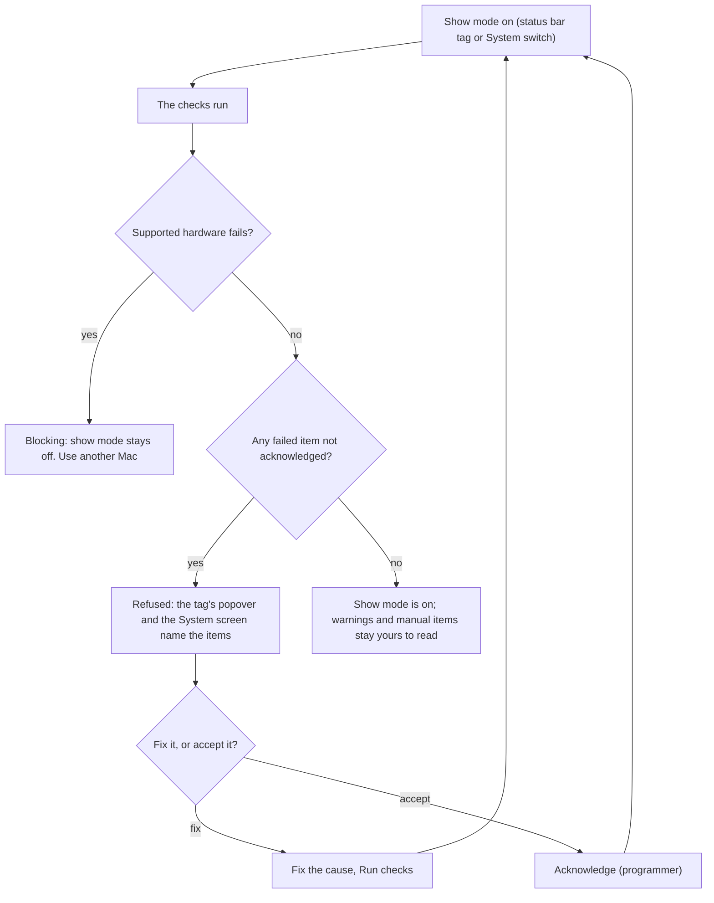
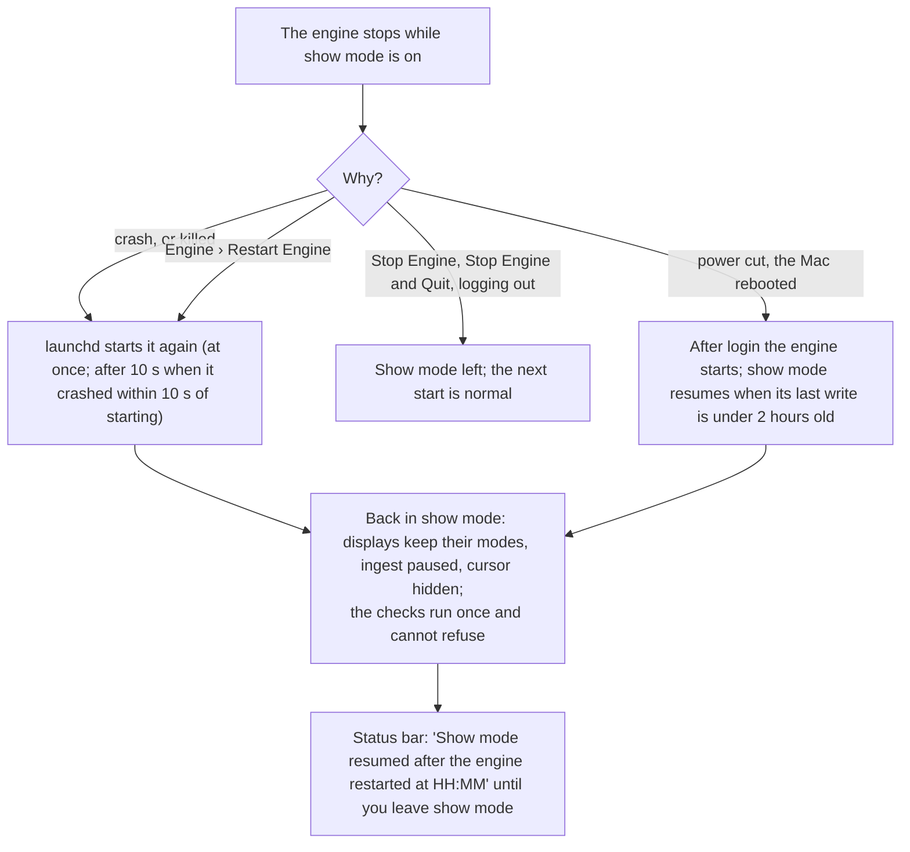

<!-- SPDX-License-Identifier: GPL-3.0-only -->
<!-- Copyright (c) 2026 Tim de Bruijn -->
<!-- Additional terms under GPLv3 §7 apply: see LICENSE-ADDITIONAL-TERMS.md -->

# Show-day checklist

Print this page. Date: ______________ Venue: ______________________
Mac: ______________ Fanous version: ______________

Show mode, the show lock and the readiness list are explained after the
boxes. Every readiness item with its threshold and fix is in
[reference/readiness.md](reference/readiness.md); when something is wrong
on the night, [troubleshooting.md](troubleshooting.md).

## The day before

- [ ] Every file the show uses is in the library on the Mac's internal disk,
      with more than 10 % of the disk free ([media-library.md](media-library.md)).
- [ ] Layers screen: every layer you use shows its file and a green dot, no
      red message.
- [ ] Patch screen: no red collisions in the toolbar; every universe you use
      shows green when the console runs ([console-setup.md](console-setup.md#before-the-show)).
- [ ] Outputs screen: every output bound to its display; blend, warp and
      masks checked with the test patterns ([outputs-and-mapping.md](outputs-and-mapping.md#before-the-show)).
- [ ] Every cue tested with Go to; timecode Locked if you chase or trigger
      from it ([show-control.md](show-control.md#before-the-show)).
- [ ] Permissions granted (camera, screen recording, microphone) on the
      Inputs screen: they cannot be asked in show mode.
- [ ] System screen: **Run checks**, and the list green except what you
      acknowledge on purpose. After an engine start the list is empty until
      you run it.
- [ ] A named version saved: System › Project versions › **Save version…**
      ("Day before").
- [ ] No macOS update planned between now and the show.

## Mac settings, once per show machine

- [ ] AC power connected; cooling and airflow checked.
- [ ] Display sleep off: System Settings › Lock Screen › Turn display off:
      Never. Any other value fails the readiness item and blocks show mode.
- [ ] Spotlight off for the library volume: `sudo mdutil -i off <volume>`.
      Adding the folder to Spotlight Privacy does not change what Fanous
      reads; acknowledge the item then.
- [ ] Automatic updates off: System Settings › General › Software Update ›
      Automatic updates.
- [ ] Time Machine paused: stop a running backup, or switch it off for the
      show.
- [ ] Focus on (Do Not Disturb) from the menu bar, so no notification lands
      on an output. Fanous cannot read this; the item stays manual.
- [ ] One network interface for the console network: Wi-Fi off when the
      console is on Ethernet, or the universe's Interface set to the console
      network (Patch › Universes).
- [ ] Displays extended, not mirrored (System Settings › Displays); each
      output's Mode set on the Outputs screen, so show mode applies it.
- [ ] Firewall allows `fanousd` ([getting-started.md](getting-started.md#firewall-and-network)).

## In Fanous, before doors

- [ ] Console sending: every patched universe in the status bar green.
- [ ] Programmer password set (System › Roles and passwords) and the yellow
      "web UI open" notice gone; an operator password set when an iPad or a
      second computer is in the room.
- [ ] System screen: **Run checks**; work through the list (below).
- [ ] **Show mode** on, from the status bar's tag or the switch on the System
      screen. It refuses while an item blocks and names the items.
- [ ] Timecode on, state **Locked**, if you use it.
- [ ] **L** (programmer) locks the show: the status bar reads **Locked**.
      Unlocking while show mode is on asks for confirmation.
- [ ] "dropped" in the status bar reads 0 and stays there.
- [ ] A named version saved before doors: **Save version…**, "Doors 19:30".
      It never expires, works while the show is locked, and is where you go
      back to if a late change goes wrong
      ([troubleshooting.md](troubleshooting.md#go-back-to-an-earlier-version)).

## The readiness list

Show mode runs the checks when you switch it on, and every 30 seconds while
it is on; **Run checks** on the System screen runs them at any time, and
nothing else does: after an engine start the list is empty and the pill
reads **not checked** until you run them. Each row shows the item, what it
found, a fix hint when it is not green, and either **Acknowledge** or a
badge.

| Row | Means | Do |
|---|---|---|
| Green dot | OK | Nothing |
| Yellow dot, **warning** | Noted, never blocks | Read the detail; decide |
| Red dot, **Acknowledge** | Failed: blocks show mode | Fix it, or press Acknowledge (programmer) to accept the risk on purpose, for example a spare display that is not connected |
| Yellow dot, **acknowledged** | Failed, accepted | Nothing; it no longer blocks |
| Grey ring, **manual** | Fanous cannot read it | Check it yourself |
| Red dot, **blocking** | Cannot be accepted | Only Supported hardware: use a Mac with a ProRes engine |

An acknowledgement is kept in the engine's memory: it survives Run checks
and leaving show mode, is lost at an engine restart, and sticks to the
item, so an item that recovers and fails again later is still acknowledged.

## Show mode

While show mode is on the Mac does not go to sleep by itself (display and
system; closing the lid still sleeps it), the engine is exempt from App Nap,
the ingest queue is paused, the cursor is hidden over the outputs, every
display runs its output's Mode, and a canvas change, a library root change
and a version revert are refused or wait. Entering it saves an automatic
version when the project changed. Leaving it resumes ingest and puts the
previous display modes back.

The engine writes its show-mode state to disk every 30 seconds, so show
mode comes back by itself:

A locked show stays locked across all of that. The System screen adds "The
engine stopped uncleanly during the show; check the outputs and the log."
to the banner, also after a deliberate Engine › Restart Engine
([known limitations](reference/known-limitations.md#show-mode-and-the-machine)).
Download the log after the show.

## During the show

- [ ] Watch the status bar: a universe pill turns red when a patched
      universe has been silent for 2.5 s; dropped frames, lost timecode and a
      lost output turn red while the show is locked.
- [ ] GO, Back, Go to, the timecode switch, show mode, Run checks,
      Acknowledge, Release and Save version keep working while the show is
      locked; everything else needs the programmer to unlock first (**L**).
- [ ] No imports or transcodes during the show; ingest is paused in show
      mode anyway.
- [ ] After an engine restart no cue is current: fire the section's first
      cue with Go to.

## After the show

- [ ] Leave show mode; unlock the show (**L**) to edit.
- [ ] System › Logs › **Download** the log if anything odd happened.
- [ ] Automatic updates and Time Machine back on if you want them.
