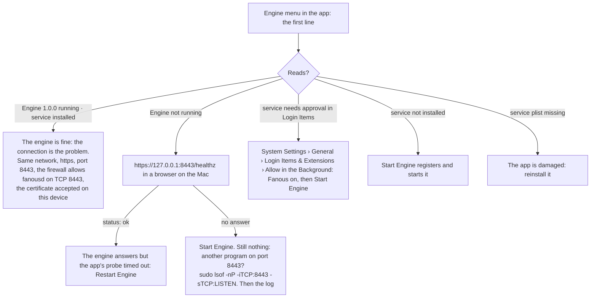
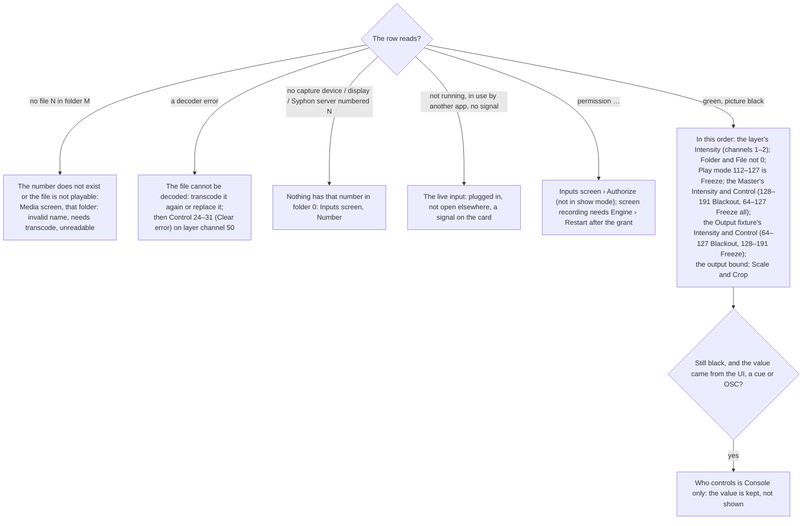
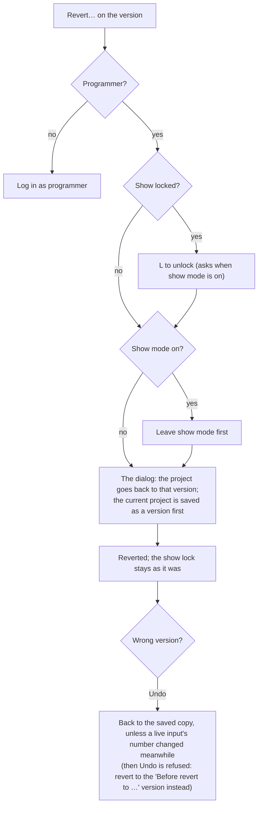

<!-- SPDX-License-Identifier: GPL-3.0-only -->
<!-- Copyright (c) 2026 Tim de Bruijn -->
<!-- Additional terms under GPLv3 §7 apply: see LICENSE-ADDITIONAL-TERMS.md -->

# Troubleshooting

From the symptom to the cause, the most likely first. The log is at the end
([Logs](#logs)); the readiness items with their fixes are in
[reference/readiness.md](reference/readiness.md).

## The UI says the engine is unreachable

Inside a loaded page: "Connecting to the engine…" (yellow) while nothing
has arrived yet, "Engine unreachable: …; retrying" (yellow) when the
connection failed before any data, or the red "Connection lost · … · values
shown are stale" after data had arrived; the red one goes off for a moment
at each retry. The app window shows a blank page when the engine is down at
launch and retries every second by itself.

The engine menu's first line comes from the same `/healthz` address with a
one-second timeout, so a hung engine also reads "Engine not running".
`/healthz` needs no login and answers a short JSON with `"status":"ok"`;
the browser warns about the certificate first. A second engine started by
hand refuses with "fanousd is already running (pid n): one engine per
user", on the terminal only, not in the log. A port held by another program
(8443, Art-Net 6454, OSC 8000) does not stop the engine: the log says
"… listener failed" and the engine runs without that listener.

## Certificate warning on the iPad

Expected once: the engine makes its own certificate. Compare the fingerprint
in the warning with System › Network › TLS fingerprint on the Mac (the
browser shows it with colons and in capitals) and continue. It warns again
after `fanousd reset-tls`, on another device or browser, and when you use
an address the certificate was not made for: it holds the Mac's name and
the addresses it had at first start. If the page does not load at all,
check the address ([ui.md](ui.md#the-ui-on-an-ipad-or-another-computer))
and the firewall. A preview that is a still image updating five times a
second is the JPEG fallback instead of H.264.

## A DMX universe is silent

The status bar has one pill per universe: green, packets arrive within the
universe's Signal lost after time (2.5 s to start); yellow "silent" when
nothing has ever arrived; yellow with seconds while it is silent for less
than 2.5 s; red when a patched universe has been silent for longer. The
fixtures hold their last values meanwhile, unless the universe's **Hold on
signal loss** says otherwise ([console-setup.md](console-setup.md#when-the-console-goes-silent)).

- Console: output enabled for that universe, right protocol, right universe
  number. Art-Net `A 0.0.0` is port-address 0; some consoles count from 1
  ([console-setup.md](console-setup.md#tell-the-console)).
- Patch screen › Universes: a universe the console sends to with no fixture
  on it reads "heard, nothing patched" in yellow. If the console sends
  universe 1 and you patched 0, `A 0.0.1` says that while `A 0.0.0` stays
  silent. Tap the row to see its values in the DMX monitor.
- System › Machine › DMX universes shows the sender's address, the packet
  count and the age of the last packet; "No DMX universes seen" means
  nothing arrives at all: the console's target address, the cable or Wi-Fi.
- Network: Mac and console on the same subnet, one active interface, the
  firewall allowing UDP 6454 (Art-Net) and 5568 (sACN).
- Two sources on one universe: Art-Net takes the latest packet, sACN the
  highest priority. Send each universe from one console.

## A layer shows an error, or the picture is black

The Layers screen shows the problem in the row's Media column.

The Layer panel on the Layers screen shows every channel's value as the
engine reads it. The engine's own texts for a layer are "no file N in
folder M", "no capture device numbered N (folder 0, 1–20)", "no display
numbered N (folder 0, 21–28)", "no Syphon server numbered N (folder 0,
150–169)", "no built-in content N in folder 0", "not running", "in use by
another app", "could not connect", "no signal", the camera and screen
permission texts, and a decoder's error ("unsupported codec …",
"VideoToolbox error …", "no video track").

## A display layer is black

A layer on folder 0, file 21 to 28, shows a whole display of this Mac
([live-inputs.md](live-inputs.md#displays-2128)). "screen permission not
granted": Inputs screen › **Authorize screen** (not in show mode), allow
Fanous under System Settings › Privacy & Security › Screen & System Audio
Recording, then Engine › **Restart Engine**: macOS applies the grant only to
a new engine process. It worked before and stopped: macOS asks about once a
month, with a dialog on the main display; allow it, then restart the engine
if the layer stays black. "not running": the display is unplugged, or it is
one of Fanous's outputs. For a show-critical slides feed use a capture card
instead; it needs no permission and is never asked again.

## Outputs stay black although the layers play

- The output's row on the Outputs screen: green with its display, not "not
  assigned to a display" or the red "display missing"
  ([outputs-and-mapping.md](outputs-and-mapping.md#add-an-output-and-bind-it-to-a-display)).
- Its Intensity up, and the Output and Master fixtures' Intensity up with
  no Blackout: a test pattern follows them like the picture, so a pattern
  that stays black points at them.
- No output at all: the status bar reads "outputs 0" and a banner says "no
  outputs rendering".
- After a library root change the layers look their media up in the new
  library at once: a number that does not exist there reads "no file N in
  folder M".

## Lines and a yellow cross on the projector

Someone has Warp & Slices open: the projector shows what they edit
([warp-and-masks.md](warp-and-masks.md#show-on-output)). Leave the tab or
switch **Show on output** off and the lines go; a browser that went away
takes them with it within a few seconds.

## Dropped frames

The status bar shows "dropped · 1 s". System › Live metrics shows, over the
last second, fps, dropped (missed and late), GPU and CPU time (p50, p99,
max), DMX to photon, texture misses (a layer without a decoded frame in
time), clients, preview frames and audio, with a graph of the GPU p99
against the frame budget ([screens/system.md](screens/system.md#live-metrics)).
The dropped tile is red in show mode and yellow before it; the status bar's
"dropped" is red while the show is locked.

- Heat or power: System › Machine › Thermal nominal (fair still passes the
  readiness item, serious does not); AC power. Fix airflow first; the engine
  only reports the thermal state, it does not slow itself down.
- Other work on the Mac: quit other applications (Memory headroom), pause
  Time Machine, switch Spotlight off for the library volume, turn show mode
  on (it pauses ingest). Many open browser previews cost time too: the
  clients tile.
- Display mode: the display at the canvas frame rate or a multiple of it,
  not mirrored; the output's Mode set, so show mode applies it
  ([outputs-and-mapping.md](outputs-and-mapping.md#display-modes)).
- Too much media: 4K60 ProRes, Blur and Edge, dissolves on many layers
  ([media-library.md](media-library.md#what-a-mac-can-play)).

## LTC does not lock

Show screen › Timecode: the state should read **Locked** and "frames seen"
count up ([show-control.md](show-control.md#timecode)).

- Source **LTC**, the **Timecode** switch on, the right **Device** (an
  unplugged one reads "not connected") and **Channel** (1 is the first; the
  LTC may be on another).
- Level: the meter under the readout shows the channel's peak. Near the
  bottom, nothing arrives on this channel; yellow, above −3 dBFS, is close
  to clipping. Too quiet or clipped LTC does not decode: set the interface's
  input level.
- Permission: the red line under the readout says "microphone permission
  denied" when Fanous is not allowed under Privacy & Security › Microphone
  (or **Authorize microphone** on the Inputs screen, not in show mode).
- Freewheel (yellow) means the signal dropped; Lost (red) means it stayed
  away longer than the Freewheel time.

For MTC the MIDI panel must list the source; connect the interface or
enable a network MIDI session, then choose it under Device or All sources.

## A CITP console does not see Fanous

- System › Network, CITP line: "not running" means the CITP server did not
  start (the log says "CITP start failed"); otherwise it shows the TCP port,
  the consoles and the open streams.
- Same subnet as the console, and multicast must pass the network (managed
  switches: check multicast settings); not with `--no-network`.
- Firewall: `fanousd` needs outgoing UDP to 224.0.0.180 and 239.224.0.180
  on port 4809; a network filter holds the first packets until you allow
  them ("CITP PLoc beacon failed" in the log).
- No hardware console has been tried yet
  ([known limitations](reference/known-limitations.md#consoles-and-protocols)).

## A sync slave does not follow

[multi-server.md](multi-server.md#when-the-slave-does-not-follow): the
badge, Packets in on System › Sync, the port, the interface, a cloned
install.

## Logs

System › Logs (programmer) shows the last 64 KB of the engine log with a
filter field, **Refresh** (it does not follow the log live) and
**Download** (the whole current file; the rotated `fanousd.log.1` is not
served). The Service line shows the engine version and its uptime: a short
uptime you did not expect means it restarted.

The file is `~/Library/Logs/Fanous/fanousd.log` (Engine › **Open Logs**
opens the folder; it rotates once at 10 MB). The same lines are in
Console.app under the subsystem `org.fanous`. At a start the engine logs
its version and chip, the TLS identity, each listener ("Art-Net listening",
"OSC listening", "HTTPS listening", "CITP listening"), the MIDI sources and
the LTC input; what went wrong reads "… listener failed", "sACN port in use;
running without sACN", "sync port in use", "CITP start failed", "media not
found", "media open failed", "project file not readable", "show mode
resumed after an unclean stop" or "show mode kept across a restart".

## Restart the engine

Engine › **Restart Engine**: the outputs go black for a moment and the UI
reloads; the console's values apply again at once and playback positions
start over. Avoid it during a show; if show mode is on, the engine comes
back in show mode and the displays keep their modes
([show-day-checklist.md](show-day-checklist.md#show-mode)). After a crash
the engine restarts by itself, at once, or after 10 seconds when it crashed
within 10 seconds of starting. Quitting the app does not stop the engine
unless you choose **Stop Engine and Quit** in the quit question; **Stop
Engine…** does, and **Start Engine** starts it again.

## Go back to an earlier version

A change made the show worse and Undo is no help (the engine restarted, or
too much happened since). System › **Project versions** holds the versions:
automatic ones at every engine start, on entering show mode and every 10
minutes, each only when the project changed since the newest version (the
newest 50 automatic ones are kept); named ones from **Save version…**, kept
until you delete them.

Everything in the project goes back: layers, patch, outputs, canvases,
cues, timecode and MIDI settings. A console can do the same with OSC:
`/fanous/project/load "Doors 19:30"` restores the newest named version with
that name, under the same rules ([reference/osc.md](reference/osc.md)).

The versions are files in `~/Library/Application Support/Fanous/versions/`,
one per version. If `project.json` itself does not read as a project when
the engine starts, the engine starts with the standard patch and keeps the
file next to it as `project.json.unreadable-<time>`; the log names it.
Revert to a version, or, with the engine stopped (Engine › **Stop
Engine…**), move the kept file back to `project.json` once it is repaired.

## Reset the project

This drops the patch changes, outputs, cues and timecode settings. Save a
named version first, or copy `project.json`; the `versions/` folder is not
touched.

1. Engine › **Stop Engine…**, or quit and choose **Stop Engine and Quit**.
2. In Finder move `~/Library/Application Support/Fanous/project.json` away,
   for example to the Desktop.
3. Engine › **Start Engine**. The engine starts with the standard patch.

## A forgotten password

The app window on the Mac always has programmer access: System › Roles and
passwords sets a new password or clears it. Without the Mac's screen, stop
the engine, remove the `passwords` entry from `~/Library/Application
Support/Fanous/settings.json` (or move the file away, which also resets the
sync and OSC feedback settings) and start the engine: the role is open
again. The certificate is reset with `fanousd reset-tls`, with the engine
stopped; browsers then warn again ([reference/files-and-ports.md](reference/files-and-ports.md)).
