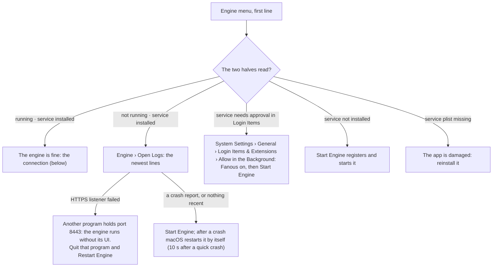
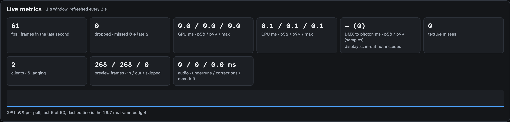
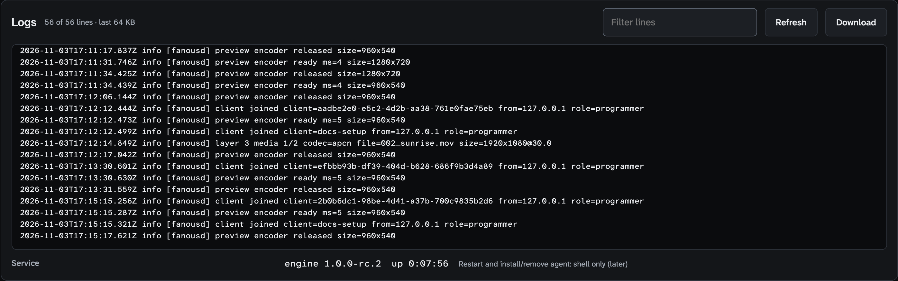
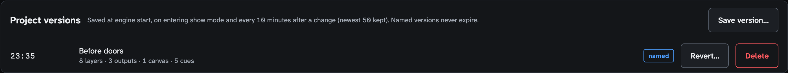
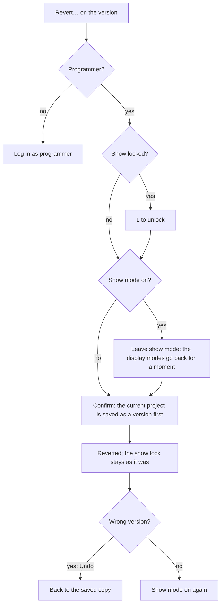

<!-- SPDX-License-Identifier: GPL-3.0-only -->
<!-- Copyright (c) 2026 Tim de Bruijn -->
<!-- Additional terms under GPLv3 §7 apply: see LICENSE-ADDITIONAL-TERMS.md -->

# Troubleshooting

From the symptom to the cause, the most likely first. The readiness items
with their fixes are in [Readiness items](reference/readiness.md);
the log is under [Logs](#logs).

| You see | Go to |
|---|---|
| The picture froze, the iPad says "Connection lost" | [The engine died during the show](#the-engine-died-during-the-show) |
| The UI cannot reach the engine | [Engine unreachable](#the-ui-says-the-engine-is-unreachable) |
| The iPad warns about the certificate, or will not load the UI | [The iPad warns about the certificate](#the-ipad-warns-about-the-certificate) |
| The console moves nothing | [The console moves nothing](#the-console-moves-nothing) |
| A universe pill is not green | [A DMX universe is silent](#a-dmx-universe-is-silent) |
| A layer reads an error, or is black | [A layer shows an error, or the picture is black](#a-layer-shows-an-error-or-the-picture-is-black) |
| The picture is frozen | [The picture is frozen](#the-picture-is-frozen) |
| A projector is black | [Outputs stay black although the layers play](#outputs-stay-black-although-the-layers-play) |
| Lines and a yellow cross on a projector | [Lines on the projector](#lines-and-a-yellow-cross-on-the-projector) |
| The picture stutters, "dropped" above 0 | [Dropped frames](#dropped-frames) |
| No sound | [No sound](#no-sound) |
| A cue does not fire | [A cue does not fire](#a-cue-does-not-fire) |
| Timecode does not lock | [LTC does not lock](#ltc-does-not-lock) |
| The console does not list Fanous | [A CITP console does not see Fanous](#a-citp-console-does-not-see-fanous) |
| The second Mac does not follow | [Multi-server sync](multi-server.md#when-the-slave-does-not-follow) |
| Show mode refuses | [Show-day checklist](show-day-checklist.md#the-readiness-list) |
| The patch or the cues are gone after a restart | [The project is gone after a restart](#the-project-is-gone-after-a-restart) |

Who can do what: an operator on an iPad can read every screen, run the
checks, enter and leave show mode and fire cues. Everything else below
needs the programmer, or someone at the Mac: the Engine menu is in the
menu bar at the top of the Mac's screen while the Fanous app is in front
(click Fanous in the Dock), not in the browser or on the iPad. Its first
line says what the engine is doing, "Engine <version> running · service
installed" when all is well ([The user interface](ui.md#menus-of-the-app-window)).

## The engine died during the show

1. Wait 15 seconds: macOS restarts the engine by itself. Done when the
   status bar reads "Show mode resumed after the engine restarted at
   HH:MM" and the projectors show a picture.
2. Log in again on every iPad; the logins did not survive the restart.
3. Go to the section's first cue: no cue is current after a restart.
4. Programmer, System screen: acknowledge again what the red banner "Show
   mode is on with blocking items" names; acknowledgements did not survive
   either.
5. Not back after 30 seconds: at the Mac, Engine › **Restart Engine**.
   Still nothing: the next section.
6. Afterwards, copy the log before any further restart, and look in
   `~/Library/Logs/DiagnosticReports` for a crash report of `fanousd`.

## The UI says the engine is unreachable

Inside a loaded page: "Connecting to the engine…" (yellow) while nothing
has arrived yet, "Engine unreachable: …; retrying" (yellow) when the
connection failed before any data, or the red "Connection lost · … · values
shown are stale" after data had arrived; the red one goes off for a moment
at each retry. The app window shows a blank page when the engine is down at
launch and retries every second by itself.



The connection, when the engine runs: the same network, `https`, port
8443, the firewall allowing `fanousd` on TCP 8443, the certificate accepted
on that device, and macOS's Local Network permission granted to Fanous.
`https://127.0.0.1:8443/healthz` in a browser on the Mac answers a short
JSON with `"status":"ok"` when the engine answers (the browser warns about
the certificate first); the Engine menu uses the same address with a
one-second timeout, so a hung engine also reads "Engine not running".

Do not press **Start Engine** on a hunch while the show runs: when an
engine runs but does not answer within 10 seconds (port 8443 held by
another program, or hung), Start Engine restarts it, and the outputs go
black for a moment. Read the log first. A port held by another program
(8443, Art-Net 6454, OSC 8000) does not stop the engine; the log says
"HTTPS listener failed", "Art-Net listener failed" or "OSC UDP failed" and
the engine runs without that listener ([known limitations](reference/known-limitations.md#show-mode-and-the-machine)).

## The iPad warns about the certificate

Expected once per device: the engine makes its own certificate. On the
iPad tap Show Details › visit this website. To check that it is your Mac,
compare the fingerprint with System › Network › TLS fingerprint on the Mac
(the browser shows it with colons and in capitals). It warns again after
`fanousd reset-tls`, on another device or browser, and when you use an
address the certificate was not made for: it holds the Mac's name and the
addresses it had at first start, so a new network needs a reset
([Files, ports and the command line](reference/files-and-ports.md)). If the
page does not load at all, check the address
([The user interface](ui.md#the-ui-on-an-ipad-or-another-computer)) and the firewall.

A preview that is a still image updating five times a second is the JPEG
fallback instead of H.264: the browser cannot decode the stream, or the
engine's four encoders are taken.

## The console moves nothing

The universe pill is green but the layer does not follow the desk.

1. Who controls (Patch screen) on **Fanous only**: the console is ignored.
   Set it to Console only or one of the "Console and Fanous" choices
   ([Console setup](console-setup.md#who-controls)).
2. The fixture's address: the Patch screen's DMX monitor shows what
   arrives on each channel; the console's address and mode must match the
   patch sheet ([Console setup](console-setup.md#tell-the-console)).
3. The layer's Intensity (channels 1 and 2) above 0, Folder and File not 0.
4. A UI or MIDI value masking the console: the layer panel reads "UI
   control" or "MIDI control"; **Release** hands it back.

## A DMX universe is silent

| Pill | Means |
|---|---|
| Green | Packets arrive within the universe's Signal lost after time (2.5 s to start) |
| Yellow "silent" | Nothing has ever arrived on it, also right after an engine restart |
| Yellow with seconds | Silent for less than 2.5 s, or an unpatched universe (which is never red) |
| Red | A patched universe silent for longer than its Signal lost after time and 2.5 s |

The fixtures hold their last values meanwhile, unless the universe's
**Hold on signal loss** says otherwise ([Console setup](console-setup.md#when-the-console-goes-silent)).

1. System › Machine › DMX universes: the sender's address, the packet count
   and the age of the last packet. "No DMX universes seen" means nothing
   arrives at all: the console's target address, the cable or Wi-Fi, or
   macOS's Local Network permission.
2. Console: output enabled for that universe, right protocol, right
   universe number. Art-Net `A 0.0.0` is port-address 0; some consoles
   count from 1.
3. Patch screen › Universes: a universe the console sends to with no
   fixture on it reads "heard, nothing patched". If the console sends 1 and
   you patched 0, `A 0.0.1` says that while `A 0.0.0` stays silent.
4. Network: Mac and console on the same subnet, one active interface, the
   firewall allowing UDP 6454 (Art-Net) and 5568 (sACN).
5. Two sources on one universe: Art-Net takes the latest packet, sACN the
   highest priority. Send each universe from one console.

Done when the pill turns green.

## A layer shows an error, or the picture is black

The Layers screen shows the problem in the row's Media column.

| The row reads | Do |
|---|---|
| "no file N in folder M" | The number does not exist or the file is not playable: Media screen, that folder: invalid name, needs transcode, unreadable ([Media library](media-library.md)) |
| A decoder error ("unsupported codec", "VideoToolbox error", "no video track") | Transcode the file again or replace it, then send Control 24–31 (Clear error) on layer channel 50 from the console and back to 0 |
| "no capture device / display / Syphon server numbered N" | Nothing has that number in folder 0: Inputs screen, **Number** ([Live inputs](live-inputs.md)) |
| "not running", "in use by another app", "no signal" | The live input: plugged in, not open in another app, a signal on the card |
| A permission text | Inputs screen › **Authorize** (not in show mode); screen recording needs Engine › Restart Engine after the grant |

The row is green and the picture black, in this order, done when the
picture appears:

1. The layer's Intensity (channels 1 and 2) above 0; Folder and File not 0.
2. Play mode 112 to 127 is Freeze.
3. The Master fixture, if patched: Intensity (channels 1 and 2) up,
   Control (channel 3) below 64; 64 to 127 is Freeze all, 128 to 191
   Blackout.
4. The Output fixture, if patched: Intensity up, Control below 64; 64 to
   127 is Blackout, 128 to 191 Freeze.
5. The output bound ([below](#outputs-stay-black-although-the-layers-play)).
6. Scale and Crop.
7. The value came from the UI, a cue or OSC and Who controls is **Console
   only**: it is kept, not shown ([Remote control](remote-control.md#who-controls)).

The Layer panel on the Layers screen shows every channel's value as the
engine reads it.

## The picture is frozen

Play mode 112 to 127 is Freeze on the layer; Master Control 64 to 127 is
Freeze all; Output Control 128 to 191 is Freeze. A frozen output shows a
test pattern live over the held frame. A still image, or a live input that
lost its signal, holds its last frame by design.

## Outputs stay black although the layers play

- The output's row on the Outputs screen: green with its display, not "not
  assigned to a display" or the red "display missing"
  ([Outputs and mapping](outputs-and-mapping.md#add-an-output-and-bind-it-to-a-display)).
- Its Intensity up, and the Output and Master fixtures' Intensity up with
  no Blackout: a test pattern follows them like the picture, so a pattern
  that stays black points at them.
- No output at all: the status bar's outputs item reads 0 and its caption
  "no outputs rendering: add or assign one (Outputs)".
- After a library root change the layers look their media up in the new
  library at once: a number that does not exist there reads "no file N in
  folder M".
- A display layer (folder 0, 21 to 28) black: "screen permission not
  granted" wants **Authorize screen** on the Inputs screen, the grant under
  Privacy & Security › Screen & System Audio Recording, then Engine ›
  Restart Engine; macOS asks again about once a month, on the main
  display ([Live inputs](live-inputs.md#displays-2128)).

## Lines and a yellow cross on the projector

Someone has Warp & Slices open: the projector shows what they edit
([Warp, slices and masks](warp-and-masks.md#show-on-output)). Leave the tab or
switch **Show on output** off; a browser that went away takes them with it
within a few seconds.

## Dropped frames

The status bar shows "dropped · 1 s"; in show mode the tile on System ›
Live metrics is red, and the status bar's item is red while the show is
locked. The tile to read is **dropped**; the graph shows the GPU's p99
against the frame budget ([System screen](screens/system.md#live-metrics)).



- Heat or power: System › Machine › Thermal nominal (fair still passes the
  readiness item); AC power. Fix airflow first; the engine only reports the
  thermal state and does not slow itself down.
- Other work on the Mac: quit other applications, switch Time Machine
  off, Spotlight off for the library's volume, show mode on (it pauses
  ingest). Many open browser previews cost time too: the clients tile.
- Display mode: the display at the canvas frame rate or a multiple of it,
  not mirrored; the output's Mode set, so show mode applies it
  ([Outputs and mapping](outputs-and-mapping.md#display-modes)).
- Too much media: 4K60 ProRes, Blur and Edge, dissolves on many layers
  ([Media library](media-library.md#what-a-mac-can-play)).

## No sound

Audio plays on the Mac's default output device in one stereo mix
([Media library](media-library.md#audio)). System Settings › Sound ›
Output: the right device; a replugged HDMI display can switch it. The
layer's audio channels on the console (volume, mute); audio plays only at
100 % speed forward. System › Live metrics › audio counts underruns.

## A cue does not fire

- From GO: Who controls on **Console only** keeps the cue's values from
  showing; the Show screen says so in yellow.
- From a trigger: the timecode must be Locked and pass the trigger time
  running; a start exactly at the trigger, a jump back, or a jump forward
  of 5 seconds or more fires nothing ([Show control](show-control.md#triggers-and-follows)).
  Fire a skipped cue with Go to.
- From OSC or MSC: the OSC panel's "Last received" or the MIDI panel's last
  message shows whether it arrived; the MSC format and device id must match
  ([Remote control](remote-control.md#midi-show-control)).
- After an engine restart no cue is current: Go to the right one.

## LTC does not lock

Show screen › Timecode: the state should read **Locked** and "frames seen"
count up ([Show control](show-control.md#timecode)).

- Source **LTC**, the **Timecode** switch on, the right **Device** (an
  unplugged one reads "not connected") and **Channel** (1 is the first; the
  LTC may be on another).
- Level: the meter under the readout shows the channel's peak. Near the
  bottom, nothing arrives on this channel; yellow, above −3 dBFS, is close
  to clipping. Too quiet or clipped LTC does not decode: set the interface's
  input level.
- Permission: the red line under the readout says "microphone permission
  denied" when Fanous is not allowed under Privacy & Security › Microphone
  (or **Authorize microphone** on the Inputs screen, not in show mode).
- Freewheel (yellow) means the signal dropped; Lost (red) means it stayed
  away longer than the Freewheel time.

For MTC the MIDI panel must list the source; connect the interface or
enable a network MIDI session, then choose it under Device or All sources.

## A CITP console does not see Fanous

- System › Network, CITP line: "not running" means the CITP server did not
  start (the log says "CITP start failed"); otherwise it shows the TCP port,
  the consoles and the open streams.
- Same subnet as the console, and multicast must pass the network (managed
  switches: check multicast settings); not with `--no-network`.
- Firewall: `fanousd` needs outgoing UDP to 224.0.0.180 and 239.224.0.180
  on port 4809; a network filter holds the first packets until you allow
  them ("CITP PLoc beacon failed" in the log).
- No hardware console has been tried yet
  ([known limitations](reference/known-limitations.md#consoles-and-protocols)).

## The project is gone after a restart

The engine starts with the standard patch and no cues when `project.json`
does not read as a project (a damaged file, a file from another version).
It keeps the file next to it as `project.json.unreadable-<time>` and the
log names it. Revert to the newest version (System › Project versions,
[below](#go-back-to-an-earlier-version)); or, with the engine stopped
(Engine › **Stop Engine…**), move the kept file back to `project.json` once
it is repaired.

## Logs

System › Logs (programmer) shows the last 64 KB of the engine log with a
filter field, **Refresh** (it does not follow the log live) and
**Download** (the whole current file). The start-up lines are in the 64 KB
view only when the engine started recently. The Service line shows the
engine version and its uptime: a short uptime you did not expect means it
restarted.



The file is `~/Library/Logs/Fanous/fanousd.log` (Engine › **Open Logs**
opens the folder); it rotates once at 10 MB to `fanousd.log.1`, which
Download does not serve, and the rotation drops the older copy, so copy the
log before restarting anything in a crash loop. A crash leaves no trace in
it: look in `~/Library/Logs/DiagnosticReports` for a report of `fanousd`.
The same lines are in the unified log under the subsystem `org.fanous`:

```bash
log show --predicate 'subsystem == "org.fanous"' --last 1h
```

| Line | Means |
|---|---|
| "HTTPS listener failed", "Art-Net listener failed", "OSC UDP failed", "OSC TCP failed" | That listener could not open, usually a port another program holds; the engine runs without it |
| "CITP listener failed" | The CITP server could not open its port; the console will not list Fanous |
| "sACN port in use; running without sACN" | The readiness item warns too |
| "sync port in use; not receiving sync packets" | System › Sync: apply a free port |
| "CITP start failed", "CITP PLoc beacon failed (firewall?)" | The console will not list Fanous |
| "media not found", "media open failed" | The layer's row says the same |
| "project file not readable" | The section above |
| "stale show state ignored" | The Mac was down for more than 2 hours: a normal start |
| "show mode resumed after an unclean stop", "show mode kept across a restart" | Show mode came back; the second is a deliberate Restart Engine |
| "autosave failed", "show mode state not saved" | The disk or the folder is not writable: the engine plays on and saves nothing |

## Disk full, or the folder not writable

The readiness item checks the library's volume only; the project, the
versions and the log live on the home volume. When that is full or
`~/Library/Application Support/Fanous` is not writable, the engine keeps
playing but saves nothing and the UI does not say so: the log reads
"autosave failed". Free space, or fix the folder's owner and permissions,
then save a named version.

## Restart the engine

Engine › **Restart Engine**: the outputs go black for a moment and the UI
reloads; every iPad logs in again; the console's values apply again at once
and playback positions start over. Avoid it during a show; if show mode is
on, the engine comes back in show mode and the displays keep their modes
([Show-day checklist](show-day-checklist.md#what-comes-back-after-the-engine-stops)).
Quitting the app does not stop the engine unless you choose **Stop Engine
and Quit** in the quit question; **Stop Engine…** does, and **Start
Engine** starts it again.

## Go back to an earlier version

A change made the show worse and Undo is no help. System › **Project
versions** holds the versions: automatic ones at every engine start, on
entering show mode, every 10 minutes and before a revert, each only when
the project changed since the newest version (the newest 50 automatic ones
are kept); named ones from **Save version…**, kept until you delete them.





Everything in the project goes back: layers, patch, outputs, canvases,
cues, timecode and MIDI settings. Undo is refused when a live input's
number changed meanwhile; revert to the "Before revert to …" version then.
A console can do the same with OSC: `/fanous/project/load "Doors 19:30"`
restores the newest named version with that name, under the same rules
([OSC reference](reference/osc.md)).

## Reset the project

This drops the patch changes, outputs, cues and timecode settings. Save a
named version first; the `versions/` folder is not touched.

1. Engine › **Stop Engine…**, or quit and choose **Stop Engine and Quit**.
2. Finder › Go › Go to Folder, paste `~/Library/Application Support/Fanous`
   and move `project.json` away, for example to the Desktop.
3. Engine › **Start Engine**. Done when the UI shows the standard patch.

## A forgotten password

At the Mac: the app window always has programmer access. System › Roles
and passwords sets a new password or clears it. Only without the Mac's
screen: stop the engine, remove the `passwords` entry from
`~/Library/Application Support/Fanous/settings.json` (or move the file
away, which also resets the sync and OSC feedback settings) and start the
engine; the role is open again. The certificate is reset with
`fanousd reset-tls`, with the engine stopped
([Files, ports and the command line](reference/files-and-ports.md#service-and-process-names)).

## For the venue's systems technician

- Monitor without a login: `https://<mac>:8443/healthz` (status, version,
  uptime; an uptime that reset is a restart), `/metrics` (frames, missed,
  late, show mode, clients) and `/api/live` (per universe `active` and the
  age of the last packet); use `curl -k -m 8`. Readiness, the show lock and
  timecode are on the WebSocket only. These addresses need no password, so
  reach them from a management network only.
- Firewall both ways: in UDP 6454, 5568, 8000, 8002 and TCP 8443; out UDP
  to the Art-Net poller, to OSC subscribers, to 224.0.0.180 and
  239.224.0.180 on 4809, and sync on 8002
  ([Files, ports and the command line](reference/files-and-ports.md#ports)).
  Allow-list the console's addresses: OSC and Art-Net carry no login.
- A managed Mac: a profile can block the login item (the Engine menu then
  reads "service needs approval"), pre-deny the camera and microphone,
  force updates (the readiness item cannot be satisfied) or lock the
  lock-screen settings; ask for the profile list before the first show.
  Keep the app in Applications: a moved or re-signed app leaves the
  background service pinned to the old binary until Stop Engine and Start
  Engine.
- Time Machine off during the show, not paused: a Time Machine target that
  does not answer can stall the readiness probe, which runs on the same
  queue as the UI's live values.
