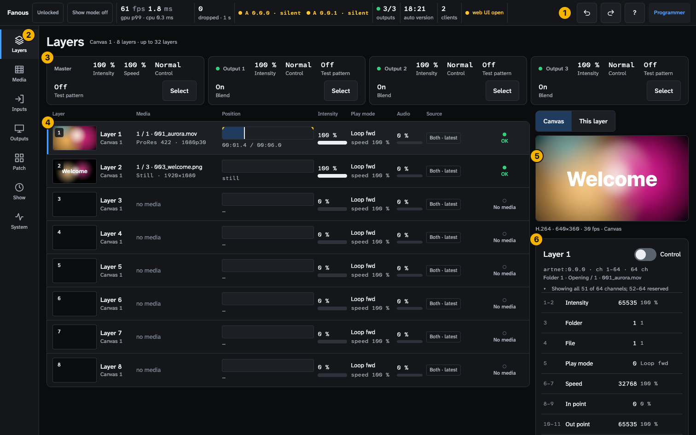
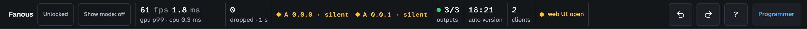
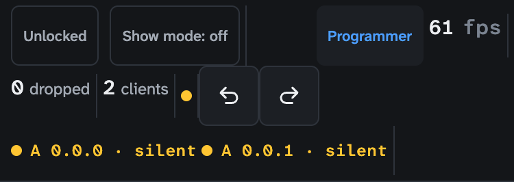
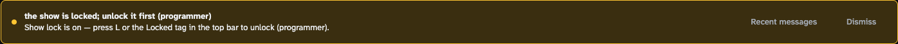
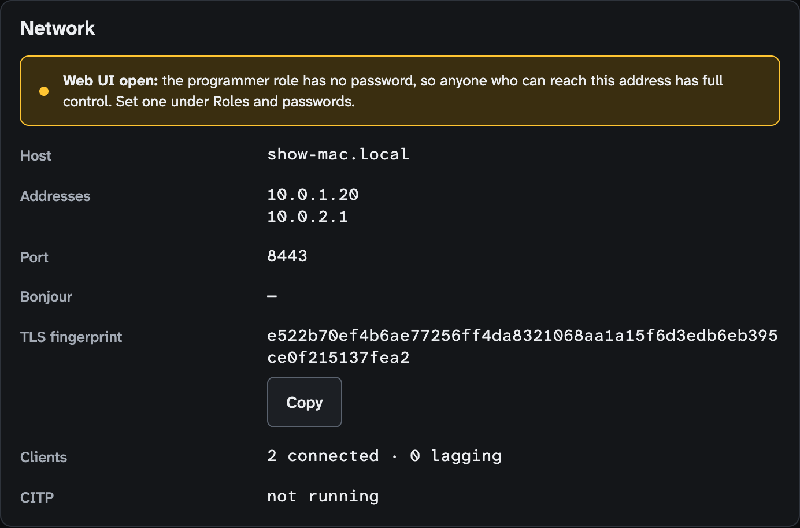
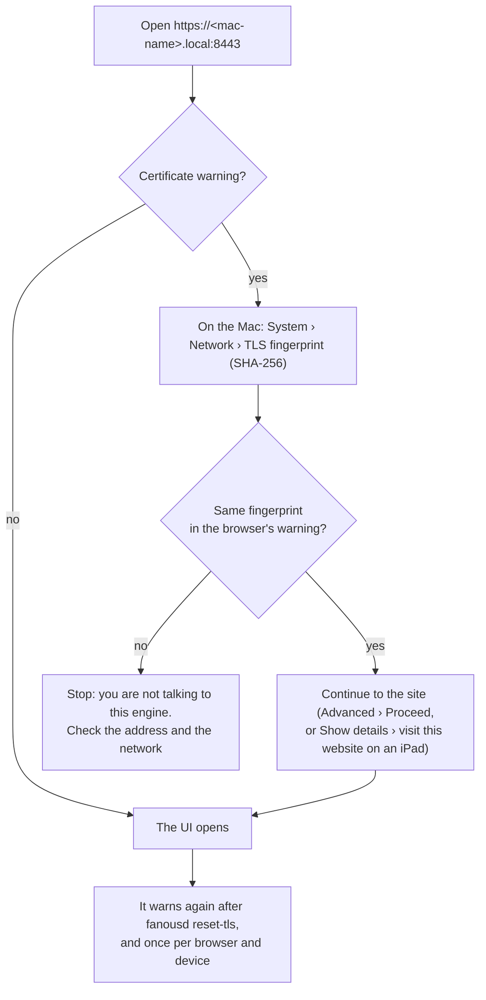
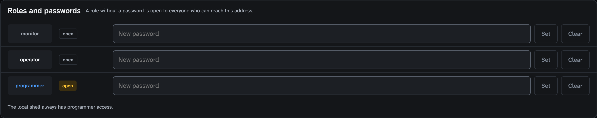
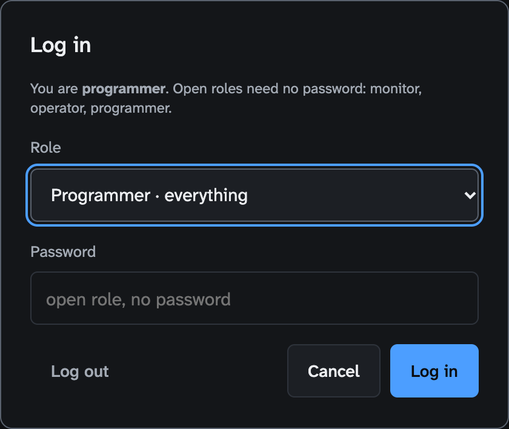

<!-- SPDX-License-Identifier: GPL-3.0-only -->
<!-- Copyright (c) 2026 Tim de Bruijn -->
<!-- Additional terms under GPLv3 §7 apply: see LICENSE-ADDITIONAL-TERMS.md -->

# The user interface

What every screen has in common, for anyone who operates Fanous from the app
window, an iPad or a laptop: the window and its menus, the status bar item by
item, the messages, the keys, the UI on another device, roles and passwords,
and what a greyed-out control means. Each screen's own controls are on the
page of its task (see the [index](README.md)); terms are in the
[glossary](reference/glossary.md).

## The window

The app window is a browser view of the web UI, the same page an iPad or
another computer opens. Every screen has the same frame:

1. The **status bar**: lock, show mode, frame timing, DMX universes, outputs,
   versions, clients, Undo and Redo, the shortcut list and your role. See
   [The status bar](#the-status-bar).
2. The **rail**: the seven screens, also on the keys 1 to 7 (the
   [index](README.md#the-seven-screens) says what each is for). At
   1100 px wide and below only the icons show; hover one for its name and key. On an
   iPad only the icons show; their order matches the keys.
3. On the Layers screen, one strip for the **Master** fixture and one per
   **Output** fixture, each with **Select** to edit it.
4. One **row per layer**.
5. The **preview**: the whole canvas, or only the selected layer.
6. The **layer panel** of the selected layer: every DMX channel with its value
   and where it came from, and **Control** to set values from the UI.

### Menus of the app window

- **Fanous**: About, Hide, Quit.
- **Engine**: the first line is the engine's state, for example "Engine
  1.0.0-rc.4 running · service installed", or "service needs approval in
  Login Items", "service not installed", "service plist missing". **Reload
  UI** (⌘R) reloads the page. **Start Engine**, **Restart Engine** and
  **Stop Engine…** control the service; Stop removes the service registration,
  so the outputs go black until the next Start. **Open Logs** opens
  `~/Library/Logs/Fanous` in Finder.
- **Edit**: Undo and Redo, Cut, Copy, Paste, Select All.
- **Window**: Minimize, Zoom.

In the app window **Export GDTF** and the log **Download** open a macOS save
dialog; in a browser they download as usual.

### Quitting

Closing the window quits the app. While the engine runs, the app asks
"Quit Fanous?" first:

- **Keep Engine Running** (the default, Return): the app quits, the outputs
  keep running.
- **Stop Engine and Quit**: the same as Engine › Stop Engine…, then quit.
- **Cancel**.

Tick **Don't ask again** with Keep Engine Running to quit without the question
from then on (`defaults delete org.fanous.app KeepEngineOnQuit` brings it
back). Stopping is never remembered. When the engine is not running, the app
quits without asking.

## The status bar

The status bar is on every screen and shows the engine's state, not the
browser's. From the left:

| Item | Says |
|---|---|
| **Unlocked** / **Locked** | The show lock. Press it, or L (programmer). A padlock shows while locked |
| **Show mode: on / off** | Show mode (operator or programmer). Entering runs the readiness list first; when an item blocks, a popover **Cannot enter show mode** lists the items with their fix and offers **Open System**. After the engine restarted while show mode was on, "Show mode resumed after the engine restarted at HH:MM" appears next to it, as a link to System |
| fps and ms | Frames per second and the GPU time of the slowest frame in a hundred (p99), with "gpu p99 · cpu N ms" under it. "no outputs rendering: add or assign one (Outputs)" while nothing renders |
| dropped | Missed and late frames in the last second. Red when above 0 while the show is locked |
| One pill per universe | `A 0.0.0`, `S 1`, … with a dot and a word; the colours are below. "no DMX received" instead of pills while no universe is patched and none was heard |
| timecode | The incoming time and its state (locked, freewheel, lost); only while timecode is switched on or running. Red when lost while the show is locked |
| outputs | Outputs bound to their display out of all outputs, for example 2/3. Green when all are bound; yellow when one is lost or unassigned; 0 when the project has no output; off while the engine renders nothing. Red under show lock when yellow, 0 or off |
| ingest | Progress of the running transcode, only while one runs |
| auto version | When the engine last saved a version of the project; opens System › Project versions |
| clients | Browsers and windows connected, and how many lag behind (yellow) |
| sync lost | Red, only when a Sync slave layer on this Mac lost its master; opens Layers |
| web UI open | Yellow, only while the programmer role has no password; hover it for the fix (System › Roles) |
| Undo, Redo | The last setup change (programmer) |
| **?** | The keyboard shortcut list |
| Role | **Monitor**, **Operator** or **Programmer**: press it to log in as another role |

The universe pill:

- **Green**: receiving.
- **Yellow · silent**: nothing has arrived on this universe since the engine
  started. The normal state of a fresh install until the console sends.
- **Yellow · 1.2 s**: heard, then quiet for less than the universe's Signal
  lost after time (2.5 s by default); or heard but not in the patch (the
  Patch screen's Universes panel then says "heard, nothing patched", often a
  universe one off from the one you patched).
- **Red**: a patched universe that was heard and has been quiet for more
  than 2.5 s (the status bar uses that fixed time; the Patch screen's
  Universes panel uses the universe's own Signal lost after time). Its
  fixtures hold their last values unless the universe's Hold on signal loss
  says otherwise.

Red means look now: dropped frames, a lost timecode, outputs missing or not
rendering while the show is locked, a patched universe that went silent, a
lost sync master. Yellow means something is not as it will be on show night:
a universe not heard yet, an output without a display, a client that lags, no
programmer password.

### On a phone

Below 600 px wide the bar folds to three rows and drops what does not fit: the
Fanous name, the GPU and CPU times, the auto version item and the **?**
button. The role button moves next to the frame rate, Undo and Redo join the
numbers row, and the outputs item shows only while it is yellow, red or off.
On an iPad in either orientation everything is there.

## Messages

- **Yellow banner, top of the screen.** The engine refused a command. The
  bold line is the engine's reason (in the picture: "the show is locked;
  unlock it first (programmer)"), the line under it the next step, one of:
  - "Show lock is on — press L or the Locked tag in the top bar to unlock
    (programmer)."
  - "Not allowed for this role — click the role tag in the top bar and log in
    as programmer."
  - "Show mode is blocked by failed readiness checks — open System to fix or
    acknowledge them."
  - "Nothing left to undo."
  - "Something changed since — undo no longer applies. Check the current
    values and redo the edit by hand." (another browser changed the same thing
    after your edit)
  - "The value was not accepted — check it and try again."
  - "The engine does not know this command — the UI and the engine may be
    different versions; reload the page."

  "Top bar" in these texts is the status bar. The banner goes after 10
  seconds, or with **Dismiss**. **Recent messages** lists the last 20 with
  their time, so a refusal you missed can be read back.
- **Yellow banner "Connecting to the engine…"** on the first load, or
  "Engine unreachable: …; retrying". **Red "Connection lost · … · values shown
  are stale"** when the connection dropped after it was up: the numbers on
  screen stop moving until it is back. What to do:
  [troubleshooting.md](troubleshooting.md#the-ui-says-the-engine-is-unreachable).
- **Toast, bottom centre.** After a removal (an output, a slice, a preset, a
  wall, a layer, a cue) and after a one-step edit such as storing or
  recalling a preset or resetting a slice: "Output 2 removed." with a button
  labelled **Undone? — Undo**, for 8 seconds. ⌘Z does the same after the
  toast is gone.
- **Yellow note in a panel.** Who controls is **Console only**, so values set
  from the UI are kept but not shown on the layer; the note offers **Use
  Console and Fanous, latest change wins** (programmer). It appears in the
  layer panel, on the Media screen and on the Show screen.
- **Greyed-out control.** Hover it: the tooltip names the reason, see
  [Why is this control greyed out](#why-is-this-control-greyed-out).

## Keys

Switch screens with 1 to 7, lock with L, undo with ⌘Z, fire the next cue with
Space on the Show screen, open the list with **?**. Keys do nothing while you
type in a field or while a dialog is open, and Space is ignored while a field
or button has the focus: on show night click an empty part of the Show screen
once, or use the GO button. The full list, with what to tap instead on an
iPad: [reference/shortcuts.md](reference/shortcuts.md).

## The UI on an iPad or another computer

Browse to `https://<mac-name>.local:8443`. The exact host name, the
addresses and the port are under System › Network (Host, Addresses, Port,
Bonjour); the Mac also announces itself as an HTTPS service, so a Bonjour
browser on the network lists it with the right port. On the Mac itself a
browser can use `https://localhost:8443`.

The engine makes its own certificate the first time it runs, so every browser
warns once:

The preview on the Layers screen uses H.264 through the browser's own decoder
(WebCodecs). If the browser cannot decode it, the preview falls back to JPEG
at 5 frames a second and the caption says so. Safari on an iPad works. The
preview pauses while the tab is in the background.

A touch screen gets the same controls with 44 px targets, a nudge pad in the
warp editor and **Remote** mode for aligning from the iPad while you look at
the projection ([outputs-and-mapping.md](outputs-and-mapping.md#warp--slices-tab)).

## Roles and logging in

| Role | Can do |
|---|---|
| monitor | Look. No commands |
| operator | Cues (Go, Back, Go to), show mode on or off, run the readiness list, the timecode on/off switch. All of these also while the show is locked |
| programmer | Everything: patch, media, outputs, cue editing, acknowledging a readiness item, passwords, show lock |

The status bar and the login dialog write the roles with a capital
(**Programmer**); the guide writes the concept in lowercase. DMX from the
console (blackout, test patterns, everything else) does not depend on roles.

By default no role has a password, so anyone who can reach the address is
programmer, and the status bar says **web UI open**. **Set a programmer
password before the show**: System › Roles and passwords, type the new
password for the role, press **Set**. **Clear** removes it again, and the role
is open. Both are refused while the show is locked: unlock first.

A role without a password is open to everyone who can reach the address; each
role is open or protected on its own. A browser gets the highest role it asks
for that it is entitled to. To change role, press the role name at the right
of the status bar, pick the role, enter its password and press **Log in**;
**Log out** drops the session. The dialog says which roles are open. After
five login attempts in a minute from one address, right or wrong, you must
wait a minute. A session lasts 24 hours.

The app window on the Mac itself is always programmer; it needs no password.

Passwords are stored hashed in the machine's `settings.json`; how to back it
up and what happens when the file is edited by hand:
[reference/files-and-ports.md](reference/files-and-ports.md#application-support).

## Why is this control greyed out

A greyed control shows the reason when you hover it with a mouse; on an iPad
the same reason comes as the yellow banner when you try:

| Tooltip | Reason | What to do |
|---|---|---|
| Locked: programmer only | Your role is monitor or operator | Press the role name in the status bar and log in as programmer |
| Locked: operator only | Your role is monitor | Log in as operator or programmer |
| Locked: the show is locked (press L to unlock) | The show lock is on | A programmer presses L or the Locked tag; while show mode is on it asks first |
| Leave show mode first | The change would interrupt the show (a canvas, the library root, a renumbering, a permission prompt, sync settings, Compare) | Leave show mode, change, enter it again |
| Programmer only / Operator or programmer only (status bar tags) | The lock or show mode tag is not for your role | Log in |

Not every control greys out: the Canvas, Output and Warp controls on the
Outputs screen stay enabled under the show lock and the engine refuses the
change with the yellow banner instead. The outcome is the same.

**What keeps working while the show is locked:** Go, Back and Go to, show
mode on and off, the timecode switch, Run checks and Acknowledge on the
System screen, Save version…, logging in and out, and everything the console
sends. Everything that changes the setup is
refused: patch, media, outputs, warp, cues, timecode settings, MIDI maps,
Control and Keep in the layer panel (Release is greyed in the UI, though the
engine would accept it), Revert and Delete under Project versions, Forget
and Number on the Inputs screen, Set and Clear under Roles and passwords.

**What show mode refuses on top of that:** changing or adding a canvas,
changing the library root, renumbering an input, the Authorize buttons,
the sync settings, Revert under Project versions, Hold to compare, Show on
output, and the test patterns of the wall wizard and the seam check. Leave
show mode for those.
