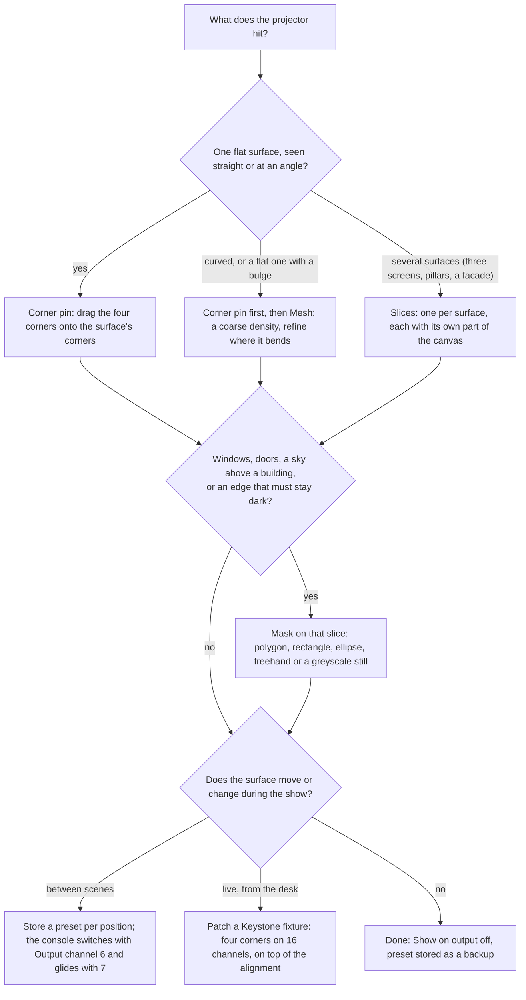
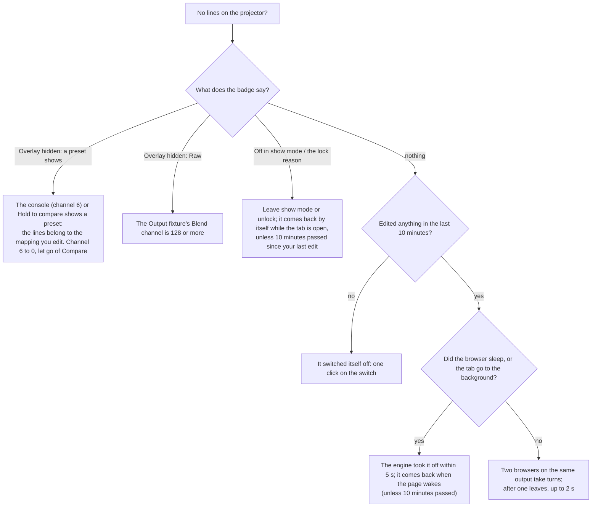
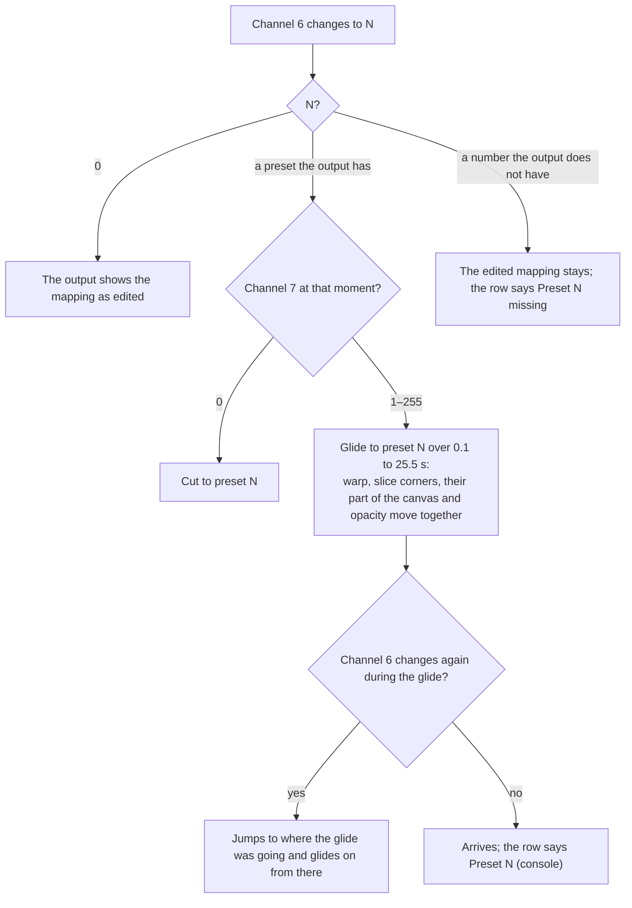

<!-- SPDX-License-Identifier: GPL-3.0-only -->
<!-- Copyright (c) 2026 Tim de Bruijn -->
<!-- Additional terms under GPLv3 §7 apply: see LICENSE-ADDITIONAL-TERMS.md -->

# Warp, slices and masks

Use this page to place the picture on the surface: a flat screen seen at an
angle (corner pin), a curved or uneven surface (mesh), several surfaces
from one projector (slices), windows and doors that must stay dark (masks),
alignment from an iPad while you look at the projection (Remote and Show on
output), and mappings an output switches between from the console
(presets, the Keystone fixture). Binding, blending, walls and colour are
[outputs-and-mapping.md](outputs-and-mapping.md); every control of the
Warp & Slices tab is in [screens/outputs.md](screens/outputs.md#warp--slices-tab);
terms are in the [glossary](reference/glossary.md#mapping).

Editing here needs the programmer role and is refused while the show is
locked (you can still select and step through points, not move them).
**Show on output**, **Hold to compare** and the wizard's Output IDs are
also off in show mode.

## Which tool

| Tool | What it moves | Keep in mind |
|---|---|---|
| **Corner pin** | The whole output by its four corners | First, always: the mesh works on top of it |
| **Mesh** | The whole output on a grid of 2 × 2 to 33 × 33 points | Start coarse; a change of density keeps the shape |
| **Slices** | A rectangle of the canvas into a four-corner area of the output | One per surface; the warp still applies on top of all slices |
| **Masks** | What a slice shows: inside an add mask, outside a subtract mask | Feather the edge; an image mask is a still from the library |
| **Presets** | Everything above, stored under a number | Blend, colour and black lift are not in a preset |
| **Keystone fixture** | The four corners from the console, on top of everything | 32768 on each channel is "no change" |

## The editor

The handles sit over the output preview, which shows the picture as the
projector sees it, in the output's own shape. Drag a handle with the mouse
or a finger (the hit area is large for touch). With a handle selected the
arrow keys move it by one output pixel, Shift by ten, Tab and Shift+Tab
select the next and previous point, Esc lets go, and Backspace or Delete
removes a mask point. The **nudge pad** under the mode buttons does the same
by tap: arrows move 1 px, the **10 px** key in the middle makes every press
move ten, and holding an arrow for half a second moves 0.25 px. **Selected
point (px)** shows the point's x and y in output pixels, as the projector
shows them, and takes typed values. Changes go to the engine while you
drag; nudges of the same point less than a second apart are one Undo step.

Slice, mask and mesh points are stored before the warp, but the preview
shows the warped picture: the editor draws the handles where the picture
really is and moves them in that picture, so a handle stays under your
finger while a corner pin or mesh is active.

## Corner pin

Drag each corner onto the corner of the surface, or select it and nudge.
For a flat screen seen at an angle this is all the warp there is. **Reset
corners** puts them back on the output's corners.

## Mesh

**Density** is Off (corner pin only) or 2 × 2, 3 × 3, 5 × 5, 9 × 9,
17 × 17 or 33 × 33 points; the picture follows a smooth surface through
them. Start coarse (3 × 3 or 5 × 5), move the points onto the surface,
then raise the density where it bends: a change of density keeps the
shape, because the new points are placed on the current surface (going
down keeps the overall shape, not the detail between the points that
remain). **Reset mesh** flattens it. On a mesh the Remote panel names a
point by row and column, "r3 c5".

## Slices

A **slice** is a rectangle of the canvas (**Source x · y · w · h**, in
canvas pixels) stretched into a four-corner area of the output (the
handles). An output starts with one slice that shows the whole canvas, so
you need more only when one projector covers several surfaces that each
need their own part of the picture.

Three screens on a stage from one projector:

1. Make the content so each screen has its own strip of the canvas (give
   the content maker the [content template](#content-template)).
2. Slices mode, **Add slice** twice. Only the slice chosen in the **Slice**
   list has handles; the others are outlines.
3. **Spread canvas**: from left to right on the output, each slice gets the
   next strip of the canvas, as wide as the slice is on the output, at full
   canvas height. Or type each slice's **Source** by hand (640 · 0 · 640 ·
   1080 for the middle third of a 1920 canvas).
4. Drag each slice's four corners onto its screen. Fine-tune a seam between
   two slices by changing the w of one and the x of the next by the same
   amount.
5. **Opacity %** per slice; a later slice draws over an earlier one.

The warp applies to the whole output on top of all slices. **Reset slice**
puts the whole canvas on the whole output again (the masks stay); **Remove
slice** keeps at least one. Each slice has a **Canvas** list when the
project has several canvases ([outputs-and-mapping.md](outputs-and-mapping.md#several-canvases)).
Two shape buttons act on the selected slice: **Triangle** moves its top
corners together into the middle of the top edge, so the picture's top is
squeezed into a point (drag one away and it is four corners again);
**Circle** adds an ellipse mask that fills the box around the slice's
corners, to edit in Mask mode. On a wall member slice 1's Source is the
wall's; changing it marks the field **manual**
([outputs-and-mapping.md](outputs-and-mapping.md#the-wall-panel)).

## Masks

A **mask** hides part of a slice. The slice shows what is inside its
**add** masks (all of it when it has none) minus what is inside its
**subtract** masks: a window or a door is a subtract mask, a hole. A slice
can have several.

Pick the slice in the **Slice** list, then a tool; each tool adds an add
mask, one Undo step:

| Tool | How |
|---|---|
| **Polygon** | Tap the corners of the area that stays visible, in order around it; **Done** after three or more; **Undo last corner** and **Cancel** while drawing |
| **Rectangle**, **Ellipse** | Drag a box on the picture; the shape fills it. **10 % inside** makes one 10 % inside the output without a drag |
| **Freehand** | Drag along the outline with the mouse or, on an iPad, one finger (a second finger or the palm is ignored); letting go closes the shape. It keeps the fewest points that stay within 2 output pixels of your stroke; where the stroke turns by more than 40° the point is a corner, elsewhere the curve is smoothed through the points |
| **Image mask** | A still from the library: black hides, white shows, grey is partly visible, stretched over the whole output. A file changed in the library is picked up by itself; a missing one covers nothing (as an add mask the slice is black) and the readiness list warns |

The **mask list** shows every mask of the slice: its number (tap it to
select its first point), **Add** or **Subtract**, its points or image,
**Invert** (add becomes subtract and back), **Feather px** (softens the
edge, from 2 px; an image carries its own softness), **Redraw** (draw its
shape again with any tool, keeping its mode and feather) and **Remove**. A
subtract mask has a dashed outline and hollow points.

Drag points to move them or nudge them; the selected point shows its curve
handles (small dots on a line), which you drag too. A press takes the
nearest of the point and its handles. **Double-tap** a point (or **Smooth
point**) to make a corner smooth, or a smooth point a corner again. To add
points, turn on **Add points** and tap where the point goes, or
double-click anywhere: the point joins the nearest edge without changing
the shape. **Backspace** (or **Remove point**) deletes the selected point,
and a mask keeps at least three; with a handle selected it removes that
handle instead (**Remove handle**), and that side becomes a corner. A
handle may go past the edge of the output; a point stays on it.

## Content template

**Content template (PNG)** downloads a picture at the size of the selected
slice's canvas that shows, per slice on that canvas, which rectangle it
uses and, filled, what its masks leave visible (an image mask is not
drawn). Give it to whoever makes the content, as a layer under their
design, so windows and edges land where the mapping expects them.

## Show on output

**Show on output**, under the preview, draws what you edit on the projector
itself, so at the wall you see which point is selected without looking
back at the screen:

- The warp (the corner pin's edges or the mesh's grid lines), every
  slice's outline and each mask's outline, through the warp and the
  keystone, so they lie on the picture. The lines are 2 pixels of white
  with a black edge.
- The selected point as a yellow cross with a gap, its number beside it: a
  mesh point as row·column (**3·5**), a corner of a corner pin or slice 1
  to 4 clockwise from the top left, a mask point by its own number. With a
  group selected in Remote, one point of the group is marked.
- A Blackout, or the Master at 0, hides the lines; the output's own
  Intensity does not dim them.

It is on whenever you open Warp & Slices and off when you leave the tab or
switch it off. The badge beside the switch says why it is hidden:

Moving a point or changing a field counts as an edit; selecting a point
does not. The preview never shows the lines; the handles are drawn over it
instead.

## Remote: aligning from an iPad

**Remote** next to the mode buttons puts the controls before the preview
and makes them large, so you can align from an iPad while you look at the
projection (**Show on output** shows the selected point there). It is on
by default on touch screens narrower than 900 px, and each browser
remembers your choice.

1. Stand where you see the projection, open Warp & Slices for the output
   and pick the mode.
2. **Next** and **Previous** step through the points: row by row on a
   mesh, corner by corner on a corner pin or slice, point by point with its
   in and out handles on a mask. The selection reads in large type:
   "corner top-left", "r3 c5", "slice 2 · bottom-right", "slice 2 · mask
   point 5".
3. Choose what moves: **One point**, **Row** or **Column** (mesh), **All**;
   or **Top**, **Right**, **Bottom**, **Left** for every point on that edge
   (two corners on a corner pin or slice; a mask has no rows or edges, and
   All moves the points of every mask of the slice). With a group selected,
   Next steps to the next row, column or edge.
4. Nudge with the pad (1 px, 10 px, 0.25 px on a long press) or drag on
   the **trackpad** area, so your finger never covers the picture: 1 output
   pixel per 4 screen pixels of finger travel, four times as far when you
   drag fast. The points move as one: when the first reaches the edge of
   the output, or cannot go further under the warp, the group stops.
5. Tapping a handle on the picture, turning Remote off or picking another
   output goes back to **One point**.

Distances are output pixels as seen on the projector, also under a corner
pin or mesh. Moves go out up to ten times a second; taps in between are
added up, so none is lost.

## Mapping presets

A **preset** stores what this tab edits under a number from 1 to 255, so an
output can switch between alignments: scenery that flies in and out, a
screen that moves between scenes. It holds the corner pin, the mesh and the
slices with their part of the canvas, their place on the output, their
opacity and their masks. It does not hold the blend edges, the black lift,
the colour, the intensity, the region or the display: those are the
projector's own tuning and stay as they are whichever preset shows. A
projector wall changed later does not change the presets stored before, so
store them again after a wall change.

The **Presets** strip is at the bottom of Warp & Slices for the selected
output, and at the bottom of each wall panel for the whole wall (every
output of the wall at once, as one Undo step; the list shows the presets
all of them have).

- **Store as N** stores the mapping as it is now, N being the lowest free
  number; type another to choose. An existing number is replaced (the
  button reads **Replace N**) and keeps its name.
- **Recall** copies the chosen preset into the mapping you edit, as an edit
  like any other: Undo takes it back. It cuts, without a glide.
- **Name** renames the chosen preset when you leave the field; **Remove**
  deletes it (Undo brings it back).
- **Hold to compare** shows the chosen preset on the output for as long as
  you hold the button (mouse, finger, Space or Enter) and goes back when
  you let go; the preview and the handles keep showing the mapping you
  edit. While held it wins over the console's channel 6. It is off in show
  mode and under the lock, and reaches outputs 1 to 8.

### From the console

Output fixture channels 6, **Mapping preset**, and 7, **Mapping fade**
([console-setup.md](console-setup.md#the-four-fixtures)):

- Nothing in the project changes while the console shows a preset: the
  mapping you edit stays, and the output shows it again at channel 6 = 0.
  Warp & Slices says so in yellow, and **Show on output** is hidden
  meanwhile.
- Channel 7 is read at the moment channel 6 changes, as a time: value ÷ 10
  is seconds (50 = 5 s). Changing it during a glide does nothing to that
  glide. If your console fades channel 7 with the cue, make it snap, or set
  it in an earlier cue.
- Slices glide by number: Slice 2 to Slice 2. A slice that is in only one
  preset, or shows a different canvas in each, appears or disappears when
  the glide starts. The new preset's masks are on from the start and move
  with their slice.
- For a wall, store the preset on the whole wall, then give every Output
  fixture of the wall the same channel 6 and 7 values, or the tiles glide
  out of step.
- OSC: `/fanous/output/{n}/preset` and `/fanous/output/{n}/fade`.
- On signal loss the output follows the universe's **Hold on signal loss**
  ([console-setup.md](console-setup.md#when-the-console-goes-silent)):
  Hold keeps the preset (a running glide finishes); Go to zero cuts to the
  edited mapping (under *Console and Fanous, highest value wins* a channel
  7 from the UI or a cue makes it a glide); UI and cues take over shows the
  preset and fade the UI or a cue set, else the edited mapping. When the
  signal comes back, and on the first packet after the engine starts, the
  output glides to the console's preset over the console's channel 7.

While an output shows a preset, its row and the tab say **Preset N
(console)** or **Preset N (compare)**; during a glide **Preset A → B**,
**Edited → Preset B** or **Preset A → edited**. A Keystone fixture moves a
preset like any mapping.

## Keystone from the console

The **Keystone** fixture (16 channels,
[console-setup.md](console-setup.md#the-four-fixtures)) moves an output's four
corners from the console, on top of the alignment made here: for moving
scenery, or a quick fix from front of house without touching the hand
alignment.

- Patch one per output, next to its Output fixture: Keystone 1 belongs to
  Output 1. The Patch screen lists a Keystone row under every Output row;
  it is not in the standard patch, so set its address when you want it.
- The channels: top-left X and Y, top-right, bottom-right, bottom-left,
  each 16-bit (coarse, then fine), from −50 % to +50 % of the output's
  width or height; + moves right or down. The default 32768 (50 % on a
  fader) is no change, so a centred or unpatched Keystone leaves the
  output as aligned. A fixture built by hand on the console must default
  to 32768 too: at 0 every corner sits at −50 % and the picture moves half
  an output up and left. A universe set to **Go to zero** on signal loss
  centres its Keystone fixtures instead of sending 0.
- The whole mapping moves: every slice and test pattern, with their masks.
  The blend ramps and the black lift stay where they are on the projector,
  so a wall's overlap stays put while the picture moves. Raw (the Output
  fixture's Blend channel at 128 or more) bypasses it.
- The preview and the handles show the mapping as edited, without the
  keystone, so a handle stays where you drag it. The row and the tab say
  **Keystone active** while it moves the output.
- Corners that would fold the picture (one pulled onto or past the line
  between two others) are refused: the output keeps the last keystone that
  worked and shows **Keystone invalid** until the console sends corners
  that work.
- OSC: `/fanous/keystone/{n}/topLeftX` and the other keys of the
  [channel map](../channel-map.md).

## The canvas for other apps

Canvas 1 is published as the Syphon server "Fanous – Canvas", so another
app on the same Mac can receive it (the other canvases are not published).
Other apps' Syphon servers are layer content in folder 0, files 150 to
169 ([live-inputs.md](live-inputs.md#syphon-servers-150169)).
