<!-- SPDX-License-Identifier: GPL-3.0-only -->
<!-- Copyright (c) 2026 Tim de Bruijn -->
<!-- Additional terms under GPLv3 §7 apply: see LICENSE-ADDITIONAL-TERMS.md -->

# Warp, slices and masks

Use this page to place the picture on the surface. The tools, each with a
section below:

- **Corner pin**: drag the four corners of the picture onto the corners of
  a flat screen.
- **Mesh**: the same with a grid of points, for a curved or uneven surface.
- **Slices**: one rectangle of the canvas sent to one surface, when one
  projector covers several.
- **Masks**: a shape that hides part of the picture, for a window or a door.
- **Show on output** and **Remote**: see the selected point on the
  projector, and align from an iPad.
- **Presets** and the Keystone fixture: mappings an output switches
  between from the console, and the four corners driven live from the desk.

Together, the corner pin, mesh, slices and masks of one output are its
mapping. Binding, blending, walls and colour are
[Outputs and mapping](outputs-and-mapping.md); every control of the
Warp & Slices tab is in [Outputs screen](screens/outputs.md#warp--slices-tab);
terms are in the [glossary](reference/glossary.md#mapping).

Editing here needs the Fanous programmer role
([The user interface](ui.md#roles-and-logging-in)) and is refused while the show is
locked (you can still select and step through points, not move them).
**Show on output**, **Hold to compare** and the wizard's Output IDs are
also off in show mode.

## Which tool

The warp (corner pin, then mesh) is per output and sits on top of all its
slices, so align the output first, then cut it into slices, then mask.

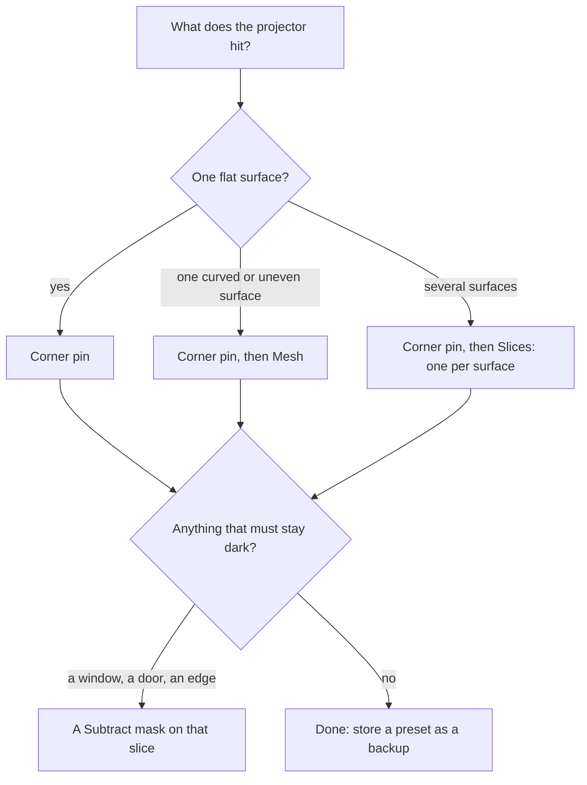

| Tool | What it moves | Keep in mind |
|---|---|---|
| **Corner pin** | The whole output by its four corners | First, always: the mesh works on top of it |
| **Mesh** | The whole output on a grid of 2 × 2 to 33 × 33 points | Start coarse; a change of density keeps the shape |
| **Slices** | A rectangle of the canvas into a four-corner area of the output | One per surface; the warp still applies on top |
| **Masks** | What a slice shows: inside an Add mask, outside a Subtract mask | A mask removes content, not light: the projector's black still falls there |
| **Presets** | The corner pin, mesh, slices and masks of one output, stored under a number | Blend, colour and black lift are not in a preset |
| Keystone fixture | The four corners from the console, on top of everything | A fader at 50 % (32768) is "no change" |

Does the surface move? Between scenes: store a preset per position and let
the console switch and glide ([presets](#mapping-presets)). Live, from the
desk: patch a Keystone fixture ([below](#keystone-from-the-console)).

## The editor

The handles sit over the output preview, which shows the picture as the
projector sees it. They stay on the picture you see, also under a corner
pin or mesh. Drag a handle with the mouse or a finger; the projector follows
while you drag. **Selected point (px)** shows the point's x and y in output
pixels and takes typed values.

| Key or control | Does |
|---|---|
| Arrow keys | Move the selected point 1 px; with Shift, 10 px |
| Tab, Shift+Tab | Select the next and previous point |
| Esc | Let go of the point |
| Backspace, Delete | Remove the selected mask point |
| Nudge pad (under the mode buttons) | Arrows move 1 px; with the **10 px** key on, 10 px; holding an arrow for half a second moves 0.25 px |

Nudges of the same point less than a second apart are one Undo step.

## Corner pin

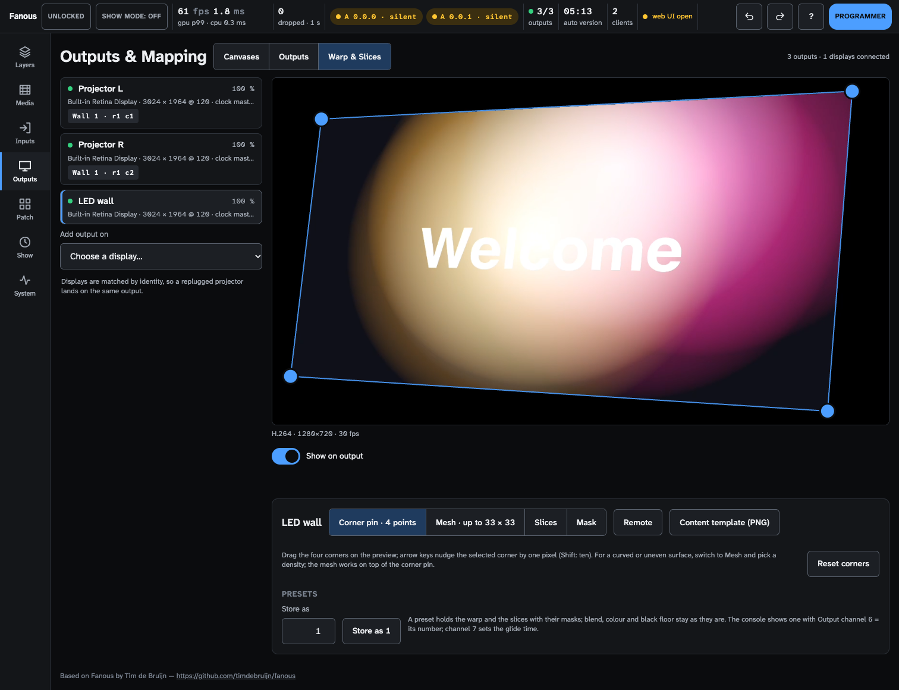

The picture does not fit the screen because the projector is off-centre or
at an angle. To fit a flat screen:

1. Outputs tab: **Grid** on this output (the test pattern buttons under
   the output settings).
2. Warp & Slices, the output in the list, **Corner pin**. **Show on
   output** is on by itself: the projector marks the selected corner.
3. Drag each of the four handles onto the matching corner of the screen,
   or select it and nudge for the last pixels.
4. Done when the Grid's border runs along the screen's edges and the lines
   are straight. **Reset corners** starts again.

## Mesh

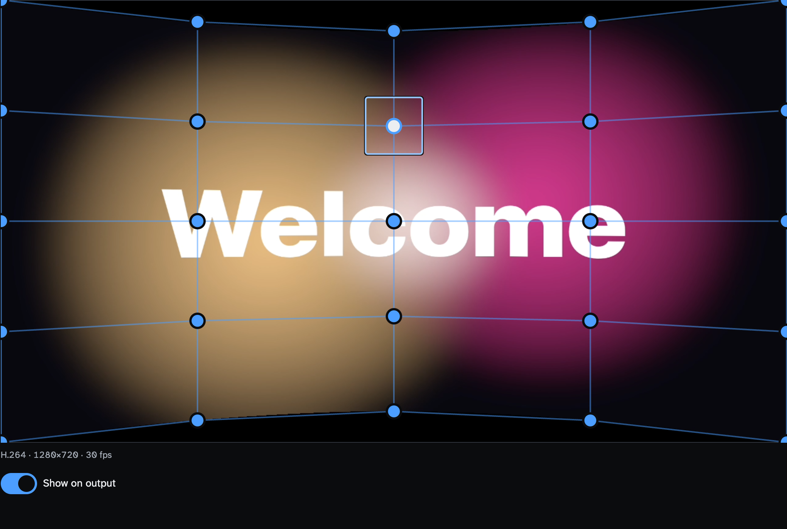

For a curved or uneven surface, after the corner pin:

1. **Mesh**, **Density** 3 × 3 or 5 × 5 (Off is corner pin only; up to
   33 × 33). The picture follows a smooth surface through the points.
2. With Grid on the output, move the points until every grid line follows
   the surface.
3. A line still wobbles between two points: raise the density and move the
   new points. A change of density keeps the shape, because the new points
   are placed on the current surface (going down keeps the overall shape,
   not the detail between the points that remain).
4. Done when the lines are straight on the surface from the audience.
   **Reset mesh** flattens it. The Remote panel names a mesh point by row
   and column, "r3 c5".

## Slices

A slice is one piece of the canvas shown in one area of the output.
**Source x · y · w · h** says which piece, in canvas pixels; the four
handles say where on the output it appears. An output starts with one slice
that shows the whole canvas, so you need more only when one projector
covers several surfaces that each need their own part of the picture.

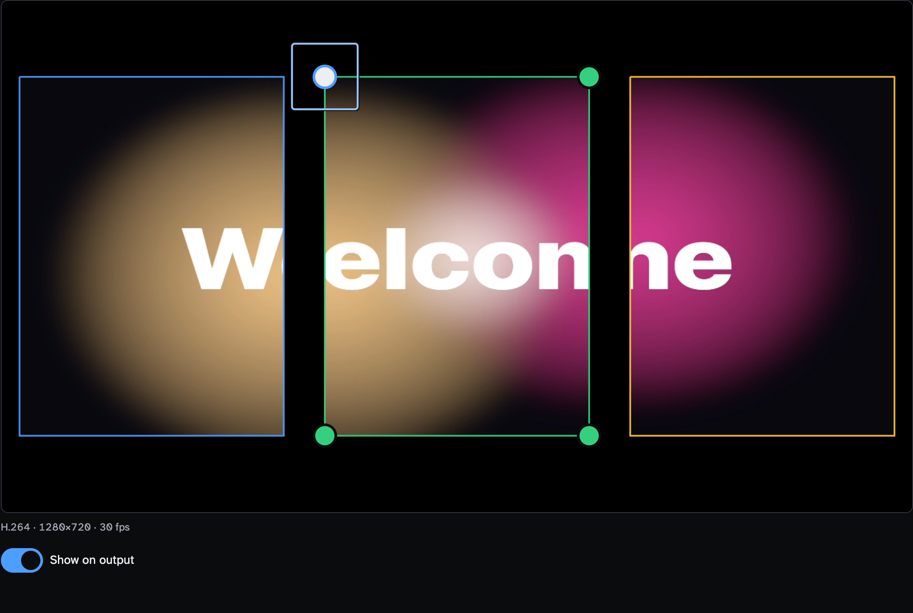

Three screens on a stage from one projector, on a 1920 × 1080 canvas:

1. Agree with the content maker that each screen gets its own strip of the
   canvas: 0 to 640, 640 to 1280, 1280 to 1920 pixels wide. The
   [content template](#content-template) shows them where.
2. **Slices**, **Add slice** twice. Only the slice chosen in the **Slice**
   list has handles; the others are outlines.
3. **Spread canvas** cuts the canvas into strips, one per slice, left to
   right in the order and relative widths of the slices on the output, at
   full canvas height. Or type each **Source**: 0 · 0 · 640 · 1080,
   640 · 0 · 640 · 1080 and 1280 · 0 · 640 · 1080.
4. Drag each slice's four corners onto its screen. Fine-tune the edge
   between two slices by changing the width in one slice's Source and the
   x in the next by the same amount.
5. **Opacity %** per slice; a later slice draws over an earlier one.

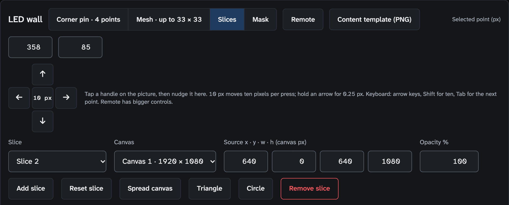

**Reset slice** puts the whole canvas on the whole output again (the masks
stay); **Remove slice** keeps at least one. Each slice has a **Canvas** list
when the project has several canvases
([Outputs and mapping](outputs-and-mapping.md#several-canvases)). Two
shape buttons act on the selected slice: **Triangle**, for a gable or a
pointed screen, moves its top corners together into the middle of the top
edge (drag one away and it is four corners again); **Circle** adds an
ellipse mask that fills the box around the slice's corners (a circle when
the slice is square), to edit in Mask mode. On a wall member slice 1's
Source is the wall's; changing it marks the field **manual**
([Outputs and mapping](outputs-and-mapping.md#the-wall-panel)).

## Masks

A mask limits what a slice shows. An **Add** mask keeps what is inside its
outline; a **Subtract** mask cuts a hole. A slice with no Add mask shows
all of itself. A mask removes content, not light: the projector's own black
still falls on the window, so use lens shift or a physical flag where that
matters, and do not raise the black lift to match the masked area.

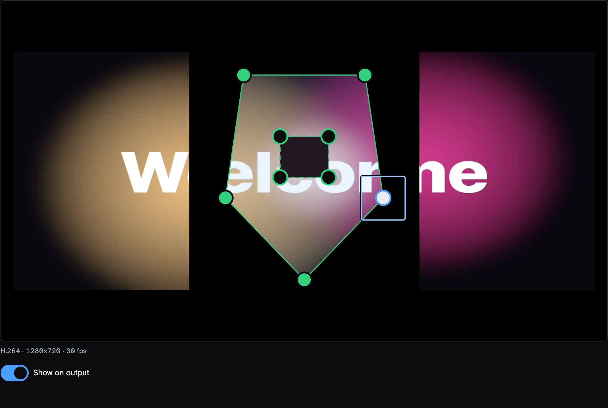

To keep a window dark:

1. **Mask**, pick the slice in the **Slice** list.
2. **Rectangle** (or **Polygon** for an odd shape) and drag a box over the
   window on the picture: a new Add mask.
3. **Invert** on that mask in the list: it becomes a Subtract mask, with a
   dashed outline.
4. **Feather px** 2 or more for a soft edge (0 is hard).
5. Done when the window is black on the projector with a bright layer
   playing.

Each tool adds an Add mask, one Undo step:

| Tool | How |
|---|---|
| **Polygon** | Tap the corners of the area that stays visible, in order around it; **Done** after three or more; **Undo last corner** and **Cancel** while drawing |
| **Rectangle**, **Ellipse** | Drag a box on the picture; the shape fills it. **10 % inside** makes one inset 10 % from each edge of the output, without a drag |
| **Freehand** | Drag along the outline with the mouse or one finger (a second finger or the palm is ignored); letting go closes the shape. Fanous keeps as few points as it can, with sharp turns as corners and smooth curves elsewhere |
| **Image mask** | A still from the library: black hides, white shows, grey is partly visible, stretched over the whole output. A file changed in the library is picked up by itself; a missing one covers nothing (as an Add mask the slice is black) and the readiness list warns |

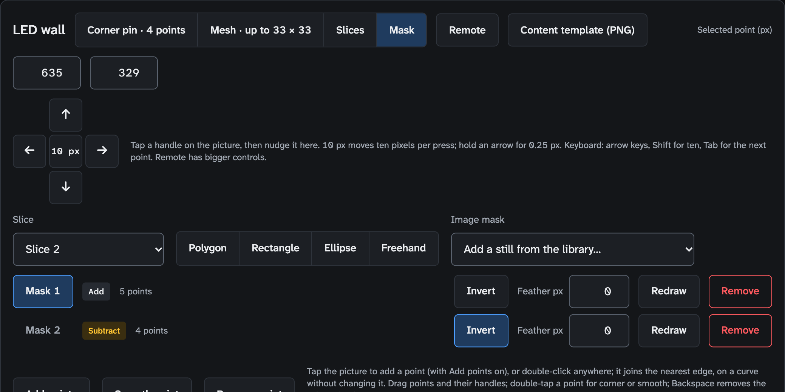

The mask list shows every mask of the slice: its number (tap it to select
its first point), **Add** or **Subtract**, its points or image, **Invert**
and **Remove**. Drawn masks also have **Feather px** and **Redraw** (draw
the shape again with any tool, keeping its mode and feather); an image mask
has neither. A Subtract mask has a dashed outline and hollow points.

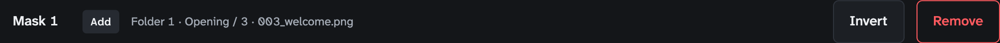

Editing the points of a drawn mask:

- **Move**: drag a point, or nudge it; the selected point shows its curve
  handles (small dots on a line), which you drag too. A handle may go past
  the edge of the output; a point stays on it.
- **Smooth or corner**: double-tap a point, or **Smooth point**.
- **Add**: turn on **Add points** and tap where the point goes, or
  double-click anywhere; the point joins the nearest edge without changing
  the shape.
- **Remove**: Backspace or **Remove point** (a mask keeps at least three);
  with a handle selected, **Remove handle**, and that side becomes a
  corner.

## Content template

**Content template (PNG)** downloads an image the size of the selected
slice's canvas. It shows each slice's rectangle and, filled in, what its
masks leave visible (image masks are not drawn). Give it to the content
maker as the bottom layer of their design, so windows and edges land where
the mapping expects them. Warped content loses resolution, so keep a
margin around anything that must stay sharp.

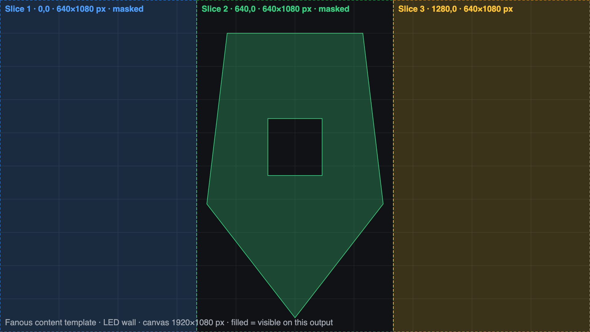

## Show on output

**Show on output**, under the preview, draws what you edit on the projector
itself, so at the wall you see which point is selected without looking
back at the screen. It is on whenever you open Warp & Slices, and off when
you leave the tab, switch it off, or have not edited for 10 minutes.

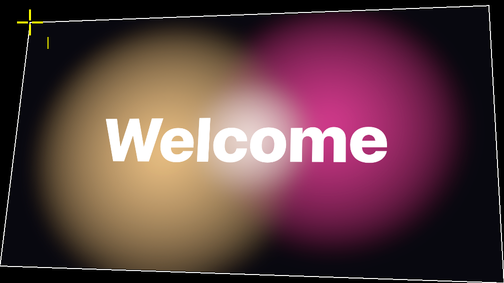

- The warp (the corner pin's edges or the mesh's grid lines), every
  slice's outline and each mask's outline, through the warp and the
  keystone, so they lie on the picture. The lines are white with a black
  edge.
- The selected point as a yellow cross with a gap, its number beside it: a
  mesh point as row·column (3·5), a corner of a corner pin or slice 1
  to 4 clockwise from the top left, a mask point by its own number. With a
  group selected in Remote, one point of the group is marked.
- A Blackout, or the Master at 0, hides the lines; the output's own
  Intensity does not dim them. The preview never shows the lines; the
  handles are drawn over it instead.

No lines on the projector? The badge beside the switch says why:

| Badge | Why | Do |
|---|---|---|
| **Overlay hidden: a preset shows** | The console (Output channel 6) or **Hold to compare** shows a preset; the lines belong to the mapping you edit | Channel 6 to 0, or let go of Compare |
| **Overlay hidden: Raw** | The Output fixture's Blend channel (5) is 128 or more | Lower it |
| "Off in show mode", or the lock reason | Show mode or the show lock | Leave show mode or unlock; it comes back by itself while the tab is open |
| No badge, no lines | 10 minutes without an edit (moving a point or changing a field; selecting is no edit), or the browser slept or the tab went to the background | One click on the switch, or wake the page |

Two browsers with Warp & Slices open on the same output take turns: the
projector shows one selection, then the other.

## Remote: aligning from an iPad

**Remote** next to the mode buttons puts the controls before the preview
and makes them large, so you can align from an iPad while you look at the
projection (**Show on output** marks the selected point there). It is on
by default on touch screens narrower than 900 px, and each browser
remembers your choice. The iPad logs in as programmer like any browser
([The user interface](ui.md#the-ui-on-an-ipad-or-another-computer)).

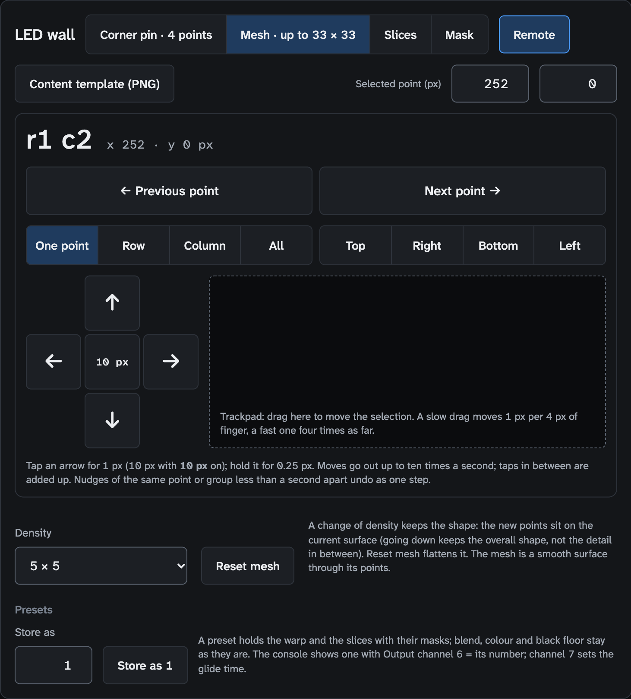

1. Stand where you see the projection, open Warp & Slices for the output
   and pick the mode.
2. **Next point →** and **← Previous point** step through the points (the
   word follows the group: row, column, edge): row by row on a mesh,
   corner by corner on a corner pin or slice, point by point with its in
   and out handles on a mask. The selection reads in large type: "corner
   top-left", "r3 c5", "slice 2 · bottom-right", "slice 2 · mask point 5".
3. Choose what moves. **One point**: the selected point. **Row**,
   **Column** (mesh only): its row or column. **All**: every point; on a
   mask, the points of every mask of the slice. **Top**, **Right**,
   **Bottom**, **Left**: every point on that edge (two corners on a corner
   pin or slice). With a group selected, Next steps to the next row,
   column or edge.
4. Nudge with the pad, or drag on the **trackpad** area so your finger
   never covers the picture; a fast drag moves further. The points move as
   one: when the first reaches the edge of the output, or cannot go further
   under the warp, the group stops.

Tapping a handle on the picture, turning Remote off or picking another
output goes back to **One point**. Distances are output pixels as seen on
the projector, also under a corner pin or mesh.

## Mapping presets

A preset stores the mapping of an output (corner pin, mesh, slices with
their masks) under a number from 1 to 255, so the output can switch between
alignments: scenery that flies in and out, a screen that moves between
scenes. It does not hold the blend edges, the black lift, the colour, the
intensity, the region or the display: those are the projector's own tuning
and stay as they are whichever preset shows. A projector wall changed later
does not change the presets stored before, so store them again after a wall
change.

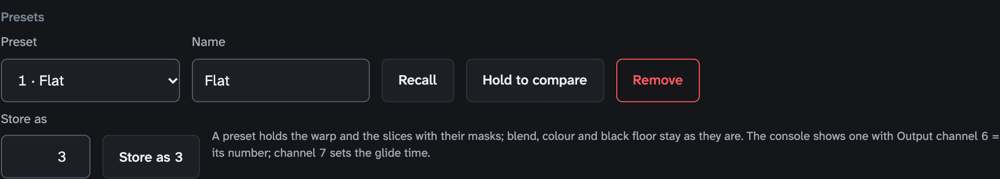

The **Presets** strip is at the bottom of Warp & Slices for the selected
output, and at the bottom of each wall panel for the whole wall (every
output of the wall at once, as one Undo step; the list shows the presets
all of them have).

- **Store as N** stores the mapping as it is now, N being the lowest free
  number; type another to choose. An existing number is replaced (the
  button reads **Replace N**) and keeps its name.
- **Recall** copies the chosen preset into the mapping you edit, as an edit
  like any other: Undo takes it back. It cuts, without a glide.
- **Name** renames the chosen preset when you leave the field; **Remove**
  deletes it (Undo brings it back).
- **Hold to compare** shows the chosen preset on the output for as long as
  you hold the button (mouse, finger, Space or Enter) and goes back when
  you let go; the preview and the handles keep showing the mapping you
  edit. While held it wins over the console's channel 6. It is off in show
  mode and under the lock, and reaches outputs 1 to 8.

### From the console

Output fixture channels 6, **Mapping preset**, and 7, **Mapping fade**
([Console setup](console-setup.md#the-four-fixtures)), on outputs 1 to
8:

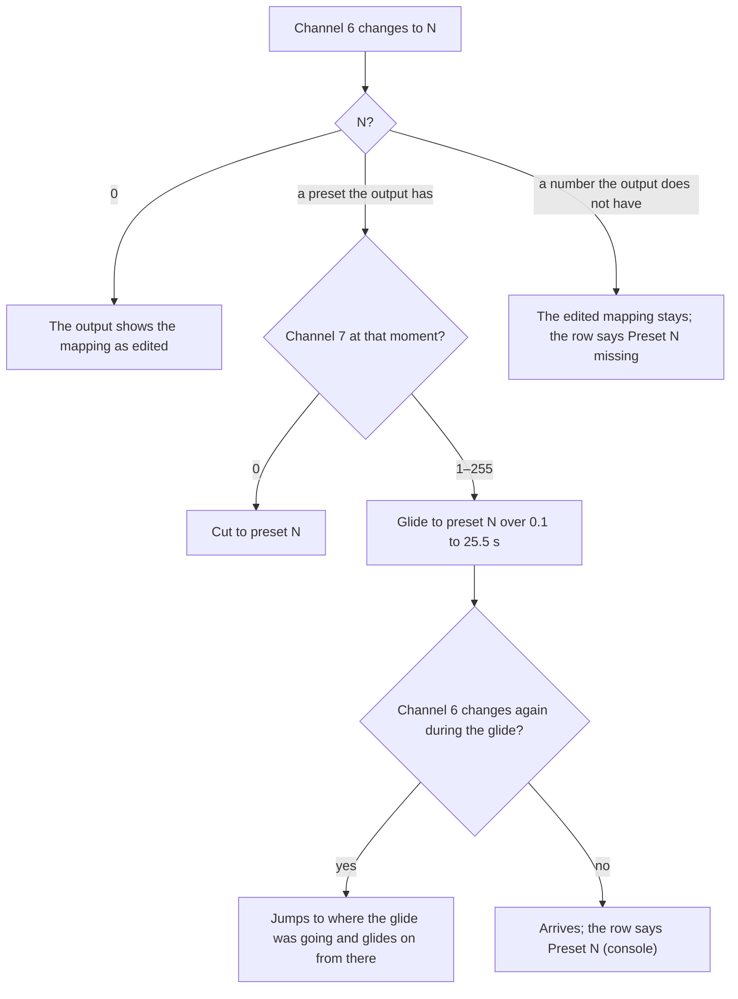

- Glides are for scenery, not for re-blending: a glide moves the warp, the
  slice corners, their part of the canvas and their opacity together, and
  matches slices by number (Slice 2 to Slice 2). Give both presets the same
  slices: a slice that is in only one of them, or shows a different canvas
  in each, appears or disappears when the glide starts. The new preset's
  masks are on from the start and move with their slice.
- Nothing in the project changes while the console shows a preset: the
  mapping you edit stays, and the output shows it again at channel 6 = 0.
  Warp & Slices says so in yellow, and the lines on the projector are
  hidden meanwhile (**Overlay hidden: a preset shows**; the **Show on
  output** switch stays on).
- Channel 7 is read at the moment channel 6 changes, as a time: value ÷ 10
  is seconds (50 = 5 s). Changing it during a glide does nothing to that
  glide. If your console fades channel 7 with the cue, make it snap, or set
  it in an earlier cue.
- For a wall, store the preset on the whole wall, then give every Output
  fixture of the wall the same channel 6 and 7 values, or the tiles glide
  out of step.
- OSC: `/fanous/output/{n}/preset` and `/fanous/output/{n}/fade`.

While an output shows a preset, its row and the tab say **Preset N
(console)** or **Preset N (compare)**; during a glide **Preset A → B**,
**Edited → Preset B** or **Preset A → edited**. A Keystone fixture moves a
preset like any mapping.

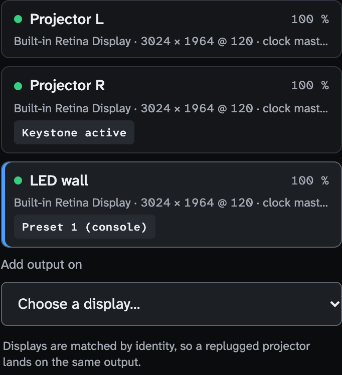

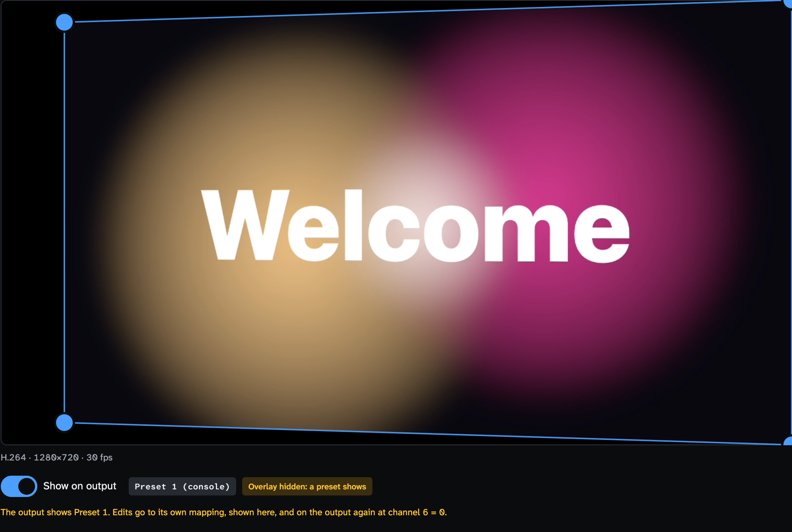

When the console signal drops, the output follows the universe's **Hold on
signal loss** ([Console setup](console-setup.md#when-the-console-goes-silent)):

| Hold on signal loss | The output |
|---|---|
| **Hold last values** | Keeps the preset; a running glide finishes |
| **Go to zero** | The whole Output fixture goes to 0, intensity included: the output goes black, and the preset and fade fall to 0 as well, under Who controls Console only or latest change wins; under highest value wins a UI or cue intensity above 0 still shows. Keystone fixtures centre instead |
| **UI and cues take over** | Shows the preset and fade that the UI or a cue set for channels 6 and 7, otherwise the edited mapping |

When the signal comes back, and on the first packet after the engine
starts, the output glides to the console's preset over the console's
channel 7 if that preset differs from what it shows.

## Keystone from the console

To move an output's four corners from the console, patch a **Keystone**
fixture (16 channels,
[Console setup](console-setup.md#the-four-fixtures)). It works on top of
the alignment made here, for moving scenery or a quick fix from front of
house; it is not the projector's own keystone setting.

- Patch one per output, next to its Output fixture: Keystone 1 belongs to
  Output 1 (outputs 1 to 8). The Patch screen shows a Keystone chip under
  every Output row; it is not in the standard patch, so set its address
  when you want it.
- The channels: top-left X and Y, top-right, bottom-right, bottom-left,
  each 16-bit (coarse, then fine), from −50 % to +50 % of the output's
  width or height; + moves right or down.
- A Keystone built by hand on the console must default to 32768 on each
  pair: a fader at 50 %, or coarse 128 and fine 0 on an 8-bit console.
  That is "no change", so a centred or unpatched Keystone leaves the output
  as aligned. At 0 every corner sits at −50 % and the picture moves half an
  output up and left. A universe set to **Go to zero** on signal loss
  centres its Keystone fixtures instead of sending 0.
- The whole mapping moves: every slice and test pattern, with their masks.
  The blend ramps and the black lift stay where they are on the projector,
  so a wall's overlap stays put while the picture moves. Raw (the Output
  fixture's Blend channel at 128 or more) bypasses it.
- The preview and the handles show the mapping as edited, without the
  keystone, so a handle stays where you drag it. The row and the tab say
  **Keystone active** while it moves the output.
- Corners that would fold the picture (one pulled onto or past the line
  between two others) are refused: the output keeps the last keystone that
  worked and shows **Keystone invalid** until the console sends corners
  that work.
- OSC: `/fanous/keystone/{n}/topLeftX` and the other keys of the
  [channel map](../channel-map.md).

## Before the show

- Every output aligned, a preset stored as a backup of the alignment.
- **Show on output** off (leave the tab), the console's Keystone channels
  at 50 %, channel 6 at the preset the first cue needs.
- The content made to the [content template](#content-template), checked
  on the projector with the masks on.
